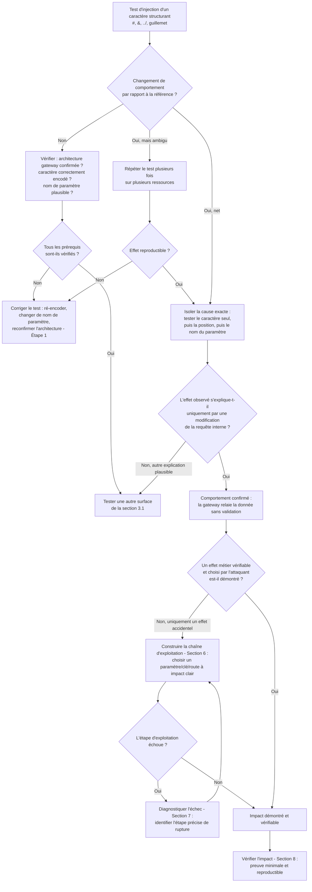

# Server-Side Parameter Pollution (SSPP) — Méthodologie d'exploitation

## 1. Objectif et périmètre de la méthodologie

**Objectif des tests** : démontrer qu'une donnée fournie par un client externe, une fois relayée par une **gateway/API intermédiaire** vers un **microservice interne**, peut altérer la **structure** de la requête interne construite par la gateway — et non simplement la valeur d'un paramètre attendu.

**Comportement de sécurité à démontrer** : la gateway ne doit jamais concaténer une donnée utilisateur brute dans l'URL, le chemin ou le corps d'une requête interne sans l'encoder ou la valider. L'objectif final du test est de prouver qu'un paramètre, un chemin ou une clé **non prévus par le concepteur de l'API** peuvent être injectés dans la requête reçue par le microservice.

**Variantes couvertes par cette fiche** (toutes issues du cours source) :

- SSPP dans les **query strings** : troncature par `#` encodé (`%23`), injection de paramètre par `&` encodé (`%26`), surcharge de paramètres (*parameter overshadowing*).
- SSPP dans les **chemins REST** : traversée de répertoire encodée (`%2f..%2f`).
- SSPP dans les **formats structurés** (JSON/XML) : injection de caractères structurants pour ajouter des clés/balises.

**Ce qui n'est pas couvert ici** : la reconnaissance d'API est traitée uniquement comme prérequis à la détection de SSPP (section 2 et 3) ; le **Mass Assignment** applicatif classique (comparaison GET/PATCH, DTO) n'est traité que brièvement en tant que mécanisme voisin — le cours indique explicitement qu'une fiche dédiée couvre son exploitation détaillée avec exemples de code applicatif.

> **Information manquante dans le cours** : le cours ne précise pas de méthode explicite pour observer l'effet d'une pollution de paramètre lorsque celui-ci se manifeste uniquement **en aval**, dans la réponse ou le comportement du microservice, sans jamais apparaître dans la réponse immédiate de la gateway. Cette fiche traite donc l'observation des effets de second ordre comme une **démarche à adapter au cas par cas** (différentiel de réponse, changement d'état, timing, erreurs applicatives), et non comme une technique figée.

### Principe de raisonnement

La SSPP n'est pas visible directement : elle se prouve **par différentiel**. On ne cherche pas un payload qui « casse » la réponse de la gateway, mais une valeur qui, une fois décodée et concaténée par la gateway, **change la syntaxe** de la requête interne. La démarche consiste donc toujours à (1) identifier un point où une donnée utilisateur est susceptible d'être relayée vers un composant interne, (2) injecter des caractères structurants propres au format de destination probable (query string, chemin, JSON, XML), (3) observer un changement de comportement applicatif qui ne s'explique que par une modification de la requête interne, puis (4) confirmer en construisant une charge qui produit un effet choisi et vérifiable, pas seulement un effet accidentel.

---

## 2. Conditions préalables et état de référence

### 2.1. Prérequis techniques

**Prérequis indispensables :**

- La présence d'une **application intermédiaire** (gateway, API gateway, reverse proxy applicatif) qui relaie des requêtes vers un **composant backend distinct** (microservice interne). Sans intermédiaire relayant la donnée vers un second composant, il n'y a pas de SSPP au sens où le cours la définit.
- Un ou plusieurs paramètres, segments de chemin ou champs de corps de requête **contrôlables par le client** et que l'on suppose **concaténés** (plutôt qu'assemblés de façon structurée) par la gateway lors de la construction de la requête interne.

**Conditions fréquentes mais non systématiques (à vérifier sur la cible) :**

- Absence de normalisation/validation de la donnée utilisateur **avant** sa réinjection côté gateway (encodage URL, échappement JSON/XML).
- Normalisation du chemin ou résolution des séquences `../` effectuée **après** la construction de la requête par la gateway, côté microservice interne uniquement.
- Technologie backend interne ayant un comportement connu et documenté en cas de paramètre dupliqué (PHP, ASP.NET, Node.js/Express) — ce comportement n'est pas garanti identique sur toute l'infrastructure et doit être testé empiriquement (section 5.2 du cours).

**Éléments restant à vérifier dans l'application cible :**

- L'existence réelle d'une architecture gateway → microservice (peut être déduite d'une latence différente, d'en-têtes spécifiques, de messages d'erreur révélant un composant interne, ou d'une documentation Swagger/OpenAPI exposée — voir section 3).
- La pile technologique du microservice interne consommant la requête polluée, nécessaire pour la surcharge de paramètres.

### 2.2. Établir le comportement normal

Avant tout test de pollution, établir une référence sur **chaque point d'entrée candidat** :

- Capturer la **requête de référence légitime** (méthode, chemin complet, paramètres de query string, corps, en-têtes `Content-Type`/`Accept`) telle qu'émise par le front-end ou documentée dans une spécification OpenAPI/Swagger.
- Noter le **code de réponse** et le **contenu retourné** pour cette requête de référence.
- Si plusieurs requêtes légitimes touchent le même type de ressource (ex. consultation d'un profil `alice` vs `bob`), comparer leurs réponses pour établir ce qui varie normalement (contenu propre à l'utilisateur) et ce qui est stable (structure, champs présents).
- Noter tout **en-tête ou message d'erreur révélant un composant interne** (nom de service, stack trace, en-tête `X-Powered-By`, temps de réponse anormal) : ce sont des indices directs de l'existence d'une architecture gateway/microservice, prérequis de la SSPP.

Cette référence est nécessaire car la SSPP se détecte **par différence de comportement** : sans connaître le comportement normal exact (structure de réponse, champs retournés, code HTTP), il est impossible de distinguer un effet de pollution réel d'une variation normale de l'application.

---

## 3. Reconnaissance : où rechercher la vulnérabilité ?

### 3.1. Surfaces de test

| Élément à examiner | Pourquoi cette surface est pertinente | Contrôle disponible | Observation initiale | Hypothèse de vulnérabilité | Premier test |
|---|---|---|---|---|---|
| Fichiers de spécification (`swagger.json`, `openapi.yaml`, `/api-docs`, `/redoc`) | Une spécification exposée documente l'ensemble des endpoints, y compris ceux relayés vers des microservices internes et jamais visibles côté front-end | URL directe à requêter | Code de réponse, présence/absence d'authentification requise | La documentation machine expose des routes ou paramètres internes non filtrés | `curl` sur les chemins connus (section 2.2 du cours), puis import dans Burp/Postman |
| Paramètres de query string relayés (ex. `?name=`, `?user=`) | Point d'entrée le plus direct pour tester la troncature (`%23`) et l'injection (`%26`) | Valeur du paramètre | Comportement avec une valeur normale vs une valeur contenant un caractère spécial encodé | La gateway décode le paramètre puis le concatène sans ré-encodage avant la requête interne | Injecter `%23` puis `%26` dans la valeur et observer tout changement de comportement applicatif |
| Segments de chemin REST (ex. `/users/{id}`, `/profile/{nom}`) | Une valeur de chemin concaténée sans normalisation permet une traversée vers une route interne différente | Segment de chemin contrôlable | Comportement avec un identifiant valide vs un identifiant contenant des séquences encodées | La normalisation des `../` a lieu côté microservice, après construction de la requête par la gateway | Injecter une séquence `%2f..%2f` ciblant une route interne plausible (ex. `admin`) |
| Champs de corps JSON/XML transmis à un microservice (ex. `"name": "..."`) | Une valeur insérée sans échappement dans une structure peut permettre l'ajout de clés/balises non prévues | Contenu du champ texte | Structure de la réponse avec une valeur normale | La gateway insère la valeur par concaténation de chaîne plutôt que par un sérialiseur structuré | Injecter des caractères structurants (`"`, `{`, `}`, `<`, `>`) dans le champ et observer tout changement de structure de réponse |
| En-têtes et méthode `OPTIONS` sur les endpoints identifiés | Révèle des méthodes HTTP actives côté serveur mais non utilisées par le front-end, élargissant les points d'entrée testables pour la SSPP | En-tête `Allow` retourné | Liste des méthodes autorisées | Des méthodes non exploitées par le front-end acceptent elles aussi des paramètres relayés vers le microservice | Requête `OPTIONS` sur chaque endpoint candidat, puis test individuel de chaque méthode listée |
| Fichiers JavaScript minifiés (bundles front-end) | Peut révéler des routes `/api/...` non découvertes autrement, notamment des routes marquées `admin`, `internal`, `debug` plus susceptibles de passer par une gateway vers un service interne sensible | Contenu statique accessible publiquement | Chaînes de caractères correspondant à des chemins d'API | Certaines routes extraites sont des points d'entrée vers des microservices non documentés | `grep`/LinkFinder sur le bundle, puis test de chaque route extraite |

> Aucune de ces surfaces n'est présumée vulnérable : chacune est un **candidat** à examiner en fonction de l'architecture réellement observée (présence ou non d'une gateway, d'un microservice distinct).

### 3.2. Indices et faux positifs

**Observations pouvant suggérer une SSPP :**

- Un en-tête, un message d'erreur ou une latence suggérant l'existence d'un composant interne distinct de celui qui répond directement.
- Un changement de comportement applicatif (contenu, code HTTP, champs retournés) lorsqu'un caractère `#`, `&`, `../`, `"`, `{`, `}`, `<` ou `>` — encodé — est inséré dans une valeur, comparé à la même requête avec une valeur « propre ».
- Une différence de résultat entre deux occurrences du même paramètre envoyées en double (indice de surcharge de paramètres côté backend interne).

**Observations qui ne suffisent pas à confirmer la vulnérabilité :**

- Un code 500 ou une erreur générique suite à l'injection d'un caractère spécial : cela peut indiquer une mauvaise gestion d'entrée **côté gateway elle-même** (simple crash de parsing), sans preuve que la donnée ait atteint un microservice interne sous une forme modifiée.
- L'absence de toute différence observable : le cours précise que l'exploitation de la SSPP se manifeste **en aval**, au niveau du microservice ; une réponse de gateway inchangée ne prouve pas l'absence de pollution si l'effet réel se situe dans un composant non directement visible.

**Comportements normaux à ne pas confondre avec la faille :**

- Une simple validation d'entrée (rejet du caractère spécial avec un message d'erreur clair et cohérent) qui serait identique quel que soit le composant interne : cela traduit plutôt un filtrage côté gateway, pas une pollution.
- Une variation de réponse due au contenu légitime d'une ressource différente (ex. profils `alice` vs `bob`) plutôt qu'à l'injection elle-même — d'où l'importance de la référence établie en section 2.2.

**Vérifications complémentaires nécessaires :**

- Reproduire le test plusieurs fois et sur des ressources différentes pour écarter une variation non liée à l'injection.
- Tester le même caractère structurant sur plusieurs points d'entrée du même endpoint (query string, chemin, corps) pour localiser précisément où la concaténation non sécurisée a lieu.

---

## 4. Séquence de tests : démarche pas à pas

### Étape 1 — Confirmer l'existence d'une architecture gateway/microservice

**Objectif**
Vérifier que l'application teste bien un scénario pertinent pour la SSPP, c'est-à-dire la présence d'un composant intermédiaire relayant vers un backend distinct.

**Prérequis**
Accès à l'application cible, proxy configuré (Burp Suite ou équivalent).

**Hypothèse**
L'application repose sur une gateway qui relaie des requêtes vers un ou plusieurs microservices internes.

**Action à effectuer**
Intercepter le trafic normal de l'application, rechercher des en-têtes, messages d'erreur ou temps de réponse révélant un composant distinct. Rechercher et récupérer toute spécification OpenAPI/Swagger exposée (`swagger.json`, `openapi.yaml`, `/api-docs`, `/redoc`, `/v2/api-docs`, `/v3/api-docs`), au besoin via une investigation régressive des chemins ou un fuzzing de répertoires ciblé, comme décrit dans le cours.

**Observations à examiner**
Présence d'en-têtes spécifiques à un composant interne, incohérences de latence, structure documentée dans une spécification révélant plusieurs services ou routes internes (`admin`, `internal`).

**Résultat positif**
Un ou plusieurs indices confirment l'existence probable d'une architecture à plusieurs composants. Cela ne démontre pas encore la SSPP, mais valide que le prérequis architectural est plausible.

**Résultat négatif ou ambigu**
Aucun indice d'architecture multi-composants : l'application peut être monolithique, ou l'indice est simplement absent des éléments accessibles de l'extérieur.

**Interprétation**
L'absence d'indice ne permet pas d'exclure totalement une architecture gateway/microservice (elle peut être invisible de l'extérieur), mais réduit la probabilité que les tests suivants soient pertinents. Poursuivre néanmoins les tests d'injection reste justifié si d'autres éléments (temps de réponse, documentation) laissent planer un doute.

**Étape suivante**
Si indice positif ou doute raisonnable → passer à l'étape 2. Si l'architecture est clairement monolithique et documentée comme telle → la SSPP telle que définie dans le cours n'est probablement pas applicable ; réorienter vers d'autres vulnérabilités (Mass Assignment, contrôle d'accès classique).

**Erreurs fréquentes**
Confondre un simple reverse-proxy HTTP (load balancer) sans logique de construction de requête avec une gateway applicative qui reconstruit des requêtes internes à partir de données utilisateur — seule la seconde est pertinente pour la SSPP.

---

### Étape 2 — Établir la référence sur les points d'entrée candidats

**Objectif**
Disposer d'une base de comparaison fiable pour chaque surface de test retenue (section 3.1).

**Prérequis**
Avoir identifié au moins un endpoint candidat (query string, chemin REST, corps structuré) relayant potentiellement vers un microservice interne.

**Hypothèse**
Aucune hypothèse de vulnérabilité à ce stade : il s'agit de calibrer l'observation.

**Action à effectuer**
Pour chaque point d'entrée candidat, envoyer la requête légitime telle qu'observée ou documentée, avec des valeurs normales, à plusieurs reprises et sur plusieurs ressources si possible.

**Observations à examiner**
Code de réponse, structure et champs de la réponse, en-têtes, temps de réponse.

**Résultat positif**
Une référence stable et reproductible est établie.

**Résultat négatif ou ambigu**
Le comportement varie déjà sans aucune injection (application instable, cache, comportement asynchrone) : documenter cette variabilité avant de poursuivre, car elle compliquera l'interprétation des tests suivants.

**Interprétation**
Une référence instable impose de répéter chaque test ultérieur plusieurs fois pour distinguer un effet de pollution d'un bruit applicatif normal.

**Étape suivante**
Passer à l'étape 3 avec la référence en main.

**Erreurs fréquentes**
Omettre d'enregistrer les en-têtes ou le `Content-Type` exact de la requête de référence, rendant impossible une comparaison fine lors des étapes suivantes.

---

### Étape 3 — Test exploratoire minimal : troncature par `#` encodé (query string)

**Objectif**
Vérifier si la gateway décode un `#` fourni dans un paramètre et le réinjecte tel quel dans la requête interne, provoquant une troncature du reste de la requête.

**Prérequis**
Un paramètre de query string identifié comme candidat (étape 1/3.1), architecture gateway plausible (étape 1).

**Hypothèse**
La gateway concatène la valeur décodée du paramètre dans l'URL interne sans ré-encodage, ce qui permettrait à `#` de couper l'interprétation de tout paramètre interne placé après.

**Action à effectuer**
Reprendre la requête de référence et ajouter `%23` à la fin de la valeur du paramètre ciblé :

```http
GET /api/v1/profile?name=alice%23 HTTP/1.1
Host: cible.com
```

Comparer avec la requête de référence sans `%23`.

**Observations à examiner**
Tout changement de contenu, de champs retournés, de code HTTP, ou de comportement applicatif (ex. disparition d'un effet normalement associé à un paramètre interne supposé suivre le paramètre testé).

**Résultat positif**
Un comportement cohérent avec la suppression effective de données supposées suivre le paramètre injecté dans la requête interne (par exemple, un effet attendu ne se produit plus). Cela démontre que la gateway relaie la donnée décodée sans ré-encodage, un comportement cohérent avec la définition de la SSPP donnée par le cours — mais ne prouve pas encore un impact exploitable.

**Résultat négatif ou ambigu**
Aucune différence observable : soit la gateway encode correctement la valeur avant concaténation, soit aucun paramètre interne ne suit la position injectée dans la construction réelle de la requête, soit l'architecture ne correspond pas à l'hypothèse de l'étape 1.

**Interprétation**
Une absence de différence ne prouve pas l'absence de SSPP : elle peut simplement signifier que ce point d'entrée précis n'est pas concaténé de façon vulnérable, ou que l'effet se situe sur un paramètre interne non détectable depuis l'extérieur.

**Étape suivante**
Si résultat positif → passer à l'étape 4 (injection de paramètre via `&`) sur le même point d'entrée pour chercher un impact plus démonstratif. Si résultat négatif → tester d'autres points d'entrée candidats de la section 3.1, ou passer directement à l'étape 5 (chemin REST) si le paramètre testé ne s'y prête pas.

**Erreurs fréquentes**
Envoyer directement un `#` non encodé : il serait interprété comme un fragment par le client/proxy local avant même d'atteindre le serveur, ne testant rien d'utile. L'encodage `%23` est nécessaire pour que le caractère traverse le canal jusqu'à la gateway.

---

### Étape 4 — Injection de paramètre interne via `&` encodé

**Objectif**
Vérifier si un paramètre supplémentaire, non prévu pour provenir d'une entrée utilisateur, peut être injecté dans la requête interne.

**Prérequis**
Même point d'entrée que l'étape 3, ou tout autre paramètre de query string candidat. Un résultat positif à l'étape 3 renforce la pertinence de ce test mais n'est pas strictement indispensable pour le tenter.

**Hypothèse**
La gateway décode `%26` en `&` avant de construire la requête interne, permettant l'ajout d'un paramètre arbitraire dans cette requête.

**Action à effectuer**
Injecter un paramètre choisi après un `%26` dans la valeur testée :

```http
GET /api/v1/profile?name=alice%26role=admin HTTP/1.1
Host: cible.com
```

Le nom du paramètre injecté (`role`, `admin`, `debug`, etc.) doit être choisi en fonction des indices de reconnaissance (section 3.1 — mots-clés `admin`, `internal`, `debug` relevés dans les bundles JS ou la documentation).

**Observations à examiner**
Tout effet applicatif cohérent avec la prise en compte du paramètre injecté par le microservice interne (changement de droits apparents, de contenu retourné, de comportement).

**Résultat positif**
Le comportement change d'une manière cohérente avec l'interprétation du paramètre injecté par le composant interne. Cela démontre la capacité à injecter un paramètre interne non prévu — un signal fort, mais qui reste à confirmer avec un paramètre dont l'effet est vérifiable sans ambiguïté (voir section 8).

**Résultat négatif ou ambigu**
Aucun effet observable : soit le nom du paramètre choisi n'est pas consommé par le microservice, soit le `&` n'est pas décodé avant concaténation, soit il est ré-encodé par la gateway.

**Interprétation**
Un résultat négatif avec un nom de paramètre arbitraire ne permet pas de conclure à l'absence de SSPP : il faut tester plusieurs noms de paramètres plausibles (issus de la reconnaissance, section 3) avant de conclure.

**Étape suivante**
Si positif avec un effet clair → aller à l'étape 7 (construction de l'exploitation / preuve d'impact). Si négatif après plusieurs noms de paramètres testés → passer à l'étape 5 ou 6 selon la surface la plus prometteuse identifiée en reconnaissance.

**Erreurs fréquentes**
Choisir un nom de paramètre sans lien avec les indices de reconnaissance (section 3.1), rendant l'absence d'effet non interprétable faute de savoir si le paramètre existe réellement côté microservice.

---

### Étape 5 — Surcharge de paramètres (Parameter Overshadowing)

**Objectif**
Déterminer la règle de résolution appliquée par le backend interne en cas de paramètre dupliqué, puis l'exploiter pour imposer sa propre valeur.

**Prérequis**
Un paramètre de query string déjà présent et exploité par la requête interne légitime (pas nécessairement un paramètre nouvellement injecté).

**Hypothèse**
Le microservice interne applique une règle déterministe (dernière occurrence conservée, première occurrence conservée, ou combinaison des valeurs) qui peut être identifiée empiriquement.

**Action à effectuer**
Dupliquer un paramètre existant avec deux valeurs différentes et observer laquelle est retenue :

```bash
curl "https://cible.com/api/v1/profile?name=legitime&name=injecte"
```

Comparer le résultat à chacune des trois règles documentées dans le cours (PHP : dernière occurrence ; ASP.NET : combinaison virgule ; Node.js/Express : première occurrence selon le middleware).

**Observations à examiner**
Contenu de la réponse permettant de déterminer laquelle des deux valeurs (`legitime` ou `injecte`) a été effectivement utilisée par le microservice, ou si les deux apparaissent combinées.

**Résultat positif**
Le comportement observé correspond à l'une des trois règles documentées, ce qui permet de déduire (sans certitude absolue, le cours ne garantissant pas une correspondance biunivoque entre comportement et technologie) la position à privilégier (avant ou après le paramètre légitime) pour que la valeur injectée soit retenue.

**Résultat négatif ou ambigu**
Aucune des deux valeurs ne semble retenue de façon claire, ou le comportement varie entre les tentatives.

**Interprétation**
Un résultat ambigu peut provenir d'un comportement non déterministe du middleware, ou d'une normalisation des paramètres dupliqués en amont (côté gateway) qui empêcherait la duplication d'atteindre le microservice sous cette forme.

**Étape suivante**
Si la règle est identifiée → reproduire l'étape 4 en positionnant stratégiquement le paramètre injecté selon la règle déduite, pour en maximiser la prise en compte par le microservice. Si ambigu → passer à l'étape 6 (SSPP dans le chemin ou dans un format structuré), ce test restant indépendant.

**Erreurs fréquentes**
Conclure à une règle universelle pour toute l'infrastructure à partir d'un seul endpoint testé : le cours précise explicitement que le comportement doit être **documenté et testé pour chaque technologie backend interne**, qui peut différer d'un microservice à l'autre.

---

### Étape 6 — SSPP dans le chemin REST (traversée encodée) et dans les formats structurés

**Objectif**
Vérifier si une valeur destinée à un segment de chemin, ou à un champ inséré dans un corps JSON/XML, peut altérer respectivement la route interne résolue ou la structure du document transmis au microservice.

**Prérequis**
Un segment de chemin REST contrôlable (ex. identifiant dans `/users/{valeur}`), ou un champ de corps structuré transmis tel quel vers un microservice (reconnu en section 3.1).

**Hypothèse (chemin)**
La normalisation des séquences `../` a lieu côté microservice interne, après que la gateway a déjà relayé la requête, permettant d'atteindre une route interne différente.

**Hypothèse (formats structurés)**
La gateway insère la valeur utilisateur dans le document JSON/XML par concaténation de chaîne plutôt que par un sérialiseur qui échapperait les caractères structurants.

**Action à effectuer — chemin**

```text
GET /api/v1/users/alice%2f..%2f..%2fadmin%2fdashboard HTTP/1.1
Host: cible.com
```

**Action à effectuer — structuré (JSON)**
Injecter dans un champ texte transmis par la gateway une valeur contenant un guillemet et une clé supplémentaire, par exemple une valeur de champ de la forme `alice", "role": "admin`, à soumettre dans le champ identifié comme relayé vers le microservice.

**Observations à examiner**
Pour le chemin : tout comportement cohérent avec l'atteinte d'une route différente de celle initialement ciblée (contenu, droits, structure de réponse propres à une route administrative). Pour le format structuré : toute apparition d'un effet cohérent avec la prise en compte d'une clé supplémentaire (`role`) par le microservice, ou une erreur de parsing révélant que la valeur injectée a bien atteint la structure du document interne.

**Résultat positif**
Le comportement observé correspond à l'atteinte d'une ressource ou d'un effet non censé être accessible/influençable depuis ce point d'entrée.

**Résultat négatif ou ambigu**
Code 404 cohérent avec une route réellement inexistante, ou erreur de parsing générique ne permettant pas de déterminer si la valeur a atteint le microservice sous forme polluée.

**Interprétation**
Un 404 peut aussi correspondre à un comportement volontairement trompeur du serveur (le cours le signale pour le fuzzing de chemins en général) : il ne faut pas l'interpréter automatiquement comme une absence de vulnérabilité sans autre vérification.

**Étape suivante**
Si positif → passer à l'étape 7 pour construire une preuve d'impact exploitable. Si négatif → revenir à la section 3.1 pour identifier d'autres points d'entrée, ou conclure provisoirement à l'absence de SSPP sur les surfaces testées (voir section 7 pour le diagnostic détaillé).

**Erreurs fréquentes**
Oublier d'encoder le `/` (`%2f`) : un `/` brut serait immédiatement interprété par le serveur HTTP lui-même comme un séparateur de chemin, sans jamais atteindre la logique de concaténation de la gateway sous la forme voulue.

---

### Ordre de la séquence

1. Confirmer l'existence d'une architecture gateway/microservice (étape 1).
2. Établir une référence sur chaque point d'entrée candidat (étape 2).
3. Tester la troncature par `#` encodé, test exploratoire minimal et peu intrusif (étape 3).
4. Tester l'injection de paramètre via `&` encodé pour isoler un effet plus démonstratif (étape 4).
5. Approfondir avec la surcharge de paramètres si un paramètre légitime dupliqué est disponible (étape 5).
6. Étendre aux chemins REST et aux formats structurés selon les surfaces identifiées en reconnaissance (étape 6).
7. Construire l'exploitation et vérifier l'impact final (sections 6 et 8).

---

## 5. Arbre de décision : que faire selon le résultat ?



---

## 6. Construire la chaîne d'exploitation

1. **Point d'entrée** : le paramètre, segment de chemin ou champ de corps identifié en reconnaissance (section 3.1) comme relayé par la gateway vers un microservice interne.
2. **Primitive technique** : la concaténation non sécurisée de la donnée utilisateur par la gateway lors de la construction de la requête interne (décodage puis réinsertion d'un caractère structurant : `#`, `&`, `../`, `"`, `{`, `}`, `<`, `>`).
3. **Déclenchement** : l'envoi, par le client externe, de la valeur encodée contenant le caractère structurant, dans une requête sinon conforme au contrat d'API attendu.
4. **Effet intermédiaire** : la requête interne construite par la gateway contient effectivement un paramètre, une route ou une clé modifiée par rapport à ce qui était prévu — effet qui doit être confirmé par un changement de comportement reproductible (étapes 3 à 6).
5. **Aboutissement** : le microservice interne traite la requête polluée d'une manière qui constitue un impact de sécurité choisi (ex. accès à une route administrative, modification d'un champ sensible via une clé injectée, contournement d'un paramètre interne de contrôle).
6. **Preuve** : une observation vérifiable et reproductible démontrant cet aboutissement (section 8), sans dépendre d'une explication alternative plausible.

| Étape | Résultat requis | Comment le vérifier | Si cela échoue |
|---|---|---|---|
| Point d'entrée | Paramètre/chemin/champ confirmé comme transmis à un composant distinct de la gateway | Indices de reconnaissance (en-têtes, spécification, latence) — section 3.1/3.2 | Revenir à la reconnaissance (section 3) pour identifier d'autres candidats |
| Primitive technique | Changement de comportement reproductible suite à l'injection d'un caractère structurant | Comparaison avec la référence établie en section 2.2, répétée plusieurs fois | Tester d'autres caractères structurants et d'autres points d'entrée (étapes 3 à 6) |
| Déclenchement | La requête contenant le caractère encodé atteint effectivement la gateway sans être filtrée en amont | Vérifier le code de réponse et l'absence de blocage WAF/proxy avant la gateway cible | Varier l'encodage (double encodage, casse) ou le point d'injection |
| Effet intermédiaire | Preuve que la requête interne a changé de structure (paramètre ajouté, route modifiée, clé ajoutée) | Effet de second ordre observable dans la réponse ou le comportement applicatif | Diagnostiquer selon la section 7 (effet peut être invisible depuis l'extérieur) |
| Aboutissement | Effet choisi par l'attaquant, et non accidentel, obtenu de façon répétable | Reproduire le test en ciblant un paramètre/route/clé précis plutôt qu'arbitraire | Revenir à la reconnaissance pour affiner le nom de paramètre ou la route ciblée |
| Preuve | Observation indépendante de toute explication alternative confirmant l'impact | Contrôles croisés décrits en section 8 | Renforcer la preuve par un second indicateur indépendant |

---

## 7. Diagnostic des échecs

| Symptôme observé | Causes possibles | Comment les distinguer | Test de diagnostic | Suite logique |
|---|---|---|---|---|
| Aucune différence de comportement après injection d'un caractère structurant | (a) La gateway encode correctement la valeur avant concaténation ; (b) le caractère n'a pas atteint la gateway sous forme décodée (filtrage WAF/proxy en amont) ; (c) il n'y a pas d'architecture gateway/microservice sur ce point d'entrée | Vérifier le code de réponse brut (blocage WAF typiquement distinct d'un traitement applicatif normal) ; retester l'architecture (étape 1) | Renvoyer la même valeur avec un double encodage (`%2523`) pour distinguer un encodage/décodage simple d'un filtrage actif | Si filtrage confirmé → tester un autre encodage ou un autre point d'entrée ; si architecture absente → abandonner cette surface |
| Le comportement varie entre plusieurs tentatives identiques | (a) Application réellement non déterministe (cache, répartition de charge entre plusieurs instances du microservice) ; (b) la règle de résolution des paramètres dupliqués n'est pas stable sur l'infrastructure testée | Répéter le test un nombre suffisant de fois en espaçant les requêtes | Comparer les résultats en changeant uniquement un paramètre à la fois (ex. ordre des paramètres dupliqués) | Si variation liée à l'infrastructure (plusieurs instances) → documenter la variabilité plutôt que conclure trop vite ; si liée à l'ordre → confirmer la règle identifiée en étape 5 |
| Le test fonctionne sur un endpoint mais pas sur un autre a priori similaire | Chaque endpoint peut être géré par un microservice interne différent, avec une technologie et un comportement de parsing distincts | Comparer les en-têtes et messages d'erreur spécifiques à chaque endpoint | Retester la règle de résolution des paramètres dupliqués (étape 5) spécifiquement sur l'endpoint qui échoue | Documenter séparément le comportement par endpoint plutôt que de supposer une infrastructure homogène |
| Un comportement semble vulnérable mais n'est pas reproductible | Effet accidentel dû à un état applicatif changeant (ex. cache expiré, session différente) plutôt qu'à l'injection elle-même | Reproduire le test dans des conditions strictement identiques (même session, même ressource) | Répéter l'injection en contrôlant explicitement les variables de contexte (session, ressource ciblée) | Si non reproductible après contrôle → traiter comme faux positif et documenter l'observation sans la retenir comme preuve |
| La pollution de paramètre est confirmée mais aucun impact métier n'est démontré | L'effet obtenu est accidentel (ex. troncature sans conséquence visible) plutôt que choisi | Vérifier si le paramètre/route/clé injecté correspond à un élément identifié en reconnaissance comme potentiellement sensible (section 3.1) | Reprendre la reconnaissance pour cibler un nom de paramètre ou une route précise avant de reproduire l'injection | Construire la chaîne d'exploitation (section 6) avec une cible précise plutôt que de multiplier les injections génériques |
| Une protection semble empêcher l'exploitation | Normalisation du chemin effectuée côté gateway elle-même (avant relais), ou encodage systématique appliqué avant concaténation | Comparer le comportement entre plusieurs techniques d'encodage (simple, double, casse mixte) | Tester un double encodage ou une variation de casse sur le même caractère structurant | Si confirmé sur toutes les variantes testées → cette surface spécifique est probablement protégée ; documenter et tester une autre surface |
| L'effet attendu dépend d'un contexte applicatif non contrôlé | Le paramètre/clé injecté peut nécessiter un état préalable (ex. ressource existante, session spécifique) non recréé dans le test | Vérifier les prérequis applicatifs de la ressource ciblée avant de conclure à un échec | Reproduire le test après avoir recréé explicitement l'état préalable nécessaire | Documenter les prérequis manquants plutôt que de conclure à une absence de vulnérabilité |

**Principe directeur** : avant de changer de technique ou d'abandonner une surface, identifier précisément **à quelle étape de la chaîne d'exploitation** (section 6) le comportement attendu cesse de se produire — point d'entrée, primitive technique, déclenchement, effet intermédiaire ou aboutissement — plutôt que de multiplier des variantes de payload sans méthode.

---

## 8. Vérification de l'exploitation et preuve de l'impact

**Résultat final à observer** : un effet métier choisi et vérifiable, cohérent avec l'hypothèse testée — par exemple l'atteinte démontrée d'une route interne différente de celle ciblée par le front-end, ou la prise en compte, par le microservice, d'une clé/paramètre que le client n'était jamais censé pouvoir influencer.

**Éléments techniques permettant de confirmer ce résultat** :

- Reproductibilité de l'effet sur plusieurs tentatives indépendantes.
- Cohérence entre le caractère/position injecté et l'effet observé (ex. l'effet disparaît si l'on retire le caractère structurant, ou change si l'on modifie la position du paramètre dupliqué selon la règle identifiée en étape 5).
- Absence d'explication alternative plausible (variation normale de ressource, comportement non déterministe déjà écarté via la section 7).

**Contrôles nécessaires pour exclure une explication alternative** :

- Reproduire la requête de référence (section 2.2) immédiatement avant et après le test pour s'assurer que le comportement normal n'a pas lui-même varié entre-temps.
- Isoler la variable testée (un seul caractère, une seule position modifiée à la fois).

**Différence entre une preuve de comportement vulnérable et une preuve d'impact** :

- Une **preuve de comportement vulnérable** démontre que la gateway relaie une donnée polluée vers un composant interne (ex. troncature confirmée à l'étape 3).
- Une **preuve d'impact** démontre qu'un effet de sécurité concret et choisi en résulte (ex. accès à une route interne précise, modification d'une valeur sensible) — c'est cette seconde preuve qui doit être recherchée avant de considérer le test comme concluant pour un rapport d'audit.

**Limites de ce que l'on peut conclure à partir des observations** :

- Le cours ne fournit pas de méthode garantie pour observer un effet strictement interne au microservice lorsque celui-ci n'a aucune répercussion visible depuis l'extérieur de la gateway. Dans ce cas, la preuve reste limitée à la démonstration du comportement de concaténation non sécurisée (section 3 du cours), sans pouvoir aller au-delà sans accès supplémentaire (logs internes, environnement de lab instrumenté) — ce qui doit être signalé comme une limite du test, pas contourné par une supposition.

La preuve retenue doit rester **minimale** (le plus petit changement nécessaire pour démontrer l'effet), **reproductible** (confirmée au moins deux fois) et **proportionnée** à l'objectif du test — ne pas pousser l'exploitation au-delà de ce qui est nécessaire pour démontrer l'impact dans le cadre autorisé de l'audit.

---

## 9. Checklist opérationnelle

**Prérequis**

- [ ] Autorisation d'audit écrite ou environnement de lab confirmé.
- [ ] Indice d'une architecture gateway → microservice recherché (en-têtes, latence, messages d'erreur).

**Reconnaissance**

- [ ] Recherche des fichiers de spécification exposés (`swagger.json`, `openapi.yaml`, `/api-docs`, `/redoc`, `/v2/api-docs`, `/v3/api-docs`).
- [ ] Analyse régressive des chemins et fuzzing ciblé si aucune spécification trouvée directement.
- [ ] Extraction des routes depuis les bundles JavaScript minifiés, avec attention particulière aux mots-clés `admin`, `internal`, `debug`.
- [ ] Test `OPTIONS` sur chaque endpoint candidat et relevé de l'en-tête `Allow`.
- [ ] Identification des paramètres de query string, segments de chemin et champs de corps candidats pour la SSPP.

**Premiers tests**

- [ ] Requête de référence capturée et conservée pour chaque point d'entrée candidat.
- [ ] Test de troncature par `%23` sur chaque paramètre de query string candidat.
- [ ] Test d'injection de paramètre via `%26` avec un nom de paramètre issu de la reconnaissance.

**Validation des hypothèses**

- [ ] Reproduction de chaque effet positif au moins deux fois sur des ressources différentes.
- [ ] Isolation de la cause exacte (caractère seul, position, nom de paramètre) avant de conclure.
- [ ] Test de la surcharge de paramètres avec un paramètre dupliqué légitime, pour déduire la règle de résolution du backend interne.

**Construction de l'exploitation**

- [ ] Ciblage d'un paramètre, d'une route ou d'une clé précise issue de la reconnaissance, plutôt qu'un test générique.
- [ ] Test de la traversée de chemin encodée (`%2f..%2f`) si un segment de chemin candidat a été identifié.
- [ ] Test de l'injection de caractères structurants (`"`, `{`, `}`, `<`, `>`) sur les champs de corps candidats.

**Vérification de l'impact**

- [ ] Contrôle croisé excluant une explication alternative (variation normale, non-déterminisme applicatif).
- [ ] Preuve minimale, reproductible et proportionnée consignée pour le rapport.

**Diagnostic si l'exploitation échoue**

- [ ] Identification de l'étape précise de la chaîne d'exploitation (section 6) où l'effet attendu cesse de se produire.
- [ ] Vérification d'un éventuel filtrage en amont (WAF/proxy) via un test de double encodage.
- [ ] Vérification des prérequis applicatifs (état, session, ressource) avant de conclure à une absence de vulnérabilité.

---

## 10. Leçons transférables

**Principes de raisonnement réutilisables sur d'autres vulnérabilités** :

- La démarche « établir une référence → injecter un élément minimal → observer un différentiel → isoler la cause exacte → construire un effet choisi plutôt qu'accidentel » s'applique à toute vulnérabilité dont l'exploitation dépend d'un comportement de parsing ou d'assemblage de données (injections au sens large).
- Distinguer systématiquement une **preuve de comportement anormal**, une **vulnérabilité confirmée** et une **exploitation à impact démontré** évite de surestimer la portée d'un test.
- Diagnostiquer un échec en localisant l'étape précise de rupture dans la chaîne d'exploitation, plutôt qu'en multipliant des variantes de payload au hasard.

**Mécanismes techniques propres à cette vulnérabilité, à ne pas généraliser** :

- Les trois comportements de résolution de paramètres dupliqués (PHP, ASP.NET, Node.js/Express) sont spécifiques aux technologies citées par le cours et ne doivent pas être supposés valables pour d'autres frameworks sans vérification empirique.
- Le fait que l'exploitation se manifeste « en aval », au niveau du microservice et non dans la réponse immédiate de la gateway, est une spécificité de la SSPP qui ne s'applique pas nécessairement à d'autres classes d'injection où l'effet est directement visible.

**Hypothèses les plus faciles à confondre avec des certitudes** :

- Supposer qu'une absence d'effet observable prouve l'absence de vulnérabilité, alors que l'effet peut être invisible depuis l'extérieur de la gateway.
- Supposer qu'une règle de résolution de paramètres dupliqués identifiée sur un endpoint s'applique à toute l'infrastructure, alors que chaque microservice interne peut reposer sur une technologie différente.

**Compétences pratiques à maîtriser pour exploiter cette vulnérabilité sans aide** :

- Savoir encoder/décoder correctement les caractères structurants (`#`, `&`, `/`) selon le canal testé, pour s'assurer qu'ils atteignent la gateway sous la forme voulue.
- Savoir construire et comparer méthodiquement une requête de référence et une requête modifiée, en isolant une seule variable à la fois.
- Savoir distinguer, à partir d'une réponse HTTP, un filtrage en amont (WAF/proxy) d'un traitement applicatif reflétant un comportement de la gateway ou du microservice interne.
