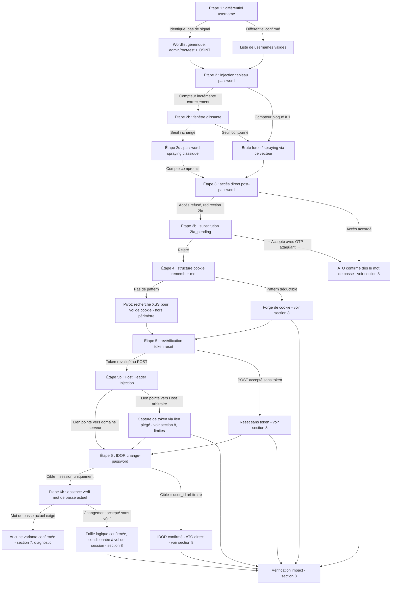

# Broken Authentication — Méthodologie d'exploitation

## 1. Objectif et périmètre de la méthodologie

Cette fiche a pour objectif de démontrer, dans le cadre d'un test d'intrusion **autorisé**, qu'une ou plusieurs étapes du cycle de vie de l'authentification (connexion, second facteur, persistance, réinitialisation, changement de mot de passe) reposent sur une donnée **fournie ou influençable par le client** plutôt que sur un **état de session garanti par le serveur**.

Le comportement de sécurité à démontrer n'est donc pas un défaut cryptographique, mais une **rupture de la chaîne de confiance côté serveur** : à chaque étape testée, la question est « cette décision repose-t-elle sur quelque chose que je contrôle en tant que client, ou sur un fait que seul le serveur peut garantir ? ».

**Variantes couvertes par cette fiche** (chacune nécessitant une démarche distincte, détaillées séparément en section 4) :

1. Énumération de comptes par canal auxiliaire (code HTTP, message d'erreur, timing).
2. Contournement du rate-limiting / brute force (manipulation de structure de requête, fenêtre glissante, password spraying).
3. Bypass du 2FA (accès direct post-authentification, substitution de jeton `2fa_pending` entre comptes).
4. Forge du cookie de persistance « remember-me » (prévisibilité, encodage réversible, hachage sans sel).
5. Faiblesses du workflow de réinitialisation de mot de passe (absence de revérification du jeton en fin de workflow, Host Header Injection).
6. IDOR et logique applicative sur le changement de mot de passe authentifié (substitution de `user_id`, absence de vérification du mot de passe actuel).

**Hors périmètre de cette fiche** (mentionnés par le cours mais non développés en méthodologie opérationnelle faute de technique de test détaillée) :

- Les vulnérabilités spécifiques à **OAuth 2.0 / OIDC** (`redirect_uri`, `state`, confusion de `scope`) — le cours lui-même les indique comme nécessitant une fiche dédiée.
- Les attaques d'infrastructure sur les canaux SMS/e-mail du 2FA (SIM swapping, interception SS7) — non testables dans le périmètre d'un pentest applicatif web.
- L'authentification HTTP Basic : le cours liste ses faiblesses structurelles (transport en clair encodé, absence de CSRF, absence de gestion de session) mais ne décrit pas de test d'exploitation actif distinct de la force brute générique déjà couverte en variante 2 — ce point est donc traité comme un **indice de reconnaissance** (section 3) plutôt que comme une étape à part entière.
- Le brute force du champ « mot de passe actuel » lors d'un changement de mot de passe (§6.3 du cours) n'est documenté que comme contre-mesure attendue, sans scénario de test fourni ; il est repris en section 7 (diagnostic) à titre de piste complémentaire, à vérifier sur la cible.

### Principe de raisonnement

La démarche suit l'enchaînement logique qu'un attaquant suivrait naturellement : cartographier la surface (usernames valides) avant d'attaquer le canal le plus faible (mot de passe), puis tester chaque couche supplémentaire (2FA, persistance, reset, changement de mot de passe) en appliquant systématiquement le même test de fond — *« le serveur dérive-t-il cette décision de la session authentifiée, ou d'une donnée que je viens de lui fournir ? »*. Chaque étape produit soit une confirmation qui alimente l'étape suivante (ex. liste de usernames valides), soit un résultat négatif qui fait pivoter vers un vecteur alternatif plutôt que vers un abandon.

---

## 2. Conditions préalables et état de référence

### 2.1. Prérequis techniques

**Prérequis indispensables (communs à toute la méthodologie) :**

- Accès réseau à l'application cible et autorisation écrite couvrant les tests de brute force, d'énumération et de manipulation de session.
- Au moins un compte de test légitime (pour établir une référence et, pour les variantes 4/6, pour comparer des jetons ou cibler un second compte).
- Un proxy d'interception (Burp Suite, ZAP ou équivalent) permettant de rejouer et modifier des requêtes brutes (en-têtes, structure du body JSON, cookies).

**Prérequis spécifiques à chaque variante :**

| Variante | Prérequis spécifique |
|---|---|
| 1. Énumération | Un point d'entrée qui distingue, même indirectement, un compte existant d'un compte inexistant (login, reset, inscription). |
| 2. Rate-limit / brute force | Un endpoint acceptant un body structuré (JSON) sur lequel la validation de schéma n'est pas garantie — **à vérifier**, le cours ne précise pas si cela dépend d'un framework particulier. |
| 3. Bypass 2FA | Un workflow de login en deux étapes (mot de passe puis OTP), avec émission d'un cookie entre les deux étapes. |
| 4. Remember-me | La fonctionnalité « se souvenir de moi » doit être activée et émettre un cookie persistant observable. |
| 5. Reset password | Un workflow de réinitialisation par lien/jeton (GET d'affichage puis POST de soumission). |
| 6. IDOR change password | Un compte authentifié et un second `user_id` (ou équivalent) connu ou devinable. |

**Conditions fréquentes mais non systématiques :**

- La présence d'un rate-limiter applicatif n'implique pas qu'il soit correctement granularisé (variante 2) : c'est précisément l'hypothèse à tester, pas un prérequis à l'exploitation.
- La présence d'un 2FA n'implique pas qu'il soit appliqué côté serveur (variante 3) : c'est l'objet du test, pas une condition préalable.

**Éléments à vérifier sur la cible avant de commencer :**

- Si l'application utilise un framework backend connu (le cours ne liste pas de frameworks nommément vulnérables à l'itération de tableau JSON — cette information doit être établie empiriquement sur la cible, pas supposée).
- Le mécanisme exact de persistance de session (cookie opaque côté serveur vs cookie auto-porteur type JWT), qui influence la variante 4.

### 2.2. Établir le comportement normal

Avant tout test, constituer une référence pour chaque workflow concerné :

- **Pour l'énumération (variante 1)** : effectuer un login avec un username connu valide et un mot de passe faux, puis noter intégralement code HTTP, corps de réponse, en-têtes et temps de réponse. Répéter plusieurs fois pour obtenir une plage de latence normale (le timing attack repose sur un écart mesurable, donc le bruit réseau doit être caractérisé au préalable).
- **Pour le rate-limiting (variante 2)** : effectuer plusieurs tentatives de login légitimes classiques (une valeur scalaire par requête) et noter à partir de combien de tentatives un verrouillage ou un CAPTCHA apparaît.
- **Pour le 2FA (variante 3)** : effectuer un login complet légitime (mot de passe puis OTP) et conserver la valeur du cookie de session **avant** et **après** validation de l'OTP, pour comparer leur structure et leurs droits.
- **Pour le remember-me (variante 4)** : effectuer une connexion avec l'option activée et conserver le cookie émis.
- **Pour le reset password (variante 5)** : dérouler un workflow de réinitialisation complet légitime (GET avec token puis POST) et noter précisément quelles données sont envoyées à chaque étape.
- **Pour le changement de mot de passe (variante 6)** : effectuer un changement de mot de passe légitime sur son propre compte de test et noter l'intégralité des paramètres du body (y compris les champs cachés).

Conserver pour chaque référence : la requête complète, les paramètres et en-têtes pertinents, le contexte de session (cookies actifs), le code de réponse, le corps retourné, et pour la variante 1, le temps de réponse sur plusieurs essais.

Cette référence est nécessaire car plusieurs de ces vulnérabilités (notamment 1, 2 et 5) ne se révèlent que par un **différentiel** entre deux comportements proches : sans référence fiable, un écart de latence réseau normal ou une variation de message cosmétique peut être confondu à tort avec un signal de vulnérabilité.

---

## 3. Reconnaissance : où rechercher la vulnérabilité ?

### 3.1. Surfaces de test

| Élément à examiner | Pourquoi cette surface est pertinente | Contrôle disponible | Observation initiale | Hypothèse de vulnérabilité | Premier test |
|---|---|---|---|---|---|
| `POST /login` | Point d'entrée principal, teste si l'existence d'un compte fuite via un canal auxiliaire | Valeur du `username` | Code HTTP, corps, en-têtes, latence pour un username connu vs inconnu | Le serveur traite différemment un compte existant d'un compte inexistant | Comparer la réponse pour `admin` et pour un username manifestement inexistant (§4, Étape 1) |
| Endpoint de login en JSON (`POST /api/login`) | Teste si le rate-limiter compte les tentatives logiques ou les requêtes réseau | Structure du body (scalaire vs tableau) | Comportement du compteur d'échecs sur une tentative normale | Le rate-limiter ne valide pas strictement le schéma attendu | Soumettre un tableau de mots de passe dans le champ `password` (§4, Étape 2) |
| Réponse post-login avant OTP (`Set-Cookie`) + `GET /dashboard` | Teste si la session émise avant validation OTP est déjà privilégiée | Accès direct à l'URL protégée avec le cookie intermédiaire | Statut de la session juste après soumission mot de passe, avant OTP | Le 2FA n'est qu'une redirection côté client, non une contrainte serveur | Accéder directement à `/dashboard` sans soumettre l'OTP (§4, Étape 3) |
| Cookie `2fa_pending` | Teste si le jeton temporaire est lié au compte ou simplement à une session OTP générique | Le cookie `2fa_pending` reçu pour un compte donné | Valeur du cookie obtenue pour son propre compte vs pour le compte cible | Absence de liaison cryptographique entre jeton `2fa_pending`, code OTP et compte | Soumettre son propre code OTP valide avec le `2fa_pending` généré pour un autre compte (§4, Étape 3b) |
| Cookie `remember-me` | Teste si le jeton de persistance est prévisible/forgeable | Comparaison structurelle entre plusieurs comptes de test | Format (Base64/Hex), longueur, variation selon le username | Le jeton encode ou dérive des données utilisateur prévisibles | Créer deux comptes de longueurs de username différentes et comparer la structure du cookie (§4, Étape 4) |
| Workflow `GET /reset-password?token=...` puis `POST /reset-password` | Teste si le jeton est revérifié à chaque étape sensible, pas uniquement à l'affichage | Altération/suppression du `token` dans le body du POST final | Comportement du serveur en l'absence du token au POST | Seule l'étape GET valide le token ; le POST final ne le revérifie pas | Supprimer le `token` du body du POST et observer si le changement est accepté (§4, Étape 5) |
| `POST /forgot-password` + en-tête `Host` | Teste si le lien envoyé par e-mail est construit depuis une donnée client | En-tête `Host` de la requête | URL générée dans l'e-mail de réinitialisation | Le lien de reset est construit dynamiquement depuis `Host` au lieu d'une valeur serveur fixe | Soumettre la requête avec un `Host` modifié et observer le domaine du lien généré (§4, Étape 5b) |
| `POST /account/change-password` | Teste si la cible du changement de mot de passe dérive de la session ou d'un paramètre client | Paramètre `user_id` dans le body | Comportement lorsqu'on soumet son propre `user_id` | L'identité cible est dérivée d'un paramètre client plutôt que de la session serveur | Authentifié sur son propre compte, substituer `user_id` par celui d'un autre compte de test connu (§4, Étape 6) |
| `POST /account/change-password` sans mot de passe actuel | Teste si une re-authentification est exigée avant une action sensible | Présence/absence du champ mot de passe actuel | Comportement si ce champ est omis | Le changement est accepté sans validation du mot de passe courant | Soumettre directement un nouveau mot de passe sans fournir l'ancien (§4, Étape 6b) |

> Le cours mentionne également l'authentification HTTP Basic (identifiants Base64 dans l'en-tête `Authorization`) comme surface intrinsèquement faible, mais ne fournit pas de test d'exploitation distinct de la force brute générique (variante 2). À consigner comme indice de reconnaissance si cette méthode d'authentification est rencontrée sur la cible, sans étape dédiée dans cette fiche.

### 3.2. Indices et faux positifs

**Observations qui peuvent suggérer la vulnérabilité :**

- Un écart de code HTTP ou de corps de réponse entre deux tentatives de login différant uniquement par le username.
- Un compteur de tentatives échouées qui ne progresse pas malgré plusieurs mots de passe testés dans un seul appel.
- Un accès accordé à une ressource normalement protégée par 2FA, obtenu sans jamais soumettre de code OTP.
- Un cookie `remember-me` dont le décodage Base64/Hex produit une chaîne lisible ou partiellement lisible.
- Un changement de mot de passe accepté malgré l'absence du jeton de réinitialisation dans la requête finale.
- Une modification effective d'un compte autre que celui de la session courante après substitution d'un identifiant dans le body.

**Observations qui ne suffisent pas à confirmer la vulnérabilité :**

- Un écart de latence isolé (une seule mesure) : le timing attack n'est confirmé que sur un écart **reproductible** et significativement supérieur au bruit réseau mesuré en référence (§2.2) — le cours ne fournit pas de seuil universel, seulement un ordre de grandeur indicatif (~150 ms vs ~5 ms) à valider empiriquement sur la cible.
- Un cookie qui *semble* aléatoire après une seule comparaison : la prévisibilité ne peut être écartée qu'après comparaison sur plusieurs comptes de test isolant les segments variables.
- Un accès à `/dashboard` obtenu une seule fois : vérifier que ce n'est pas un effet de cache navigateur ou de session déjà pleinement authentifiée par un test précédent (toujours retester depuis une session fraîche, isolée).
- Un changement de mot de passe apparemment réussi sur le compte cible : vérifier qu'il ne s'agit pas en réalité du compte de la session courante (confusion possible si les deux comptes de test ont des caractéristiques proches).

**Comportements normaux à ne pas confondre avec la faille :**

- Un message d'erreur générique identique quel que soit le username (« Identifiants invalides ») est le comportement **attendu** d'une implémentation durcie, pas une anomalie à investiguer davantage.
- Un verrouillage de compte déclenché même via un tableau JSON indique une validation stricte du schéma — ce n'est pas un résultat ambigu, c'est une infirmation claire de l'hypothèse.

**Vérifications complémentaires pour lever les ambiguïtés :**

- Répéter chaque test de différentiel (statut, message, timing) plusieurs fois et sur plusieurs paires de comptes pour écarter le bruit.
- Toujours retester un bypass depuis une session/navigateur neuf, sans état résiduel d'un test précédent.

---

## 4. Séquence de tests : démarche pas à pas

L'ordre suit la logique de cartographie progressive du cours : énumération → mot de passe → 2FA → persistance/reset → changement de mot de passe authentifié. Chaque variante conserve sa propre démarche ; elles ne sont enchaînées que lorsque le résultat d'une étape alimente concrètement la suivante (ex. liste de usernames valides).

### Étape 1 — Différentiel sur le point d'entrée de login (énumération)

**Objectif**
Déterminer si le serveur traite différemment un compte existant d'un compte inexistant.

**Prérequis**
Accès au point d'entrée `POST /login` ; un username plausible et un username manifestement inexistant.

**Hypothèse**
Le serveur laisse fuiter, via un canal auxiliaire (code, message, timing), une information sur l'existence du compte, alors qu'il ne devrait la révéler qu'après authentification complète.

**Action à effectuer**
Soumettre `POST /login` avec un username connu/probable (ex. `admin`) et un mot de passe invalide ; répéter avec un username manifestement inexistant (ex. `zzzz_test_9999`) et le même mot de passe invalide. Comparer systématiquement code HTTP, corps de réponse, en-têtes, et mesurer le temps de réponse sur plusieurs répétitions de chaque cas.

```http
POST /login HTTP/1.1
Host: cible.exemple
Content-Type: application/x-www-form-urlencoded

username=admin&password=wrongpass
```

**Observations à examiner**
Code HTTP (ex. 200 vs 404), contenu du message d'erreur (« Invalid password » vs « User not found »), et écart de latence entre les deux cas (indicatif dans le cours : de l'ordre de quelques dizaines de ms à plus, à valider sur la cible — un compte existant déclenchant un calcul de hash bcrypt/argon2, un compte inexistant court-circuitant ce calcul).

**Résultat positif**
Réponses strictement identiques (code, corps, timing dans la plage de bruit mesurée en référence) → l'énumération **n'est pas exploitable** via ce canal : comportement attendu d'une implémentation durcie.

**Résultat négatif ou ambigu**
Un différentiel de code, de message, ou un écart de latence reproductible et significatif → l'énumération est **confirmée**, sous la forme du canal auxiliaire identifié (statut, message ou timing).

**Interprétation**
Un écart isolé ou mesuré une seule fois reste ambigu (bruit réseau) ; seul un écart reproductible sur plusieurs mesures, pour les mêmes conditions, constitue un signal fiable.

**Étape suivante**
Si confirmé → automatiser le différentiel sur une wordlist de usernames pour constituer une liste de comptes valides, puis passer à l'Étape 2 avec cette liste. Si non exploitable → passer à l'Étape 2 avec une wordlist générique (patterns OSINT, comptes par défaut `admin`/`administrator`/`root`/`test` — §2.1 du cours).

**Erreurs fréquentes**
Conclure sur une seule mesure de latence sans répétition ; comparer des requêtes qui diffèrent sur autre chose que le seul username (ex. mot de passe de longueur différente, ce qui peut lui-même influencer un timing bcrypt).

---

### Étape 2 — Contournement du rate-limiting par manipulation de structure de requête

**Objectif**
Vérifier si le compteur de tentatives échouées comptabilise chaque valeur soumise individuellement ou seulement chaque appel réseau.

**Prérequis**
Au moins un username valide ou probable (issu de l'Étape 1) ; un endpoint de login acceptant un body JSON.

**Hypothèse**
Le framework backend itère sur un tableau de valeurs sans que le rate-limiter ne compte chaque itération comme une tentative distincte.

**Action à effectuer**
Soumettre un tableau de valeurs dans le champ `password` d'une requête JSON et observer de combien d'unités le compteur de tentatives échouées progresse.

```http
POST /api/login HTTP/1.1
Content-Type: application/json

{"username": "victime", "password": ["pass1","pass2","pass3","pass4"]}
```

**Observations à examiner**
Incrément du compteur d'échecs (une seule unité malgré N valeurs testées, ou N unités), déclenchement ou non d'un verrouillage/CAPTCHA, code de réponse et contenu indiquant si une des valeurs a été acceptée.

**Résultat positif**
Le compte se verrouille après une tentative, ou le compteur augmente de N pour N valeurs soumises → le bypass **n'est pas exploitable** de cette manière : validation stricte du schéma de la requête.

**Résultat négatif ou ambigu**
Le compte n'est pas verrouillé malgré plusieurs mots de passe testés en un seul appel → le bypass est **confirmé**, sous la forme d'un contournement du rate-limiting par manipulation de structure de requête.

**Interprétation**
Si le résultat est ambigu (ex. aucun verrouillage observé mais aucune confirmation explicite que toutes les valeurs ont été testées), vérifier dans la réponse ou par essais successifs quelle valeur du tableau a effectivement été évaluée par le serveur.

**Étape suivante**
Si confirmé → mener un brute force ciblé ou un password spraying sur la liste de comptes de l'Étape 1 via ce vecteur. Si non exploitable → tester la variante « fenêtre glissante » (Étape 2b) ou pivoter directement vers le password spraying classique (Étape 2c).

**Erreurs fréquentes**
Supposer qu'un seul test suffit à confirmer l'absence de validation de schéma, alors que certains frameworks peuvent valider le schéma sur certains endpoints et pas sur d'autres.

---

### Étape 2b — Contournement par fenêtre glissante mal implémentée

**Objectif**
Vérifier si le rate-limiter réinitialise son compteur par simple intercalation de requêtes légitimes.

**Prérequis**
Résultat négatif à l'Étape 2 (le schéma est validé strictement).

**Hypothèse**
Le seuil basé sur une fenêtre glissante peut être évité en intercalant des requêtes d'un autre type (ex. `GET /login`) entre les tentatives de connexion, si l'implémentation de la fenêtre n'est pas robuste.

**Action à effectuer**
Intercaler un `GET /login` (ou une requête légitime équivalente) entre chaque tentative de `POST /login`, et observer si le seuil de verrouillage est atteint moins vite, voire jamais, par rapport au comportement de référence établi en §2.2.

**Observations à examiner**
Nombre de tentatives `POST /login` nécessaires pour déclencher le verrouillage, avec et sans intercalation.

**Résultat positif**
Le verrouillage se déclenche au même seuil qu'en référence → le bypass par fenêtre glissante **n'est pas exploitable**.

**Résultat négatif ou ambigu**
Le seuil est repoussé ou jamais atteint avec intercalation → le bypass est **confirmé**.

**Interprétation**
Le cours ne détaille pas le mécanisme exact de fenêtre glissante attendu côté serveur ; ce test reste à interpréter au cas par cas selon le comportement observé, sans hypothèse supplémentaire sur l'implémentation interne.

**Étape suivante**
Si confirmé → mener le brute force ciblé en exploitant l'intercalation. Si non exploitable → pivoter vers le password spraying classique (Étape 2c).

**Erreurs fréquentes**
Ne pas mesurer précisément le seuil de référence avant de conclure à un contournement.

---

### Étape 2c — Password spraying / credential stuffing (pivot générique)

**Objectif**
Contourner un rate-limiting correctement implémenté par compte en répartissant les tentatives sur un grand nombre de comptes plutôt que sur un seul.

**Prérequis**
Liste de comptes valides ou probables (Étape 1) ; pour le credential stuffing, une liste d'identifiants issus de fuites publiques (combolists) — **hors cours**, à obtenir par une source externe légitime dans le cadre autorisé du test.

**Hypothèse**
Un seul mot de passe commun testé sur de nombreux comptes (password spraying), ou des identifiants réutilisés issus de fuites (credential stuffing), restent sous le seuil de verrouillage par compte même avec un rate-limiter correctement granularisé.

**Action à effectuer**
Tester un mot de passe courant plausible (ex. `Summer2024!`) sur l'ensemble de la liste de comptes, en espaçant les tentatives pour rester sous le seuil par compte **et** sous un éventuel seuil global par IP.

**Observations à examiner**
Tout code de réponse indiquant un succès d'authentification sur l'un des comptes testés.

**Résultat positif**
Aucun compte ne répond positivement sur l'échantillon de mots de passe testés → non concluant à ce stade, pas une infirmation définitive (dépend de la robustesse réelle des mots de passe utilisés par les comptes cibles, hors du contrôle du testeur).

**Résultat négatif ou ambigu**
Un ou plusieurs comptes acceptent le mot de passe commun → faiblesse de mot de passe **confirmée** sur ces comptes.

**Interprétation**
Ce test dépend de la politique de mots de passe réellement en vigueur côté utilisateurs, non testable de façon déterministe — à documenter comme un facteur de risque plutôt qu'une preuve binaire.

**Étape suivante**
En cas de succès → pivoter vers l'Étape 3 (2FA) avec le ou les comptes compromis.

**Erreurs fréquentes**
Générer un volume de requêtes disproportionné qui dépasse le périmètre autorisé du test (risque de déni de service non intentionnel).

---

### Étape 3 — Bypass du 2FA par accès direct

**Objectif**
Vérifier si l'état « 2FA validé » est une contrainte appliquée côté serveur à chaque requête sur une ressource protégée, ou seulement une étape d'interface côté client.

**Prérequis**
Authentification réussie en étape mot de passe (Étape 1/2) sur un compte disposant du 2FA activé, avant soumission du code OTP.

**Hypothèse**
Le cookie de session émis après l'étape mot de passe est déjà pleinement privilégié, et la vérification 2FA n'est qu'une façade côté client (redirection).

**Action à effectuer**
Après soumission réussie du couple username/mot de passe, inspecter la réponse `Set-Cookie`, puis tenter d'accéder directement à une ressource protégée (`GET /dashboard`) sans jamais soumettre de code OTP.

```http
HTTP/1.1 200 OK
Set-Cookie: session=eyJhbGciOiJIUzI1NiJ9...; HttpOnly
Location: /2fa-verify
```

**Observations à examiner**
Code de réponse et contenu retourné par `/dashboard` ; présence ou absence d'une redirection forcée vers `/2fa-verify`.

**Résultat positif**
L'accès à `/dashboard` est refusé, avec redirection forcée vers `/2fa-verify` et session marquée non privilégiée → le bypass **n'est pas exploitable** de cette manière : l'état « 2FA validé » est vérifié côté serveur à chaque requête.

**Résultat négatif ou ambigu**
L'accès à `/dashboard` est accordé → le bypass est **confirmé**, sous la forme d'un accès direct contournant le 2FA : le cookie émis après l'étape mot de passe est déjà pleinement privilégié.

**Interprétation**
Un accès refusé une seule fois sur une seule ressource ne garantit pas l'absence de bypass sur d'autres ressources protégées de l'application ; si le résultat est négatif sur `/dashboard`, envisager de répéter le test sur d'autres endpoints sensibles avant de conclure.

**Étape suivante**
Si confirmé → l'ATO est complet dès l'étape mot de passe, le 2FA n'apporte aucune protection réelle (passer à la vérification d'impact, section 8). Si non exploitable → pivoter vers l'Étape 3b (substitution de jeton `2fa_pending`).

**Erreurs fréquentes**
Tester depuis une session navigateur qui conserve un état d'authentification résiduel d'un test précédent, faussant le résultat.

---

### Étape 3b — Substitution du jeton `2fa_pending` entre comptes

**Objectif**
Vérifier si le jeton temporaire `2fa_pending` est strictement lié au compte pour lequel il a été émis, ou s'il peut être validé avec le code OTP d'un autre compte.

**Prérequis**
Résultat négatif à l'Étape 3 ; accès à deux comptes (le compte de l'attaquant et un compte « victime » de test, mots de passe connus dans le cadre du lab).

**Hypothèse**
Absence de liaison cryptographique stricte entre le cookie `2fa_pending`, le code OTP soumis et le compte concerné.

**Action à effectuer**
1. Se connecter avec son propre compte pour obtenir un cookie `2fa_pending=abc123`.
2. Initier le login avec le compte victime (username + mot de passe connus en contexte de lab) pour obtenir un second cookie `2fa_pending=xyz789` généré pour la victime.
3. Soumettre son propre code OTP valide (celui de son compte) en utilisant le cookie `2fa_pending=xyz789` de la victime.

**Observations à examiner**
Le serveur accepte-t-il ou rejette-t-il l'étape 2FA de la victime lorsqu'elle est soumise avec le code OTP de l'attaquant ?

**Résultat positif**
Le serveur rejette la combinaison (cookie de la victime + code OTP de l'attaquant) → non exploitable de cette manière : liaison correcte entre jeton, code et compte.

**Résultat négatif ou ambigu**
Le serveur valide l'étape 2FA de la victime avec le code de l'attaquant → faille **confirmée** : absence de liaison stricte entre cookie `2fa_pending`, OTP et compte utilisateur.

**Interprétation**
Ce test nécessite deux comptes OTP valides et synchronisés dans le temps ; un échec peut aussi venir d'un décalage temporel du code TOTP plutôt que d'une protection effective — à écarter en vérifiant d'abord que le code OTP de l'attaquant est valide sur son propre compte au moment du test.

**Étape suivante**
Si confirmé → démontrer l'ATO complet sur le compte victime (vérification d'impact, section 8). Si non exploitable → documenter le 2FA comme effectif pour cette application et passer à l'Étape 4.

**Erreurs fréquentes**
Utiliser un code OTP expiré (fenêtre de validité TOTP typiquement courte) et interpréter à tort l'échec comme une infirmation de l'hypothèse.

---

### Étape 4 — Forge du cookie de persistance « remember-me »

**Objectif**
Déterminer si le jeton `remember-me` est prévisible ou reconstructible à partir de données connues de l'attaquant.

**Prérequis**
Fonctionnalité « se souvenir de moi » activable ; possibilité de créer plusieurs comptes de test.

**Hypothèse**
Le jeton encode ou dérive de façon déductible des données utilisateur connues (username, timestamp) plutôt que d'être généré par un CSPRNG sans lien avec ces données.

**Action à effectuer**
Créer deux comptes de test avec des usernames de longueurs différentes, activer « se souvenir de moi » pour chacun, et comparer la structure Base64/Hex des cookies générés, en isolant les segments qui varient uniquement selon le username.

**Observations à examiner**
Présence d'un pattern lisible après décodage Base64/Hex (ex. `username:timestamp` en clair), ou d'un hash reproductible dérivable d'informations connues (ex. `MD5(username)`).

**Résultat positif**
Aucune structure déductible malgré la comparaison (entropie uniforme, aucune corrélation avec username/timestamp) → non exploitable de cette manière : jeton probablement issu d'un CSPRNG sans lien direct avec les données utilisateur.

**Résultat négatif ou ambigu**
Le décodage révèle un pattern lisible ou un hash reproductible → faille **confirmée**, sous la forme d'une forge de cookie de persistance : un attaquant connaissant le username cible peut reconstruire ou brute-forcer un jeton valide sans connaître le mot de passe.

**Interprétation**
Une absence de corrélation visible sur deux comptes seulement reste un échantillon faible ; répéter sur un troisième compte avec un timestamp délibérément espacé pour isoler plus fermement la composante temporelle si une suspicion subsiste.

**Étape suivante**
Si confirmé → forger un cookie pour un username cible connu (issu de l'Étape 1) et tenter une connexion persistante (vérification d'impact, section 8). Si non exploitable → pivoter vers le vol de cookie existant via une XSS présente ailleurs sur l'application (hors périmètre de cette fiche, qui ne couvre pas l'exploitation XSS), pour analyse hors ligne.

**Erreurs fréquentes**
Confondre un simple encodage Base64 (réversible instantanément, non protecteur) avec un chiffrement, et en déduire à tort une absence de risque si le contenu décodé paraît être un identifiant opaque alors qu'il peut en réalité être un hash non salé comparable entre comptes.

---

### Étape 5 — Absence de revérification du jeton de réinitialisation en fin de workflow

**Objectif**
Vérifier si le jeton de réinitialisation est revalidé à l'étape finale de soumission, ou uniquement à l'étape d'affichage du formulaire.

**Prérequis**
Accès à un jeton de réinitialisation valide (obtenu légitimement sur un compte de test) pour amorcer le workflow.

**Hypothèse**
Seule l'étape GET (affichage du formulaire) est protégée par la vérification du token ; l'action de modification elle-même (POST) ne le revérifie pas.

**Action à effectuer**
Lancer un `GET /reset-password?token=XYZ` valide pour afficher le formulaire, puis supprimer ou altérer le `token` dans le body du `POST /reset-password` final, et observer si le changement de mot de passe est malgré tout accepté.

**Observations à examiner**
Code de réponse et confirmation (ou absence) du changement de mot de passe lorsque le `token` est absent ou invalide dans le POST.

**Résultat positif**
Le POST est rejeté sans `token` valide dans le body/session → non exploitable de cette manière : le serveur revalide le jeton à chaque étape sensible.

**Résultat négatif ou ambigu**
Le POST aboutit malgré l'absence ou l'altération du `token` → faille **confirmée** : absence de revérification du jeton en fin de workflow.

**Interprétation**
Vérifier que l'acceptation du POST correspond bien à une modification réelle du mot de passe (et non à une réponse 200 générique sans effet) avant de considérer la faille comme confirmée — distinction entre comportement anormal et impact réel (cf. section 8).

**Étape suivante**
Si confirmé → combiner avec un vecteur de fuite d'URL de formulaire (ex. fuite via en-tête `Referer`, historique navigateur partagé) pour rejouer le POST sans connaître le token (vérification d'impact, section 8). Si non exploitable → tester l'Étape 5b (Host Header Injection).

**Erreurs fréquentes**
Altérer le token sans le supprimer complètement (ex. le tronquer) et confondre un rejet dû à un format invalide avec un rejet dû à une revérification réelle du jeton — tester les deux cas (absence totale et altération) séparément.

---

### Étape 5b — Host Header Injection sur la génération du lien de réinitialisation

**Objectif**
Vérifier si le lien de réinitialisation envoyé par e-mail est construit à partir de l'en-tête `Host` de la requête plutôt que d'une valeur de configuration serveur fixe.

**Prérequis**
Accès à la fonctionnalité `POST /forgot-password` ; une adresse e-mail de test sous contrôle du testeur.

**Hypothèse**
L'application génère dynamiquement le lien de réinitialisation à partir de l'en-tête `Host` fourni par le client.

**Action à effectuer**
Soumettre `POST /forgot-password` avec un en-tête `Host` modifié (ex. domaine contrôlé par le testeur) et observer le domaine du lien généré dans l'e-mail reçu.

```http
POST /forgot-password HTTP/1.1
Host: attacker.com
Content-Type: application/x-www-form-urlencoded

email=victime@cible.exemple
```

**Observations à examiner**
Le domaine présent dans le lien de réinitialisation reçu par e-mail.

**Résultat positif**
Le lien pointe vers l'URL de configuration serveur attendue, indépendamment de l'en-tête `Host` soumis → non exploitable de cette manière.

**Résultat négatif ou ambigu**
Le lien généré pointe vers le domaine arbitraire fourni dans l'en-tête `Host` → faille **confirmée**, sous la forme d'une Host Header Injection : un attaquant peut capturer le token de réinitialisation d'une victime qui clique sur un lien piégé.

**Interprétation**
Ce test nécessite un e-mail de test sous contrôle du testeur pour éviter d'envoyer un lien piégé à un utilisateur réel non consentant ; à restreindre strictement aux comptes de test du périmètre autorisé.

**Étape suivante**
Si confirmé → documenter le scénario d'exploitation complet (nécessite que la victime clique sur le lien reçu, donc dépendant d'une action utilisateur) sans nécessairement le dérouler en conditions réelles sur un tiers non consentant (vérification d'impact, section 8, avec limites explicites). Si non exploitable → passer à l'Étape 6.

**Erreurs fréquentes**
Tester ce vecteur sur une adresse e-mail réelle d'un utilisateur de production plutôt que sur un compte de test dédié.

---

### Étape 6 — IDOR sur le changement de mot de passe authentifié

**Objectif**
Vérifier si l'identité de la cible d'un changement de mot de passe est dérivée de la session serveur ou d'un paramètre fourni par le client.

**Prérequis**
Authentification sur son propre compte de test ; connaissance d'un second `user_id` (ou équivalent) appartenant à un autre compte de test.

**Hypothèse**
Le serveur fait confiance à un paramètre `user_id` fourni par le client pour déterminer le compte cible, plutôt qu'à l'état de session.

**Action à effectuer**
Authentifié sur son propre compte, soumettre `POST /account/change-password` en substituant le `user_id` du body par l'identifiant d'un autre compte de test connu.

```http
POST /account/change-password HTTP/1.1
Content-Type: application/x-www-form-urlencoded
Cookie: session=att4ck3r_session_valide

user_id=123&new_password=Hacked123!
```

**Observations à examiner**
Quel compte voit effectivement son mot de passe modifié : celui de la session courante, ou celui désigné par `user_id`.

**Résultat positif**
La requête échoue, ou ne modifie que le compte de la session courante quel que soit le `user_id` soumis → non exploitable de cette manière : l'identité de la cible est dérivée exclusivement de la session serveur authentifiée.

**Résultat négatif ou ambigu**
Le mot de passe du compte visé par `user_id` est effectivement modifié → faille **confirmée**, sous la forme d'un IDOR sur le changement de mot de passe.

**Interprétation**
Vérifier la confirmation en tentant ensuite une connexion avec le nouveau mot de passe sur le compte ciblé, pour s'assurer qu'il ne s'agit pas d'une réponse de succès trompeuse sans effet réel (cf. section 8).

**Étape suivante**
Si confirmé → il s'agit d'un ATO direct sur tout `user_id` énumérable (vérification d'impact, section 8). Si non exploitable → tester l'Étape 6b (absence de vérification du mot de passe actuel).

**Erreurs fréquentes**
Soumettre un `user_id` qui n'existe pas et interpréter l'échec comme une infirmation de l'hypothèse, alors qu'il faudrait utiliser un identifiant appartenant réellement à un compte de test existant.

---

### Étape 6b — Absence de vérification du mot de passe actuel

**Objectif**
Vérifier si un changement de mot de passe sensible est accepté sans exigence de re-authentification (mot de passe actuel).

**Prérequis**
Une session active sur le compte cible — pertinent en particulier dans un scénario de session volée (poste partagé, XSS, CSRF).

**Hypothèse**
Le serveur accepte un nouveau mot de passe sans exiger la saisie du mot de passe actuel, permettant à quiconque dispose d'une session active d'évincer l'utilisateur légitime.

**Action à effectuer**
Avec une session active sur le compte, soumettre directement un nouveau mot de passe sans fournir l'ancien.

```http
POST /account/change-password HTTP/1.1
Cookie: session=session_volee_via_xss

new_password=Attacker123!
```

**Observations à examiner**
Le serveur accepte-t-il le changement sans qu'un champ de mot de passe actuel valide ne soit fourni ?

**Résultat positif**
Le serveur rejette la requête en l'absence du mot de passe actuel → non exploitable de cette manière.

**Résultat négatif ou ambigu**
Le changement est accepté sans vérification du mot de passe actuel → faille **confirmée** : un attaquant disposant d'une session (volée ou partagée) peut évincer l'utilisateur légitime sans connaître son mot de passe d'origine.

**Interprétation**
Ce résultat n'a de sens comme scénario d'attaque que combiné à un moyen d'obtention de session active (XSS, CSRF, poste partagé) — à documenter comme une faille de logique applicative qui aggrave l'impact d'une autre vulnérabilité, non comme un vecteur d'entrée autonome.

**Étape suivante**
Si confirmé → documenter la faille comme facteur aggravant de toute vulnérabilité de vol de session trouvée ailleurs dans le périmètre. Si non exploitable → passer au diagnostic des échecs (section 7) si aucune variante de cette fiche n'a été confirmée, ou à la vérification d'impact (section 8) sinon.

**Erreurs fréquentes**
Considérer cette faille isolément comme un ATO complet, alors qu'elle suppose déjà une session compromise par un autre vecteur.

---

## 5. Arbre de décision : que faire selon le résultat ?



**Précisions sur les branches clés :**

- **« Étape confirmée mais impact non démontré »** : applicable à toute branche menant à « voir section 8 » — un résultat positif au test (ex. le POST aboutit sans token) doit encore être vérifié comme produisant un effet réel (le mot de passe est effectivement changé, vérifiable par une tentative de connexion ultérieure).
- **« Une étape de l'exploitation échoue »** : si une branche confirmée (ex. token forgé en Étape 4) ne produit pas l'effet attendu lors de sa mise en œuvre réelle, revenir à la section 7 (diagnostic) avant de considérer la variante comme infirmée.

---

## 6. Construire la chaîne d'exploitation

Le cours fournit lui-même un schéma de cheminement global ; cette section le formalise selon la grille Point d'entrée → Primitive → Déclenchement → Effet intermédiaire → Aboutissement → Preuve, en l'appliquant à la chaîne la plus complète possible (ATO via énumération + bypass rate-limit + bypass 2FA). Les variantes indépendantes (remember-me, reset, IDOR change-password) constituent chacune une chaîne plus courte, autonome, détaillée ensuite.

### 6.1. Chaîne principale : Account Takeover par la voie mot de passe + 2FA

1. **Point d'entrée** : `POST /login`, contrôlable par l'attaquant via le `username` et le `password`.
2. **Primitive technique** : canal auxiliaire d'énumération (Étape 1) qui réduit l'espace de recherche à des comptes valides, puis contournement du rate-limiting (Étape 2/2b/2c) qui permet de tester un volume de mots de passe supérieur au seuil prévu.
3. **Déclenchement** : obtention d'un couple username/mot de passe valide sur un compte cible.
4. **Effet intermédiaire** : émission par le serveur d'un cookie de session déjà privilégié avant validation du second facteur (constaté à l'Étape 3).
5. **Aboutissement** : accès direct à une ressource protégée (`/dashboard`) sans jamais soumettre de code OTP, ou validation de l'étape 2FA de la victime via le code OTP de l'attaquant (Étape 3b).
6. **Preuve** : contenu retourné par la ressource protégée (données propres au compte victime, non génériques), confirmant un accès effectif et non une simple réponse HTTP 200 vide de contenu exploitable.

### 6.2. Chaînes indépendantes (variantes autonomes)

| Variante | Point d'entrée | Primitive | Déclenchement | Aboutissement | Preuve |
|---|---|---|---|---|---|
| Remember-me | Cookie `remember-me` observable | Structure prévisible du jeton (Étape 4) | Forge d'un jeton pour un username cible connu | Connexion persistante acceptée avec le jeton forgé | Accès à une ressource authentifiée propre au compte ciblé |
| Reset password | `POST /reset-password` | Absence de revérification du token (Étape 5) | Rejeu du POST sans token valide, via une URL de formulaire obtenue par ailleurs | Nouveau mot de passe enregistré sur le compte cible | Connexion réussie avec le nouveau mot de passe sur le compte ciblé |
| IDOR change-password | `POST /account/change-password` | Dérivation de l'identité cible depuis `user_id` (Étape 6) | Substitution du `user_id` par celui d'un compte cible | Mot de passe du compte cible modifié | Connexion réussie avec le nouveau mot de passe sur le compte ciblé |

### Tableau récapitulatif

| Étape | Résultat requis | Comment le vérifier | Si cela échoue |
|---|---|---|---|
| Énumération | Liste de usernames valides | Différentiel reproductible (statut/message/timing) sur plusieurs mesures | Basculer sur wordlist générique (OSINT, comptes par défaut) |
| Bypass rate-limit | Possibilité de tester plusieurs mots de passe sans déclencher le verrouillage | Compteur d'échecs inchangé après soumission groupée | Tester fenêtre glissante, puis password spraying classique |
| Accès via mot de passe | Couple username/mot de passe valide | Réponse de login positive | Revenir au brute force/spraying avec une autre wordlist |
| Bypass 2FA | Accès à une ressource protégée sans OTP validé, ou validation croisée du `2fa_pending` | Contenu de la ressource retournée propre au compte ciblé | Tester la substitution de `2fa_pending` si l'accès direct échoue |
| Forge remember-me | Cookie forgé accepté pour une connexion persistante | Connexion réussie sans fournir le mot de passe | Pivoter vers un vol de cookie par XSS (hors périmètre) |
| Reset sans token | Nouveau mot de passe enregistré sans token valide au POST final | Connexion réussie avec le nouveau mot de passe | Tester le vecteur Host Header Injection |
| IDOR change-password | Mot de passe d'un autre compte modifié via `user_id` | Connexion réussie sur le compte ciblé avec le nouveau mot de passe | Tester l'absence de vérification du mot de passe actuel |

Chaque ligne distingue explicitement un **comportement anormal observé** (ex. compteur figé) d'une **vulnérabilité confirmée** (ex. bypass du rate-limiting démontré) et d'une **exploitation réussie** (ex. connexion effective sur le compte ciblé) — ces trois niveaux de preuve ne doivent pas être confondus lors de la rédaction du rapport.

---

## 7. Diagnostic des échecs

| Symptôme observé | Causes possibles | Comment les distinguer | Test de diagnostic | Suite logique |
|---|---|---|---|---|
| Le différentiel de l'Étape 1 n'est jamais reproductible | (a) Les réponses sont réellement uniformisées ; (b) le bruit réseau masque un écart réel mais faible | Répéter la mesure un grand nombre de fois dans des conditions identiques (même heure, même charge réseau) | Comparer la distribution complète des temps de réponse (pas seulement une moyenne) entre compte valide et invalide | Si la distribution est strictement identique → infirmer l'hypothèse ; si un écart statistique subsiste → affiner la mesure avant de conclure |
| Le compteur de tentatives semble ne pas s'incrémenter mais aucun mot de passe n'est accepté | (a) Bypass réel du rate-limiting ; (b) tous les mots de passe testés sont simplement incorrects | Le bypass concerne le *comptage*, pas la *validité* des mots de passe | Soumettre volontairement le bon mot de passe dans le tableau testé, pour vérifier qu'il est bien évalué par le serveur | Si le bon mot de passe est accepté → bypass confirmé ; sinon → le tableau n'est peut-être pas itéré comme supposé, revoir l'hypothèse |
| L'accès direct à `/dashboard` échoue sur un compte mais pas sur un autre | (a) Une configuration par rôle diffère (ex. compte admin traité différemment) ; (b) état de session résiduel ayant faussé un test précédent | Comparer sur des comptes de test aux rôles identiques, avec des sessions fraîches | Retester avec un navigateur/session totalement neuf sur chaque compte | Si l'écart persiste à rôle identique → documenter une inconsistance à investiguer séparément |
| La substitution de `2fa_pending` échoue systématiquement | (a) Liaison cryptographique correcte ; (b) code OTP de l'attaquant expiré au moment du test (fenêtre TOTP courte) | Vérifier d'abord que le code OTP de l'attaquant est valide sur son propre compte au moment exact du test | Répéter le test en soumettant le code OTP immédiatement après sa génération | Si l'échec persiste avec un code frais → infirmer l'hypothèse |
| Le cookie remember-me ne révèle aucun pattern sur deux comptes | (a) CSPRNG réel ; (b) échantillon trop petit pour détecter une corrélation faible | Un échantillon de deux comptes est faible pour une conclusion définitive | Créer un troisième compte de test avec un timestamp délibérément espacé et recomparer | Si aucun pattern n'émerge sur trois comptes → infirmation raisonnable ; sinon → pattern confirmé |
| Le POST de reset sans token échoue de façon incohérente (accepté une fois, rejeté une autre) | (a) État de session résiduel conservant un token valide en mémoire serveur ; (b) comportement réellement non déterministe à investiguer | Vérifier si une session/cookie de reset distinct n'est pas réutilisé entre les tentatives | Retester depuis un état totalement vierge (nouveau cookie de session, nouvelle demande de reset) à chaque essai | Un résultat incohérent après contrôle de l'état doit être documenté comme tel, sans conclusion forcée |
| Le lien de réinitialisation ne reflète jamais l'en-tête `Host` modifié | (a) Protection effective (whitelist ou valeur de configuration fixe) ; (b) en-tête mal positionné dans la requête (ex. proxy qui réécrit `Host` avant transmission) | Vérifier via le proxy d'interception que l'en-tête envoyé correspond bien à ce qui est reçu par le serveur | Inspecter les logs ou le comportement du proxy intermédiaire s'il y en a un | Si l'en-tête est bien transmis inchangé et le lien reste correct → infirmer l'hypothèse |
| Le changement de mot de passe via `user_id` modifié semble réussir mais la connexion échoue ensuite sur le compte ciblé | (a) Succès trompeur : réponse 200 sans effet réel ; (b) erreur dans le `user_id` soumis (compte inexistant ou mal identifié) | Vérifier que le `user_id` utilisé correspond bien à un compte de test existant et connu | Reconfirmer l'identifiant du compte cible avant de retester | Si le `user_id` est correct et la connexion échoue malgré une réponse de succès → documenter comme résultat ambigu, ne pas classer en IDOR confirmé |
| Une protection empêche l'exploitation malgré une faille confirmée en amont (ex. IDOR confirmé mais rate-limiting bloque la validation finale) | Protection additionnelle à une autre couche du workflow | Identifier précisément à quelle étape le comportement attendu cesse de se produire | Dérouler la chaîne d'exploitation (section 6) étape par étape en vérifiant l'effet à chacune | Documenter la faille comme confirmée mais l'impact comme limité par la protection rencontrée |

**Principe directeur du diagnostic** : avant de changer de technique ou d'abandonner une hypothèse, identifier précisément à quelle étape de la chaîne d'exploitation (section 6) le comportement attendu cesse de se produire, plutôt que de multiplier les tentatives sans isoler la cause.

---

## 8. Vérification de l'exploitation et preuve de l'impact

**Résultat final à observer selon la variante :**

- Pour les variantes basées sur un accès ou une modification de compte (bypass 2FA, forge remember-me, reset sans token, IDOR change-password) : une **connexion effective** sur le compte ciblé avec les identifiants obtenus ou le mot de passe modifié, ou l'affichage de données propres à ce compte (non génériques) via la ressource protégée.
- Pour l'énumération et le bypass de rate-limiting seuls : ces variantes ne constituent pas, à elles seules, un ATO ; leur preuve d'impact se limite à la démonstration qu'elles **réduisent effectivement** la difficulté d'une attaque ultérieure (liste de comptes valides constituée, volume de mots de passe testable démontré supérieur au seuil théorique) — l'impact final reste conditionné à la réussite d'une étape suivante.

**Éléments techniques permettant de confirmer le résultat :**

- Capture de la réponse serveur montrant un contenu spécifique au compte ciblé (et non un message générique de succès).
- Pour le remember-me et l'IDOR : une tentative de connexion ultérieure réussie avec les éléments obtenus (jeton forgé ou nouveau mot de passe).

**Contrôles pour exclure une explication alternative :**

- Vérifier que l'accès obtenu n'est pas dû à une session résiduelle du testeur lui-même sur le compte cible (toujours opérer entre comptes de test distincts et sessions isolées).
- Pour l'énumération par timing, écarter une variation due à la charge du serveur au moment du test plutôt qu'au mécanisme applicatif (répéter à des moments différents si possible).

**Différence entre preuve de comportement vulnérable et preuve d'impact :**

Un comportement anormal (ex. le POST de reset aboutit sans token, le compteur ne s'incrémente pas) établit qu'une **faille existe**. Seule la démonstration qu'il en résulte un accès non autorisé réel à un compte (connexion réussie, données exposées) établit l'**impact**. Le cours insiste sur cette distinction pour l'ensemble des variantes : chaque « résultat négatif ou ambigu » des étapes de la section 4 n'est qu'une confirmation de faille, pas une preuve d'ATO en soi.

**Limites de ce que l'on peut conclure :**

- Le vecteur Host Header Injection (Étape 5b) dépend d'une action de la victime (clic sur le lien piégé) : sa preuve d'impact en conditions de lab autorisé se limite à démontrer que le lien généré pointe vers un domaine arbitraire, sans nécessairement dérouler le scénario complet sur un compte non consentant.
- Le password spraying (Étape 2c) dépend de la robustesse réelle des mots de passe des comptes existants, hors du contrôle du testeur : un résultat négatif ne prouve pas l'absence de risque, seulement l'absence de succès sur l'échantillon testé.

La preuve retenue doit rester minimale, reproductible et proportionnée à l'objectif du test — ne pas aller au-delà de ce qui est nécessaire pour démontrer l'impact (ex. ne pas modifier durablement les données d'un compte au-delà de ce qui est requis pour la preuve).

---

## 9. Checklist opérationnelle

**Prérequis**

- [ ] Autorisation écrite couvrant énumération, brute force et manipulation de session.
- [ ] Au moins un compte de test légitime disponible, idéalement deux ou plus.
- [ ] Proxy d'interception configuré pour modifier body JSON, en-têtes et cookies.

**Reconnaissance**

- [ ] Identifier tous les points d'entrée du cycle de vie de l'authentification présents sur la cible (login, 2FA, remember-me, reset, change-password).
- [ ] Établir une référence de comportement normal pour chaque point d'entrée concerné (§2.2).

**Premiers tests (par variante)**

- [ ] Étape 1 : différentiel username connu vs inexistant (code, message, timing, répété plusieurs fois).
- [ ] Étape 2 : injection d'un tableau dans le champ `password` d'une requête JSON.
- [ ] Étape 3 : accès direct à une ressource protégée avant soumission OTP.
- [ ] Étape 4 : comparaison structurelle du cookie `remember-me` entre deux comptes.
- [ ] Étape 5 : suppression/altération du token dans le POST final de reset.
- [ ] Étape 6 : substitution du `user_id` lors d'un changement de mot de passe authentifié.

**Validation des hypothèses**

- [ ] Chaque résultat positif est confirmé par répétition (différentiel timing, structure de cookie) avant d'être considéré comme fiable.
- [ ] Chaque test est retesté depuis une session fraîche pour écarter un état résiduel.

**Construction de l'exploitation**

- [ ] Pour chaque variante confirmée, dérouler la chaîne d'exploitation correspondante (section 6) jusqu'à l'aboutissement.
- [ ] Pivoter vers la sous-étape alternative prévue (2b, 2c, 3b, 5b, 6b) pour chaque résultat négatif.

**Vérification de l'impact**

- [ ] Démontrer une connexion effective ou un accès à des données spécifiques au compte ciblé (pas seulement un code 200).
- [ ] Documenter le niveau de preuve atteint (comportement anormal / faille confirmée / impact démontré) pour chaque variante testée.

**Diagnostic si l'exploitation échoue**

- [ ] Identifier précisément à quelle étape de la chaîne (section 6) le comportement attendu cesse de se produire, avant de changer de technique (section 7).

---

## 10. Leçons transférables

**Principes de raisonnement réutilisables sur d'autres vulnérabilités :**

- Toujours établir un comportement de référence avant de chercher un différentiel : sans référence, un écart observé ne peut pas être distingué du bruit normal de l'application.
- La question « cette décision repose-t-elle sur une donnée client ou sur un état serveur garanti » s'applique bien au-delà de l'authentification (autorisation, gestion de session, logique métier en général).
- Distinguer systématiquement trois niveaux de preuve — comportement anormal, vulnérabilité confirmée, impact démontré — évite de surestimer la portée d'un résultat lors de la rédaction d'un rapport.
- Lorsqu'un test échoue, localiser précisément l'étape de la chaîne où le comportement attendu disparaît, plutôt que de changer de technique au hasard.

**Mécanismes techniques propres à cette vulnérabilité à ne pas généraliser :**

- Les seuils de latence indicatifs du timing attack (~150 ms vs ~5 ms) sont spécifiques au mécanisme de hachage (bcrypt/argon2) mentionné par le cours et ne doivent pas être supposés transférables à une autre cible sans remesure.
- L'itération non comptabilisée d'un tableau JSON par le rate-limiter est une faiblesse d'implémentation particulière à certains frameworks backend — le cours ne nomme pas ces frameworks, ce point reste à vérifier empiriquement sur chaque cible plutôt que supposé par défaut.

**Hypothèses les plus faciles à confondre avec des certitudes :**

- Un encodage Base64 lisible n'est pas automatiquement une preuve de prévisibilité totale du jeton : il faut encore établir la relation déductible avec des données connues (username, timestamp), pas seulement le fait que le contenu soit décodable.
- Un résultat négatif au password spraying (section 4, Étape 2c) ne prouve pas l'absence de mots de passe faibles sur l'ensemble du périmètre, seulement sur l'échantillon de comptes et de mots de passe testés.
- Une réponse de succès (code 200) à une action sensible (reset, changement de mot de passe) n'équivaut pas à un effet réel confirmé tant qu'elle n'a pas été vérifiée par une tentative de connexion ultérieure.

**Compétences pratiques à maîtriser pour exploiter cette famille de vulnérabilités sans aide :**

- Manipulation de body JSON et de structures de données (tableaux vs scalaires) via un proxy d'intercept.
- Lecture et comparaison fine de cookies encodés (Base64/Hex) pour en déduire une structure.
- Conduite de mesures de latence répétées et interprétation statistique élémentaire (distinguer un écart significatif du bruit).
- Construction méthodique d'une chaîne d'exploitation multi-étapes, en documentant à chaque étape le niveau de preuve atteint.
