# Information Disclosure — Méthodologie d'exploitation

!!! warning "Cadre légal"
    À utiliser exclusivement en laboratoire, CTF, ou test d'intrusion couvert par une autorisation écrite.

## 1. Objectif et périmètre de la méthodologie

L'objectif de cette fiche est de systématiser la recherche d'informations divulguées involontairement par l'application — données techniques, secrets applicatifs, code source, données utilisateurs — puis d'évaluer la **chaînabilité réelle** de chaque fuite plutôt que de la documenter isolément.

Le comportement de sécurité à démontrer : une ressource, une réponse ou une différence de comportement observable expose une information qui n'aurait pas dû être accessible à ce niveau d'authentification/autorisation, et cette information présente une utilité directe ou indirecte pour un attaquant.

**Variantes couvertes par cette fiche**, regroupées selon les trois causes identifiées par le cours source :

- *Échec de nettoyage avant mise en production* : commentaires de développement, fichiers de sauvegarde/d'édition (`.bak`, `~`, `.swp`), dossier `.git`/`.svn` exposé.
- *Mauvaise configuration serveur* : mode debug actif, en-têtes bavards, listing de répertoires, méthode `TRACE`, endpoints de diagnostic.
- *Comportement applicatif défectueux (oracle d'inférence)* : différences de réponse (code, taille, contenu, temps) révélant l'existence d'une donnée ; accès à des pages de compte tiers (IDOR).

**Non couvert par cette fiche** (absent du cours source, à traiter séparément si pertinent) : l'exploitation complète d'un IDOR confirmé au-delà de sa détection comme source de divulgation — le cours renvoie lui-même à un contrôle d'autorisation anti-IDOR en remédiation sans détailler la méthodologie d'exploitation propre à cette classe de vulnérabilité ; l'exploitation détaillée d'une CVE identifiée grâce à une version de framework divulguée, qui relève d'une méthodologie propre à chaque CVE et non de la divulgation elle-même ; les techniques précises d'extraction de secrets depuis un historique Git récupéré (hors de la commande `git log`/`git show`/`git diff` mentionnée), qui peuvent nécessiter des outils dédiés non décrits ici.

### Principe de raisonnement

Contrairement à une vulnérabilité à mécanisme unique, l'Information Disclosure est une **famille de vecteurs indépendants** partageant un même critère de validation : toute différence observable entre deux états (contenu, code HTTP, taille, en-tête, temps de réponse) est un signal à investiguer, qu'elle provienne d'un fichier oublié, d'une erreur provoquée ou d'un comportement métier. La démarche ne consiste donc pas à suivre une seule chaîne d'étapes croissantes, mais à **couvrir systématiquement chaque famille de vecteurs sans effet tunnel**, puis à évaluer pour chaque fuite trouvée sa valeur isolée et sa valeur de chaînage avec d'autres informations ou vulnérabilités déjà identifiées. Une fuite jugée mineure individuellement doit toujours être réévaluée à la lumière des autres informations déjà en main.

---

## 2. Conditions préalables et état de référence

### 2.1. Prérequis techniques

**Indispensables :**

- Accès à l'application cible, authentifié ou non selon le périmètre du test — plusieurs vecteurs (pages de compte, endpoints de debug internes) nécessitent un accès authentifié pour être comparés à un accès non authentifié ou à un autre rôle.
- Un proxy d'interception (Burp Suite, ZAP ou équivalent) pour parcourir l'intégralité de l'application avant toute attaque ciblée, condition posée explicitement par le cours pour éviter l'effet tunnel.

**Fréquents mais non systématiques :**

- La présence de fichiers de sauvegarde ou d'éditeur dépend des pratiques de déploiement de l'équipe cible — à vérifier systématiquement mais sans présumer leur présence.
- Un dossier `.git` accessible dépend d'un déploiement effectué directement depuis le répertoire de travail du dépôt, pratique non garantie mais suffisamment fréquente pour justifier une vérification systématique.
- Des messages d'erreur verbeux dépendent du mode (debug actif ou non) et ne sont pas garantis même en l'absence de durcissement explicite.

**À vérifier sur la cible, non supposés à l'avance :**

- La stack technique précise (framework, langage, serveur web), qui conditionne les chemins de fichiers de debug et de sauvegarde pertinents à tester (ex. `/actuator/env` pour Spring Boot, `/_profiler/` pour Symfony, `/console` pour Werkzeug/H2).
- L'existence de rôles multiples (utilisateur standard, administrateur) permettant une comparaison de comportement authentifié vs non authentifié, ou utilisateur vs administrateur.
- La présence de proxys ou reverse-proxys susceptibles d'ajouter des en-têtes internes exploitables via `TRACE`.

### 2.2. Établir le comportement normal

Avant tout test, établir une cartographie de référence de l'application :

- **Parcours complet de l'application en mode proxy**, incluant les ressources considérées comme inintéressantes (images, JS, CSS, redirections), condition posée explicitement par le cours pour ne pas manquer un vecteur hors des endpoints principaux.
- **Comportement de référence sur une requête légitime** : code de réponse, taille de contenu, en-têtes (`Server`, `X-Powered-By`, `Via`), temps de réponse approximatif.
- **Comportement de référence sur une requête invalide anodine** (ex. identifiant inexistant, paramètre manquant) : message d'erreur par défaut, page personnalisée ou générique.
- **Comparaison authentifié vs non authentifié, utilisateur vs administrateur** pour chaque fonctionnalité pertinente, condition explicitement posée par le cours.
- Pour une page de compte : la requête de référence sur son propre compte (identifiant, structure de réponse, code HTTP).

Cette référence permet de distinguer un comportement normal d'un comportement spécifiquement provoqué par une entrée ou un contexte d'accès modifié, et sert de point de comparaison pour tout test ultérieur basé sur une différence observable (section 2.3 du cours : principe de l'oracle).

---

## 3. Reconnaissance : où rechercher la vulnérabilité ?

### 3.1. Surfaces de test

| Élément à examiner | Pourquoi cette surface est pertinente | Contrôle disponible | Observation initiale | Hypothèse de vulnérabilité | Premier test |
|---|---|---|---|---|---|
| `/robots.txt`, `/sitemap.xml`, `/.well-known/security.txt` | Guident les moteurs de recherche sans constituer un contrôle d'accès ; révèlent souvent des chemins que l'on cherche à masquer | Aucun — lecture directe | Contenu du fichier, chemins listés dans `Disallow` | Les chemins listés mènent à des ressources non protégées par authentification | Récupérer le fichier et tester l'accessibilité directe de chaque chemin listé |
| Code HTML/JS/CSS livré au client | Les commentaires de développement ne sont pas toujours retirés avant mise en production | Aucun — lecture du code source livré | Présence de commentaires `<!-- -->`, `//`, `/* */` | Des commentaires contiennent des identifiants, chemins ou indications internes | Rechercher des motifs (`TODO`, `password`, `secret`, `api_key`, `debug`, `internal`) dans l'ensemble du trafic proxifié |
| En-têtes de réponse HTTP | Révèlent la stack technique sans interaction particulière | Aucun — observation passive | Présence et contenu de `Server`, `X-Powered-By`, `X-AspNet-Version`, `Via` | La version exposée correspond à une CVE connue, ou facilite le ciblage d'autres tests | Comparer les en-têtes entre plusieurs endpoints de l'application |
| Paramètres de requête (type, valeur) | Un paramètre mal validé peut déclencher un message d'erreur verbeux révélant la stack ou la structure interne | Valeur et type du paramètre | Comportement sur une valeur légitime | Une valeur hors norme provoque une erreur non filtrée en production | Soumettre un type incorrect, un caractère spécial, une valeur extrême et comparer au comportement de référence |
| Endpoints de diagnostic/debug (`/debug`, `/actuator`, `/phpinfo.php`, `/_profiler/`, `/console`) | Exposent directement des variables d'environnement, secrets ou informations de configuration lorsqu'ils restent accessibles en production | Aucun — accès direct si non protégé | Code de réponse sur ces chemins | Ces endpoints sont restés accessibles sans authentification | Tester l'accès direct à chaque chemin de la checklist de reconnaissance (section 4.4 du cours) |
| Fichiers de sauvegarde/d'édition (`.bak`, `~`, `.swp`, `.old`, `.orig`, `.save`, `.tmp`) sur des fichiers connus de l'application | Un serveur sert ces fichiers en texte brut alors qu'il interprète l'original, exposant le code source | Suffixe/extension ajoutée au nom de fichier connu | Comportement sur le fichier original (interprété) | Une variante de nom du même fichier est servie sans interprétation | Tester chaque variante sur les fichiers d'entrée connus de l'application (`index.php.bak`, `index.php~`, etc.) |
| Dossier `.git`/`.svn`/`.env`/`.DS_Store` | Expose l'historique complet du dépôt ou des fichiers de configuration sensibles s'il est déployé par erreur dans la racine web | Aucun — accès direct si non protégé | Code de réponse sur `/.git/HEAD`, `/.git/config` | Le répertoire de travail du dépôt a été déployé directement comme racine web | Requêter `/.git/HEAD` et `/.git/config` et observer le contenu retourné |
| Méthode HTTP `TRACE`/`OPTIONS` | `TRACE` renvoie la requête telle qu'elle est reçue par le serveur, y compris des en-têtes ajoutés par des composants internes (proxy, reverse-proxy) | Méthode HTTP de la requête | Réponse à une requête `OPTIONS` (méthodes listées dans `Allow`) | La méthode `TRACE` est active et répercute des en-têtes internes exploitables | Envoyer une requête `OPTIONS` puis `TRACE` et comparer la requête reçue à la requête envoyée |
| Réponses différenciées selon l'existence d'une donnée (authentification, réinitialisation de mot de passe, accès à une ressource) | Toute différence observable entre deux cas métier distincts constitue un oracle exploitable pour l'énumération | Valeur testée (identifiant, email) | Réponse pour une valeur connue comme valide vs une valeur connue comme invalide | L'application distingue structurellement les deux cas (message, code HTTP, taille, temps de réponse) | Comparer les réponses à une valeur valide et une valeur invalide pour un même paramètre |
| Paramètre d'identifiant sur une page de compte (`?id=`, `?user=`, `?uuid=`) | Peut révéler des données d'un autre utilisateur si l'autorisation n'est vérifiée que côté client ou absente | Valeur de l'identifiant | Structure de la réponse pour son propre compte | L'accès à un identifiant tiers retourne des données sans contrôle d'autorisation serveur | Remplacer l'identifiant par celui d'un autre compte connu ou prévisible et observer la réponse, y compris en cas de redirection |

Aucune de ces surfaces n'est nécessairement vulnérable : chacune correspond à une famille de causes identifiée par le cours (nettoyage incomplet, configuration, comportement applicatif), et leur couverture systématique est le principal facteur de qualité de cette méthodologie, le cours insistant explicitement sur le risque d'effet tunnel.

### 3.2. Indices et faux positifs

**Observations qui peuvent suggérer la vulnérabilité :**

- Un code 200 sur un chemin de fichier de sauvegarde ou un dossier `.git`, là où un code 404 était attendu.
- Un message d'erreur contenant un chemin de fichier absolu, un nom de table/colonne SQL, ou une trace d'appel complète.
- Une différence de taille de contenu ou de code HTTP entre deux valeurs de paramètre censées produire un comportement identique côté utilisateur légitime.
- Une requête `TRACE` acceptée (code 200 avec `Content-Type: message/http`) renvoyant la requête telle qu'envoyée.

**Observations qui ne suffisent pas à confirmer la vulnérabilité :**

- Un chemin listé dans `robots.txt` : révèle seulement l'existence probable d'un chemin, pas son accessibilité réelle ni l'absence de contrôle d'accès dessus.
- Un en-tête `Server`/`X-Powered-By` présent : indique une divulgation de version, mais son exploitabilité dépend de l'existence d'une CVE réellement applicable à cette version précise — à vérifier séparément avant de la considérer comme un impact.
- Une page d'erreur personnalisée différente de la page par défaut : ne prouve en soi aucune fuite si son contenu reste générique.

**Comportements normaux susceptibles d'être confondus avec la faille :**

- Une redirection après soumission d'un formulaire : peut sembler neutraliser l'accès à une ressource, alors que le corps de la réponse de redirection contient parfois déjà les données sensibles — à vérifier explicitement plutôt que de supposer que la redirection suffit à la protection.
- Un temps de réponse légèrement variable sans lien avec la donnée testée (latence réseau, charge serveur) : à distinguer d'un oracle temporel réel par répétition du test.

**Vérifications complémentaires nécessaires :**

- Pour un oracle de différence, répéter le test plusieurs fois avec les mêmes valeurs pour écarter une variation due au bruit réseau plutôt qu'au comportement applicatif.
- Pour une information technique divulguée (version, chemin), toujours évaluer sa chaînabilité avec d'autres éléments déjà identifiés avant de conclure à un impact nul ou mineur.

---

## 4. Séquence de tests : démarche pas à pas

Cette méthodologie regroupe des vecteurs indépendants plutôt qu'une chaîne unique d'escalade. Les étapes 1 à 3 relèvent de la reconnaissance passive, les étapes 4 à 7 de vérifications actives ciblées, et doivent toutes être parcourues avant de conclure, conformément au principe d'évitement de l'effet tunnel.

### Étape 1 — Cartographie et reconnaissance passive

**Objectif**

Identifier, sans provoquer de comportement anormal, les fuites immédiatement visibles dans les ressources livrées au client.

**Prérequis**

Application accessible via un proxy d'interception, scope défini pour limiter le bruit.

**Hypothèse**

Des informations sensibles (chemins, versions, commentaires) sont présentes dans les ressources statiques ou les en-têtes sans nécessiter d'interaction particulière.

**Action à effectuer**

```bash
curl -s https://cible.example/robots.txt
curl -s https://cible.example/sitemap.xml
```

Parcourir l'intégralité de l'application en mode proxy, y compris les ressources jugées inintéressantes (JS, CSS, images, redirections), puis utiliser les outils d'engagement pour automatiser la recherche :

- `Search` (Burp) sur l'ensemble du trafic proxifié : `password`, `secret`, `api_key`, `token`, `BEGIN RSA`, `internal`, `TODO`, `debug`.
- `Find Comments` (Burp `Engagement tools`) pour extraire automatiquement les commentaires HTML/JS des requêtes et réponses.
- Inspection des en-têtes de réponse (`Server`, `X-Powered-By`, `X-AspNet-Version`, `Via`) sur plusieurs endpoints.

**Observations à examiner**

Chemins listés dans `robots.txt`/`sitemap.xml`, commentaires contenant des identifiants ou indications internes, en-têtes exposant une version de framework.

**Résultat positif**

Un chemin, un commentaire ou un en-tête révèle une information exploitable (chemin non protégé, identifiant de test, version précise d'un composant) : fuite confirmée, à qualifier selon son impact direct ou indirect (section 8).

**Résultat négatif ou ambigu**

Aucune information notable n'apparaît dans ce passage passif : ne permet pas de conclure à l'absence de divulgation, les vecteurs actifs (étapes 2 à 7) n'ayant pas encore été testés.

**Interprétation**

Cette étape sert de base à toutes les suivantes : chaque chemin découvert ici (via `robots.txt` ou les commentaires) doit être testé pour son accessibilité réelle (étapes 4 à 6), un `Disallow` n'étant jamais une protection en soi.

**Étape suivante**

Pour chaque chemin découvert → tester son accessibilité directe (étapes 4 à 6 selon sa nature). Dans tous les cas → poursuivre avec l'étape 2 (déclenchement d'erreurs) indépendamment du résultat de cette étape.

**Erreurs fréquentes**

Se limiter aux pages principales de l'application sans examiner les fichiers JS/CSS ni les réponses de redirection, où des commentaires ou chemins sont fréquemment présents.

---

### Étape 2 — Déclenchement volontaire d'erreurs verbeuses

**Objectif**

Provoquer des messages d'erreur révélant la stack technique, les chemins de fichiers ou la structure interne de l'application.

**Prérequis**

Comportement de référence établi sur une requête légitime et une requête invalide anodine (section 2.2).

**Hypothèse**

Le mode debug ou une gestion d'erreur insuffisamment durcie expose des informations techniques au client en cas d'entrée invalide.

**Action à effectuer**

Soumettre aux paramètres des valeurs hors norme et comparer systématiquement les réponses :

```http
GET /product?id=1 HTTP/1.1
Host: cible.example

GET /product?id=abc HTTP/1.1
Host: cible.example

GET /product?id=1' HTTP/1.1
Host: cible.example
```

Catégories de valeurs à tester : types incorrects (chaîne pour un entier), caractères spéciaux (`'`, `"`, `\`, `%00`, `{{`, `<`, `${`), valeurs extrêmes (chaînes très longues, nombres négatifs, `null`, valeurs vides).

Automatiser la comparaison via Burp Intruder sur codes HTTP, tailles de contenu, temps de réponse, et *grep matching*/*grep extract* sur des motifs caractéristiques (`error`, `exception`, `SQL`, `Warning`, `Traceback`).

**Observations à examiner**

Toute divergence de taille, code ou contenu entre les trois réponses ; présence de motifs caractéristiques d'une erreur non filtrée.

**Résultat positif**

Un message d'erreur verbeux apparaît, par exemple révélant le moteur de base de données, un nom de colonne, un chemin absolu et la technologie utilisée (cf. exemple du cours : `SQLSTATE[42S22]` révélant MySQL/MariaDB, la colonne `usr_pwd`, le chemin `/var/www/html/app/models/User.php`, et PHP+PDO) : fuite de divulgation technique confirmée, potentiellement chaînable avec un vecteur d'injection si la structure révélée s'y prête.

**Résultat négatif ou ambigu**

Réponse générique identique quelle que soit l'entrée testée : indique une gestion d'erreur uniformisée (bonne pratique du cours, section 6.1) — ne pas conclure à l'absence totale de divulgation sans avoir testé l'ensemble des catégories de valeurs hors norme.

**Interprétation**

Un message d'erreur unique peut à lui seul valider une hypothèse de stack technique complète et orienter l'intégralité de la suite des tests, y compris en dehors du périmètre de cette fiche (ex. vecteur d'injection suggéré par l'erreur).

**Étape suivante**

Si positif → documenter la fuite et évaluer sa chaînabilité (section 8) ; si l'erreur suggère un autre type de vulnérabilité (injection SQL, par exemple), orienter vers la méthodologie dédiée. Si négatif → poursuivre avec l'étape 3 (endpoints de debug).

**Erreurs fréquentes**

Ne tester qu'une seule catégorie de valeur hors norme (ex. uniquement des caractères spéciaux) sans tester les types incorrects ni les valeurs extrêmes, qui peuvent déclencher des erreurs différentes.

---

### Étape 3 — Recherche d'endpoints de debug et de diagnostic

**Objectif**

Identifier des endpoints de diagnostic restés accessibles en production, exposant potentiellement des variables d'environnement, secrets ou informations de configuration.

**Prérequis**

Stack technique au moins partiellement identifiée (étapes 1 et 2), pour prioriser les chemins pertinents.

**Hypothèse**

Des endpoints de debug propres au framework identifié sont restés actifs sans contrôle d'accès en production.

**Action à effectuer**

Tester l'accès direct aux chemins de la checklist de reconnaissance rapide, en priorisant selon la stack identifiée :

```text
/debug
/phpinfo.php
/actuator/env
/_profiler/
/console           (Werkzeug / H2 console)
/server-status
```

Compléter par `Discover Content` (Burp) pour découvrir des chemins non référencés dans la documentation ou le code source visible (`/backup/`, `/old/`, `/admin/`).

**Observations à examiner**

Code de réponse (200 attendu pour une fuite), contenu retourné (variables d'environnement, configuration, clé de signature).

**Résultat positif**

Un endpoint retourne des informations de diagnostic sans authentification requise : fuite confirmée, à évaluer immédiatement pour sa criticité — le cours signale explicitement qu'une clé de signature (JWT, `SECRET_KEY`) exposée ici peut mener à une compromission complète (forge de session, exécution de code selon le framework).

**Résultat négatif ou ambigu**

Tous les chemins testés retournent une erreur 404/403 : ne permet pas de conclure à l'absence d'endpoints de debug, la liste testée n'étant pas nécessairement exhaustive pour la stack réelle de la cible — compléter avec `Discover Content` avant de conclure.

**Interprétation**

Un endpoint de debug exposé est l'une des fuites à plus fort impact direct de cette fiche : son évaluation de criticité ne doit pas attendre la fin de l'audit si un secret de signature ou des identifiants backend y sont visibles (procédure de réaction, section 8).

**Étape suivante**

Si positif → documenter immédiatement, évaluer la nécessité d'une procédure de réaction (révocation de secrets) dans le périmètre du test. Si négatif → poursuivre avec l'étape 4 (fichiers de sauvegarde).

**Erreurs fréquentes**

Se limiter à une liste générique de chemins sans l'adapter à la stack réellement identifiée, manquant ainsi des endpoints spécifiques à un framework précis.

---

### Étape 4 — Fichiers de sauvegarde et d'édition

**Objectif**

Vérifier si des fichiers de sauvegarde ou d'édition laissés en production permettent de lire en clair le code source de fichiers normalement interprétés.

**Prérequis**

Au moins un fichier d'entrée connu de l'application (ex. `index.php`, un contrôleur identifié via la cartographie).

**Hypothèse**

Le serveur sert en texte brut une variante de nom d'un fichier normalement interprété, car l'extension de la variante n'est pas reconnue par le handler serveur.

**Action à effectuer**

```bash
curl -sI https://cible.example/index.php.bak
curl -sI https://cible.example/index.php~
curl -sI https://cible.example/.index.php.swp
```

Variantes à tester systématiquement sur chaque fichier d'entrée connu : suffixe `~`, extensions `.bak`, `.old`, `.orig`, `.save`, `.copy`, `.tmp`, archives (`backup.zip`, `site.tar.gz`, `dump.sql`), fichiers de swap Vim (`.<nom>.swp`, `.<nom>.swo`), fichiers d'éditeur (`<nom>.swp`, `#<nom>#`).

**Observations à examiner**

Code de réponse (200 attendu pour une fuite), `Content-Type` de la réponse (texte brut attendu plutôt qu'une exécution), contenu retourné.

**Résultat positif**

Une variante retourne un code 200 avec le contenu source en clair du fichier original : fuite de code source confirmée, sévérité potentiellement élevée à critique selon le cours, du fait de l'exposition probable de secrets hard-codés et de la logique de validation.

**Résultat négatif ou ambigu**

Toutes les variantes testées sur ce fichier retournent 404 : ne garantit pas l'absence de fichiers de sauvegarde ailleurs dans l'application — répéter le test sur chaque fichier d'entrée identifié lors de la cartographie, pas uniquement sur le point d'entrée principal.

**Interprétation**

L'absence de fichier de sauvegarde sur un fichier testé ne permet aucune conclusion sur les autres fichiers de l'application : chaque point d'entrée découvert doit être testé individuellement.

**Étape suivante**

Si positif → extraire le code source, identifier les secrets hard-codés, documenter l'impact (section 8). Si négatif sur tous les fichiers connus → poursuivre avec l'étape 5 (exposition `.git`).

**Erreurs fréquentes**

Ne tester qu'un seul fichier d'entrée (souvent la page d'accueil) sans étendre le test aux autres fichiers identifiés lors de la cartographie.

---

### Étape 5 — Exposition du contrôle de version (`.git`, `.svn`)

**Objectif**

Vérifier si le répertoire de travail du dépôt a été déployé directement dans la racine web, exposant l'historique complet du projet.

**Prérequis**

Aucun prérequis spécifique au-delà de l'accès à l'application.

**Hypothèse**

Le processus de déploiement copie le répertoire de travail du dépôt tel quel, sans exclure le dossier `.git`/`.svn`.

**Action à effectuer**

```bash
curl -sI https://cible.example/.git/HEAD
curl -s  https://cible.example/.git/config
```

En cas de confirmation, récupération du dépôt pour analyse dans le cadre d'un audit autorisé :

```bash
git-dumper https://cible.example/.git/ ./dump
cd dump
git log --oneline
git show <commit>
git diff <commit_a> <commit_b>
```

Autres artefacts de contrôle de version et de configuration à vérifier de la même façon : `/.svn/`, `/.hg/`, `/.env`, `/.DS_Store`, `/.idea/`, `/WEB-INF/web.xml`, `composer.json`, `package.json`, `*.js.map`.

**Observations à examiner**

Code de réponse sur `/.git/HEAD` (200 avec un contenu de type `ref: refs/heads/...` attendu pour une fuite), contenu de `/.git/config`.

**Résultat positif**

`/.git/HEAD` et `/.git/config` retournent un contenu cohérent avec un dépôt Git réel : exposition confirmée, gravité maximale selon le cours — l'historique complet, y compris des commits où un secret a été « supprimé » sans être réellement effacé de l'historique, devient accessible.

**Résultat négatif ou ambigu**

Code 404 sur `/.git/HEAD` : ne garantit pas l'absence d'autres artefacts de configuration — tester systématiquement les autres chemins listés (`.env`, `.svn`, `.idea`, fichiers de manifeste `composer.json`/`package.json`, source maps `*.js.map`).

**Interprétation**

Tout secret trouvé dans l'historique Git, même dans un commit ultérieurement « corrigé », doit être considéré comme compromis : la suppression d'un commit ultérieur n'efface pas l'historique.

**Étape suivante**

Si positif → extraire et analyser le dépôt (`git-dumper` ou équivalent), rechercher les secrets dans l'historique complet, pas uniquement dans le dernier commit. Si négatif → tester les autres artefacts de contrôle de version et de configuration avant de conclure, puis poursuivre avec l'étape 6 (configuration serveur).

**Erreurs fréquentes**

Se limiter à vérifier `/.git/HEAD` sans tenter l'extraction complète en cas de confirmation, manquant ainsi des secrets présents uniquement dans des commits antérieurs.

---

### Étape 6 — Erreurs de configuration serveur (méthode `TRACE`, bannières, listing)

**Objectif**

Identifier des options de diagnostic ou de configuration laissées actives au niveau du serveur web lui-même, indépendamment du code applicatif.

**Prérequis**

Aucun prérequis spécifique au-delà de l'accès réseau à l'application.

**Hypothèse**

Le serveur accepte des méthodes HTTP superflues ou expose des bannières de version, pouvant révéler des en-têtes internes ajoutés par des composants en amont.

**Action à effectuer**

```bash
curl -i -X OPTIONS https://cible.example/
curl -i -X TRACE   https://cible.example/
```

Comparer également les en-têtes `Server`/`X-Powered-By` entre plusieurs endpoints, et vérifier si le listing de répertoires est actif sur des chemins statiques connus.

**Observations à examiner**

Présence de `TRACE` dans l'en-tête `Allow`, contenu de la réponse à la requête `TRACE` (la requête telle que reçue par le serveur, y compris d'éventuels en-têtes ajoutés par un proxy interne, ex. `X-Internal-Auth`).

**Résultat positif**

La méthode `TRACE` est acceptée et la réponse révèle un en-tête ajouté par un composant interne (ex. `X-Internal-Auth`) : fuite confirmée, dangereuse car cet en-tête peut ensuite être forgé par l'attaquant pour tenter de contourner une authentification supposée interne.

**Résultat négatif ou ambigu**

`TRACE` absent de l'en-tête `Allow`, ou retournant une erreur : méthode probablement désactivée (`TraceEnable Off` sous Apache) — vérifier malgré tout les autres éléments de configuration (bannières, listing de répertoires) avant de conclure à une configuration durcie.

**Interprétation**

La valeur de cette fuite dépend entièrement de la présence effective d'un en-tête interne révélé : l'acceptation seule de `TRACE` sans en-tête supplémentaire révélé a un impact limité par rapport au cas où un en-tête d'authentification interne apparaît.

**Étape suivante**

Si positif avec en-tête interne révélé → documenter comme fuite à fort potentiel de chaînage avec un contournement de contrôle d'accès (hors périmètre détaillé de cette fiche). Si négatif → poursuivre avec l'étape 7 (oracle de différence et pages de compte).

**Erreurs fréquentes**

Conclure à une absence de fuite dès que `TRACE` est désactivé, sans vérifier séparément les autres erreurs de configuration serveur (bannières, listing de répertoires).

---

### Étape 7 — Oracle de différence et contrôle d'autorisation sur les pages de compte

**Objectif**

Déterminer si l'application distingue structurellement deux cas métier (existence d'une donnée, autorisation sur une ressource) de façon observable par un attaquant, et si cette distinction permet d'énumérer des données ou d'accéder à des comptes tiers.

**Prérequis**

Comportement de référence établi pour une valeur connue comme valide (section 2.2). Pour le test de pages de compte, disposer d'un identifiant tiers connu ou prévisible.

**Hypothèse**

L'application renvoie une réponse structurellement différente (message, code HTTP, taille, temps de réponse) selon l'existence de la donnée testée, ou n'applique pas de contrôle d'autorisation serveur sur l'identifiant fourni dans une page de compte.

**Action à effectuer**

Comparer les réponses entre une valeur connue comme valide et une valeur connue comme invalide, sur chacun des scénarios suivants si applicables à l'application cible : authentification (« mot de passe incorrect » vs « utilisateur inconnu »), récupération de mot de passe (« email envoyé » vs « aucun compte associé »), accès à une ressource (403 vs 404), temps de traitement (requête BDD effectuée vs non effectuée).

Pour les pages de compte :

```http
GET /my-account?id=wiener HTTP/1.1
Host: cible.example
Cookie: session=...

GET /my-account?id=carlos HTTP/1.1
Host: cible.example
Cookie: session=...
```

Tester des identifiants prévisibles (incrémentaux) comme non prévisibles (GUID divulgués ailleurs, par exemple lors de l'étape 1 ou 4). Vérifier systématiquement si une réponse de redirection contient malgré tout les données dans son corps.

**Observations à examiner**

Différence de message, de code HTTP, de taille de contenu ou de temps de réponse entre les deux requêtes de comparaison ; contenu effectif d'une page de compte accédée avec un identifiant tiers, y compris en cas de redirection.

**Résultat positif**

Une différence structurelle et reproductible est observée entre les deux cas : oracle confirmé, exploitable pour une énumération d'utilisateurs ou, pour une page de compte, un accès non autorisé aux données d'un tiers (IDOR) constituant une divulgation de données utilisateur.

**Résultat négatif ou ambigu**

Réponses identiques en structure, ou différence non reproductible sur plusieurs tentatives : répéter le test pour écarter le bruit réseau avant de conclure à l'absence d'oracle ; pour les pages de compte, vérifier séparément le corps d'une éventuelle redirection avant de conclure à une protection effective.

**Interprétation**

Un oracle confirmé sur l'authentification ou la réinitialisation de mot de passe est un multiplicateur de force pour une attaque par énumération, mais ne constitue pas en soi un accès à des données ; un accès confirmé à une page de compte tiers constitue en revanche une divulgation directe de données.

**Étape suivante**

Si oracle confirmé (sans accès direct à des données tierces) → documenter comme facilitant une énumération, impact à évaluer selon le contexte. Si accès confirmé à des données tierces via un identifiant modifié → documenter comme divulgation directe et signaler la nécessité d'une méthodologie IDOR dédiée pour une exploitation plus poussée (hors périmètre de cette fiche). Dans tous les cas, cette étape conclut le parcours systématique des surfaces identifiées en section 3.1.

**Erreurs fréquentes**

Conclure à une absence d'oracle après une seule comparaison sans répétition, alors qu'un oracle temporel notamment peut nécessiter plusieurs mesures pour être distingué du bruit réseau ; ne pas vérifier le corps d'une réponse de redirection avant de conclure à l'absence de fuite sur une page de compte.

---

## 5. Arbre de décision : que faire selon le résultat ?

```mermaid
flowchart TD
    A[Debut du parcours systematique] --> B[Etape 1: reconnaissance passive\nrobots.txt, commentaires, en-tetes]
    B --> C{Information exploitable\ntrouvee ?}
    C -- Oui --> D[Documenter la fuite -\nevaluer chainage Section 8]
    C -- Non ou partiel --> E[Etape 2: declenchement\nd'erreurs verbeuses]

    D --> E
    E --> F{Message d'erreur verbeux\nobtenu ?}
    F -- Oui --> G[Documenter stack/chemin/SQL -\nverifier si vecteur d'injection suggere]
    F -- Non --> H[Etape 3: endpoints\nde debug]

    G --> H
    H --> I{Endpoint de debug\naccessible ?}
    I -- Oui, secret/config expose --> J[Fuite critique -\nevaluer reaction immediate]
    I -- Non --> K[Etape 4: fichiers de\nsauvegarde/edition]

    J --> K
    K --> L{Variante .bak/~/.swp\nretourne 200 ?}
    L -- Oui --> M[Code source expose -\nextraire secrets hardcodes]
    L -- Non sur fichier teste --> N{Autres fichiers d'entree\nrestants a tester ?}
    N -- Oui --> K
    N -- Non --> O[Etape 5: exposition\n.git/.svn/.env]

    M --> O
    O --> P{/.git/HEAD repond\navec contenu valide ?}
    P -- Oui --> Q[Extraire depot complet -\nanalyser historique entier]
    P -- Non --> R{Autres artefacts\n.env/.svn/.idea testes ?}
    R -- Non --> O
    R -- Oui --> S[Etape 6: configuration\nserveur TRACE/bannieres]

    Q --> S
    S --> T{TRACE accepte avec\nen-tete interne revele ?}
    T -- Oui --> U[Fuite a fort potentiel\nde chainage - contournement d'auth]
    T -- Non --> V[Etape 7: oracle de difference\net pages de compte]

    U --> V
    V --> W{Difference structurelle\nreproductible observee ?}
    W -- Oui, sans donnees tierces --> X[Oracle d'enumeration -\nimpact a evaluer selon contexte]
    W -- Oui, avec acces donnees tierces --> Y[Divulgation directe IDOR -\norienter vers methodologie dediee]
    W -- Non --> Z[Repeter le test -\necarter le bruit avant de conclure]

    Z --> AA{Toutes les surfaces\nde 3.1 couvertes ?}
    AA -- Non --> B
    AA -- Oui --> AB[Synthese finale -\nevaluation de chainabilite globale Section 8]
```



---

## 6. Construire la chaîne d'exploitation

Contrairement à une vulnérabilité à mécanisme unique, la chaîne d'exploitation d'une Information Disclosure ne suit pas une progression technique fixe : son impact dépend presque toujours de la **combinaison** de plusieurs fuites distinctes, ou du chaînage avec une autre classe de vulnérabilité. La grille ci-dessous s'applique donc par fuite individuelle, puis une synthèse de chaînage est à construire manuellement selon les résultats obtenus.

1. **Point d'entrée** : la surface ayant produit la fuite (fichier, en-tête, erreur, endpoint, oracle, identifiant modifié).
2. **Primitive technique** : la cause structurelle (nettoyage incomplet, configuration serveur, comportement applicatif défectueux).
3. **Déclenchement** : l'action ayant produit l'observation (requête directe, valeur hors norme, méthode HTTP alternative, identifiant modifié).
4. **Effet intermédiaire** : la nature exacte de l'information obtenue (version, chemin, secret, donnée utilisateur, en-tête interne).
5. **Aboutissement** : l'usage concret que cette information permet (ciblage de CVE, contournement d'authentification, accès à des données tierces, compromission de secrets).
6. **Preuve** : l'élément vérifiable démontrant que l'information est exploitable au-delà de sa simple observation.

| Étape | Résultat requis | Comment le vérifier | Si cela échoue |
|---|---|---|---|
| Point d'entrée | Surface identifiée comme exposant une différence observable | Résultat positif sur l'une des étapes 1 à 7 | Poursuivre le parcours systématique des surfaces restantes (section 3.1) |
| Primitive technique | Cause de la fuite identifiée (nettoyage, configuration, logique applicative) | Classement de la fuite selon les trois familles de causes (section 2 du cours) | Documenter comme fuite isolée sans cause structurelle claire, à investiguer séparément |
| Déclenchement | Action reproductible produisant systématiquement la fuite | Répéter la requête ou l'action et confirmer la constance du résultat | Si non reproductible, traiter comme signal faible plutôt que comme fuite confirmée |
| Effet intermédiaire | Nature précise de l'information qualifiée (secret, version, donnée personnelle, chemin) | Analyse manuelle du contenu obtenu | Si la nature de l'information reste ambiguë, la documenter comme telle sans sur-interpréter |
| Aboutissement | Usage concret identifié (CVE ciblable, contournement, accès tiers) | Recherche de CVE correspondant à la version exposée ; test de l'en-tête interne forgé ; accès confirmé aux données tierces | Si aucun usage direct n'est identifié, documenter comme risque indirect/potentiel plutôt que comme impact démontré |
| Preuve | Preuve minimale et reproductible de l'usage identifié | Capture de la requête et de la réponse démontrant l'usage concret | Documenter le niveau de preuve atteint (observation / qualification / usage démontré) |

---

## 7. Diagnostic des échecs

| Symptôme observé | Causes possibles | Comment les distinguer | Test de diagnostic | Suite logique |
|---|---|---|---|---|
| Aucune fuite trouvée après un seul passage de reconnaissance | Effet tunnel : surfaces non couvertes (JS/CSS non examinés, un seul rôle testé) | Vérifier la liste des surfaces de la section 3.1 effectivement couvertes | Reprendre le parcours en incluant explicitement les ressources statiques et la comparaison authentifié/non authentifié | Compléter les surfaces manquantes avant de conclure |
| Message d'erreur générique quelle que soit l'entrée testée | Gestion d'erreur uniformisée (bonne pratique), ou catégorie de valeur hors norme non testée | Vérifier si toutes les catégories (type, caractère spécial, valeur extrême) ont été testées | Tester systématiquement les trois catégories avant de conclure | Si toutes échouent, documenter comme gestion d'erreur durcie |
| Fichier de sauvegarde absent sur le point d'entrée principal | Fichier simplement non présent sur ce fichier précis, ou protection spécifique en place | Comparer le comportement entre plusieurs fichiers d'entrée distincts de l'application | Tester les variantes sur au moins trois fichiers d'entrée différents identifiés en cartographie | Si absent partout, documenter comme protection effective (blocage par extension ou absence de fichiers oubliés) |
| `/.git/HEAD` retourne 404 | Dossier `.git` réellement absent, ou bloqué spécifiquement par configuration (`deny all` sur `/\.git`) | Comparer avec le comportement sur un autre chemin cachée connu (`.env`, `.svn`) | Tester si tous les chemins cachés sont bloqués de façon identique (signature d'une règle générique) ou seulement `.git` (signature d'une règle spécifique) | Documenter le niveau de protection observé |
| `TRACE` accepté mais aucun en-tête interne révélé | Absence de proxy/reverse-proxy ajoutant des en-têtes internes dans ce contexte, ou en-têtes filtrés avant renvoi | Comparer la requête envoyée et la requête renvoyée champ par champ | Ajouter manuellement un en-tête personnalisé à la requête `TRACE` et vérifier s'il est répercuté | Si aucun en-tête n'est jamais répercuté au-delà de ceux envoyés, documenter comme absence d'en-tête interne exploitable, indépendamment de l'activation de `TRACE` |
| Oracle testé mais résultat non reproductible | Bruit réseau/charge serveur plutôt qu'oracle réel, ou oracle présent mais à faible marge temporelle | Répéter le test un nombre suffisant de fois et comparer la distribution des résultats, pas une seule mesure | Augmenter le nombre de répétitions et mesurer un intervalle plutôt qu'une valeur unique | Si la distribution reste indifférenciée malgré un nombre suffisant de répétitions, conclure à l'absence d'oracle exploitable de façon fiable |
| Accès à un identifiant tiers refusé en apparence (redirection) | Contrôle d'autorisation effectif, ou donnée tout de même présente dans le corps de la redirection | Inspecter explicitement le corps de la réponse de redirection, pas seulement son code HTTP | Comparer la taille du corps de redirection entre un identifiant propre et un identifiant tiers | Si le corps est vide et identique dans les deux cas, documenter comme contrôle d'autorisation effectif |

**Principe de diagnostic** : avant de conclure à l'absence d'une fuite sur une surface donnée, vérifier que l'ensemble des variantes pertinentes de cette surface (catégories de valeurs, fichiers d'entrée, chemins de configuration) a été testé, plutôt que de généraliser un résultat négatif obtenu sur un seul cas particulier.

---

## 8. Vérification de l'exploitation et preuve de l'impact

**Résultat final attendu** : pour chaque fuite confirmée, une qualification explicite de son impact direct (la donnée elle-même est critique) et/ou indirect (la donnée facilite une attaque ultérieure), ainsi qu'une évaluation de sa chaînabilité avec d'autres informations ou vulnérabilités déjà identifiées dans l'audit.

**Éléments techniques de confirmation :**

- Pour une fuite de secret (clé API, identifiant backend, clé de signature) : vérifier que la valeur obtenue correspond à un format cohérent avec le type de secret identifié (ex. structure d'une clé JWT, format d'une clé d'API connue).
- Pour une fuite de code source : confirmer que le contenu obtenu correspond bien au code applicatif (présence de logique métier, de requêtes, de configuration) et non à un contenu générique.
- Pour un oracle : démontrer la reproductibilité sur plusieurs tentatives indépendantes.
- Pour un accès à des données tierces (page de compte) : confirmer que les données retournées appartiennent bien à un autre compte identifiable et non au compte du testeur.

**Contrôles pour exclure une explication alternative :**

- Vérifier qu'une information apparemment sensible n'est pas en réalité publique ou intentionnellement documentée (ex. une clé API publique destinée à un usage côté client, par opposition à une clé privée).
- Pour un en-tête de version, vérifier que la version annoncée correspond réellement au comportement observé de l'application (une bannière peut être volontairement modifiée à des fins de leurre).

**Distinction entre niveaux de preuve :**

- **Observation** : une différence ou un contenu inhabituel a été noté, sans qualification de sa nature exacte.
- **Qualification** : la nature de l'information est identifiée avec certitude (type de secret, version précise, type de donnée personnelle).
- **Usage démontré** : un impact concret a été établi à partir de l'information (CVE applicable confirmée, en-tête interne effectivement réutilisable, accès confirmé à des données tierces).

**Limites des observations :**

- Le cours ne fournit pas de méthode pour confirmer qu'une CVE correspondant à une version divulguée est effectivement exploitable sur la cible : cette confirmation relève d'une méthodologie propre à la CVE identifiée, hors périmètre de cette fiche.
- La preuve doit rester minimale et proportionnée : pour un secret exposé, la simple confirmation de sa validité formelle suffit généralement à démontrer l'impact, sans nécessiter son utilisation complète (ex. authentification réelle avec des identifiants trouvés), sauf si le périmètre du test l'exige explicitement.

---

## 9. Checklist opérationnelle

**Prérequis**

- [ ] Accès proxy configuré avec scope défini sur la cible.
- [ ] Comportement de référence établi (requête légitime, requête invalide anodine, comparaison de rôles si disponible).

**Reconnaissance**

- [ ] `/robots.txt`, `/sitemap.xml`, `/.well-known/security.txt` récupérés et chemins listés testés individuellement.
- [ ] Parcours complet de l'application en mode proxy, y compris ressources statiques et redirections.
- [ ] Recherche de commentaires (`Find Comments`) et de motifs sensibles (`Search`) effectuée sur l'ensemble du trafic.
- [ ] En-têtes de réponse comparés entre plusieurs endpoints.

**Premiers tests**

- [ ] Valeurs hors norme testées sur les paramètres (types incorrects, caractères spéciaux, valeurs extrêmes).
- [ ] Comparaison systématique des codes HTTP, tailles de contenu et temps de réponse entre requêtes de référence et requêtes modifiées.

**Validation des hypothèses**

- [ ] Endpoints de debug/diagnostic testés, adaptés à la stack identifiée.
- [ ] Variantes de fichiers de sauvegarde/édition testées sur chaque fichier d'entrée connu.
- [ ] `/.git/HEAD`, `/.git/config` et artefacts de configuration connexes (`.env`, `.svn`, `.idea`, manifestes) testés.
- [ ] Méthode `TRACE` testée, en-têtes de la requête renvoyée comparés à la requête envoyée.
- [ ] Oracle de différence testé sur chaque scénario applicable (authentification, réinitialisation, accès ressource, temps de traitement), avec répétition pour écarter le bruit.
- [ ] Accès à une page de compte testé avec un identifiant tiers prévisible et non prévisible, corps des redirections vérifié.

**Construction de l'exploitation**

- [ ] Chaque fuite confirmée qualifiée selon son impact direct et/ou indirect.
- [ ] Chaînabilité évaluée entre les différentes fuites trouvées et avec d'autres vulnérabilités déjà identifiées dans l'audit.

**Vérification de l'impact**

- [ ] Niveau de preuve atteint explicitement qualifié pour chaque fuite (observation / qualification / usage démontré).
- [ ] Pour tout secret exposé : validité formelle confirmée sans utilisation complète non nécessaire au périmètre du test.

**Diagnostic si l'exploitation échoue**

- [ ] Surfaces non couvertes identifiées avant de conclure à l'absence de fuite.
- [ ] Toutes les variantes pertinentes d'une surface testées avant de généraliser un résultat négatif.

---

## 10. Leçons transférables

**Principes de raisonnement réutilisables sur d'autres vulnérabilités :**

- Couvrir systématiquement l'ensemble des surfaces identifiées avant de conclure, plutôt que de se focaliser sur un seul point d'entrée prometteur (effet tunnel) — ce principe dépasse largement la seule divulgation d'informations.
- Toute différence observable entre deux états comparables (contenu, code, taille, en-tête, temps) est un signal à investiguer avant d'être écarté.
- Évaluer systématiquement la chaînabilité d'un résultat isolé avec les autres éléments déjà identifiés, plutôt que de qualifier chaque fuite indépendamment des autres.
- Un résultat négatif sur une surface ne vaut que pour les variantes effectivement testées : généraliser au-delà nécessite d'avoir couvert l'ensemble des variantes pertinentes.

**Mécanismes techniques propres à cette vulnérabilité, à ne pas généraliser :**

- Les chemins d'endpoints de debug (`/actuator`, `/_profiler/`, `/console`) sont spécifiques à chaque framework et ne constituent pas une liste universelle.
- La pertinence d'un en-tête interne révélé par `TRACE` dépend entièrement de la présence d'un proxy ou reverse-proxy ajoutant ce type d'en-tête, ce qui n'est pas systématique.
- La gravité d'une exposition `.git` dépend de l'historique réel du dépôt : un dépôt sans secret jamais commité, même historiquement, limite fortement l'impact malgré l'exposition elle-même.

**Hypothèses les plus faciles à confondre avec des certitudes :**

- Un chemin listé dans `robots.txt` n'est qu'un indice de son existence probable, pas une preuve de son accessibilité réelle ni de l'absence de protection.
- Une information technique divulguée (version, chemin) n'a d'impact réel que si elle est effectivement chaînable avec une autre vulnérabilité ou information — une version exposée sans CVE applicable reste un risque faible en l'état.
- Une redirection après accès à une ressource tierce n'implique pas l'absence de fuite : le corps de la réponse doit être vérifié explicitement.

**Compétences pratiques à maîtriser pour exploiter cette vulnérabilité sans aide :**

- Automatiser une recherche de motifs sensibles sur l'ensemble du trafic proxifié plutôt que de les chercher manuellement page par page.
- Construire et interpréter des comparaisons différentielles rigoureuses (taille, code, temps) entre requêtes proches, en répétant les mesures pour écarter le bruit.
- Récupérer et analyser un dépôt Git exposé au-delà du seul dernier commit, en explorant l'historique complet pour des secrets supprimés.
- Évaluer la criticité réelle d'une information en la recoupant systématiquement avec le reste des éléments déjà réunis durant l'audit, plutôt que de la noter isolément.
