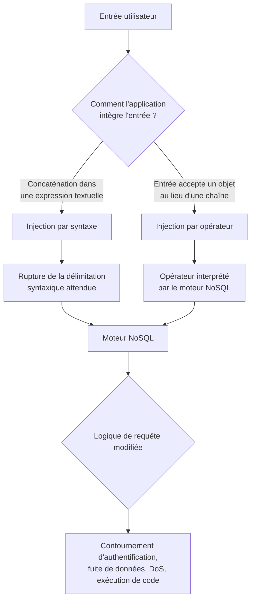

# NoSQL Injection — Cours de référence

## 1. Définition

Une **NoSQL Injection** est une vulnérabilité qui permet à un attaquant de modifier la structure ou la logique d'une requête qu'une application envoie à une base de données NoSQL, en injectant des éléments de syntaxe ou des opérateurs propres au moteur de requête utilisé. Le composant concerné est la **couche de construction de requête** de l'application : le défaut apparaît lorsque cette couche intègre une entrée utilisateur dans une requête (sous forme de chaîne ou de structure de données) sans s'assurer que cette entrée reste strictement une donnée, et non un fragment de syntaxe ou un opérateur interprétable par le moteur de base de données. Ce défaut devient exploitable dès lors que l'attaquant peut influencer soit la chaîne de caractères insérée dans une expression de requête, soit la structure même de l'objet transmis au pilote de base de données (par exemple en remplaçant une chaîne attendue par un objet JSON). La propriété de sécurité compromise dépend du contexte : il peut s'agir de la **confidentialité** (lecture de données non autorisées, extraction de champs), de l'**intégrité** (modification de données), de la **disponibilité** (déni de service) ou du **contrôle d'accès** (contournement d'authentification).

**Formulation simplifiée :** une NoSQL Injection permet de faire exécuter par la base de données une logique différente de celle prévue par l'application, en injectant de la syntaxe ou des opérateurs dans une donnée censée être neutre.

Cette définition évite de réduire la vulnérabilité au seul contournement d'authentification, qui n'est qu'une conséquence possible parmi d'autres, et souligne que le principe général — faire basculer une donnée en instruction — est partagé avec l'injection SQL, tout en précisant que la syntaxe et les techniques concrètes dépendent entièrement du moteur NoSQL ciblé.

## 2. Cause racine

La cause racine d'une NoSQL Injection est une **absence de séparation stricte entre les données fournies par l'utilisateur et la syntaxe ou la structure de la requête exécutée par la base de données**.

Chaîne causale :

**L'application construit une requête en insérant une entrée utilisateur, soit directement dans une expression textuelle (concaténation), soit en acceptant que cette entrée détermine la structure même de l'objet transmis au moteur NoSQL → le moteur NoSQL interprète cette entrée non comme une simple valeur, mais comme un fragment de syntaxe ou un opérateur légitime → la logique de la requête réellement exécutée diverge de celle voulue par l'application → cette divergence peut élargir, restreindre ou modifier les critères de sélection, de comparaison ou d'évaluation initialement prévus → selon le contexte d'utilisation du résultat (authentification, affichage de données, recherche), cette divergence peut produire un contournement de contrôle d'accès, une fuite d'information ou un comportement anormal.**

Deux hypothèses incorrectes sont en jeu, correspondant aux deux grandes familles d'injection identifiées dans ce cours :

- **Injection par syntaxe** : l'application suppose qu'une entrée utilisateur insérée dans une expression textuelle (par exemple entre apostrophes dans une condition `this.category == '...'`) restera nécessairement interprétée comme une simple chaîne de caractères, sans tenir compte du fait que certains caractères spéciaux peuvent rompre cette délimitation et introduire de nouvelles instructions.
- **Injection par opérateur** : l'application suppose qu'un champ attendu comme chaîne de caractères (par exemple `username`) ne peut recevoir qu'une chaîne, sans valider le type réellement reçu. Si le format d'échange (JSON le plus souvent) autorise la soumission d'un objet à la place d'une chaîne, et que cet objet est transmis tel quel au moteur NoSQL, celui-ci peut l'interpréter comme contenant un opérateur légitime (`$ne`, `$gt`, `$regex`, etc.) plutôt que comme une valeur de comparaison.

Il faut distinguer ces deux causes : la première relève d'un défaut d'échappement ou de délimitation syntaxique, analogue à l'injection SQL classique ; la seconde relève d'un défaut de validation de type et de structure de données, propre aux formats semi-structurés (JSON, BSON) utilisés par de nombreuses bases NoSQL, et n'a pas d'équivalent direct en SQL classique.

## 3. Fonctionnement normal

En l'absence de vulnérabilité, le traitement d'une requête impliquant une entrée utilisateur suit ces étapes :

1. **Réception de l'entrée** : l'application reçoit une valeur fournie par l'utilisateur, par exemple via un paramètre d'URL (`?category=fizzy`) ou un champ de formulaire (nom d'utilisateur, mot de passe).
2. **Validation attendue** : l'application devrait vérifier que cette entrée correspond au type et au format attendus — une chaîne de caractères simple, sans structure ni syntaxe de requête.
3. **Construction de la requête** : l'application insère cette valeur dans une requête destinée au moteur NoSQL, soit sous forme d'expression (`this.category == 'fizzy'`), soit sous forme d'objet structuré (`{"username": "wiener", "password": "peter"}`).
4. **Exécution par le moteur NoSQL** : le moteur évalue la requête selon sa propre syntaxe et ses propres opérateurs internes. Pour un document, un champ ou une paire clé-valeur, il compare les valeurs fournies aux données stockées selon la logique attendue (égalité stricte, dans cet exemple).
5. **Retour du résultat** : le moteur renvoie les documents correspondant exactement aux critères voulus par l'application — un produit de la catégorie `fizzy`, ou un utilisateur dont le nom et le mot de passe correspondent exactement aux valeurs fournies.

Dans ce fonctionnement normal, la valeur `fizzy` ou `wiener` reste une **donnée** du point de vue du moteur NoSQL : elle est comparée telle quelle, sans être interprétée comme une instruction ou un opérateur. L'application part de l'hypothèse que toute entrée reçue restera cantonnée à ce rôle de donnée, quelle que soit sa forme ou son contenu.

## 4. Fonctionnement vulnérable

Le comportement bascule vers la vulnérabilité selon deux mécanismes distincts, correspondant aux deux types d'injection.

| Aspect | Fonctionnement normal | Injection par syntaxe | Injection par opérateur |
|---|---|---|---|
| Entrée | Chaîne simple sans caractère spécial | Chaîne contenant des caractères capables de rompre la délimitation syntaxique (`'`, `"`, `\`, `{`) | Objet JSON soumis à la place d'une chaîne attendue |
| Traitement | L'entrée est intégrée comme valeur dans l'expression ou l'objet | L'entrée modifie la structure de l'expression textuelle construite par l'application | Le moteur NoSQL reçoit un objet contenant un opérateur (`$ne`, `$regex`, etc.) au lieu d'une valeur simple |
| Décision | Le moteur compare une valeur à une autre valeur | Le moteur évalue une expression dont la logique a été modifiée par l'attaquant | Le moteur applique l'opérateur injecté comme un critère de comparaison légitime |
| Résultat | Correspondance exacte avec les critères voulus | La condition peut devenir toujours vraie, toujours fausse, ou partiellement modifiée | Le critère de comparaison change de nature (différent de, dans une liste, correspond à une expression régulière, etc.) |
| Conséquence de sécurité | Aucune | Filtre contourné, condition de sélection élargie ou modifiée | Contournement d'authentification, extraction de données, évaluation de code selon le contexte |

**Illustration de l'injection par syntaxe :**

```text
Requête voulue : this.category == 'fizzy'
Entrée injectée : fizzy'||'1'=='1
Requête résultante : this.category == 'fizzy' || '1' == '1'
```

L'apostrophe injectée referme prématurément la chaîne attendue par l'application, et la suite de l'entrée (`||'1'=='1`) introduit une nouvelle condition, toujours vraie, qui s'ajoute par disjonction logique à la condition initiale. Le résultat peut inclure des documents qui ne correspondent pas au critère de catégorie initialement prévu.

**Illustration de l'injection par opérateur :**

```json
Requête voulue :
{ "username": "bob", "password": "motdepasse" }

Entrée injectée (objet à la place d'une chaîne) :
{ "username": { "$ne": "invalid" }, "password": { "$ne": "invalid" } }
```

Si le format d'échange (JSON) permet à l'attaquant de remplacer la valeur attendue (une chaîne) par un objet, et que l'application ne valide pas ce type avant de transmettre la requête, le moteur NoSQL interprète `$ne` comme un opérateur de comparaison ("différent de"), et non comme une chaîne de caractères arbitraire. La condition devient alors "le nom d'utilisateur est différent de `invalid`", ce qui peut correspondre à n'importe quel compte existant.

Ces deux mécanismes sont indépendants : une application peut être protégée contre l'un et rester vulnérable à l'autre, car ils ciblent des couches différentes de la construction de requête (l'expression textuelle d'un côté, la structure de données de l'autre).

## 5. Modèle technique

### 5.1. Vue d'ensemble



Ce schéma illustre le chemin complet : l'entrée contrôlée par l'attaquant (point 1) peut emprunter l'une ou l'autre des deux voies d'injection selon la manière dont l'application construit sa requête (point 2), chacune produisant un comportement incorrect différent au niveau du moteur NoSQL (point 3), pour aboutir à une logique de requête modifiée (point 4) dont l'impact de sécurité dépend du contexte d'utilisation du résultat (point 5).

### 5.2. Explication du schéma

La **frontière de confiance** franchie diffère selon la variante : pour l'injection par syntaxe, c'est la frontière entre texte de requête et donnée textuelle qui est rompue (le moteur NoSQL ne peut pas distinguer, dans une chaîne concaténée, ce qui provient de l'application de ce qui provient de l'attaquant). Pour l'injection par opérateur, c'est la frontière entre **type attendu** et **type réellement reçu** qui est rompue (le moteur accepte une structure que l'application pensait impossible à recevoir).

Le désaccord d'interprétation, lorsqu'il existe, se situe entre l'application — qui suppose un format d'entrée strict (chaîne simple) — et le moteur NoSQL, ainsi que le format d'échange sous-jacent (JSON/BSON), qui acceptent nativement des structures plus riches (objets, opérateurs) que l'application n'a pas explicitement exclues.

### 5.3. Exemple technique commenté

```json
{
  "username": "admin",
  "password": { "$regex": "^a.*" }
}
```

- `username` reste une chaîne simple ici : seul le champ `password` est ciblé par l'injection.
- `$regex` est un opérateur MongoDB qui teste si la valeur stockée correspond à une expression régulière, plutôt que de vérifier une égalité stricte.
- `^a.*` signifie : la chaîne doit commencer (`^`) par le caractère `a`, suivi de n'importe quelle suite de caractères (`.*`).
- Si l'application compare le résultat de cette requête (succès ou échec de connexion, par exemple) à son comportement avec un mot de passe incorrect, une différence de réponse peut indiquer que le premier caractère du mot de passe réel est effectivement `a`.
- Ce qui dépend du contexte : cette technique suppose que le champ `password` est transmis sans validation de type au moteur, et que l'application distingue visiblement, dans sa réponse, un résultat positif d'un résultat négatif. Sans cette distinction observable, l'extraction caractère par caractère décrite ici n'est pas réalisable de cette manière (voir section 7.4 sur les injections basées sur le temps, qui proposent une alternative lorsque cette distinction n'existe pas).

## 6. Conditions nécessaires à l'exploitation

| Condition | Pourquoi elle est importante | Obligatoire ou dépendante du scénario ? |
|---|---|---|
| L'application intègre une entrée utilisateur dans une requête NoSQL sans validation stricte du format attendu | C'est le défaut fondamental sans lequel aucune des deux familles d'injection n'est possible | Obligatoire |
| Pour l'injection par syntaxe : l'entrée est insérée par concaténation dans une expression textuelle, sans échappement des caractères spéciaux | Nécessaire pour qu'une entrée utilisateur puisse rompre la délimitation syntaxique prévue | Obligatoire pour cette variante spécifiquement |
| Pour l'injection par opérateur : le format d'échange (JSON) et le point d'entrée de l'application permettent de soumettre un objet à la place d'une chaîne attendue | Nécessaire pour injecter un opérateur du moteur NoSQL plutôt qu'une simple valeur | Obligatoire pour cette variante spécifiquement |
| L'application ne restreint pas les clés ou opérateurs acceptés dans les objets transmis au moteur | Sans cette restriction, un opérateur comme `$ne`, `$regex` ou `$where` peut être transmis tel quel | Obligatoire pour l'injection par opérateur |
| Le résultat de la requête modifiée est utilisé dans une décision observable par l'attaquant (authentification réussie, contenu affiché, différence de réponse, délai de traitement) | Nécessaire pour transformer la modification de la requête en information exploitable ou en contournement effectif | Obligatoire pour obtenir un impact, mais pas pour la seule détection du comportement anormal |
| L'application distingue visiblement une condition vraie d'une condition fausse dans sa réponse (contenu, code HTTP, structure) | Permet une extraction ou une confirmation par comparaison directe de réponses | Dépendante du scénario : en son absence, une extraction basée sur le temps (section 7.4) peut parfois être utilisée à la place |
| Le contexte d'exécution du moteur NoSQL autorise des fonctionnalités avancées (évaluation JavaScript via `$where`, fonctions comme `sleep()`) | Conditionne la possibilité d'exploitation plus poussée (extraction de noms de champs, injection temporelle) | Dépendante de l'implémentation et de la configuration du moteur, non universelle |

Trois situations sont à bien distinguer :

- **Détecter un comportement anormal** : observer qu'une entrée contenant un caractère spécial ou un opérateur produit une réponse différente de celle attendue (erreur, changement de contenu). Cela suggère une injection possible, sans la confirmer.
- **Confirmer que l'entrée influence réellement la logique de la requête** : comparer systématiquement une condition manifestement fausse et une condition manifestement vraie construites selon le même principe d'injection, et vérifier que les réponses diffèrent de façon cohérente.
- **Démontrer un impact concret** : obtenir effectivement un contournement d'authentification, une donnée extraite, ou un comportement anormal du système, ce qui peut nécessiter des conditions supplémentaires (distinction de réponse exploitable, absence de limitation du nombre de tentatives, etc.).

## 7. Variantes et cas particuliers

### 7.1. Injection par syntaxe — contournement de condition

Cette variante exploite la rupture de la délimitation textuelle d'une expression de requête. La détection initiale repose sur l'envoi de caractères spéciaux (`'`, `"`, `\`, `{`) susceptibles de provoquer une erreur ou une réponse différente, puis sur la comparaison de conditions booléennes manifestement fausses et vraies construites avec la même syntaxe (par exemple `' && 0 && 'x` contre `' && 1 && 'x`). Si ces deux formes produisent des réponses distinctes, cela confirme que l'injection influence la logique exécutée. L'exploitation type consiste à transformer une condition de filtre en condition toujours vraie (`'||'1'=='1`), ce qui peut élargir les résultats retournés au-delà de ce que le filtre était censé autoriser.

Un cas particulier associé est l'utilisation d'un **caractère nul** (`\u0000`, encodé `%00` dans une URL) pour tenter d'interrompre le traitement d'une chaîne avant qu'une restriction supplémentaire ne soit prise en compte. Ce comportement dépend strictement de l'implémentation du moteur et du pilote utilisés : il ne doit pas être présenté comme une règle générale applicable à toute base NoSQL.

### 7.2. Injection par opérateur — contournement d'authentification et extraction

Cette variante exploite la possibilité de soumettre un objet structuré à la place d'une chaîne attendue. Les opérateurs couramment en jeu avec MongoDB incluent `$ne` (différent de), `$in` (appartient à une liste), `$regex` (correspond à une expression régulière) et `$where` (évalue une expression JavaScript dans certains contextes).

- Le **contournement d'authentification** repose sur l'injection de `$ne` sur les champs `username` et `password`, ce qui peut faire correspondre la requête à n'importe quel document existant si l'application considère le premier résultat trouvé comme une connexion valide. Ce résultat n'est pas garanti : il dépend de la manière dont l'application traite un résultat multiple.
- Le **ciblage d'un compte précis** repose sur `$in` pour restreindre la recherche à une liste de noms d'utilisateurs probables (par exemple des comptes administrateurs), combiné à un opérateur permettant de satisfaire la condition sur le mot de passe sans le connaître.
- L'**extraction de données caractère par caractère** repose sur `$regex`, en testant des préfixes de plus en plus longs (`^a.*`, puis `^ab.*`, etc.) et en observant si la réponse de l'application diffère selon que le motif correspond ou non à la valeur réelle stockée.

### 7.3. Injection via `$where` — exécution d'expressions JavaScript

Lorsque l'application construit elle-même une expression `$where` à partir d'une entrée utilisateur, ou que l'attaquant parvient à injecter ce champ, l'expression résultante est évaluée comme du code JavaScript par le moteur. Cela permet des opérations plus riches qu'une simple comparaison :

- Extraction caractère par caractère d'un champ via des expressions comme `this.password[0] == 'a'`.
- Test de propriétés d'un champ sans en révéler la valeur complète (par exemple `this.password.match(/\d/)` pour détecter la présence d'un chiffre).
- Découverte de noms de champs inconnus via `Object.keys(this)[0].match('^.{0}a.*')`, qui exploite le fait que les documents NoSQL ne partagent pas nécessairement un schéma identique.

Cette variante se distingue de l'injection `$regex` par le fait qu'elle repose sur l'évaluation de code, et non sur un opérateur de comparaison déclaratif : elle est donc disponible uniquement si le contexte d'exécution du moteur autorise ce type d'évaluation, ce qui n'est pas universel (certaines configurations ou certaines bases NoSQL ne proposent pas d'équivalent à `$where`).

### 7.4. Injection basée sur le temps

Lorsque l'application ne distingue visiblement ni dans son contenu ni dans son comportement une condition vraie d'une condition fausse, l'exploitation peut s'appuyer sur la mesure du **temps de réponse**. Le principe consiste à injecter une condition qui, si elle est évaluée comme vraie, déclenche un délai artificiel (par exemple via une fonction comme `sleep()`, ou une boucle d'attente conditionnelle), et à comparer ce délai au temps de réponse habituel de l'application. Cette technique nécessite une mesure de référence fiable (plusieurs requêtes témoins) avant de tirer une conclusion, car de nombreux facteurs externes peuvent influencer le temps de réponse. Elle dépend également fortement de la disponibilité de la fonction de délai dans l'environnement JavaScript exécuté par le moteur, ce qui n'est pas garanti dans tous les contextes.

## 8. Impact et limites de l'impact

| Impact possible | Mécanisme | Conditions supplémentaires nécessaires | Limites potentielles |
|---|---|---|---|
| Contournement d'authentification | Une condition d'identification (nom d'utilisateur, mot de passe) est remplacée par une condition toujours vraie ou par un opérateur comme `$ne` qui correspond à un compte existant sans connaître ses identifiants réels | L'application doit traiter un résultat de requête correspondant à plusieurs documents, ou au premier document trouvé, comme une authentification valide | Si l'application vérifie qu'un seul document correspond exactement, ou applique une vérification supplémentaire après la requête, le contournement peut échouer |
| Lecture de données non autorisées | Extraction caractère par caractère via des conditions booléennes, des expressions régulières (`$regex`) ou des expressions JavaScript (`$where`) | Une distinction observable entre condition vraie et condition fausse doit exister dans la réponse, ou à défaut un canal temporel exploitable | L'extraction champ par champ, caractère par caractère, peut être lente et nécessiter un grand nombre de requêtes ; des limitations de débit peuvent la ralentir ou l'empêcher |
| Déni de service | Une requête malveillante (expression complexe, boucle d'attente) peut consommer des ressources excessives côté serveur ou base de données | L'expression injectée doit pouvoir être évaluée par le moteur sans contrôle de ressources ni limite de temps d'exécution | De nombreuses configurations limitent le temps d'exécution des requêtes ou désactivent les fonctionnalités d'évaluation de code les plus coûteuses |
| Exécution de code côté serveur | Dans certains contextes, l'évaluation d'expressions JavaScript (`$where` ou équivalent) peut aller au-delà d'une simple comparaison de données | Dépend strictement de la configuration du moteur NoSQL et de ce que son environnement d'exécution autorise ; ce n'est pas une capacité universelle des bases NoSQL | De nombreux moteurs ou configurations modernes restreignent fortement ou désactivent ce type d'évaluation |

Deux applications utilisant la même base NoSQL avec la même absence de validation peuvent présenter des risques très différents selon la sensibilité des champs accessibles (un simple champ de catégorie de produit n'a pas le même impact qu'un champ de mot de passe ou un champ utilisé pour une décision d'autorisation), et selon les fonctionnalités avancées (comme `$where`) réellement activées sur l'instance ciblée.

## 9. Signaux d'identification et observations pertinentes

| Observation | Interprétation possible | Autres explications | Ce qui reste à démontrer |
|---|---|---|---|
| L'envoi d'un caractère spécial (`'`, `"`, `\`) provoque une erreur ou une réponse différente de la normale | L'entrée atteint une expression de requête sans échappement adéquat | L'erreur peut provenir d'une validation générique non liée à une injection NoSQL, ou d'un bug sans rapport | L'entrée influence-t-elle réellement la logique de la requête, ou provoque-t-elle seulement un rejet générique ? |
| Deux conditions construites pour être respectivement toujours fausse et toujours vraie produisent des réponses différentes | L'entrée modifie effectivement la logique de la requête exécutée côté serveur | Une différence de réponse peut parfois provenir d'un comportement non déterministe de l'application, sans lien avec l'injection testée | Le résultat est-il reproductible de façon cohérente sur plusieurs tests similaires ? |
| L'envoi d'un objet JSON à la place d'une chaîne attendue (par exemple `{"$ne": "..."}`) ne provoque pas de rejet et modifie le comportement de l'application | L'application ne valide pas le type des champs reçus avant de les transmettre au moteur NoSQL | L'application peut accepter des objets pour d'autres raisons légitimes sans que cela implique une interprétation par un opérateur du moteur | L'opérateur injecté est-il réellement interprété par le moteur, ou simplement ignoré sans effet ? |
| Une requête contenant une fonction de délai (`sleep()` ou équivalent) prend sensiblement plus de temps que la normale | L'expression injectée est évaluée par le moteur, qui prend en charge cette fonction dans ce contexte | La latence peut provenir d'une charge serveur, d'une variation réseau, ou d'un traitement légitime sans lien avec l'injection | Le délai est-il reproductible, et varie-t-il de façon cohérente selon que la condition associée est vraie ou fausse ? |
| Une recherche de champs via wordlist (test de noms courants) produit des réponses distinctes pour certains noms | Ces champs existent potentiellement dans les documents de la base | Des champs inexistants peuvent produire des réponses similaires à des champs existants selon la gestion des erreurs de l'application | Le champ supposé existant contient-il réellement une donnée exploitable, ou seulement une valeur par défaut ou vide ? |

Ces observations constituent des indices à confirmer, et non des preuves d'impact : une différence de réponse confirmée ne garantit pas, à elle seule, qu'une donnée sensible soit effectivement extractible ou qu'un contournement d'authentification complet soit réalisable.

## 10. Défenses et prévention

### 10.1. Valider et filtrer les entrées selon une liste d'autorisation (correction de la cause racine, injection par syntaxe)

La défense la plus fondamentale consiste à définir précisément les valeurs autorisées pour chaque champ (allowlist), plutôt que de tenter de bloquer uniquement certains caractères jugés dangereux. Un filtrage limité à l'apostrophe, par exemple, ne protège pas contre d'autres caractères ou combinaisons capables de rompre la syntaxe. La validation doit correspondre strictement au format métier attendu (par exemple : lettres, chiffres et tirets uniquement pour un identifiant de catégorie).

### 10.2. Utiliser des requêtes paramétrées plutôt que la concaténation

Lorsque l'API du moteur NoSQL ou son pilote le permet, transmettre les valeurs utilisateur comme des données distinctes de la structure de la requête (plutôt que par concaténation dans une expression textuelle) empêche qu'une entrée modifie la syntaxe de la requête elle-même. Cette mesure corrige directement la cause racine de l'injection par syntaxe, de la même manière que les requêtes préparées protègent contre l'injection SQL classique.

### 10.3. Autoriser uniquement les clés et types de données attendus (correction de la cause racine, injection par opérateur)

Pour empêcher l'injection par opérateur, l'application doit valider strictement la **structure** des données reçues, et pas seulement leur contenu : un champ attendu comme chaîne de caractères doit être rejeté s'il est reçu sous forme d'objet, quelle que soit la clé que cet objet contienne. Les clés inattendues, en particulier celles correspondant à des opérateurs du moteur (`$where`, `$ne`, `$regex`, etc.), doivent être explicitement rejetées plutôt que transmises telles quelles. Cette mesure traite la cause racine spécifique à cette variante, puisqu'elle empêche que la structure de l'entrée détermine la logique de la requête.

### 10.4. Limites générales de ces défenses

Ces mesures sont complémentaires : une validation de type seule (section 10.3) ne protège pas contre une injection par syntaxe si des chaînes contenant des caractères spéciaux restent acceptées sans échappement (section 10.1-10.2), et inversement. Leur efficacité dépend également de leur application cohérente à l'ensemble des points d'entrée de l'application, y compris ceux qui ne semblent pas, à première vue, construire une requête de recherche (filtres, tris, paramètres d'agrégation).

## 11. Synthèse conceptuelle

### 11.1. Le mécanisme en quelques phrases

Une NoSQL Injection survient lorsqu'une entrée utilisateur parvient à modifier la logique d'une requête destinée à une base NoSQL, soit en rompant la syntaxe d'une expression textuelle (injection par syntaxe), soit en substituant un objet contenant un opérateur du moteur à une simple chaîne attendue (injection par opérateur). Ces deux mécanismes sont indépendants et exigent des défenses distinctes. Selon le contexte d'utilisation de la requête modifiée, l'impact peut aller du contournement d'authentification à l'extraction progressive de données, en passant par le déni de service ou, dans certains environnements, l'exécution de code.

### 11.2. Les points fondamentaux à retenir

- Deux familles d'injection distinctes existent : par syntaxe (rupture de délimitation textuelle) et par opérateur (substitution de type/structure).
- L'absence de validation stricte du type des données reçues est aussi dangereuse que l'absence d'échappement syntaxique.
- L'extraction de données repose généralement sur la comparaison de réponses à des conditions vraies/fausses construites systématiquement, rarement sur une seule observation.
- Les techniques précises (opérateurs, fonctions comme `sleep()`, disponibilité de `$where`) dépendent fortement du moteur NoSQL et de sa configuration ; aucune ne doit être généralisée sans vérification.

### 11.3. Les confusions à éviter

- Confondre l'absence d'erreur lors d'un test avec une preuve de sécurité : l'application peut simplement échapper ou traiter différemment l'entrée sans que cela signifie qu'aucune injection n'est possible par une autre voie.
- Confondre l'injection par syntaxe et l'injection par opérateur comme s'il s'agissait d'une seule et même technique : elles ciblent des défauts différents et nécessitent des tests comme des défenses distinctes.
- Présenter un contournement d'authentification via `$ne` comme systématique : il dépend de la manière dont l'application traite un résultat multiple ou le premier document trouvé.
- Généraliser une technique dépendante de l'implémentation (caractère nul, fonction `sleep()`, disponibilité de `$where`) à l'ensemble des bases NoSQL ou à tous les contextes d'exécution d'un même moteur.
- Confondre une différence de temps de réponse isolée avec une preuve d'injection temporelle confirmée, sans mesure de référence répétée.

## 12. Glossaire des termes techniques

| Terme | Définition | Rôle dans la vulnérabilité NoSQL Injection |
|---|---|---|
| Base de données NoSQL | Système de gestion de données n'utilisant pas le modèle relationnel classique (tables/lignes/colonnes), reposant par exemple sur des documents, des paires clé-valeur ou des graphes | Détermine la syntaxe et les opérateurs disponibles pour l'injection, propres à chaque moteur |
| Injection par syntaxe | Modification de la structure d'une expression de requête par rupture de délimitation (apostrophes, guillemets) | Premier grand mécanisme d'injection, analogue à l'injection SQL classique |
| Injection par opérateur | Substitution d'une valeur simple attendue par un objet structuré contenant un opérateur du moteur NoSQL | Second grand mécanisme d'injection, propre aux formats semi-structurés comme JSON/BSON |
| `$ne`, `$gt`, `$in`, `$regex`, `$where` | Opérateurs MongoDB permettant respectivement une comparaison de différence, de supériorité, d'appartenance à une liste, de correspondance à une expression régulière, et l'évaluation d'une expression JavaScript | Éléments concrets injectés pour modifier la logique de comparaison ou évaluer du code |
| Allowlist (liste d'autorisation) | Ensemble des valeurs ou formats explicitement acceptés, tout le reste étant rejeté par défaut | Principe de défense recommandé contre l'injection par syntaxe comme par opérateur |
| Requête paramétrée | Méthode de construction de requête où les valeurs sont transmises séparément de la structure de la requête, sans concaténation textuelle | Défense structurelle contre l'injection par syntaxe |
| Extraction basée sur le temps (time-based) | Technique consistant à déduire la véracité d'une condition par la mesure du délai de réponse plutôt que par son contenu | Utilisée lorsque l'application ne distingue pas visiblement une condition vraie d'une condition fausse |
| Wordlist | Liste de valeurs ou de noms courants (noms de champs, identifiants) testés successivement pour en déduire l'existence | Méthode utilisée pour découvrir des noms de champs inconnus dans des documents sans schéma fixe |

## 13. Ressources et références

- Document de cours source fourni pour cette fiche (notes de formation sur la NoSQL Injection).
- PortSwigger Web Security Academy — *NoSQL injection* : ressource de référence couvrant la détection par caractères spéciaux, l'injection d'opérateurs MongoDB, l'extraction via `$regex` et `$where`, et les techniques basées sur le temps, dont une partie des concepts de ce cours sont directement issus. Disponible sur le site officiel de PortSwigger (portswigger.net), dans la section Web Security Academy.

Aucune autre référence externe n'a pu être vérifiée dans le cadre de la rédaction de cette fiche. Il est recommandé de consulter en complément la documentation officielle du moteur NoSQL effectivement utilisé par l'application étudiée (par exemple la documentation de MongoDB sur ses opérateurs de requête et sur `$where`), afin de confirmer les comportements précis disponibles pour cette implémentation.
