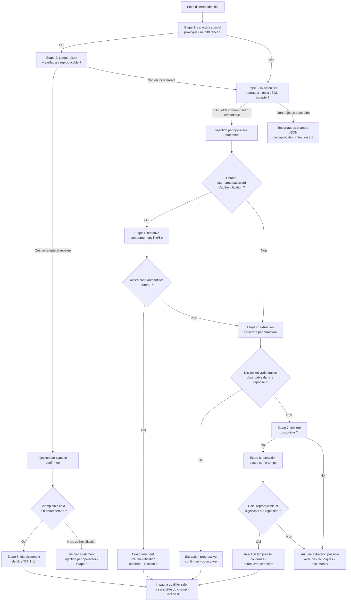

# NoSQL Injection — Méthodologie d'exploitation

!!! warning "Cadre légal"
    À utiliser exclusivement en laboratoire, CTF, ou test d'intrusion couvert par une autorisation écrite.

## 1. Objectif et périmètre de la méthodologie

L'objectif de cette fiche est de démontrer qu'une entrée utilisateur parvient à modifier la logique d'une requête destinée à une base NoSQL, et d'en évaluer l'impact réel (contournement d'authentification, extraction de données, déni de service, voire exécution de code selon la configuration du moteur).

Le comportement de sécurité à démontrer : l'application intègre une entrée utilisateur dans une requête NoSQL sans garantir qu'elle reste strictement une donnée, permettant à l'attaquant de faire exécuter une logique différente de celle prévue.

**Variantes couvertes par cette fiche**, traitées séparément car elles ciblent des défauts distincts et nécessitent des tests différents :

- **Injection par syntaxe** : rupture de la délimitation textuelle d'une expression de requête (analogue à l'injection SQL classique).
- **Injection par opérateur** : substitution d'un objet structuré (contenant un opérateur du moteur, ex. `$ne`, `$regex`, `$where`) à une chaîne simple attendue — propre aux formats semi-structurés (JSON/BSON).

Ces deux mécanismes sont indépendants : une application peut être protégée contre l'un et rester vulnérable à l'autre. Cette fiche ne les mélange donc pas et propose un parcours de test distinct pour chacun, avant une phase commune d'escalade vers l'extraction de données et l'exécution de code.

**Non couvert par cette fiche** (absent du cours source, à traiter séparément si pertinent) : la syntaxe d'injection spécifique à des moteurs NoSQL autres que MongoDB (Redis, CouchDB, Elasticsearch, etc.) — le cours précise explicitement que les techniques concrètes dépendent du moteur ciblé et ne généralise qu'à MongoDB ; les méthodes précises de contournement d'un rate limiting lors d'une extraction caractère par caractère, mentionnées comme limite potentielle sans solution détaillée ; la configuration exacte requise pour qu'une instance MongoDB autorise `$where`, non détaillée dans le cours au-delà du principe de non-universalité.

### Principe de raisonnement

La démarche distingue trois niveaux de preuve rappelés explicitement par le cours : **détecter** un comportement anormal (une entrée avec caractère spécial ou opérateur produit une réponse différente), **confirmer** que cette entrée influence réellement la logique de la requête (comparaison systématique d'une condition construite comme fausse et d'une condition construite comme vraie, selon le même principe d'injection), puis **démontrer un impact concret** (contournement effectif, donnée réellement extraite, comportement anormal mesurable). Chaque étape ne doit être tentée qu'après confirmation de la précédente, car une simple différence de réponse ne garantit ni que l'injection est réellement interprétée par le moteur, ni qu'un impact exploitable en découle.

---

## 2. Conditions préalables et état de référence

### 2.1. Prérequis techniques

**Indispensables :**

- Un point d'entrée où une valeur utilisateur est intégrée dans une requête NoSQL, sans validation stricte du format attendu — condition fondamentale commune aux deux variantes.
- *Pour l'injection par syntaxe* : l'entrée doit être insérée par concaténation dans une expression textuelle, sans échappement des caractères spéciaux.
- *Pour l'injection par opérateur* : le format d'échange (généralement JSON) doit permettre à l'attaquant de soumettre un objet structuré à la place d'une chaîne attendue, et l'application ne doit pas valider ce type avant transmission au moteur.

**Fréquents mais non systématiques :**

- Un message d'erreur ou une réponse visiblement différente entre un caractère spécial accepté et rejeté — utile pour orienter les tests mais son absence ne prouve rien (l'application peut distinguer ses réponses d'une autre façon, ou pas du tout, nécessitant alors une technique basée sur le temps).
- La disponibilité de `$where` ou de fonctions d'évaluation JavaScript (`sleep()`), qui dépend strictement de la configuration du moteur NoSQL et n'est pas universelle.

**À vérifier sur la cible, non supposés à l'avance :**

- Si l'application traite un résultat multiple ou le premier document trouvé comme une authentification valide (condition nécessaire au contournement d'authentification par `$ne`, non garantie).
- Si une distinction observable existe dans la réponse de l'application entre un résultat positif et un résultat négatif (condition nécessaire à l'extraction par condition booléenne classique ; en son absence, seule l'extraction basée sur le temps reste envisageable).
- La présence éventuelle de limitation du nombre de tentatives ou de débit, qui peut ralentir ou empêcher une extraction caractère par caractère.

### 2.2. Établir le comportement normal

Avant tout test, établir une référence sur chaque point d'entrée suspecté :

- **Requête initiale** avec une valeur légitime simple (ex. `?category=fizzy`, ou un formulaire de connexion avec des identifiants connus comme invalides) : conserver la requête exacte, les paramètres et en-têtes pertinents.
- **Code de réponse et contenu retourné** pour cette valeur légitime.
- **Comportement sur une valeur invalide mais anodine** (ex. une catégorie inexistante, des identifiants incorrects) : message affiché, code HTTP, temps de réponse approximatif — cette référence sert à distinguer, plus tard, un comportement provoqué par l'injection d'un comportement d'erreur générique déjà existant.
- **Format d'échange utilisé** (JSON, formulaire classique) : détermine si une substitution objet-contre-chaîne (injection par opérateur) est syntaxiquement possible à transmettre.
- **Contexte de session** : point d'entrée accessible sans authentification (formulaire de connexion) ou après authentification (recherche, filtre) ?

Cette référence est nécessaire pour distinguer un comportement normal d'un comportement spécifiquement provoqué par la rupture de syntaxe ou la substitution de type, et pour disposer d'une mesure de temps de réponse fiable avant toute tentative d'extraction basée sur le temps.

---

## 3. Reconnaissance : où rechercher la vulnérabilité ?

### 3.1. Surfaces de test

| Élément à examiner | Pourquoi cette surface est pertinente | Contrôle disponible | Observation initiale | Hypothèse de vulnérabilité | Premier test |
|---|---|---|---|---|---|
| Paramètre de filtre/recherche inséré dans une expression textuelle (`?category=`, champ de recherche) | Point classique de concaténation d'une entrée dans une expression de requête NoSQL | Valeur du paramètre | Réponse pour une valeur légitime (liste de résultats correspondants) | L'entrée est concaténée sans échappement dans une expression textuelle du type `this.champ == '...'` | Injecter un caractère spécial (`'`, `"`, `\`, `{`) et observer une erreur ou un changement de réponse |
| Champs `username`/`password` d'un formulaire de connexion transmis en JSON | Cible privilégiée de l'injection par opérateur pour un contournement d'authentification | Type et structure de la valeur soumise pour ces champs | Comportement avec des identifiants valides puis invalides | L'application ne valide pas que ces champs restent des chaînes, acceptant un objet contenant un opérateur | Remplacer la valeur chaîne par un objet `{"$ne": "valeur_improbable"}` et observer si la requête aboutit |
| Tout champ JSON soumis à l'application, y compris hors formulaire de connexion (filtres, tris, paramètres d'agrégation) | Le cours signale explicitement que l'injection par opérateur touche tout point d'entrée acceptant du JSON, pas seulement l'authentification | Structure de l'objet JSON soumis | Comportement de référence pour une valeur simple | Un champ attendu comme chaîne accepte en réalité un objet structuré sans rejet | Soumettre un objet à la place d'une valeur simple sur chaque champ JSON identifié et observer si une erreur de validation apparaît |
| Réponse de l'application à une authentification ou une recherche, en matière de distinction visible succès/échec | Détermine si une extraction par condition booléenne classique est possible, ou si une technique basée sur le temps sera nécessaire | Contenu, code HTTP, longueur de la réponse | Différence (ou absence de différence) entre une tentative réussie et une tentative échouée de référence | Une distinction de réponse existe, exploitable pour comparer des conditions vraies/fausses construites par injection | Comparer deux requêtes légitimes (succès vs échec) avant toute injection, pour calibrer l'oracle |
| Disponibilité de fonctionnalités avancées du moteur (`$where`, fonctions de délai) | Conditionne la possibilité d'exploitation poussée (extraction de noms de champs inconnus, injection temporelle, exécution de code) | Aucun contrôle direct — dépend de la configuration serveur | Aucune observation initiale possible sans test actif | Le moteur autorise l'évaluation d'expressions JavaScript via `$where` | Tester un `$where` inoffensif (ex. condition toujours vraie) et observer si la requête aboutit sans erreur |

Aucune de ces surfaces n'est nécessairement vulnérable : chacune correspond à un point où une entrée utilisateur rencontre la construction d'une requête NoSQL, ce qui justifie leur examen systématique, en gardant à l'esprit que l'injection par syntaxe et l'injection par opérateur ciblent des défauts indépendants nécessitant chacun leur propre vérification sur chaque surface.

### 3.2. Indices et faux positifs

**Observations qui peuvent suggérer la vulnérabilité :**

- L'envoi d'un caractère spécial (`'`, `"`, `\`) provoque une erreur ou une réponse différente de la normale.
- Deux conditions construites pour être respectivement toujours fausse et toujours vraie, selon la même syntaxe d'injection, produisent des réponses différentes.
- L'envoi d'un objet JSON à la place d'une chaîne attendue ne provoque pas de rejet et modifie le comportement de l'application.
- Une requête contenant une fonction de délai prend sensiblement plus de temps que la normale.

**Observations qui ne suffisent pas à confirmer la vulnérabilité :**

- Une erreur provoquée par un caractère spécial : peut provenir d'une validation générique non liée à une injection NoSQL, ou d'un bug sans rapport — ne confirme pas que l'entrée atteint réellement une expression de requête.
- L'acceptation d'un objet JSON à la place d'une chaîne sans rejet : ne prouve pas que l'opérateur injecté est réellement interprété par le moteur ; l'application peut accepter des objets pour d'autres raisons légitimes.
- Une différence de temps de réponse isolée, mesurée une seule fois : ne constitue pas une preuve d'injection temporelle confirmée sans mesure de référence répétée.
- Une réponse différente pour un nom de champ testé via wordlist : peut provenir d'une gestion d'erreur similaire entre champs existants et inexistants, sans que le champ contienne réellement une donnée exploitable.

**Comportements normaux susceptibles d'être confondus avec la faille :**

- Un comportement non déterministe de l'application (variation de réponse sans lien avec l'injection testée) pouvant imiter une confirmation d'injection par syntaxe lors d'un test isolé non répété.
- Une latence réseau ou une charge serveur ponctuelle pouvant imiter un délai provoqué par une fonction `sleep()` injectée.

**Vérifications complémentaires nécessaires :**

- Toujours répéter un test de comparaison vraie/fausse plusieurs fois avant de conclure à une injection confirmée, en particulier pour les techniques basées sur le temps.
- Vérifier explicitement que l'opérateur injecté produit un effet cohérent avec sa sémantique attendue (ex. `$regex` doit faire varier la réponse selon que le motif correspond ou non à la donnée réelle), plutôt que de se contenter d'une absence de rejet.

---

## 4. Séquence de tests : démarche pas à pas

### Étape 1 — Détection de l'injection par syntaxe

**Objectif**

Vérifier si une entrée contenant un caractère spécial de délimitation provoque une erreur ou une réponse différente, signe que l'entrée atteint une expression de requête textuelle sans échappement.

**Prérequis**

Un paramètre identifié en section 3.1 comme inséré dans une expression de filtre/recherche.

**Hypothèse**

L'entrée est concaténée sans échappement dans une expression textuelle du type `this.champ == '...'`.

**Action à effectuer**

Soumettre successivement les caractères suivants en remplacement ou en complément de la valeur légitime :

```text
'
"
\
{
```

Exemple sur un paramètre de catégorie :

```http
GET /filter?category=fizzy' HTTP/1.1
Host: cible.example
```

**Observations à examiner**

Code de réponse, message d'erreur éventuel, contenu retourné comparé à la référence (section 2.2).

**Résultat positif**

Au moins un caractère provoque une erreur ou une réponse structurellement différente de la référence : indice d'une injection par syntaxe possible — ne constitue qu'une détection, pas encore une confirmation.

**Résultat négatif ou ambigu**

Aucune différence observée : soit l'entrée est échappée correctement, soit elle n'atteint pas une expression textuelle de ce type — ne pas conclure à l'absence totale de vulnérabilité avant d'avoir testé l'injection par opérateur (étape 3), mécanisme indépendant.

**Interprétation**

Une erreur provoquée par un caractère spécial est un indice, pas une preuve : elle peut provenir d'une validation générique sans rapport avec une injection NoSQL. Seule l'étape 2 permet de confirmer que l'entrée influence réellement la logique de la requête.

**Étape suivante**

Si positif → étape 2 (confirmation par comparaison vraie/fausse). Si négatif → étape 3 (injection par opérateur, mécanisme indépendant à tester systématiquement même après un échec sur la syntaxe).

**Erreurs fréquentes**

Conclure à une confirmation d'injection dès la première erreur obtenue, sans avoir comparé une condition construite comme fausse et une condition construite comme vraie (étape 2).

---

### Étape 2 — Confirmation de l'injection par syntaxe (comparaison vraie/fausse)

**Objectif**

Démontrer que l'entrée influence réellement la logique exécutée par le moteur, et non un simple rejet générique.

**Prérequis**

Un signal de détection obtenu à l'étape 1 (comportement différent sur au moins un caractère spécial).

**Hypothèse**

Une condition construite comme manifestement fausse et une condition construite comme manifestement vraie, selon la même syntaxe d'injection, produisent des réponses cohérentes avec leur valeur de vérité respective.

**Action à effectuer**

```http
GET /filter?category=fizzy' && 0 && 'x HTTP/1.1
Host: cible.example

GET /filter?category=fizzy' && 1 && 'x HTTP/1.1
Host: cible.example
```

Comparer les deux réponses entre elles et avec la référence de l'étape 2.2.

**Observations à examiner**

Nombre de résultats retournés, code de réponse, contenu, pour chacune des deux requêtes.

**Résultat positif**

La condition `&& 0 &&` produit un résultat cohérent avec une condition fausse (ex. absence de résultats ou comportement identique à une catégorie inexistante) et la condition `&& 1 &&` produit un résultat cohérent avec une condition vraie (ex. résultats inchangés ou élargis) : confirme que l'injection par syntaxe influence réellement la logique de la requête.

**Résultat négatif ou ambigu**

Les deux requêtes produisent des réponses identiques ou incohérentes avec leur valeur de vérité attendue : le signal de détection de l'étape 1 peut être un faux positif (comportement non déterministe, erreur générique) — répéter le test avant de conclure, puis passer à l'étape 3 si la confirmation échoue de façon reproductible.

**Interprétation**

La reproductibilité cohérente du résultat sur plusieurs tentatives distingue une confirmation réelle d'une variation due au hasard ou à un comportement non déterministe de l'application.

**Étape suivante**

Si positif → étape 5 (exploitation : contournement de condition ou élargissement de filtre). Si négatif → étape 3 (injection par opérateur).

**Erreurs fréquentes**

Ne tester la comparaison vraie/fausse qu'une seule fois sans répétition, risquant de confondre un comportement non déterministe avec une confirmation d'injection.

---

### Étape 3 — Détection et confirmation de l'injection par opérateur

**Objectif**

Vérifier si un champ attendu comme chaîne accepte en réalité un objet structuré contenant un opérateur du moteur NoSQL, interprété comme un critère de comparaison légitime.

**Prérequis**

Le point d'entrée transmet les données en JSON (ou un format équivalent permettant de soumettre un objet structuré). Indépendant du résultat de l'étape 1/2.

**Hypothèse**

L'application ne valide pas que le champ reste une chaîne avant transmission au moteur NoSQL, qui interprète alors un objet contenant un opérateur (`$ne`, `$gt`, `$regex`, etc.) comme un critère de comparaison.

**Action à effectuer**

Remplacer la valeur chaîne attendue par un objet contenant un opérateur, sur chaque champ identifié :

```json
{ "username": { "$ne": "invalid" }, "password": { "$ne": "invalid" } }
```

Puis confirmer avec une comparaison structurée similaire à l'étape 2, en testant un opérateur dont la sémantique produit un résultat vérifiable (ex. `$regex` avec un motif correspondant certainement à une donnée connue, puis avec un motif ne correspondant certainement pas) :

```json
{ "username": "admin", "password": { "$regex": "^a.*" } }
```

**Observations à examiner**

Absence ou présence d'un rejet (erreur de validation de type), changement de comportement de l'application (connexion réussie, résultat de recherche modifié) par rapport à la référence.

**Résultat positif**

L'objet est accepté sans rejet et produit un comportement cohérent avec la sémantique de l'opérateur injecté (ex. connexion réussie avec `$ne` sur des identifiants inconnus, ou réponse différente selon que `$regex` correspond ou non à la donnée réelle) : confirme que l'injection par opérateur est interprétée par le moteur.

**Résultat négatif ou ambigu**

L'objet est rejeté (erreur de validation de type), ou accepté sans effet observable sur le comportement de l'application : soit une validation de structure est en place (protection contre cette variante spécifiquement), soit l'opérateur est simplement ignoré sans effet — à distinguer en testant un second opérateur à la sémantique différente avant de conclure.

**Interprétation**

Une absence de rejet ne suffit pas à confirmer l'injection : il faut vérifier que l'opérateur produit un effet cohérent avec sa sémantique attendue, par exemple que `$regex` fait varier la réponse selon la correspondance réelle du motif, pour écarter le cas où l'objet serait accepté sans réellement être interprété comme un opérateur.

**Étape suivante**

Si positif sur l'authentification → étape 4 (contournement d'authentification). Si positif sur un champ hors authentification → étape 6 (extraction de données). Si négatif → documenter la protection sur ce point d'entrée précis ; répéter néanmoins le test sur les autres champs JSON identifiés en 3.1, cette protection n'étant pas garantie uniforme sur l'ensemble de l'application (section 10.4 du cours).

**Erreurs fréquentes**

Tester l'injection par opérateur uniquement sur le formulaire de connexion sans l'étendre aux autres champs JSON de l'application (filtres, tris, paramètres d'agrégation), alors que le cours signale explicitement ce risque de validation incohérente.

---

### Étape 4 — Exploitation : contournement d'authentification

**Objectif**

Démontrer qu'une authentification peut être contournée sans connaître d'identifiants valides, via l'injection par opérateur confirmée à l'étape 3.

**Prérequis**

Injection par opérateur confirmée sur les champs `username`/`password` du mécanisme d'authentification (étape 3).

**Hypothèse**

L'application traite un résultat de requête correspondant à plusieurs documents, ou au premier document trouvé, comme une authentification valide — condition non garantie, à vérifier par le résultat du test lui-même.

**Action à effectuer**

```json
POST /login
Content-Type: application/json

{ "username": { "$ne": "invalid" }, "password": { "$ne": "invalid" } }
```

Si un ciblage d'un compte précis est recherché plutôt qu'un contournement générique, combiner `$in` sur une liste de noms d'utilisateurs probables avec un opérateur satisfaisant la condition de mot de passe sans le connaître :

```json
{ "username": { "$in": ["admin", "administrator", "root"] }, "password": { "$ne": "invalid" } }
```

**Observations à examiner**

Code de réponse, redirection vers une zone authentifiée, présence d'un cookie de session, contenu de la page retournée (nom d'utilisateur affiché, zone réservée accessible).

**Résultat positif**

La connexion aboutit sans connaître d'identifiants valides, avec accès effectif à une zone authentifiée : contournement d'authentification confirmé.

**Résultat négatif ou ambigu**

- Erreur de connexion malgré l'absence de rejet de type à l'étape 3 : l'application applique peut-être une vérification supplémentaire après la requête (ex. comparaison explicite du nombre de documents retournés), neutralisant le contournement malgré l'injection techniquement acceptée.
- Connexion réussie mais sur un compte non exploitable ou sans privilège particulier : le contournement fonctionne mais son impact reste à qualifier selon le compte réellement atteint.

**Interprétation**

Le cours précise explicitement que ce résultat n'est pas garanti : il dépend de la manière dont l'application traite un résultat multiple. Un échec à cette étape ne remet pas en cause la confirmation de l'étape 3, mais indique une couche de protection supplémentaire après l'exécution de la requête.

**Étape suivante**

Si positif → documenter l'impact (section 8). Si négatif → vérifier si une extraction caractère par caractère (étape 6) reste possible sur le champ mot de passe pour un compte ciblé, plutôt qu'un contournement direct.

**Erreurs fréquentes**

Confondre une requête acceptée sans erreur (confirmé à l'étape 3) avec un contournement d'authentification réussi, sans vérifier l'accès effectif à une zone protégée.

---

### Étape 5 — Exploitation : élargissement de filtre (injection par syntaxe)

**Objectif**

Démontrer qu'une condition de filtre peut être transformée en condition toujours vraie, élargissant les résultats retournés au-delà de ce que le filtre devait autoriser.

**Prérequis**

Injection par syntaxe confirmée (étape 2).

**Hypothèse**

Une disjonction logique ajoutée à la condition initiale permet de contourner le filtre prévu sans en respecter les critères.

**Action à effectuer**

```http
GET /filter?category=fizzy'||'1'=='1 HTTP/1.1
Host: cible.example
```

**Observations à examiner**

Nombre et nature des résultats retournés, comparés à la référence pour la catégorie légitime.

**Résultat positif**

Les résultats retournés incluent des éléments ne correspondant pas au critère de catégorie initial : élargissement de filtre confirmé, démontrant un contournement de contrôle d'accès ou de filtrage selon le contexte métier du champ ciblé.

**Résultat négatif ou ambigu**

Les résultats restent identiques à la référence pour la catégorie légitime : la confirmation de l'étape 2 peut être correcte sur la syntaxe mais sans effet observable sur ce point d'entrée précis (ex. filtrage supplémentaire appliqué après la requête) — documenter cette limite plutôt que de conclure à une absence totale d'impact.

**Interprétation**

Un élargissement de filtre confirmé sur un champ non sensible (catégorie de produit) a un impact très différent du même mécanisme appliqué à un champ utilisé pour une décision d'autorisation ou de visibilité de données : l'impact dépend entièrement de la sensibilité du champ ciblé.

**Étape suivante**

Si positif sur un champ sensible → documenter l'impact (section 8). Si le champ n'est pas sensible → évaluer si le même point d'injection permet d'accéder à d'autres champs ou d'autres logiques métier dans l'application.

**Erreurs fréquentes**

Documenter un élargissement de filtre sur un champ anodin comme un impact critique sans évaluer la sensibilité réelle de la donnée exposée.

---

### Étape 6 — Extraction de données caractère par caractère

**Objectif**

Extraire la valeur d'un champ sensible (ex. mot de passe) sans la connaître à l'avance, en exploitant une distinction observable entre condition vraie et condition fausse.

**Prérequis**

Une distinction observable existe dans la réponse de l'application entre un résultat positif et un résultat négatif (vérifiée en section 2.2), et un opérateur permettant une comparaison progressive (`$regex` pour l'injection par opérateur) est disponible et confirmé exploitable (étape 3).

**Hypothèse**

En testant des préfixes de plus en plus longs, la réponse de l'application permet de déduire, caractère par caractère, la valeur réelle du champ ciblé.

**Action à effectuer**

```json
{ "username": "admin", "password": { "$regex": "^a.*" } }
```

Puis, si la réponse indique une correspondance :

```json
{ "username": "admin", "password": { "$regex": "^ab.*" } }
```

Itérer sur l'ensemble des caractères possibles à chaque position jusqu'à épuisement du jeu de caractères attendu (alphanumérique a minima), puis avancer d'une position.

Pour découvrir des noms de champs inconnus plutôt que leur valeur, utiliser une wordlist de noms courants testés successivement, ou, si `$where` est disponible (étape 7), une expression telle que :

```javascript
Object.keys(this)[0].match('^.{0}a.*')
```

**Observations à examiner**

Différence de réponse (contenu, code HTTP) entre un préfixe correspondant et un préfixe ne correspondant pas, à chaque itération.

**Résultat positif**

La réponse distingue de façon cohérente et reproductible les préfixes corrects des préfixes incorrects, permettant de reconstituer progressivement la valeur complète du champ ciblé : extraction confirmée.

**Résultat négatif ou ambigu**

- Aucune distinction observable entre préfixe correct et incorrect : la condition nécessaire (section 2.1) n'est pas remplie sur ce champ — passer à l'étape 8 (extraction basée sur le temps) comme alternative.
- Distinction observée mais non reproductible : répéter le test avant de conclure, un comportement non déterministe pouvant produire un faux signal ponctuel.
- Progression ralentie ou bloquée après plusieurs requêtes : une limitation de débit ou de tentatives peut intervenir, ralentissant ou empêchant l'extraction complète.

**Interprétation**

L'extraction champ par champ, caractère par caractère, est intrinsèquement lente et nécessite un grand nombre de requêtes ; un ralentissement ne signifie pas nécessairement un échec de la technique, mais peut indiquer une limitation de débit à prendre en compte dans l'évaluation de la faisabilité pratique de l'attaque.

**Étape suivante**

Si positif → poursuivre l'extraction jusqu'à obtention de la valeur complète, documenter l'impact (section 8). Si absence de distinction observable → étape 8 (extraction basée sur le temps).

**Erreurs fréquentes**

Conclure à l'absence de donnée exploitable après un seul caractère testé sans tenir compte d'un éventuel throttling ralentissant artificiellement les réponses ; ne pas prévoir de jeu de caractères suffisamment large (au-delà de l'alphabet simple) pour les champs pouvant contenir des caractères spéciaux.

---

### Étape 7 — Exploitation via `$where` (si disponible)

**Objectif**

Vérifier si le moteur autorise l'évaluation d'expressions JavaScript via `$where`, ouvrant des possibilités d'exploitation plus riches qu'une simple comparaison.

**Prérequis**

Injection par opérateur confirmée (étape 3). La disponibilité de `$where` n'est pas universelle et dépend strictement de la configuration du moteur — à vérifier et non à présumer.

**Hypothèse**

L'application construit une expression `$where` à partir d'une entrée utilisateur, ou l'attaquant parvient à injecter ce champ directement, et cette expression est évaluée comme du code JavaScript.

**Action à effectuer**

Tester d'abord une expression inoffensive pour confirmer la disponibilité :

```json
{ "$where": "1 == 1" }
```

Si disponible, extraction caractère par caractère via une expression directe :

```json
{ "$where": "this.password[0] == 'a'" }
```

Test de propriété sans révéler la valeur complète :

```json
{ "$where": "this.password.match(/\\d/)" }
```

Découverte de noms de champs inconnus :

```json
{ "$where": "Object.keys(this)[0].match('^.{0}a.*')" }
```

**Observations à examiner**

Acceptation de la requête sans erreur, comportement observable cohérent avec la condition testée.

**Résultat positif**

L'expression `$where` est évaluée et produit un comportement cohérent avec sa logique (ex. correspondance de caractère confirmée) : `$where` disponible et exploitable, ouvrant la voie à une extraction plus flexible que `$regex` seul, voire à une évaluation de code allant au-delà d'une simple comparaison selon la configuration du moteur (déni de service par expression coûteuse, exécution de code selon le contexte — non garanti et à vérifier séparément).

**Résultat négatif ou ambigu**

L'expression est rejetée ou provoque une erreur : `$where` n'est probablement pas disponible dans ce contexte — fréquent sur les configurations modernes qui restreignent ou désactivent ce type d'évaluation ; ne pas s'acharner sur cette voie et se concentrer sur `$regex` (étape 6) et les opérateurs de comparaison simples (étape 4).

**Interprétation**

La disponibilité de `$where` ne doit jamais être présumée avant test : le cours souligne explicitement que ce n'est pas une capacité universelle des bases NoSQL, et que de nombreux moteurs ou configurations modernes la restreignent fortement.

**Étape suivante**

Si positif → étape 6 (extraction, variante `$where`) ou documentation d'un impact de déni de service/exécution de code selon ce que l'expression permet réellement de faire sur cette instance précise. Si négatif → se limiter aux opérateurs de comparaison déclaratifs (`$ne`, `$regex`, `$in`).

**Erreurs fréquentes**

Présumer la disponibilité de `$where` sans test préalable et construire toute la suite de l'exploitation sur cette hypothèse non vérifiée.

---

### Étape 8 — Extraction basée sur le temps (si aucune distinction de réponse n'existe)

**Objectif**

Déduire la véracité d'une condition par la mesure du délai de réponse, lorsque l'application ne distingue visiblement ni dans son contenu ni dans son comportement une condition vraie d'une condition fausse.

**Prérequis**

Absence de distinction observable confirmée à l'étape 6. Disponibilité d'une fonction de délai dans l'environnement JavaScript exécuté par le moteur (ex. `sleep()`) — non garantie, à vérifier par le test lui-même. Une mesure de référence du temps de réponse habituel de l'application est indispensable (section 2.2).

**Hypothèse**

Une condition injectée qui, si elle est évaluée comme vraie, déclenche un délai artificiel mesurable par rapport au temps de réponse habituel.

**Action à effectuer**

```json
{ "$where": "sleep(5000) || this.password[0] == 'a'" }
```

Comparer le temps de réponse à une version de la condition manifestement fausse pour la même position de caractère, et répéter chaque mesure plusieurs fois pour établir une distribution plutôt qu'une valeur unique.

**Observations à examiner**

Temps de réponse mesuré pour la condition testée, comparé à la référence et à une condition fausse équivalente, sur plusieurs répétitions.

**Résultat positif**

Le délai mesuré est systématiquement et significativement plus long lorsque la condition est vraie, de façon reproductible sur plusieurs répétitions : injection temporelle confirmée, exploitable pour une extraction caractère par caractère malgré l'absence de distinction visible dans le contenu de la réponse.

**Résultat négatif ou ambigu**

- Aucune différence de délai mesurable : soit la fonction de délai n'est pas disponible dans ce contexte, soit `$where` lui-même n'est pas disponible (vérifier d'abord l'étape 7).
- Différence de délai observée une seule fois, non reproductible sur répétition : signal probablement dû au bruit réseau ou à la charge serveur plutôt qu'à l'injection — ne pas conclure sans répétition suffisante.

**Interprétation**

Le cours insiste explicitement sur la nécessité d'une mesure de référence fiable avant toute conclusion, de nombreux facteurs externes pouvant influencer le temps de réponse ; une différence isolée ne constitue jamais une preuve d'injection temporelle confirmée.

**Étape suivante**

Si positif → poursuivre l'extraction caractère par caractère selon ce principe temporel, documenter l'impact en tenant compte de la lenteur intrinsèque de la méthode. Si négatif → documenter l'absence d'extraction possible sur ce point d'entrée avec les techniques couvertes par cette fiche.

**Erreurs fréquentes**

Conclure à une injection temporelle confirmée à partir d'une seule mesure de délai, sans répétition ni comparaison à une mesure de référence établie au préalable.

---

## 5. Arbre de décision : que faire selon le résultat ?



---

## 6. Construire la chaîne d'exploitation

### 6.1. Cas A — Contournement d'authentification par injection par opérateur

1. **Point d'entrée** : champs `username`/`password` d'un formulaire de connexion transmis en JSON.
2. **Primitive technique** : substitution d'une chaîne attendue par un objet contenant `$ne` ou `$in`.
3. **Déclenchement** : soumission de la requête de connexion avec ces objets injectés.
4. **Effet intermédiaire** : le moteur NoSQL retourne un ou plusieurs documents correspondant à la condition modifiée, sans que l'attaquant connaisse les identifiants réels.
5. **Aboutissement** : l'application traite ce résultat comme une authentification valide.
6. **Preuve** : accès effectif à une zone authentifiée, session établie, observable par le testeur.

### 6.2. Cas B — Extraction de données par injection par syntaxe ou opérateur

1. **Point d'entrée** : champ dont la valeur est comparée à une donnée sensible non directement affichée (mot de passe, jeton).
2. **Primitive technique** : condition booléenne injectée (syntaxe) ou opérateur `$regex`/`$where` (opérateur) testant progressivement des préfixes.
3. **Déclenchement** : série de requêtes itératives, chacune testant un caractère ou un préfixe supplémentaire.
4. **Effet intermédiaire** : une distinction de réponse (contenu ou temps) confirme ou infirme chaque préfixe testé.
5. **Aboutissement** : reconstruction complète de la valeur du champ ciblé après un nombre suffisant d'itérations.
6. **Preuve** : valeur extraite, vérifiable si un moyen de confirmation indépendant existe (ex. tentative d'authentification avec la valeur reconstruite).

| Étape | Résultat requis | Comment le vérifier | Si cela échoue |
|---|---|---|---|
| Point d'entrée | Champ identifié comme intégré dans une requête NoSQL sans validation stricte | Différence de comportement observée dès l'étape 1 ou 3 | Étendre la recherche à d'autres champs JSON de l'application (3.1) |
| Primitive technique | Injection confirmée comme influençant réellement la logique (pas un simple rejet/erreur générique) | Comparaison vraie/fausse reproductible (étape 2) ou effet cohérent avec la sémantique de l'opérateur (étape 3) | Répéter le test, tester l'autre variante (syntaxe vs opérateur) si l'une échoue |
| Déclenchement | Requête d'exploitation construite selon le mécanisme confirmé | Requête envoyée produit un comportement différent de la référence | Ajuster la syntaxe/opérateur selon les variantes documentées (sections 4.4 à 4.8) |
| Effet intermédiaire | Distinction observable (contenu ou temps) confirmée et reproductible | Répétition du test sur plusieurs tentatives | Si non reproductible, basculer vers l'extraction basée sur le temps (étape 8) si applicable |
| Aboutissement | Accès à une zone protégée, ou valeur de champ reconstruite | Accès effectif vérifié, ou valeur complète obtenue et cohérente | Vérifier une couche de protection supplémentaire après requête (ex. contrôle du nombre de documents) |
| Preuve | Preuve reproductible et minimale de l'impact | Capture de la session obtenue, ou de la valeur extraite avec un moyen de vérification indépendant si disponible | Documenter le niveau de preuve atteint (détection / confirmation / impact démontré) |

---

## 7. Diagnostic des échecs

| Symptôme observé | Causes possibles | Comment les distinguer | Test de diagnostic | Suite logique |
|---|---|---|---|---|
| Caractère spécial sans effet observable | Échappement correct en place, ou entrée non insérée dans une expression textuelle de ce type | Tester l'injection par opérateur en parallèle (mécanisme indépendant) | Étape 3 sur le même champ et sur d'autres champs JSON | Si les deux échouent sur ce point d'entrée, documenter comme protégé et passer à une autre surface (3.1) |
| Comparaison vraie/fausse incohérente d'un test à l'autre | Comportement non déterministe de l'application, ou faux positif de l'étape 1 | Répéter la comparaison plusieurs fois et observer la cohérence | Augmenter le nombre de répétitions avant de conclure | Si incohérence persiste, traiter comme signal faible, non confirmé |
| Objet JSON accepté mais aucun effet observable sur le comportement | Validation de structure en place pour ce champ précis, ou opérateur ignoré sans interprétation | Tester un second opérateur à sémantique différente (ex. `$regex` après un `$ne` sans effet) | Comparer l'effet de plusieurs opérateurs distincts sur le même champ | Si tous échouent, documenter la protection comme efficace sur ce champ ; tester les autres champs JSON de l'application |
| Contournement d'authentification techniquement accepté mais connexion refusée | Vérification applicative supplémentaire après l'exécution de la requête (contrôle du nombre de documents, vérification explicite) | Comparer avec un test d'extraction caractère par caractère sur le même champ, qui ne dépend pas de cette vérification supplémentaire | Tester l'étape 6 (extraction) en alternative au contournement direct | Si l'extraction échoue également, documenter la protection comme robuste sur ce point précis |
| Extraction caractère par caractère ralentie ou bloquée après plusieurs requêtes | Limitation de débit ou de tentatives appliquée par l'application | Observer si le ralentissement est progressif (rate limiting) ou brutal (blocage) | Espacer les requêtes et observer si le comportement se rétablit | Si le blocage persiste, documenter comme limite pratique à l'exploitation plutôt que comme absence de vulnérabilité |
| `$where` rejeté systématiquement | Fonctionnalité désactivée ou non disponible sur cette configuration de moteur | Comparer avec une expression `$where` minimale totalement inoffensive avant d'en déduire l'indisponibilité totale | Tester une expression `$where` triviale (`"1 == 1"`) en isolant toute autre cause d'erreur | Si rejet confirmé sur l'expression triviale, abandonner cette voie et se limiter à `$regex`/opérateurs simples |
| Différence de temps non reproductible | Bruit réseau, charge serveur, absence réelle d'injection temporelle | Répéter la mesure un nombre suffisant de fois et comparer une distribution plutôt qu'une valeur unique | Établir une distribution de temps de réponse pour la condition vraie et la condition fausse séparément | Si les distributions se recouvrent largement, conclure à l'absence d'injection temporelle exploitable de façon fiable |

**Principe de diagnostic** : avant de remplacer une technique par une autre, vérifier à quelle étape précise (détection, confirmation, exploitation) le comportement attendu cesse de se produire, et ne jamais traiter l'injection par syntaxe et l'injection par opérateur comme un seul et même mécanisme dont l'échec de l'une impliquerait l'échec de l'autre.

---

## 8. Vérification de l'exploitation et preuve de l'impact

**Résultat final attendu** selon le vecteur confirmé :

- *Contournement d'authentification* : accès effectif et vérifiable à une zone authentifiée sans connaissance préalable d'identifiants valides.
- *Extraction de données* : valeur complète d'un champ sensible reconstruite, idéalement vérifiable par un moyen indépendant (ex. tentative d'authentification avec la valeur extraite).
- *Élargissement de filtre* : démonstration que des données hors du périmètre attendu par le filtre métier sont retournées.
- *Déni de service / exécution de code* : comportement anormal mesurable (consommation de ressources, délai extrême) résultant d'une expression injectée, dans les limites du périmètre autorisé du test.

**Éléments techniques de confirmation :**

- Pour un contournement d'authentification : vérifier l'accès à des fonctionnalités ou données réservées à un utilisateur authentifié, pas seulement l'absence d'erreur à la soumission du formulaire.
- Pour une extraction : répéter la reconstruction sur plusieurs positions de caractères et vérifier la cohérence globale de la valeur obtenue (format attendu, absence d'incohérence entre deux passes).
- Pour un élargissement de filtre : comparer explicitement les résultats obtenus avec et sans injection pour isoler les éléments qui ne devraient pas apparaître selon la logique métier du filtre.

**Contrôles pour exclure une explication alternative :**

- Vérifier que le résultat n'est pas reproductible par une requête légitime de l'application (ex. une catégorie réellement existante qui porterait un nom proche de la valeur injectée).
- Pour une extraction basée sur le temps, confirmer la cohérence du délai sur plusieurs répétitions et plusieurs positions de caractères avant de considérer la valeur reconstruite comme fiable.

**Distinction entre niveaux de preuve :**

- **Détection** : une entrée contenant un caractère spécial ou un opérateur produit une réponse différente — ne confirme rien par elle-même.
- **Confirmation** : une comparaison systématique de conditions vraies/fausses démontre que l'entrée influence réellement la logique de la requête exécutée.
- **Impact démontré** : un contournement effectif, une donnée réellement extraite et vérifiée, ou un comportement anormal mesurable est obtenu.

**Limites des observations :**

- Le cours précise explicitement que ces trois niveaux ne doivent jamais être confondus : une différence de réponse confirmée ne garantit pas, à elle seule, qu'une donnée sensible soit effectivement extractible ou qu'un contournement d'authentification complet soit réalisable.
- La preuve doit rester minimale et proportionnée au périmètre du test : pour un contournement d'authentification, l'accès démontré une fois suffit généralement, sans nécessiter une exploitation exhaustive des données accessibles au-delà de ce périmètre.

---

## 9. Checklist opérationnelle

**Prérequis**

- [ ] Format d'échange de chaque point d'entrée identifié (JSON ou non), condition nécessaire à l'injection par opérateur.
- [ ] Distinction observable succès/échec vérifiée sur chaque point d'entrée pertinent (nécessaire pour l'extraction par comparaison classique, sinon prévoir le recours au temps).

**Reconnaissance**

- [ ] Paramètres de filtre/recherche et champs JSON d'authentification recensés séparément.
- [ ] Tout champ JSON de l'application, pas uniquement l'authentification, recensé comme surface potentielle (filtres, tris, agrégation).
- [ ] Comportement de référence établi pour une valeur légitime et une valeur invalide anodine, avec mesure de temps de référence.

**Premiers tests**

- [ ] Caractères spéciaux (`'`, `"`, `\`, `{`) testés sur chaque champ de filtre/recherche identifié (injection par syntaxe).
- [ ] Objet structuré soumis à la place d'une chaîne attendue, testé sur chaque champ JSON identifié (injection par opérateur).

**Validation des hypothèses**

- [ ] Comparaison vraie/fausse répétée et cohérente confirmée avant de qualifier l'injection par syntaxe.
- [ ] Effet cohérent avec la sémantique de l'opérateur confirmé (pas seulement absence de rejet) avant de qualifier l'injection par opérateur.
- [ ] Disponibilité de `$where` testée séparément via une expression triviale avant toute hypothèse d'exploitation avancée.

**Construction de l'exploitation**

- [ ] Contournement d'authentification tenté si le champ ciblé le permet, avec vérification de l'accès effectif obtenu.
- [ ] Extraction caractère par caractère tentée si une distinction de réponse existe, avec prise en compte d'un éventuel rate limiting.
- [ ] Extraction basée sur le temps tentée en alternative si aucune distinction de contenu n'existe, avec mesures répétées.

**Vérification de l'impact**

- [ ] Niveau de preuve atteint explicitement qualifié (détection / confirmation / impact démontré) pour chaque vecteur testé.
- [ ] Sensibilité réelle du champ ou de la fonctionnalité impactée évaluée avant de qualifier la gravité.

**Diagnostic si l'exploitation échoue**

- [ ] Étape précise d'échec identifiée (détection, confirmation, exploitation) avant de changer de technique.
- [ ] Injection par syntaxe et injection par opérateur testées indépendamment l'une de l'autre, sans supposer que l'échec de l'une implique l'échec de l'autre.

---

## 10. Leçons transférables

**Principes de raisonnement réutilisables sur d'autres vulnérabilités :**

- Distinguer explicitement détection, confirmation et impact démontré, plutôt que de considérer une simple différence de comportement comme une preuve suffisante.
- Toujours répéter un test de comparaison avant de conclure à une injection confirmée, en particulier pour toute technique reposant sur une mesure de temps.
- Face à deux mécanismes indépendants ciblant des défauts différents (ici syntaxe vs opérateur), les tester et les documenter séparément plutôt que de supposer qu'une protection contre l'un couvre l'autre.
- Étendre systématiquement un test confirmé sur un point d'entrée à l'ensemble des points d'entrée comparables de l'application, la protection n'étant pas garantie uniforme.

**Mécanismes techniques propres à cette vulnérabilité, à ne pas généraliser :**

- Les opérateurs spécifiques (`$ne`, `$regex`, `$where`, `$in`) et leur syntaxe sont propres à MongoDB ; d'autres moteurs NoSQL utilisent des mécanismes et syntaxes différents.
- La disponibilité de `$where` et des fonctions d'évaluation JavaScript dépend strictement de la configuration de l'instance ciblée et ne doit jamais être présumée.
- Le caractère nul comme technique de contournement dépend strictement de l'implémentation du moteur et du pilote utilisés.

**Hypothèses les plus faciles à confondre avec des certitudes :**

- Une absence d'erreur lors d'un test ne constitue pas une preuve de sécurité : l'application peut simplement traiter l'entrée différemment sans qu'aucune injection ne soit possible par cette voie précise, tout en restant vulnérable par une autre.
- Un contournement d'authentification via `$ne` n'est pas systématique : il dépend entièrement de la manière dont l'application traite un résultat multiple ou le premier document trouvé.
- Une différence de temps de réponse isolée n'est jamais une preuve d'injection temporelle confirmée sans mesure de référence répétée.

**Compétences pratiques à maîtriser pour exploiter cette vulnérabilité sans aide :**

- Construire des comparaisons vraie/fausse rigoureuses et reproductibles, tant en syntaxe textuelle qu'en structure d'objet JSON.
- Mener une extraction caractère par caractère méthodique via `$regex` ou `$where`, en gérant la progression sur l'ensemble du jeu de caractères possible et les éventuelles limitations de débit.
- Établir et interpréter une distribution de temps de réponse fiable pour une extraction basée sur le temps, en écartant le bruit réseau.
- Évaluer, pour chaque champ ciblé, la sensibilité réelle de la donnée et le rôle de la requête modifiée dans la logique métier (authentification, autorisation, affichage), pour qualifier correctement l'impact obtenu.
