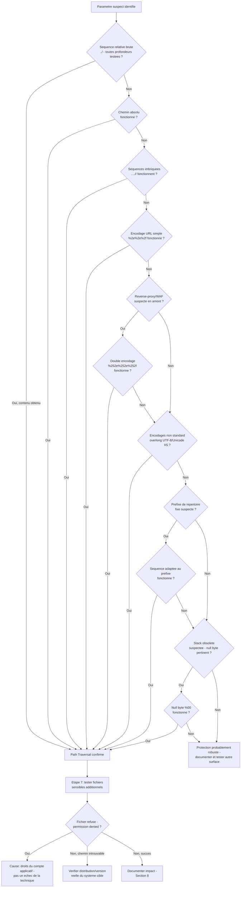

# Path Traversal — Méthodologie d'exploitation

!!! warning "Cadre légal"
    À utiliser exclusivement en laboratoire, CTF, ou test d'intrusion couvert par une autorisation écrite.

## 1. Objectif et périmètre de la méthodologie

L'objectif de cette fiche est de démontrer qu'un paramètre utilisateur transmis à une fonction d'entrée/sortie du système de fichiers permet de sortir du répertoire prévu (`document root` ou répertoire de base applicatif) pour lire — voire, selon le contexte, écrire — des fichiers arbitraires.

Le comportement de sécurité à démontrer : une entrée contrôlée par l'attaquant influence la résolution d'un chemin de fichier côté serveur sans validation suffisante portant sur le chemin final canonisé.

**Variantes couvertes par cette fiche :**

- Lecture arbitraire de fichiers (chemins relatifs, chemins absolus, séquences imbriquées, encodages simples/doubles, encodages non standard).
- Contournement d'un préfixe de répertoire imposé et d'un suffixe d'extension imposé (y compris null byte, technique historique).

**Non couvert par cette fiche** (absent du cours source, à traiter séparément si pertinent) : l'escalade d'une lecture de fichier confirmée vers une exécution de code (inclusion dynamique `include()`/`require()`, wrappers PHP, log/session poisoning, RFI) — le cours mentionne le terme *Local File Inclusion* uniquement comme distinction terminologique et évoque le log poisoning comme vecteur de RCE sans en détailler la méthodologie ; cette escalade relève d'une fiche LFI/RFI dédiée. L'écriture arbitraire de fichiers n'est mentionnée dans le cours que comme impact possible, sans mécanisme ni technique associée — à traiter comme hypothèse à vérifier au cas par cas, non comme une technique disponible ici.

### Principe de raisonnement

La démarche progresse par niveaux de sophistication croissante du payload, et non par hasard : on commence par la séquence la plus simple (`../` brute), on ne passe à une technique de contournement (imbrication, encodage simple, double encodage, encodage non standard) que si la précédente échoue, et on vérifie à chaque niveau si l'échec provient d'une absence totale de traitement du paramètre (à investiguer ailleurs) ou d'un filtre actif mais contournable (à approfondir sur place). Chaque test doit être interprété à la lumière de l'architecture probable (serveur applicatif direct, ou reverse-proxy/WAF en amont), car certaines techniques (double encodage notamment) ne sont pertinentes que dans un scénario architectural précis.

---

## 2. Conditions préalables et état de référence

### 2.1. Prérequis techniques

**Indispensables :**

- Un paramètre, un champ ou un en-tête dont la valeur est utilisée côté serveur pour construire un chemin de fichier transmis à une fonction d'E/S système, sans validation suffisante du chemin final.

**Fréquents mais non systématiques :**

- Un nom de paramètre évocateur (`file`, `page`, `include`, `template`, `path`, `doc`, `folder`, `download`, `lang`, `locale`) — indice utile mais non garanti ; un nom neutre peut tout autant être vulnérable.
- Un répertoire de base fixe concaténé avant le paramètre (préfixe imposé) — fréquent dans les fonctionnalités de chargement de ressources (images, documents), mais à vérifier au cas par cas plutôt qu'à présumer.
- Une extension forcée ajoutée après le paramètre (suffixe imposé) — pertinent uniquement si l'application semble restreindre le type de fichier accessible.

**À vérifier sur la cible, non supposés à l'avance :**

- Le système d'exploitation sous-jacent (Linux/Windows), qui conditionne le séparateur de chemin (`/` uniquement sous Linux, `/` et `\` tous deux valides sous Windows) et les fichiers cibles pertinents.
- La présence d'un reverse-proxy ou d'un WAF en amont de l'application, condition déterminante pour la pertinence du double encodage (section 5.4 du cours : efficace uniquement si un composant décode une fois avant transmission, et que l'application décode une seconde fois).
- La version et la stack du composant applicatif, qui conditionnent la pertinence résiduelle du null byte (corrigé en PHP ≥ 5.3.4 et dans les runtimes managés modernes — technique à ne tester que sur des stacks dont l'obsolescence est suspectée).

### 2.2. Établir le comportement normal

Avant tout test, observer le fonctionnement légitime du paramètre suspecté :

- **Requête initiale** : valeur légitime acceptée par le paramètre (ex. `?filename=2018.png`), conservée telle quelle.
- **Code de réponse et contenu retourné** pour cette valeur légitime.
- **Comportement sur une valeur invalide mais non malveillante** (ex. `?filename=inexistant.png`) : code de réponse (404 généralement attendu), message d'erreur éventuel — cette référence sert à distinguer, plus tard, un fichier réellement absent au chemin résolu d'un filtre actif bloquant la requête.
- **En-têtes et contexte de la réponse** : `Content-Type` retourné pour la ressource légitime, utile pour distinguer un contenu de fichier système (texte brut) d'un contenu habituel (image binaire, par exemple).

Cette référence est nécessaire pour ne pas confondre une erreur générique (fichier absent, paramètre mal formé) avec un comportement spécifiquement provoqué par l'injection d'une séquence de traversée.

---

## 3. Reconnaissance : où rechercher la vulnérabilité ?

### 3.1. Surfaces de test

| Élément à examiner | Pourquoi cette surface est pertinente | Contrôle disponible | Observation initiale | Hypothèse de vulnérabilité | Premier test |
|---|---|---|---|---|---|
| Paramètres `?file=`, `?page=`, `?include=`, `?template=`, `?path=`, `?doc=`, `?folder=`, `?download=` | Noms évocateurs d'une opération de lecture de fichier côté serveur | Valeur du paramètre | Valeur par défaut (nom de fichier ou chemin relatif) | Le paramètre est concaténé directement à un chemin de base sans validation du chemin final | Injecter `../../../../etc/passwd` (ou l'équivalent Windows) et observer la réponse |
| Paramètres `?lang=`, `?locale=` | Souvent utilisés pour charger un fichier de traduction/template depuis un répertoire par nom de langue, mécanisme de concaténation similaire | Valeur du paramètre | Comportement pour une langue légitime (ex. `fr`, `en`) | Le nom de langue est utilisé pour construire un chemin de fichier sans restriction à une liste de valeurs autorisées | Remplacer la valeur par une séquence de traversée vers un fichier cible connu |
| Fonctionnalité de chargement de ressource statique (image, document, pièce jointe) avec mappage vers un répertoire fixe | Cas d'usage applicatif classique décrit par le cours (`/loadImage?filename=`), où un préfixe de répertoire est généralement concaténé | Nom ou chemin du fichier demandé | Fichier attendu correctement servi, `Content-Type` cohérent | Absence de canonisation du chemin final malgré un préfixe de répertoire fixe | Tester un chemin absolu (section 5.1) et une séquence relative en complément du préfixe supposé (section 5.7) |

Aucune de ces surfaces n'est nécessairement vulnérable : chacune mérite d'être testée car elle correspond à un point où une entrée utilisateur rencontre une résolution de chemin de fichier, ce qui est le mécanisme commun à cette vulnérabilité.

### 3.2. Indices et faux positifs

**Observations qui peuvent suggérer la vulnérabilité :**

- Le contenu d'un fichier cible connu (ex. `root:` pour `/etc/passwd`, section `[fonts]` pour `win.ini`) apparaît dans la réponse.
- Un code de réponse différent entre une valeur de paramètre légitime, une valeur invalide anodine, et une valeur contenant une séquence de traversée.
- Un `Content-Type` de réponse incohérent avec celui attendu pour la ressource normalement servie (ex. texte brut retourné là où une image était attendue).

**Observations qui ne suffisent pas à confirmer la vulnérabilité :**

- Un code 500 générique : peut indiquer une erreur applicative sans lien avec la résolution de chemin.
- L'absence d'erreur visible avec un payload simple (`../`) : ne prouve pas l'absence de vulnérabilité si un filtre actif bloque spécifiquement cette forme sans bloquer ses variantes (section 5).
- Une erreur 404 après un seul test de profondeur de remontée : peut simplement indiquer une profondeur insuffisante, pas une absence de vulnérabilité (cf. note du cours sur le sur-remontage sans risque).

**Comportements normaux susceptibles d'être confondus avec la faille :**

- Une page d'erreur 404 personnalisée identique quelle que soit la cause réelle (fichier absent vs chemin bloqué par un filtre), masquant la distinction entre les deux cas.
- Une validation apparente sur `../` qui ne bloque en réalité qu'une seule occurrence non récursive, produisant un comportement normal en apparence pour un payload simple tout en restant vulnérable aux séquences imbriquées (section 5.2).

**Vérifications complémentaires nécessaires :**

- Toujours faire varier la profondeur de remontée (`../` répété de 1 à 8-12 fois) avant de conclure à un échec, le sur-remontage au-delà de la racine réelle ne provoquant pas d'erreur selon le cours.
- Tester systématiquement plusieurs familles d'encodage (section 5) avant de conclure à l'absence de vulnérabilité sur un paramètre suspecté, un filtre pouvant bloquer une forme et laisser passer une autre.

---

## 4. Séquence de tests : démarche pas à pas

### Étape 1 — Confirmation de la traversée par séquence relative brute

**Objectif**

Vérifier qu'une séquence de traversée simple modifie effectivement le fichier résolu par le serveur.

**Prérequis**

Un paramètre identifié en section 3.1 dont la valeur ressemble à un chemin ou un nom de fichier.

**Hypothèse**

Le paramètre est concaténé à un chemin de base sans validation du chemin final, permettant de sortir du répertoire prévu.

**Action à effectuer**

```bash
# Linux
curl "http://cible.com/page.php?file=../../../../etc/passwd"

# Windows
curl "http://cible.com/page.php?file=..\..\..\..\windows\win.ini"
```

Si le résultat est négatif, faire varier systématiquement la profondeur de remontée avant de conclure, le sur-remontage au-delà de la racine ne provoquant pas d'erreur :

```bash
for i in 1 2 3 4 5 6 7 8; do
  curl -s "http://cible.com/page.php?file=$(printf '../%.0s' $(seq 1 $i))etc/passwd" | grep -q "root:" && echo "Profondeur $i : succès"
done
```

**Observations à examiner**

Code de réponse HTTP, présence de contenu caractéristique du fichier cible (`root:` pour `/etc/passwd`, section `[fonts]` pour `win.ini`), `Content-Type` de la réponse.

**Résultat positif**

Le contenu du fichier cible apparaît dans la réponse, à une profondeur de remontée donnée : Path Traversal confirmé par séquence relative brute.

**Résultat négatif ou ambigu**

- Aucune profondeur testée ne produit le contenu attendu : le paramètre peut ne pas être utilisé pour une opération de fichier, ou un filtre bloque spécifiquement cette forme.
- Erreur différente de la référence sans contenu du fichier cible : signal ambigu à approfondir avec les techniques de contournement (étapes 2 à 6).

**Interprétation**

Seule la présence du contenu attendu du fichier cible constitue une preuve. Un échec à toutes les profondeurs testées ne permet pas de conclure sans avoir testé les variantes de contournement, un filtre naïf pouvant bloquer précisément cette forme simple.

**Étape suivante**

Si positif → passer à l'étape 7 (exploration des fichiers sensibles additionnels) ou documenter l'impact (section 8). Si négatif ou ambigu → étape 2 (chemin absolu).

**Erreurs fréquentes**

Conclure à l'absence de vulnérabilité après avoir testé une seule profondeur de remontée sans faire varier le nombre de `../` ; ne tester qu'un seul OS cible sans envisager l'autre en l'absence de certitude sur la stack.

---

### Étape 2 — Chemin absolu

**Objectif**

Vérifier si l'application accepte un chemin absolu en remplacement complet de la valeur attendue, contournant un filtre limité à la suppression des séquences relatives.

**Prérequis**

L'étape 1 a échoué ou reste ambiguë. Pertinent en particulier si le cours suppose un filtre naïf de type `str_replace("../", "")`, qui ne traite que les séquences relatives et ignore un chemin absolu fourni directement.

**Hypothèse**

L'application ne valide pas que le chemin fourni reste relatif à son répertoire de base, acceptant un chemin absolu tel quel.

**Action à effectuer**

```http
GET /loadImage?filename=/etc/passwd HTTP/1.1
```

**Observations à examiner**

Code de réponse, présence du contenu du fichier cible.

**Résultat positif**

Le contenu du fichier cible apparaît : confirme que l'application ne restreint pas l'entrée à un chemin relatif, indépendamment du traitement appliqué aux séquences `../`.

**Résultat négatif ou ambigu**

Aucun contenu retourné : soit un préfixe de répertoire est systématiquement concaténé avant le paramètre (auquel cas un chemin absolu seul ne suffit pas et il faut tester l'étape 6, préfixe imposé), soit une validation de format est en place.

**Interprétation**

Un échec à cette étape, combiné à un succès potentiel à l'étape 6 (contournement de préfixe par séquence relative après le préfixe), permet de déduire la présence d'un préfixe de répertoire fixe dans la construction du chemin côté serveur.

**Étape suivante**

Si positif → étape 7. Si négatif → étape 3 (séquences imbriquées).

**Erreurs fréquentes**

Conclure à l'absence totale de vulnérabilité après l'échec du chemin absolu seul, sans tester sa combinaison avec un préfixe supposé (étape 6).

---

### Étape 3 — Séquences imbriquées (suffixes absorbés)

**Objectif**

Contourner un filtre non récursif qui supprime une seule occurrence de `../` dans la chaîne.

**Prérequis**

Les étapes 1 et 2 ont échoué ou restent ambiguës, avec un indice qu'un filtre actif bloque spécifiquement la séquence simple (comportement différent de la référence sans toutefois révéler le fichier cible).

**Hypothèse**

Le filtre applique un remplacement du type `str_replace("../", "")` sans répétition, laissant une séquence de traversée valide après suppression d'une occurrence imbriquée.

**Action à effectuer**

```text
....//....//....//etc/passwd
....\/\....\/
..././..././etc/passwd
```

```bash
curl "http://cible.com/page.php?file=....//....//....//etc/passwd"
```

**Observations à examiner**

Présence du contenu du fichier cible.

**Résultat positif**

Le contenu du fichier cible apparaît : confirme un filtre non récursif contournable par imbrication.

**Résultat négatif ou ambigu**

Aucune variante imbriquée ne produit le contenu attendu : le filtre peut être récursif, ou ne pas cibler spécifiquement `../` de cette manière.

**Interprétation**

Un succès à cette étape après échec de l'étape 1 est une preuve directe que l'application filtre activement `../` mais de façon non récursive — information utile pour orienter le reste du test (les filtres basés sur un remplacement simple sont souvent contournables par plusieurs méthodes).

**Étape suivante**

Si positif → étape 7. Si négatif → étape 4 (encodage URL simple).

**Erreurs fréquentes**

Ne tester qu'une seule des trois variantes d'imbrication présentées, alors que l'implémentation exacte du filtre peut réagir différemment selon la forme testée.

---

### Étape 4 — Encodage URL simple

**Objectif**

Contourner un filtre qui compare la chaîne décodée du paramètre à des motifs littéraux (`../`) sans tenir compte d'un encodage URL appliqué par le client.

**Prérequis**

Les étapes précédentes ont échoué. Pertinent si le filtre semble comparer des chaînes littérales plutôt que d'effectuer une analyse structurelle du chemin.

**Hypothèse**

Le filtre applicatif s'exécute sur la chaîne brute reçue avant un décodage effectué plus tard par une couche différente (ou inversement), créant un décalage exploitable.

**Action à effectuer**

```http
GET /loadImage?filename=..%2f..%2f..%2fetc%2fpasswd HTTP/1.1
```

Variante Windows : `%2e%2e%5c` pour `..\`.

**Observations à examiner**

Présence du contenu du fichier cible.

**Résultat positif**

Le contenu du fichier cible apparaît : confirme que le filtre ne tient pas compte de la forme encodée de la séquence de traversée.

**Résultat négatif ou ambigu**

Aucun contenu retourné : le framework ou le serveur web décode probablement automatiquement le paramètre avant que le filtre applicatif ne s'exécute, rendant cette forme équivalente à la séquence brute déjà testée (étape 1) — passer au double encodage (étape 5), pertinent uniquement si un composant intermédiaire (reverse-proxy/WAF) est présent.

**Interprétation**

Un échec ici ne signifie pas nécessairement que le filtre est robuste à tout encodage : il peut simplement indiquer que l'encodage simple est déjà neutralisé par un décodage automatique en amont du filtre, ce qui est un comportement différent d'un filtre réellement conçu pour détecter les formes encodées.

**Étape suivante**

Si positif → étape 7. Si négatif → vérifier la présence d'un reverse-proxy/WAF (section 2.1) puis étape 5 si pertinent, sinon étape 6 (préfixe/suffixe imposé) ou étape 2bis.

**Erreurs fréquentes**

Tester le double encodage sans avoir d'abord vérifié la plausibilité d'un composant intermédiaire décodant une fois la requête, rendant le test moins ciblé qu'il ne pourrait l'être.

---

### Étape 5 — Double encodage URL

**Objectif**

Contourner un filtre ou un WAF qui décode une seule fois la requête avant transmission à l'application, qui effectue un second décodage.

**Prérequis**

Un reverse-proxy ou un WAF est suspecté en amont de l'application (section 2.1). Les étapes précédentes ont échoué.

**Hypothèse**

Le composant intermédiaire décode une fois la séquence doublement encodée (révélant une forme simplement encodée, jugée inoffensive par ses règles), puis transmet cette forme à l'application qui la décode une seconde fois en séquence de traversée active.

**Action à effectuer**

```bash
curl "http://cible.com/page.php?file=..%252f..%252f..%252fetc%252fpasswd"
```

Variante Windows : `%252e%252e%255c` pour `..\`.

**Observations à examiner**

Présence du contenu du fichier cible.

**Résultat positif**

Le contenu du fichier cible apparaît : confirme un décalage de décodage entre un composant intermédiaire et l'application, typique d'un WAF ne normalisant pas récursivement l'URL avant application de ses règles.

**Résultat négatif ou ambigu**

Aucun contenu retourné : soit aucun composant intermédiaire n'effectue de décodage partiel, soit le WAF normalise correctement de façon récursive avant filtrage (bonne pratique signalée par le cours) — passer à l'étape 6 ou 2bis (encodages non standard).

**Interprétation**

Un succès à cette étape est un indice fort de l'architecture réseau de la cible (présence d'un composant de décodage intermédiaire), information réutilisable pour d'autres classes de vulnérabilités au-delà du Path Traversal.

**Étape suivante**

Si positif → étape 7. Si négatif → étape 2bis (encodages non standard : overlong UTF-8, Unicode IIS).

**Erreurs fréquentes**

Appliquer le double encodage sans vérifier au préalable qu'un composant intermédiaire est réellement présent, ce qui rend le test moins interprétable en cas d'échec (absence de composant vs normalisation correcte, deux causes très différentes).

---

### Étape 2bis — Encodages non standard (overlong UTF-8, Unicode IIS)

**Objectif**

Contourner un filtre reposant sur une implémentation de décodage spécifique, vulnérable à des représentations non standard de caractères.

**Prérequis**

Les étapes 1 à 5 ont échoué. Pertinent en particulier si la stack technique suggère un serveur IIS (pour l'encodage Unicode 16-bit) ou un composant avec une implémentation UTF-8 non stricte.

**Hypothèse**

Le composant de décodage accepte des représentations multi-octets invalides (overlong) ou un encodage Unicode non standard comme équivalentes aux caractères ASCII qu'elles représentent, alors que le filtre de sécurité ne les reconnaît pas comme telles.

**Action à effectuer**

```text
# Overlong UTF-8
..%c0%af
%c0%ae%c0%ae%c0%af

# Encodage Unicode / IIS (16-bit)
..%u2215
..%u2200
..%u002f
%u002e%u002e%u002f
```

**Observations à examiner**

Présence du contenu du fichier cible.

**Résultat positif**

Le contenu du fichier cible apparaît : confirme une implémentation de décodage non conforme (overlong UTF-8) ou un support d'un encodage Unicode historique non filtré.

**Résultat négatif ou ambigu**

Aucune variante ne produit le contenu attendu : ces techniques sont qualifiées d'historiques par le cours (pertinentes contre certaines versions anciennes d'IIS notamment) et peuvent simplement ne pas s'appliquer à la stack moderne de la cible — ne pas s'acharner sur cette voie, passer à l'étape 6.

**Interprétation**

L'échec de ces techniques sur une stack moderne ne doit pas être interprété comme une faiblesse du raisonnement : le cours les qualifie explicitement de pertinence historique limitée.

**Étape suivante**

Si positif → étape 7. Si négatif → étape 6 (préfixe/suffixe imposé).

**Erreurs fréquentes**

Généraliser l'échec de ces techniques spécifiques à IIS/UTF-8 non strict à une conclusion sur l'absence de vulnérabilité, alors que leur pertinence est intrinsèquement limitée à certains environnements précis.

---

### Étape 6 — Préfixe et suffixe imposés

**Objectif**

Vérifier si l'application concatène un répertoire de base fixe avant le paramètre et/ou une extension fixe après, nécessitant d'adapter le payload en conséquence.

**Prérequis**

Les étapes précédentes ont échoué malgré un indice que le paramètre est utilisé pour une opération de fichier (ex. erreur différente de la référence, comportement cohérent avec une fonctionnalité de chargement de ressource).

**Hypothèse**

Le chemin final résolu par le serveur est de la forme `<préfixe fixe><valeur du paramètre><suffixe fixe>`, et la séquence de traversée doit être placée de façon à neutraliser ce préfixe et ce suffixe.

**Action à effectuer**

*Contournement de préfixe* — faire suivre le paramètre d'une séquence de traversée après une valeur neutre, ou directement par une séquence suffisante pour remonter au-delà du préfixe fixe supposé :

```text
filename=/var/www/images/../../../etc/passwd
```

*Contournement de suffixe (null byte)* — pertinent uniquement si la stack est suspectée obsolète (PHP < 5.3.4 ou composant natif non maintenu) :

```text
filename=../../../etc/passwd%00.png
```

**Observations à examiner**

Présence du contenu du fichier cible ; pour le null byte, toute différence de comportement par rapport à un payload sans le byte nul.

**Résultat positif**

*Préfixe* : le contenu du fichier cible apparaît une fois la séquence adaptée au préfixe supposé — confirme la présence d'un répertoire de base fixe contournable par traversée suffisante.

*Null byte* : le contenu du fichier cible apparaît malgré le suffixe `.png` attendu — confirme une troncature de chaîne par l'appel système sous-jacent, indicateur fort d'une stack obsolète.

**Résultat négatif ou ambigu**

- Pour le préfixe : aucune combinaison ne fonctionne — le préfixe peut ne pas exister, ou une canonisation correcte est appliquée après résolution complète du chemin (contrôle recommandé par le cours, section 7).
- Pour le null byte : absence d'effet quasi certaine sur une stack moderne (technique corrigée depuis PHP 5.3.4 et absente des runtimes managés actuels) — un résultat négatif ici ne doit pas être interprété comme un échec de la méthodologie, mais comme attendu dans la majorité des contextes actuels.

**Interprétation**

Le null byte est une technique à faible taux de succès attendu sur une cible moderne : son test reste pertinent par exhaustivité mais ne doit pas être priorisé avant les techniques des étapes 1 à 2bis sur une stack récente.

**Étape suivante**

Si positif (préfixe ou null byte) → étape 7. Si négatif sur l'ensemble des étapes 1 à 6 → documenter une protection probablement robuste (validation par liste blanche ou canonisation correcte, section 7 du cours) et orienter vers d'autres surfaces identifiées en 3.1.

**Erreurs fréquentes**

Tester le null byte en priorité avant les techniques plus génériquement efficaces (imbrication, encodage) ; ne pas faire varier la position de la séquence de traversée par rapport au préfixe supposé.

---

### Étape 7 — Exploration des fichiers sensibles et qualification de l'impact

**Objectif**

Une fois une forme de payload fonctionnelle confirmée, évaluer l'étendue réelle de l'impact en testant l'accès à plusieurs fichiers cibles pertinents selon l'OS identifié.

**Prérequis**

Au moins une technique des étapes 1 à 6 a permis d'obtenir le contenu d'un premier fichier cible.

**Hypothèse**

Le payload fonctionnel pour un fichier donné reste valide pour d'autres chemins du même système, sous réserve des droits de lecture du compte applicatif.

**Action à effectuer**

Réutiliser la forme de payload validée en substituant la cible, par exemple pour Linux :

```text
/etc/shadow
/etc/issue
/etc/hosts
/proc/self/environ
/proc/self/cmdline
/var/log/auth.log
/var/www/html/.env
~/.ssh/id_rsa
/var/log/apache2/access.log
```

ou pour Windows :

```text
C:\Windows\System32\drivers\etc\hosts
C:\inetpub\wwwroot\web.config
C:\Windows\repair\SAM
C:\Users\<user>\NTUSER.DAT
C:\xampp\apache\logs\access.log
```

**Observations à examiner**

Code de réponse et contenu pour chaque cible testée ; messages d'erreur de type « permission denied » distincts d'une erreur de chemin introuvable.

**Résultat positif**

Un ou plusieurs fichiers sensibles sont lus avec succès : qualifier précisément la nature de chaque fuite (secrets d'application pour `.env`, variables d'environnement pour `/proc/self/environ`, clé privée pour `id_rsa`, etc.).

**Résultat négatif ou ambigu**

- « Permission denied » sur un fichier précis (ex. `/etc/shadow`) alors que d'autres fichiers sont lisibles : indique une restriction de droits du compte applicatif sur ce fichier précis, pas un échec de la technique de traversée elle-même.
- Fichier introuvable alors que le chemin devrait exister : vérifier l'orthographe exacte et la distribution/version réelle du système cible (certains chemins de logs varient selon la distribution).

**Interprétation**

Distinguer explicitement un échec dû aux droits du compte applicatif (le Path Traversal fonctionne mais l'accès à ce fichier précis est refusé par le système) d'un échec dû au chemin lui-même, ces deux cas appelant des conclusions différentes sur la portée de l'impact.

**Étape suivante**

Documenter l'ensemble des fichiers effectivement accessibles et leur sensibilité (section 8). Si un fichier de log accessible en lecture est confirmé → évaluer la pertinence d'une escalade vers le log poisoning, hors périmètre détaillé de cette fiche (à traiter via une méthodologie LFI/RFI dédiée).

**Erreurs fréquentes**

S'arrêter après le premier fichier confirmé sans évaluer l'étendue réelle de l'impact sur les autres cibles pertinentes ; confondre un refus de permission avec un échec de la vulnérabilité elle-même.

---

## 5. Arbre de décision : que faire selon le résultat ?



---

## 6. Construire la chaîne d'exploitation

1. **Point d'entrée** : paramètre contrôlant un chemin de fichier résolu côté serveur (section 3.1).
2. **Primitive technique** : forme de payload confirmée comme contournant effectivement la validation en place (séquence brute, imbrication, encodage simple/double, encodage non standard, adaptation au préfixe/suffixe — sections 4, étapes 1 à 6).
3. **Déclenchement** : requête HTTP transmettant ce payload vers le paramètre vulnérable.
4. **Effet intermédiaire** : résolution par le serveur d'un chemin hors du répertoire prévu, avec lecture effective d'un premier fichier cible de test.
5. **Aboutissement** : extension de la lecture à l'ensemble des fichiers sensibles accessibles compte tenu des droits du compte applicatif (étape 7).
6. **Preuve** : contenu caractéristique et vérifiable des fichiers lus, non explicable par un comportement applicatif normal.

| Étape | Résultat requis | Comment le vérifier | Si cela échoue |
|---|---|---|---|
| Point d'entrée | Paramètre confirmé comme lié à une résolution de chemin de fichier | Comportement différent de la référence sur une entrée de test | Tester une autre surface identifiée en 3.1 |
| Primitive technique | Une forme de payload parmi les étapes 1 à 6 produit le contenu d'un fichier cible | Comparaison systématique des réponses à chaque forme testée | Progresser dans l'ordre des étapes 1 à 6 sans sauter de niveau |
| Déclenchement | Requête reproductible produisant systématiquement le même résultat | Répéter la requête et confirmer la constance du résultat | Vérifier la stabilité du comportement serveur (cache, variation de charge) |
| Effet intermédiaire | Contenu du premier fichier cible confirmé et vérifiable | Présence d'un motif caractéristique (`root:`, `[fonts]`) | Revenir au diagnostic (section 7) pour identifier l'étape bloquante |
| Aboutissement | Étendue de l'impact qualifiée sur plusieurs fichiers pertinents | Test systématique de la liste de fichiers sensibles (étape 7) | Documenter les refus par permission séparément des échecs de chemin |
| Preuve | Preuve reproductible et minimale de l'impact | Capture de la requête et de la réponse pour chaque fichier confirmé | Documenter le niveau de preuve atteint (lecture isolée vs impact étendu qualifié) |

---

## 7. Diagnostic des échecs

| Symptôme observé | Causes possibles | Comment les distinguer | Test de diagnostic | Suite logique |
|---|---|---|---|---|
| Aucune différence entre requête de référence et requête avec `../` à toutes les profondeurs testées | Paramètre non utilisé pour un chemin de fichier ; ou filtre robuste bloquant toute séquence relative | Tester le chemin absolu (étape 2) et l'imbrication (étape 3) avant de conclure | Progresser dans les étapes 2 à 6 avant d'abandonner cette surface | Si toutes échouent, tester une autre surface (3.1) |
| Erreur 404 systématique quelle que soit la profondeur | Profondeur insuffisante pour atteindre la racine réelle, ou chemin cible incorrect pour l'OS supposé | Augmenter la profondeur jusqu'à 10-12 remontées avant de conclure, selon la note du cours sur le sur-remontage sans risque | Tester explicitement les deux formes de séparateur (`/` et `\`) si l'OS n'est pas confirmé | Si l'erreur persiste sur une profondeur suffisante et les deux OS, orienter vers un filtre actif (étape 3 et suivantes) |
| Séquence encodée simple sans effet alors que la séquence brute échouait également | Décodage automatique en amont du filtre applicatif, rendant la forme encodée équivalente à la forme brute déjà testée | Comparer précisément le comportement entre la forme brute et la forme encodée simple | Vérifier si un en-tête ou un comportement de réponse révèle un décodage effectué par un framework/serveur web en amont | Passer directement au double encodage ou aux encodages non standard plutôt que de répéter l'encodage simple sous d'autres formes |
| Double encodage sans effet | Absence de composant intermédiaire effectuant un décodage partiel, ou normalisation récursive correcte en amont | Vérifier la plausibilité d'un reverse-proxy/WAF (en-têtes, comportement observé par ailleurs dans l'audit) | Rechercher des indices d'infrastructure (en-têtes `Via`, `X-Forwarded-*`, temps de réponse) avant de conclure | Si aucun indice de composant intermédiaire, ne pas insister sur cette voie et passer aux encodages non standard |
| Fichier cible confirmé accessible mais un fichier précis (ex. `/etc/shadow`) retourne une erreur | Droits de lecture insuffisants du compte applicatif sur ce fichier précis, cause distincte d'un échec de la technique de traversée | Comparer avec le succès obtenu sur un autre fichier via le même payload | Tester plusieurs fichiers de sensibilité différente avec le même payload validé | Documenter comme limite de droits du compte applicatif, pas comme échec de la vulnérabilité |
| Payload fonctionnel pour un fichier mais pas pour un autre chemin de même sensibilité apparente | Chemin réellement incorrect pour la distribution/version du système cible | Vérifier l'existence du chemin par des sources indépendantes (documentation de la distribution supposée) | Tester des variantes de chemin connues pour différer selon la distribution (ex. emplacement des logs Apache selon la distribution Linux) | Ajuster le chemin plutôt que d'abandonner la cible |

**Principe de diagnostic** : avant de remplacer une technique par une autre, vérifier à quelle étape précise (profondeur de remontée, forme d'encodage, prise en compte du préfixe/suffixe) le comportement attendu cesse de se produire, plutôt que de supposer une cause globale d'échec.

---

## 8. Vérification de l'exploitation et preuve de l'impact

**Résultat final attendu** : lecture confirmée et reproductible du contenu d'au moins un fichier système ou applicatif sensible, en dehors du répertoire prévu par l'application.

**Éléments techniques de confirmation :**

- Présence d'un motif caractéristique et non ambigu du fichier ciblé (ex. `root:x:0:0:` pour `/etc/passwd`, section `[fonts]` pour `win.ini`, structure de clé privée `-----BEGIN ... PRIVATE KEY-----` pour `id_rsa`).
- Reproductibilité de la lecture sur plusieurs tentatives avec le même payload.
- Cohérence du contenu lu avec le système d'exploitation et la stack supposés (ex. format d'un fichier `.env` cohérent avec un framework PHP identifié par ailleurs).

**Contrôles pour exclure une explication alternative :**

- Vérifier que le contenu retourné n'est pas un contenu statique ou une page d'erreur générique ressemblant par coïncidence au format attendu.
- Confirmer que le fichier correspond réellement à la cible demandée en testant un second fichier cible dont le contenu attendu est distinct, pour écarter une réponse constante indépendante du paramètre.

**Distinction entre niveaux de preuve :**

- **Preuve de comportement anormal** : une différence de réponse est observée entre un payload de traversée et la référence, sans contenu de fichier identifiable — signal, pas une preuve.
- **Preuve de vulnérabilité confirmée** : le contenu d'au moins un fichier cible de test est obtenu de façon reproductible.
- **Preuve d'impact étendu** : plusieurs fichiers sensibles pertinents (secrets applicatifs, clés, journaux) sont effectivement accessibles, qualifiant la portée réelle de la fuite au-delà d'un simple fichier de démonstration.

**Limites des observations :**

- Le cours ne fournit pas de méthode pour l'écriture arbitraire de fichiers au-delà de la mention de cet impact comme possible « dans certains cas » : toute conclusion sur une écriture arbitraire sortirait du périmètre couvert par cette fiche et nécessiterait une vérification spécifique de mécanismes non décrits ici.
- La preuve doit rester minimale et proportionnée : la lecture d'un fichier de test standard (`/etc/passwd`, `win.ini`) suffit à démontrer la vulnérabilité ; l'accès à des fichiers réellement sensibles (clés privées, `.env`) ne doit être tenté et documenté que dans les limites explicitement autorisées par le périmètre du test.

---

## 9. Checklist opérationnelle

**Prérequis**

- [ ] OS cible identifié ou à défaut les deux familles de séparateurs testées (`/` et `\`).
- [ ] Présence probable d'un préfixe de répertoire fixe et/ou d'un suffixe d'extension imposé évaluée.
- [ ] Présence éventuelle d'un reverse-proxy/WAF en amont évaluée (pertinence du double encodage).

**Reconnaissance**

- [ ] Paramètres à nom évocateur (`file`, `page`, `include`, `template`, `path`, `doc`, `folder`, `download`, `lang`, `locale`) recensés.
- [ ] Comportement de référence établi (valeur légitime, valeur invalide anodine) pour chaque paramètre suspecté.

**Premiers tests**

- [ ] Séquence relative brute testée avec variation de profondeur (1 à 8-12 remontées).
- [ ] Chemin absolu testé.

**Validation des hypothèses**

- [ ] Séquences imbriquées testées (`....//`, variantes).
- [ ] Encodage URL simple testé.
- [ ] Double encodage testé si un composant intermédiaire est suspecté.
- [ ] Encodages non standard (overlong UTF-8, Unicode IIS) testés si pertinents pour la stack supposée.
- [ ] Contournement de préfixe testé si un répertoire de base fixe est suspecté.
- [ ] Null byte testé uniquement si une stack obsolète est suspectée, sans priorité excessive sur cette technique.

**Construction de l'exploitation**

- [ ] Payload fonctionnel identifié et documenté précisément (forme exacte, profondeur, encodage utilisé).
- [ ] Étendue de l'impact testée sur plusieurs fichiers sensibles pertinents selon l'OS identifié.

**Vérification de l'impact**

- [ ] Contenu de chaque fichier confirmé comparé à un motif caractéristique non ambigu.
- [ ] Reproductibilité du payload fonctionnel vérifiée.
- [ ] Niveau de preuve atteint explicitement qualifié (comportement anormal / vulnérabilité confirmée / impact étendu qualifié).

**Diagnostic si l'exploitation échoue**

- [ ] Étape précise d'échec identifiée (profondeur, encodage, préfixe/suffixe, droits de lecture).
- [ ] Cause distinguée entre échec de la technique et restriction de droits sur un fichier précis.

---

## 10. Leçons transférables

**Principes de raisonnement réutilisables sur d'autres vulnérabilités :**

- Progresser par niveaux de sophistication croissante (forme brute, puis contournements successifs) plutôt que de tester toutes les techniques dans le désordre, pour mieux interpréter chaque échec.
- Distinguer explicitement un échec dû à l'absence de vulnérabilité d'un échec dû à une cause externe (droits insuffisants, profondeur insuffisante, architecture réseau non prise en compte).
- Ne jamais conclure à l'absence de vulnérabilité après un seul test : faire varier systématiquement la profondeur, l'encodage et le contexte avant de documenter une protection comme robuste.
- Relier chaque technique de contournement à l'hypothèse précise de filtre qu'elle cible (naïf non récursif, comparaison littérale pré-décodage, décodage partiel en amont), pour choisir la technique suivante de façon raisonnée plutôt qu'exhaustive et non ciblée.

**Mécanismes techniques propres à cette vulnérabilité, à ne pas généraliser :**

- Le double encodage n'est pertinent que dans une architecture précise (décodage partiel par un composant intermédiaire) et ne doit pas être testé en priorité sans indice de cette architecture.
- Les encodages overlong UTF-8 et Unicode IIS sont qualifiés d'historiques par le cours et concernent des implémentations de décodage spécifiques, non universelles.
- Le null byte est corrigé depuis PHP 5.3.4 et absent des runtimes managés modernes : sa pertinence est résiduelle et ne doit pas être présumée.

**Hypothèses les plus faciles à confondre avec des certitudes :**

- Un échec de la séquence relative brute ne garantit pas l'absence de vulnérabilité : un filtre actif mais contournable produit le même symptôme apparent qu'une absence totale de vulnérabilité.
- Une erreur « fichier introuvable » ne garantit pas que le chemin est incorrect : elle peut aussi résulter d'une profondeur de remontée insuffisante.
- Un refus sur un fichier précis (ex. `/etc/shadow`) ne garantit pas l'échec de la technique de traversée elle-même : il peut s'agir d'une restriction de droits du compte applicatif, la vulnérabilité restant exploitable sur d'autres fichiers.

**Compétences pratiques à maîtriser pour exploiter cette vulnérabilité sans aide :**

- Construire et adapter des séquences de traversée selon l'OS, la profondeur réelle et la présence d'un préfixe/suffixe imposé.
- Manipuler les différentes familles d'encodage (URL simple, double, overlong UTF-8, Unicode IIS) et savoir lesquelles tester en priorité selon l'architecture supposée de la cible.
- Diagnostiquer, à partir d'un pattern d'échecs et de succès sur différentes techniques, des informations sur l'architecture de la cible (présence d'un filtre non récursif, d'un composant de décodage intermédiaire, d'un préfixe de répertoire fixe).
- Qualifier précisément l'étendue d'un impact confirmé en testant méthodiquement plusieurs fichiers sensibles plutôt qu'en s'arrêtant au premier succès.
