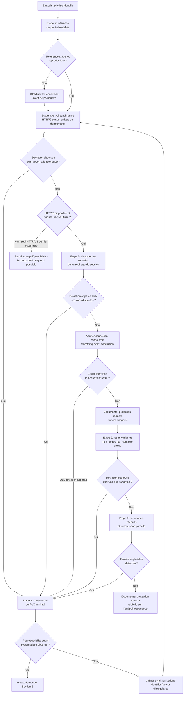

# Race Conditions — Méthodologie d'exploitation

!!! warning "Cadre légal"
    À utiliser exclusivement en laboratoire, CTF, ou test d'intrusion couvert par une autorisation écrite. L'exploitation de race conditions sur un système de production peut générer des effets de bord irréversibles (incohérences financières, corruption de données) ; toute tentative réelle doit rester dans les limites explicitement autorisées du test.

## 1. Objectif et périmètre de la méthodologie

L'objectif de cette fiche est de démontrer qu'une application traite des requêtes concurrentes sans verrouillage adéquat, permettant à un attaquant de provoquer une collision dont le résultat diverge du comportement attendu en exécution séquentielle, et d'en évaluer l'impact métier réel.

Le comportement de sécurité à démontrer : une fenêtre de temps existe entre le moment où le serveur vérifie un état (check) et le moment où il écrit le résultat de cette vérification (update/use), et cette fenêtre est exploitable par l'envoi de requêtes concurrentes synchronisées.

**Variantes couvertes par cette fiche**, qui ciblent des configurations différentes et nécessitent des techniques de synchronisation et des grilles d'analyse distinctes :

- **Limit Overrun** (dépassement de limite) sur un même endpoint : contournement d'un plafond métier (code promo, solde, quota, vote, rate-limiting, OTP/CAPTCHA à usage unique).
- **Race conditions multi-endpoints** : collision entre requêtes envoyées vers des routes différentes partageant un état sous-jacent commun (ex. panier/paiement).
- **Collision endpoint unique, paramètres distincts** : entremêlement de contexte entre threads/workers traitant des requêtes concurrentes de sessions ou comptes différents sur le même endpoint (ex. fuite de jeton entre comptes).
- **Séquences multi-étapes cachées** : exploitation d'une fenêtre entre deux micro-étapes internes d'une séquence applicative apparemment atomique côté client (ex. contournement de MFA).
- **Construction partielle d'objet** : exploitation d'un état transitoire incomplet lors de la création en plusieurs étapes d'un objet applicatif.

**Non couvert par cette fiche** (absent du cours source, à traiter séparément si pertinent) : les race conditions au niveau système d'exploitation ou système de fichiers (TOCTOU classique hors contexte web, ex. symlink race) — le cours se limite explicitement au périmètre web/applicatif ; le détail des mécanismes internes de verrouillage de session propres à des frameworks autres que PHP, mentionné uniquement comme exemple représentatif ; les techniques précises de détection automatisée de ces vulnérabilités en dehors de Burp Suite/Turbo Intruder.

### Principe de raisonnement

La démarche suit une logique en trois temps rappelée explicitement par le cours : **prédire** les endpoints à haut risque de collision avant tout test (ciblage par impact métier, pas par volume de trafic), **sonder** par comparaison systématique entre une exécution séquentielle de référence et une exécution parallèle synchronisée (recherche de déviations), puis **prouver** par un proof-of-concept minimal et reproductible de façon quasi systématique. À chaque étape, la fiabilité de la synchronisation réseau (élimination du jitter) conditionne la validité de toute conclusion : un échec de collision peut provenir d'une fenêtre de tir réellement fermée par l'application, ou simplement d'une synchronisation réseau insuffisante — ces deux causes doivent être distinguées avant de conclure.

---

## 2. Conditions préalables et état de référence

### 2.1. Prérequis techniques

**Indispensables :**

- Une opération métier suivant un schéma de type vérification → application → mise à jour (check → use → update), avec une fenêtre de temps entre la vérification et l'écriture définitive de l'état.
- La capacité d'envoyer plusieurs requêtes de façon suffisamment synchronisée pour qu'elles soient traitées par le serveur dans la même fenêtre de tir — condition technique distincte de la vulnérabilité elle-même (section 3 du cours : outillage de synchronisation).

**Fréquents mais non systématiques :**

- Un support HTTP/2 par la cible, qui conditionne la disponibilité de l'attaque par paquet unique (la technique la plus fiable selon le cours) — à vérifier, non à présumer ; en son absence, la technique du dernier octet sous HTTP/1.1 reste disponible mais structurellement moins fiable pour des fenêtres très courtes.
- Un verrouillage de session appliqué par le framework cible (fréquent avec PHP en configuration par défaut), qui annule silencieusement l'effet de concurrence recherché si toutes les requêtes du groupe partagent le même identifiant de session — condition à diagnostiquer plutôt qu'à exclure d'emblée en cas d'échec de collision.

**À vérifier sur la cible, non supposés à l'avance :**

- La présence de contraintes d'intégrité natives au niveau base de données (unicité, `CHECK`), qui peuvent empêcher une collision même en présence d'une fenêtre de tir applicative, sans qu'une telle protection soit visible depuis l'extérieur.
- La présence d'un verrouillage pessimiste ou optimiste au niveau de la logique métier testée, non détectable autrement qu'en tentant la collision elle-même.
- La possibilité d'obtenir plusieurs sessions valides distinctes pour un même compte (nécessaire pour contourner un verrouillage de session), qui dépend du comportement de l'application lors de ré-authentifications successives.

### 2.2. Établir le comportement normal

Avant tout test, établir une référence séquentielle rigoureuse (section 5.2 du cours, étape de benchmarking explicitement requise avant tout envoi parallèle) :

- **Envoi strictement séquentiel** des requêtes candidates, une par une, en attendant la réponse complète de chacune avant d'envoyer la suivante.
- **Codes HTTP, `Content-Length` et contenu de la réponse** pour chaque requête de cette séquence de référence.
- **État final en base, si observable** après la séquence (ex. solde, compteur d'utilisation, liste des codes consommés), via une requête de vérification indépendante.
- **Temps de réponse habituel** de l'opération testée, utile pour détecter ultérieurement un effet de second ordre (latence anormale signalant un traitement divergent).

Cette référence est indispensable car elle seule permet, à l'étape de sondage, de distinguer une déviation réellement provoquée par la concurrence d'un comportement normal déjà présent en exécution séquentielle (section 5.2 : « traquer les déviations par rapport à la référence séquentielle »).

---

## 3. Reconnaissance : où rechercher la vulnérabilité ?

### 3.1. Surfaces de test

| Élément à examiner | Pourquoi cette surface est pertinente | Contrôle disponible | Observation initiale | Hypothèse de vulnérabilité | Premier test |
|---|---|---|---|---|---|
| Application d'un code promo / carte cadeau à usage unique | Schéma check → use → update typique, à fort impact métier direct | Nombre et timing des requêtes d'application du code | Comportement en séquentiel (référence établie en 2.2) | Le code peut être appliqué plusieurs fois si les requêtes sont suffisamment synchronisées | Envoyer 2 requêtes identiques en paquet unique HTTP/2 et comparer l'état final au résultat théorique attendu |
| Systèmes de vote (un vote par utilisateur) | Plafond métier simple, cas d'école du Limit Overrun | Nombre de votes envoyés en parallèle | Comportement d'un vote unique en séquentiel | Le plafond d'un vote par utilisateur peut être dépassé (ballot stuffing) | Envoyer plusieurs votes simultanés et comparer le décompte final au plafond attendu |
| Opérations bancaires (transfert, retrait) | Fort impact financier même à faible trafic — priorisation par impact plutôt que par volume (section 5.1 du cours) | Montant et timing des requêtes de retrait/transfert | Solde avant opération, comportement d'un retrait unique en séquentiel | Plusieurs retraits simultanés peuvent dépasser le solde réellement disponible | Envoyer plusieurs requêtes de retrait identiques en parallèle et vérifier le solde final |
| Rate-limiting applicatif | Le compteur de limitation suit souvent le même schéma check → update que les autres plafonds métier | Nombre de requêtes envoyées en rafale synchronisée | Comportement du rate-limiting en envoi séquentiel lent | Le compteur n'est incrémenté et vérifié qu'après traitement, laissant une fenêtre pour dépasser la limite réelle | Envoyer un nombre de requêtes supérieur à la limite en paquet unique et compter celles traitées avec succès |
| Jeton OTP/CAPTCHA à usage unique | Fenêtre entre validation et invalidation du jeton, exploitable pour une réutilisation | Nombre de requêtes de validation envoyées pour un même jeton | Comportement d'une validation unique en séquentiel | Le même jeton peut être validé plusieurs fois avant son invalidation effective | Envoyer plusieurs requêtes de validation du même jeton en parallèle |
| Panier d'achat et endpoint de paiement, envoyés simultanément | Collision multi-endpoints partageant un état commun (le panier) | Timing relatif entre une requête d'ajout au panier et une requête de validation du paiement | Comportement séquentiel : ajout puis paiement, ou paiement puis tentative d'ajout | Un article peut être ajouté après la validation du montant mais avant la finalisation de la commande, ou inversement | Envoyer `/cart/add` et `/cart/checkout` en paquet unique et vérifier si l'article est livré sans être facturé |
| Endpoint de réinitialisation de mot de passe, appelé simultanément pour deux comptes distincts | Risque d'entremêlement de contexte entre threads/workers traitant des requêtes concurrentes pour des comptes différents | Timing relatif entre deux requêtes vers le même endpoint pour deux comptes différents | Comportement d'une requête unique pour un seul compte | Le jeton destiné à un compte peut être renvoyé par erreur dans la réponse adressée à l'autre requête concurrente | Envoyer simultanément deux requêtes de réinitialisation pour un compte attaquant et un compte victime, observer le contenu de chaque réponse |
| Séquence de connexion multi-facteurs (MFA) | Une session « pré-MFA » peut exister transitoirement avant l'activation effective de l'exigence du second facteur | Timing relatif entre la requête de connexion et une requête vers une ressource protégée | Comportement d'un accès à la ressource protégée après une connexion complète | Une fenêtre existe entre la validation du mot de passe et l'activation effective du verrou MFA sur la session | Envoyer la requête de connexion et une requête vers une ressource post-MFA en paquet unique |
| Création d'un objet applicatif en plusieurs étapes (ex. génération différée d'une clé API) | Un attribut de sécurité peut rester transitoirement non initialisé | Paramètres envoyés lors de la création (ex. tableau vide pour un attribut) | Comportement de création standard avec tous les attributs renseignés | L'objet existe en base avant que ses attributs de sécurité ne soient effectivement assignés | Créer l'objet avec un paramètre sous forme de tableau vide et interroger immédiatement l'objet en parallèle |

Aucune de ces surfaces n'est nécessairement vulnérable : chacune correspond à un schéma check-use-update ou à un partage d'état entre requêtes concurrentes, ce qui justifie leur examen systématique, en priorisant selon l'impact métier plutôt que le volume de trafic naturel de l'endpoint (section 5.1 du cours).

### 3.2. Indices et faux positifs

**Observations qui peuvent suggérer la vulnérabilité :**

- Un code de statut inattendu dans le groupe de requêtes envoyées en parallèle (`500` révélant une exception non gérée, `409 Conflict` révélant une détection partielle de collision déjà en place).
- Une variation de `Content-Length` entre les réponses du groupe, signe d'un traitement divergent entre les requêtes supposées identiques.
- Un état final en base incohérent avec le résultat théorique attendu après la séquence de test (effet de second ordre), même si chaque réponse individuelle semblait normale.

**Observations qui ne suffisent pas à confirmer la vulnérabilité :**

- Un `409 Conflict` isolé : peut au contraire indiquer qu'une détection de collision est déjà en place côté application, partiellement ou totalement efficace — à ne pas confondre avec un indice de vulnérabilité.
- Une absence de déviation lors d'un seul essai de synchronisation : peut provenir d'une synchronisation réseau insuffisante (jitter non éliminé) plutôt que d'une absence réelle de fenêtre de tir.
- Un effet observé une seule fois sur vingt tentatives : signal à investiguer selon le cours, mais ne constitue pas encore une preuve reproductible exploitable en l'état.

**Comportements normaux susceptibles d'être confondus avec la faille :**

- Un délai de traitement anormal sur le premier paquet d'une connexion nouvellement établie, dû au réchauffement de connexion (TLS handshake, allocation de ressources) plutôt qu'à la logique métier elle-même — peut fausser l'interprétation d'un test multi-endpoints si la connexion n'a pas été préalablement réchauffée.
- Un bridage de ressources (throttling) déclenché par la détection d'un pic de requêtes simultanées, pouvant imiter ou masquer un comportement de collision réel.
- L'absence d'effet de concurrence malgré une synchronisation technique correcte, due à un verrouillage de session sérialisant silencieusement toutes les requêtes partageant le même identifiant de session.

**Vérifications complémentaires nécessaires :**

- Toujours établir et vérifier la référence séquentielle avant d'interpréter un résultat parallèle comme une déviation.
- Avant de conclure à l'absence de fenêtre de tir après un échec de collision, vérifier successivement : l'efficacité réelle de la synchronisation (paquet unique vs dernier octet), la présence d'un verrouillage de session (section 6.3), et le réchauffement préalable de la connexion pour les scénarios multi-endpoints.

---

## 4. Séquence de tests : démarche pas à pas

### Étape 1 — Prédiction des endpoints à haut risque

**Objectif**

Sélectionner les endpoints à tester en priorité selon leur impact métier plutôt que leur volume de trafic.

**Prérequis**

Cartographie de l'application disponible, avec identification des fonctionnalités touchant à l'authentification/session, aux plafonds métier et aux transactions financières.

**Hypothèse**

Les endpoints suivant un schéma check-use-update sur une donnée critique sont les plus susceptibles de présenter une fenêtre de tir exploitable, indépendamment de leur fréquence d'utilisation naturelle.

**Action à effectuer**

Recenser les endpoints relevant des catégories suivantes : authentification et gestion de session (login, MFA, déconnexion), réinitialisation de mot de passe, panier d'achat et processus de commande, transferts financiers et crédits de solde, application de codes promotionnels, systèmes de vote, rate-limiting, validation de jetons OTP/CAPTCHA.

**Observations à examiner**

Nature de la donnée manipulée par chaque endpoint, présence apparente d'un plafond ou d'une limite métier associée.

**Résultat positif**

Une liste priorisée d'endpoints à fort impact métier est établie, y compris ceux à faible trafic mais à fort enjeu financier ou de sécurité.

**Résultat négatif ou ambigu**

Aucun endpoint identifié ne correspond clairement aux catégories à risque : élargir la cartographie à des séquences multi-étapes moins évidentes (section 4 du cours) avant de conclure à l'absence de surface pertinente.

**Interprétation**

Le cours souligne explicitement qu'un endpoint à faible trafic mais fort impact mérite une attention prioritaire, précisément parce que sa faible probabilité de collision naturelle explique qu'une telle faille reste souvent non détectée en production.

**Étape suivante**

Pour chaque endpoint priorisé → étape 2 (établissement de la référence séquentielle).

**Erreurs fréquentes**

Prioriser les endpoints par volume de trafic plutôt que par impact métier, ce qui conduit à négliger des endpoints critiques mais peu sollicités.

---

### Étape 2 — Établissement de la référence séquentielle (benchmarking)

**Objectif**

Obtenir un comportement de référence fiable avant tout envoi parallèle.

**Prérequis**

Endpoint candidat identifié (étape 1).

**Hypothèse**

Le comportement séquentiel de l'application sur cet endpoint est stable et reproductible, condition nécessaire pour détecter une déviation ultérieure.

**Action à effectuer**

Envoyer les requêtes candidates une par une, en attendant la réponse complète de chacune, et noter systématiquement codes HTTP, `Content-Length`, contenu de la réponse, et état final en base si observable (ex. via une requête de vérification indépendante comme `GET /api/account/balance`).

**Observations à examiner**

Cohérence du comportement sur plusieurs répétitions de la séquence de référence.

**Résultat positif**

Un comportement stable et reproductible est obtenu : référence valide pour la comparaison ultérieure.

**Résultat négatif ou ambigu**

Le comportement séquentiel lui-même varie d'une tentative à l'autre : l'application présente une instabilité sans lien nécessaire avec la concurrence — à documenter séparément avant de poursuivre, car toute déviation observée ensuite en parallèle sera difficile à interpréter sans référence stable.

**Interprétation**

Une référence instable invalide toute conclusion tirée d'un test parallèle ultérieur : il est impossible de distinguer une déviation due à la concurrence d'une variation déjà présente en exécution normale.

**Étape suivante**

Si référence stable → étape 3 (sondage par envoi parallèle). Si référence instable → stabiliser les conditions de test (compte de test dédié, état initial contrôlé) avant de poursuivre.

**Erreurs fréquentes**

Passer directement à l'envoi parallèle sans établir de référence séquentielle, rendant toute déviation observée impossible à interpréter avec certitude.

---

### Étape 3 — Sondage par envoi synchronisé (paquet unique ou dernier octet)

**Objectif**

Éliminer le jitter réseau pour maximiser la probabilité de collision et détecter une déviation par rapport à la référence.

**Prérequis**

Référence séquentielle établie (étape 2). Support HTTP/2 de la cible vérifié pour déterminer la technique de synchronisation disponible.

**Hypothèse**

Une synchronisation suffisamment fine des requêtes révèle une fenêtre de tir exploitable sur cet endpoint.

**Action à effectuer**

*Si HTTP/2 disponible (technique privilégiée, la plus fiable selon le cours) :*

Dans Burp Repeater : sélectionner le groupe de requêtes à tester, choisir « Send group in parallel » puis le mode « single-packet attack », et observer les réponses (codes HTTP, `Content-Length`, timing).

Pour un contrôle plus fin (volume, logique conditionnelle), utiliser Turbo Intruder avec le mécanisme de porte (gate) :

```python
def queueRequests(target, wordlists):
    engine = RequestEngine(
        endpoint=target.endpoint,
        concurrentConnections=1,
        engine=Engine.BURP2,
    )
    for letter in ['A', 'B']:
        engine.queue(target.req, gate='1')
    engine.openGate('1')

def handleResponse(req, interesting):
    table.add(req)
```

*Si HTTP/2 non disponible :* technique du dernier octet sous HTTP/1.1 — envoyer le début de chaque requête sur des connexions séparées préétablies, retenir le dernier octet de chacune, puis envoyer tous les derniers octets simultanément.

**Observations à examiner**

Codes HTTP de chaque réponse du groupe, variations de `Content-Length`, et surtout effet de second ordre : état final en base comparé au résultat théorique attendu après la séquence de test (ex. vérification du solde après une rafale de retraits).

**Résultat positif**

Une déviation par rapport à la référence est observée (code inattendu, `Content-Length` variable, ou état final incohérent avec le résultat théorique) : signal de collision à confirmer par un proof-of-concept reproductible (étape 4).

**Résultat négatif ou ambigu**

- Aucune déviation observée avec HTTP/2 et paquet unique : la fenêtre de tir peut être réellement fermée (protection effective), ou un verrouillage de session masque silencieusement l'effet recherché (étape 5) — à distinguer avant de conclure.
- Déviation observée avec la technique du dernier octet sous HTTP/1.1 mais de façon peu reproductible : la fenêtre de tir ciblée est probablement très courte (inférieure à quelques millisecondes), technique structurellement moins fiable que le paquet unique pour ce cas — documenter comme signal faible plutôt que confirmé.

**Interprétation**

Un résultat négatif avec une synchronisation imparfaite (dernier octet) ne permet pas de conclure à l'absence de vulnérabilité aussi fermement qu'un résultat négatif obtenu avec un paquet unique HTTP/2 correctement configuré ; la fiabilité de la technique de synchronisation utilisée doit toujours être prise en compte dans l'interprétation d'un échec.

**Étape suivante**

Si déviation détectée → étape 4 (preuve de concept). Si aucune déviation avec synchronisation fiable → étape 5 (diagnostic du verrouillage de session) avant de documenter une protection comme robuste.

**Erreurs fréquentes**

Conclure à l'absence de vulnérabilité après un échec avec la technique du dernier octet sans avoir tenté le paquet unique HTTP/2 si disponible ; ne pas vérifier l'effet de second ordre (état final en base) alors que chaque réponse individuelle semblait normale.

---

### Étape 4 — Construction d'un proof-of-concept minimal et reproductible

**Objectif**

Transformer une déviation détectée en démonstration fiable et reproductible de façon quasi systématique.

**Prérequis**

Déviation détectée à l'étape 3.

**Hypothèse**

La déviation observée est due à la fenêtre de tir ciblée, et non à un facteur annexe (en-tête superflu, paramètre non pertinent, bruit réseau ponctuel).

**Action à effectuer**

Nettoyer la requête de tout élément superflu (en-têtes inutiles, paramètres non pertinents), répéter le test un nombre suffisant de fois pour établir un taux de reproductibilité, et comparer ce taux à une collision isolée observée une seule fois.

**Observations à examiner**

Taux de reproductibilité de la déviation sur plusieurs répétitions du script minimal.

**Résultat positif**

La déviation se reproduit de façon quasi systématique : proof-of-concept valide, exploitable pour la documentation et la démonstration de l'impact (section 8).

**Résultat négatif ou ambigu**

La déviation ne se reproduit que de façon sporadique (ex. une fois sur vingt tentatives) : signal réel à investiguer selon le cours, mais ne constitue pas encore un proof-of-concept de qualité ; chercher à affiner la synchronisation ou identifier un facteur supplémentaire (connexion non réchauffée, verrouillage partiel) expliquant l'irrégularité.

**Interprétation**

Le cours est explicite sur ce point : une collision n'apparaissant qu'une fois sur vingt tentatives reste un signal à investiguer, mais un PoC de qualité doit viser une reproductibilité quasi systématique avant d'être considéré comme une preuve exploitable.

**Étape suivante**

Si reproductibilité quasi systématique obtenue → documenter l'impact (section 8). Si reproductibilité insuffisante → retourner au diagnostic (section 7) pour identifier la cause de l'irrégularité.

**Erreurs fréquentes**

Documenter une collision isolée et non reproduite comme une vulnérabilité confirmée sans avoir cherché à stabiliser le taux de reproductibilité.

---

### Étape 5 — Diagnostic et contournement du verrouillage de session

**Objectif**

Vérifier si l'absence de déviation à l'étape 3 provient d'un verrouillage de session masquant silencieusement l'effet de concurrence recherché, plutôt que d'une absence réelle de fenêtre de tir.

**Prérequis**

Aucune déviation observée à l'étape 3 malgré une synchronisation technique correcte (paquet unique HTTP/2).

**Hypothèse**

Le framework applicatif (fréquent avec PHP en configuration par défaut) sérialise toutes les requêtes partageant le même identifiant de session, annulant l'effet de concurrence recherché indépendamment de la qualité de la synchronisation réseau.

**Action à effectuer**

Répéter le test de l'étape 3 en fournissant à chaque requête du groupe un identifiant de session ou un cookie distinct, tout en restant authentifié sur le même compte :

```http
POST /redeem-promo HTTP/1.1
Host: cible.com
Cookie: PHPSESSID=session_dediee_A

{"code": "PROMO10"}
```

```http
POST /redeem-promo HTTP/1.1
Host: cible.com
Cookie: PHPSESSID=session_dediee_B

{"code": "PROMO10"}
```

Obtenir ces sessions distinctes en se ré-authentifiant plusieurs fois avant la salve de test (si l'application n'invalide pas les sessions précédentes), ou via tout mécanisme applicatif émettant des jetons d'API indépendants pour un même utilisateur.

**Observations à examiner**

Présence ou absence de déviation une fois les requêtes dissociées du verrouillage de session, comparée au résultat de l'étape 3.

**Résultat positif**

Une déviation apparaît avec des sessions distinctes alors qu'elle était absente avec une session partagée : confirme la présence d'un verrouillage de session comme cause de l'échec initial, et la fenêtre de tir sous-jacente reste exploitable par ce contournement.

**Résultat négatif ou ambigu**

Aucune déviation même avec des sessions distinctes : la fenêtre de tir peut être réellement fermée par une protection effective (transaction atomique, verrouillage au niveau base de données) — documenter comme protection robuste plutôt que comme échec de méthode.

**Interprétation**

Le cours qualifie ce verrouillage de session de « piège » précisément parce qu'il est invisible pour l'auditeur et peut conduire à conclure à tort à l'absence de vulnérabilité : sa vérification systématique avant d'abandonner un endpoint est donc indispensable.

**Étape suivante**

Si positif → étape 4 (construction du PoC avec sessions dissociées). Si négatif → documenter la protection comme robuste sur cet endpoint et passer à un autre endpoint candidat (section 3.1).

**Erreurs fréquentes**

Ne jamais tester la dissociation de session après un échec de collision, concluant à tort à une protection effective alors que le verrouillage de session masquait simplement la fenêtre de tir sous-jacente.

---

### Étape 6 — Test des variantes multi-endpoints et endpoint unique/paramètres distincts

**Objectif**

Étendre le test au-delà d'un unique endpoint répété, en recherchant des collisions entre routes différentes partageant un état commun, ou entre requêtes concurrentes de contextes utilisateurs distincts sur le même endpoint.

**Prérequis**

Deux endpoints ou plus partageant potentiellement un état sous-jacent commun identifiés (ex. ajout au panier et validation de commande), ou un endpoint traitant des requêtes de comptes/sessions différents de façon potentiellement non cloisonnée (ex. réinitialisation de mot de passe).

**Hypothèse**

*Multi-endpoints* : une collision entre deux routes différentes peut produire un état incohérent non atteignable en testant chaque route isolément.

*Endpoint unique, paramètres distincts* : un entremêlement de variables de contexte entre threads/workers concurrents peut faire fuiter une donnée destinée à un contexte vers la réponse d'un autre.

**Action à effectuer**

*Multi-endpoints* — réchauffer préalablement la connexion par une requête anodine, puis envoyer en paquet unique :

```http
POST /cart/add HTTP/1.1
Host: cible.com
Cookie: session=abc123

{"productId": 42, "quantity": 1}
```

```http
POST /cart/checkout HTTP/1.1
Host: cible.com
Cookie: session=abc123
```

*Endpoint unique, paramètres distincts* — envoyer simultanément deux requêtes vers le même endpoint pour deux comptes différents :

```http
POST /forgot-password HTTP/1.1
Host: cible.com

{"email": "attaquant@evil.com"}
```

```http
POST /forgot-password HTTP/1.1
Host: cible.com

{"email": "victime@cible.com"}
```

**Observations à examiner**

*Multi-endpoints* : état final du panier/de la commande (article livré sans facturation effective, ou inversement), comparé au résultat théorique attendu.

*Endpoint unique* : contenu de chaque réponse individuelle — en particulier si la réponse adressée à l'une des deux requêtes contient une donnée (jeton, identifiant) destinée à l'autre contexte.

**Résultat positif**

*Multi-endpoints* : un état incohérent est obtenu (ex. article livré sans paiement correspondant effectif).

*Endpoint unique* : le jeton ou la donnée destinée à un compte apparaît dans la réponse adressée à l'autre requête concurrente — confirme un entremêlement de contexte entre threads/workers.

**Résultat négatif ou ambigu**

- Aucune déviation observée en multi-endpoints : vérifier si la connexion a bien été réchauffée au préalable (un premier paquet non réchauffé peut fausser le résultat par un traitement différent lié à l'allocation de ressources), ou si un throttling a été déclenché par le pic de requêtes.
- Aucune fuite observée entre comptes sur l'endpoint unique testé : le pool de threads/workers peut être correctement cloisonné sur cet endpoint précis — ne pas généraliser à l'ensemble de l'application sans tester d'autres endpoints traitant des données multi-comptes similaires.

**Interprétation**

Ces deux variantes ciblent des défauts distincts (partage d'état entre routes vs cloisonnement insuffisant de contexte entre requêtes concurrentes) et ne doivent pas être confondues : un résultat négatif sur l'une ne permet aucune conclusion sur l'autre.

**Étape suivante**

Si positif (l'une ou l'autre variante) → étape 4 (construction du PoC). Si négatif → vérifier le réchauffement de connexion et le throttling avant de documenter une protection robuste sur ces vecteurs précis.

**Erreurs fréquentes**

Ne pas réchauffer la connexion avant un test multi-endpoints, faussant le résultat par un effet du premier paquet non lié à la logique métier ; limiter le test d'entremêlement de contexte au seul endpoint de réinitialisation de mot de passe sans l'étendre à d'autres endpoints traitant des données sensibles pour plusieurs comptes.

---

### Étape 7 — Test des séquences multi-étapes cachées et de la construction partielle

**Objectif**

Rechercher une fenêtre exploitable au sein d'une séquence applicative apparemment atomique du point de vue du client, ou lors de la création en plusieurs étapes d'un objet applicatif.

**Prérequis**

Un mécanisme séquentiel impliquant plusieurs écritures d'état successives pour une même session (connexion multi-facteurs, vérification d'email, changement de mot de passe avec invalidation de session, paiement en plusieurs étapes), ou un endpoint de création d'objet susceptible de générer un attribut de sécurité de façon différée (ex. clé API).

**Hypothèse**

*Séquence cachée* : une fenêtre existe entre une étape de session initiale (ex. validation du mot de passe) et l'activation effective d'un contrôle de sécurité associé (ex. exigence MFA), permettant un accès à une ressource protégée si une requête synchronisée est traitée avant l'activation effective du contrôle.

*Construction partielle* : un paramètre envoyé sous une forme inattendue (tableau vide) peut être interprété différemment par la couche de validation initiale et la couche de traitement ultérieure, créant une fenêtre où l'objet existe en base avant que ses attributs de sécurité ne soient assignés.

**Action à effectuer**

*Séquence cachée (exemple MFA)* — envoyer en paquet unique la requête de connexion et une requête vers une ressource protégée post-MFA :

```text
Requête A (POST /login avec mot de passe valide)      ─┐
Requête B (GET /dashboard, sensible, post-MFA requis)  ─┼─► paquet unique HTTP/2
                                                         ┘
```

*Construction partielle* — créer l'objet avec un paramètre sous forme de tableau vide, puis interroger immédiatement l'objet en parallèle :

```http
POST /api/create-resource HTTP/1.1
Host: cible.com
Content-Type: application/x-www-form-urlencoded

name=test&api-key[]=
```

**Observations à examiner**

*Séquence cachée* : accès effectif à la ressource protégée sans fourniture du second facteur.

*Construction partielle* : état de l'objet observé par une requête concurrente durant la fenêtre de construction (clé API vide, permissions par défaut non restrictives, propriétaire non assigné).

**Résultat positif**

*Séquence cachée* : la ressource protégée est accessible alors que le second facteur n'a jamais été fourni — contournement de MFA confirmé.

*Construction partielle* : un état transitoire incomplet et exploitable est observé ou exploité par la requête concurrente.

**Résultat négatif ou ambigu**

- Aucun accès obtenu pour la séquence cachée : l'activation du contrôle de sécurité peut être réellement atomique avec la validation initiale, ou la synchronisation n'a pas réussi à placer la requête B suffisamment tôt dans la fenêtre.
- L'interprétation du paramètre tableau vide ne produit aucun effet observable : le langage/framework cible peut traiter ce cas de façon cohérente entre les deux couches, sans fenêtre de construction partielle exploitable de cette manière précise.

**Interprétation**

Le principe des séquences cachées se généralise au-delà du seul MFA à toute séquence impliquant plusieurs écritures d'état successives pour une même session (vérification d'email, changement de mot de passe, paiement en plusieurs étapes) : un résultat négatif sur le MFA ne dispense pas de tester ces autres séquences si elles sont présentes dans l'application.

**Étape suivante**

Si positif → étape 4 (construction du PoC). Si négatif sur le MFA → tester les autres séquences multi-étapes identifiées dans l'application avant de conclure à l'absence de ce type de vecteur.

**Erreurs fréquentes**

Limiter la recherche de séquences cachées au seul exemple du MFA sans l'étendre aux autres mécanismes séquentiels de l'application ; ne tester la construction partielle qu'avec un seul type de paramètre transitoire sans explorer d'autres attributs potentiellement générés de façon différée.

---

## 5. Arbre de décision : que faire selon le résultat ?



---

## 6. Construire la chaîne d'exploitation

La grille ci-dessous s'applique à chaque variante confirmée (Limit Overrun, multi-endpoints, contexte croisé, séquence cachée, construction partielle) ; la nature du point d'entrée et de la primitive varie selon la variante, mais la structure générale reste commune.

1. **Point d'entrée** : l'endpoint ou la paire d'endpoints suivant un schéma check-use-update ou partageant un état/contexte commun.
2. **Primitive technique** : la fenêtre de tir elle-même, entre vérification et écriture définitive de l'état (ou entre deux micro-étapes internes pour une séquence cachée).
3. **Déclenchement** : la synchronisation technique des requêtes concurrentes (paquet unique HTTP/2, dernier octet HTTP/1.1, avec dissociation de session si nécessaire).
4. **Effet intermédiaire** : une déviation observable par rapport à la référence séquentielle (code inattendu, `Content-Length` variable, réponse contenant une donnée d'un autre contexte).
5. **Aboutissement** : l'état final en base ou l'accès obtenu diverge du comportement attendu en exécution séquentielle (plafond dépassé, article livré sans paiement, accès post-MFA sans second facteur, objet exploité en état incomplet).
6. **Preuve** : un proof-of-concept minimal reproduisant la déviation de façon quasi systématique.

| Étape | Résultat requis | Comment le vérifier | Si cela échoue |
|---|---|---|---|
| Point d'entrée | Endpoint(s) confirmé(s) comme suivant un schéma check-use-update ou partageant un état commun | Référence séquentielle établie et stable (étape 2) | Étendre la recherche à d'autres endpoints priorisés (section 3.1) |
| Primitive technique | Fenêtre de tir confirmée comme exploitable sous synchronisation correcte | Déviation observée à l'étape 3 avec paquet unique HTTP/2 | Diagnostiquer le verrouillage de session (étape 5) avant de conclure à l'absence de fenêtre |
| Déclenchement | Synchronisation technique fiable établie (jitter minimisé) | Comparaison des résultats entre dernier octet et paquet unique si les deux sont testables | Privilégier HTTP/2 si disponible ; sinon documenter la limite de fiabilité du dernier octet |
| Effet intermédiaire | Déviation reproductible par rapport à la référence | Répétition du test et observation de la cohérence du résultat | Vérifier réchauffement de connexion, throttling, dissociation de session |
| Aboutissement | État final ou accès divergent du comportement attendu, qualifié précisément | Vérification de l'effet de second ordre (solde, compteur, accès obtenu) | Revenir au diagnostic (section 7) pour identifier l'étape bloquante |
| Preuve | PoC minimal reproduisant la déviation de façon quasi systématique | Taux de reproductibilité mesuré sur plusieurs répétitions | Affiner la synchronisation ou documenter le niveau de preuve atteint (signal isolé vs confirmé) |

---

## 7. Diagnostic des échecs

| Symptôme observé | Causes possibles | Comment les distinguer | Test de diagnostic | Suite logique |
|---|---|---|---|---|
| Aucune déviation avec la technique du dernier octet (HTTP/1.1) | Fenêtre de tir réellement fermée, ou technique de synchronisation insuffisamment fiable pour cette fenêtre précise | Vérifier si HTTP/2 est disponible pour la cible | Tenter le paquet unique HTTP/2 avant de conclure | Si HTTP/2 indisponible et dernier octet négatif, documenter comme limite de fiabilité de la méthode plutôt que comme absence certaine de vulnérabilité |
| Aucune déviation malgré un paquet unique HTTP/2 correctement configuré | Protection effective (transaction atomique, verrouillage DB), ou verrouillage de session masquant l'effet | Tester la dissociation de session (étape 5) avant de conclure | Répéter le test avec des cookies de session distincts pour le même compte | Si toujours négatif avec sessions distinctes, documenter comme protection robuste |
| Résultat de collision non reproductible (sporadique) | Synchronisation imparfaite, connexion non réchauffée, ou fenêtre de tir extrêmement courte | Comparer le taux de reproductibilité entre plusieurs répétitions du script nettoyé | Ajouter une requête de réchauffement de connexion préalable ; retester en isolant les paramètres non essentiels | Si le taux reste bas malgré ces ajustements, documenter comme signal à investiguer plutôt que comme preuve confirmée |
| Codes `409 Conflict` systématiques lors du test parallèle | Une détection de collision est déjà en place côté application (protection partielle ou totale) | Vérifier si l'état final en base reflète malgré tout une incohérence (effet de second ordre) malgré les codes 409 | Interroger l'état final (solde, compteur) après la salve de test, indépendamment des codes de réponse individuels | Si l'état final est cohérent, documenter la protection comme efficace ; si incohérent malgré les 409, la protection est partielle — approfondir |
| Aucune déviation sur un scénario multi-endpoints | Connexion non réchauffée faussant le premier paquet, ou throttling déclenché par le pic de requêtes, ou absence réelle d'état partagé entre les deux endpoints | Réchauffer explicitement la connexion par une requête anodine avant la salve de test | Répéter le test après réchauffement et en réduisant le volume de requêtes simultanées pour écarter le throttling | Si toujours négatif après ajustement, documenter l'absence d'état partagé exploitable entre ces endpoints précis |
| Aucune fuite de contexte observée entre comptes sur un endpoint partagé | Pool de threads/workers correctement cloisonné sur cet endpoint précis | Tester d'autres endpoints traitant des données multi-comptes de façon similaire | Étendre le test à d'autres endpoints comparables avant de généraliser une conclusion | Documenter le cloisonnement comme effectif sur l'endpoint testé spécifiquement, sans généraliser à l'application entière |
| Séquence cachée (MFA) testée sans accès obtenu | Activation du contrôle de sécurité réellement atomique avec la validation initiale, ou synchronisation insuffisante pour placer la requête B dans la fenêtre réelle | Vérifier si la fenêtre ciblée est cohérente avec les temps de traitement observés par ailleurs sur l'application | Tester d'autres séquences multi-étapes de l'application (vérification d'email, changement de mot de passe) selon le même principe | Si toutes les séquences testées échouent, documenter l'activation des contrôles comme suffisamment atomique |

**Principe de diagnostic** : avant de remplacer une technique de synchronisation par une autre, ou de conclure à l'absence de fenêtre de tir, vérifier systématiquement trois causes alternatives d'échec propres à cette classe de vulnérabilité — fiabilité de la synchronisation réseau, verrouillage de session masquant l'effet, et effets de second ordre non visibles dans les réponses individuelles — avant de documenter une protection comme robuste.

---

## 8. Vérification de l'exploitation et preuve de l'impact

**Résultat final attendu** selon la variante confirmée :

- *Limit Overrun* : état final en base démontrant un dépassement effectif du plafond métier (code promo appliqué plus d'une fois, solde négatif, nombre de votes supérieur à la limite autorisée).
- *Multi-endpoints* : incohérence effective entre deux états censés être synchronisés (article livré sans paiement correspondant).
- *Contexte croisé* : donnée d'un compte/contexte effectivement présente dans la réponse destinée à un autre.
- *Séquence cachée* : accès effectif à une ressource protégée sans satisfaction complète de la séquence de sécurité prévue.
- *Construction partielle* : exploitation effective, durant la fenêtre, d'un attribut de sécurité dans son état transitoire incomplet.

**Éléments techniques de confirmation :**

- Vérifier l'état final via une requête de vérification indépendante (ex. solde, compteur d'utilisation), pas seulement le contenu des réponses individuelles du groupe de requêtes synchronisées.
- Établir un taux de reproductibilité quasi systématique sur un script minimal et nettoyé, condition posée explicitement par le cours pour qu'un proof-of-concept soit considéré comme fiable.

**Contrôles pour exclure une explication alternative :**

- Confirmer que la référence séquentielle (section 2.2) ne présentait pas déjà la même déviation, pour écarter un comportement normal préexistant sans lien avec la concurrence.
- Pour un effet de second ordre, vérifier que l'état final observé correspond précisément au nombre de requêtes concurrentes envoyées (ex. un plafond dépassé exactement du nombre de requêtes synchronisées), cohérence qui exclut une explication par un autre facteur.

**Distinction entre niveaux de preuve :**

- **Signal à investiguer** : une déviation isolée, observée une seule fois ou de façon sporadique (ex. une fois sur vingt tentatives selon l'exemple du cours).
- **Collision confirmée** : une déviation reproductible de façon cohérente sur plusieurs tentatives, avec une cause identifiée (fenêtre de tir, verrouillage de session contourné).
- **Impact démontré** : un proof-of-concept minimal reproduit la déviation de façon quasi systématique, avec un état final ou un accès effectivement divergent du comportement attendu, vérifié de façon indépendante.

**Limites des observations :**

- Le cours ne fournit pas de méthode pour quantifier précisément la largeur d'une fenêtre de tir au-delà de l'observation empirique de la reproductibilité obtenue ; toute estimation de cette largeur au-delà de ce qui est mesuré reste une hypothèse à formuler prudemment.
- La preuve doit rester minimale et proportionnée au périmètre du test : démontrer un dépassement limité (ex. application d'un code promo deux fois plutôt qu'un nombre de fois maximal) suffit généralement à établir l'impact, sans nécessiter une exploitation à grande échelle qui risquerait des effets de bord non autorisés par le périmètre du test, en particulier sur des opérations financières réelles.

---

## 9. Checklist opérationnelle

**Prérequis**

- [ ] Support HTTP/2 de la cible vérifié (conditionne la disponibilité du paquet unique, technique la plus fiable).
- [ ] Outillage de synchronisation disponible (Burp Repeater single-packet attack, ou Turbo Intruder avec mécanisme de porte).

**Reconnaissance**

- [ ] Endpoints priorisés par impact métier (authentification/MFA, réinitialisation de mot de passe, panier/commande, transferts financiers, codes promo, votes, rate-limiting, OTP/CAPTCHA), pas par volume de trafic.
- [ ] Séquences multi-étapes potentiellement cachées identifiées (MFA, vérification d'email, changement de mot de passe, paiement en plusieurs étapes).
- [ ] Endpoints de création d'objet en plusieurs étapes identifiés, avec attributs de sécurité potentiellement générés de façon différée.

**Premiers tests**

- [ ] Référence séquentielle établie et vérifiée stable avant tout envoi parallèle, pour chaque endpoint candidat.
- [ ] Envoi synchronisé effectué (paquet unique HTTP/2 prioritaire, dernier octet HTTP/1.1 en alternative).

**Validation des hypothèses**

- [ ] Déviation comparée systématiquement à la référence séquentielle (codes HTTP, `Content-Length`, effet de second ordre).
- [ ] Verrouillage de session testé par dissociation (sessions/cookies distincts pour le même compte) en cas d'absence de déviation.
- [ ] Réchauffement de connexion effectué avant tout test multi-endpoints.
- [ ] Variantes multi-endpoints et contexte croisé testées indépendamment l'une de l'autre.
- [ ] Séquences multi-étapes cachées et construction partielle testées si applicables à l'application cible.

**Construction de l'exploitation**

- [ ] Requête nettoyée de tout élément superflu (en-têtes, paramètres non pertinents).
- [ ] Taux de reproductibilité mesuré sur plusieurs répétitions du script minimal.

**Vérification de l'impact**

- [ ] État final vérifié via une requête indépendante, pas seulement via le contenu des réponses individuelles.
- [ ] Niveau de preuve atteint explicitement qualifié (signal à investiguer / collision confirmée / impact démontré).
- [ ] Ampleur de la démonstration proportionnée au périmètre autorisé du test (éviter toute exploitation à grande échelle non nécessaire).

**Diagnostic si l'exploitation échoue**

- [ ] Fiabilité de la synchronisation réseau vérifiée (paquet unique testé si HTTP/2 disponible, avant de conclure sur un échec en dernier octet).
- [ ] Verrouillage de session exclu comme cause de masquage avant de documenter une protection comme robuste.
- [ ] Effets de second ordre vérifiés même en l'absence de déviation visible dans les réponses individuelles.

---

## 10. Leçons transférables

**Principes de raisonnement réutilisables sur d'autres vulnérabilités :**

- Toujours établir une référence de comportement fiable avant d'interpréter un résultat modifié comme une déviation significative.
- Distinguer explicitement un signal isolé non reproduit d'une preuve confirmée, et ne documenter un impact qu'après avoir atteint une reproductibilité quasi systématique.
- Avant de conclure à l'absence de vulnérabilité après un échec, vérifier systématiquement les causes alternatives propres au contexte technique (ici : fiabilité de la synchronisation, verrouillage de session, effets de second ordre) plutôt que de conclure directement.
- Prioriser les surfaces de test par impact métier réel plutôt que par probabilité ou volume d'occurrence naturelle, un enjeu élevé justifiant l'investigation même pour un scénario rare.

**Mécanismes techniques propres à cette vulnérabilité, à ne pas généraliser :**

- L'attaque par paquet unique est spécifique à HTTP/2 et à son multiplexage natif ; elle n'a pas d'équivalent direct en fiabilité sous HTTP/1.1, où la technique du dernier octet reste structurellement moins fiable pour des fenêtres très courtes.
- Le verrouillage de session par fichier est une spécificité notable de PHP en configuration par défaut et ne doit pas être présumé présent sur d'autres stacks sans vérification.
- Le réchauffement de connexion et le throttling sont des effets d'infrastructure propres aux scénarios multi-endpoints et multi-connexions, non pertinents pour un test sur une connexion unique déjà établie.

**Hypothèses les plus faciles à confondre avec des certitudes :**

- Une absence de déviation ne garantit pas l'absence de fenêtre de tir : elle peut provenir d'une synchronisation insuffisante ou d'un verrouillage de session masquant l'effet.
- Un code `409 Conflict` n'est pas un indice de vulnérabilité mais, le plus souvent, un signe de protection déjà en place — à ne pas confondre avec les codes réellement révélateurs d'une collision (`500` notamment).
- Une collision observée une seule fois sur un grand nombre de tentatives reste un signal à investiguer, jamais une preuve d'impact en l'état.

**Compétences pratiques à maîtriser pour exploiter cette vulnérabilité sans aide :**

- Configurer et utiliser l'attaque par paquet unique dans Burp Repeater, et scripter une synchronisation équivalente via Turbo Intruder (mécanisme de porte).
- Établir une référence séquentielle rigoureuse et comparer systématiquement les effets de premier ordre (réponses individuelles) et de second ordre (état final en base) d'un test de concurrence.
- Diagnostiquer un verrouillage de session masquant une fenêtre de tir et le contourner par dissociation de sessions sur un même compte.
- Identifier des séquences multi-étapes cachées au-delà des cas d'école documentés (MFA), en généralisant le principe à tout mécanisme impliquant plusieurs écritures d'état successives pour une même session.
