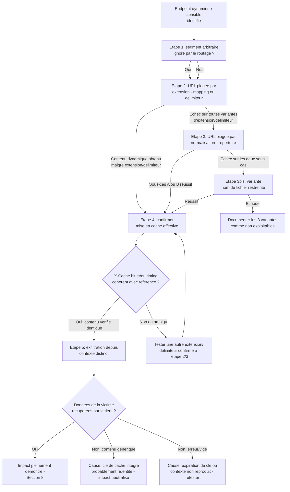

# Web Cache Deception — Méthodologie d'exploitation

!!! warning "Cadre légal"
    À utiliser exclusivement en laboratoire, CTF, ou test d'intrusion couvert par une autorisation écrite. Toute démonstration impliquant un compte « victime » doit rester strictement limitée à des comptes de test appartenant au périmètre autorisé.

## 1. Objectif et périmètre de la méthodologie

L'objectif de cette fiche est de démontrer qu'une URL peut être construite pour que le cache web (ou CDN) et le serveur d'origine interprètent différemment sa nature, amenant le cache à stocker une réponse dynamique et sensible destinée à un utilisateur authentifié, puis à la resservir à un tiers interrogeant la même URL.

Le comportement de sécurité à démontrer : le cache applique sa décision de mise en cache sur la base d'une caractéristique superficielle de l'URL (extension, préfixe de répertoire, nom de fichier) que le serveur d'origine n'interprète pas de la même façon, sans qu'aucun des deux composants ne détecte ce désaccord.

**Variantes couvertes par cette fiche**, qui ciblent des types de règle de cache différents et nécessitent des URL piégées de formes distinctes :

- **Règles basées sur l'extension de fichier**, elles-mêmes produites par deux mécanismes distincts à ne pas mélanger : différence de correspondance de chemins (path mapping REST tolérant un segment final) et différence de délimiteur (caractère marquant la fin du chemin significatif pour l'un des composants mais pas l'autre).
- **Règles basées sur le répertoire statique**, exploitées par normalisation de chemin (décodage et résolution de traversal), avec deux sous-cas symétriques selon lequel des deux composants normalise.
- **Règles basées sur le nom de fichier**, variante plus restreinte de la normalisation, limitée au cas où seul le cache normalise.

Ces trois variantes partagent la même cause racine (désaccord d'interprétation + règle de cache fondée sur une heuristique) mais reposent sur des mécanismes techniques distincts : une technique efficace contre une règle d'extension ne s'applique pas nécessairement à une règle de répertoire, et les tests doivent être menés indépendamment pour chacune.

**Non couvert par cette fiche** (absent du cours source, à traiter séparément si pertinent) : la Web Cache Poisoning, vulnérabilité distincte visant à faire stocker du contenu malveillant pour le distribuer à d'autres utilisateurs plutôt qu'à récupérer du contenu sensible pour soi-même — le cours la mentionne explicitement comme à ne pas confondre avec la WCD, sans en détailler la méthodologie propre ; les configurations précises de protections dédiées de CDN autres que la mention générale de Cloudflare Cache Deception Armor, le cours renvoyant à la documentation du fournisseur réellement utilisé par la cible.

### Principe de raisonnement

Le cours distingue explicitement trois niveaux de preuve à ne jamais confondre : **identifier une différence d'interprétation** (le serveur d'origine et/ou le cache traitent un chemin modifié de façon non standard, sans encore prouver qu'une donnée est exfiltrable), **démontrer la mise en cache effective** d'une réponse potentiellement sensible (via `X-Cache` ou le timing), puis **démontrer l'impact réel** en récupérant, depuis une requête distincte simulant un attaquant, la donnée sensible effectivement associée à une autre session. La démarche progresse strictement dans cet ordre : chaque niveau est une condition nécessaire mais non suffisante du suivant, et aucun raccourci (par exemple interpréter un `X-Cache: hit` seul comme une preuve d'impact) n'est acceptable.

---

## 2. Conditions préalables et état de référence

### 2.1. Prérequis techniques

**Indispensables :**

- Un endpoint dynamique renvoyant des informations liées à l'utilisateur authentifié (profil, paramètres de compte, jeton affiché).
- Un désaccord d'interprétation effectif entre le cache et le serveur d'origine sur une même URL (mapping, délimiteur, ou normalisation) — mécanisme technique central, à confirmer et non à présumer.
- L'application ne définit pas de `Cache-Control: no-store, private` strict sur la réponse dynamique ciblée, ou le cache ne respecte pas cette directive même si elle est présente.
- La possibilité, pour l'attaquant, de relire la même URL après la visite de la victime, sans contrôle d'accès supplémentaire appliqué par le cache lui-même.

**Fréquents mais non systématiques :**

- Un nom de paramètre ou de chemin évocateur d'une ressource personnelle (`/profile`, `/account`, `/settings`) — indice utile mais la vulnérabilité peut toucher tout endpoint renvoyant des données liées à la session.
- Un cache fondé sur une règle d'extension de fichier — fréquent, mais les règles de répertoire et de nom de fichier (sections 7.2 et 7.3 du cours) restent à tester indépendamment si l'extension échoue.

**À vérifier sur la cible, non supposés à l'avance :**

- Le framework applicatif du serveur d'origine, qui détermine le délimiteur pertinent (`;` pour Spring, `.` pour Ruby on Rails, `%00` dans certaines configurations) — un délimiteur propre à un framework donné ne se généralise jamais à une autre cible sans vérification empirique.
- Le comportement de normalisation respectif du cache et du serveur d'origine (lequel décode/résout les segments `..` et `%2f`, si l'un des deux le fait et pas l'autre), condition déterminant la forme exacte de l'URL piégée pour les variantes de répertoire et de nom de fichier.
- Si la clé de cache prend en compte ou non l'identité/la session de l'utilisateur — condition obligatoire pour que la réponse stockée soit réutilisable par un tiers, à confirmer plutôt qu'à présumer.

### 2.2. Établir le comportement normal

Avant tout test, établir une référence précise :

- **Requête de référence vers l'endpoint dynamique ciblé** avec une session valide : code de réponse, contenu retourné, en-têtes de réponse pertinents (`Cache-Control`, `X-Cache` si présent), temps de réponse approximatif.
- **Requête de référence vers une ressource réellement statique connue de l'application** (une image, un fichier CSS) : en-têtes de mise en cache observés, temps de réponse sur une seconde requête identique — sert de point de comparaison pour reconnaître un cache hit authentique.
- **Comportement sur un segment d'URL arbitraire ajouté à l'endpoint dynamique** (ex. `/endpoint/aaa`), sans extension ni caractère spécial : détermine si le routage applicatif ignore ou non un segment supplémentaire, première information nécessaire avant de construire une URL piégée (section 9 du cours, premier signal d'identification).
- **Disponibilité d'un cache buster** (un paramètre ou segment variable permettant de modifier la clé de cache à volonté) pour fiabiliser chaque test ultérieur sans risquer de réutiliser une entrée de cache déjà polluée par un test précédent.

Cette référence est indispensable pour distinguer un cache hit authentique d'une latence réseau normale, et pour savoir si le routage applicatif tolère déjà un segment supplémentaire avant même de tester une extension ou un délimiteur précis.

---

## 3. Reconnaissance : où rechercher la vulnérabilité ?

### 3.1. Surfaces de test

| Élément à examiner | Pourquoi cette surface est pertinente | Contrôle disponible | Observation initiale | Hypothèse de vulnérabilité | Premier test |
|---|---|---|---|---|---|
| Endpoint affichant des données de profil ou de compte (`/settings`, `/profile`, `/account`) | Contenu dynamique et sensible par construction, cible directe de l'impact recherché | Chemin complet de l'URL | Réponse pour une requête authentifiée légitime | La réponse peut être mise en cache si un segment ou une extension trompeuse est ajoutée au chemin | Ajouter un segment arbitraire (`/aaa`) et observer si la réponse reste identique |
| Même endpoint, avec une extension de fichier statique ajoutée en fin de chemin | Teste directement une règle de cache basée sur l'extension (section 7.1) | Extension ajoutée (`.css`, `.js`, etc.) | Comportement de l'endpoint sans extension | Le cache reconnaît l'extension comme signal de contenu statique indépendamment du contenu réel | Ajouter `.css`/`.js` au chemin dynamique et observer l'en-tête `X-Cache` ou le timing sur une seconde requête |
| Même endpoint, avec une extension précédée d'un délimiteur candidat (`;`, `.`, `%00`) | Teste si le serveur d'origine tronque le chemin avant ce caractère alors que le cache le lit intégralement (section 7.1, delimiter discrepancy) | Délimiteur et extension ajoutés | Comportement sans délimiteur (test précédent) | Le serveur d'origine ignore tout ce qui suit le délimiteur, le cache non | Comparer le contenu retourné avec et sans le délimiteur, pour un même suffixe d'extension |
| Chemin préfixé par un répertoire statique connu de l'application (`/static/..%2f...`, `/assets/..%2f...`) | Teste une règle de cache basée sur le répertoire, exploitée par normalisation de traversal (section 7.2) | Encodage du segment de traversal | Comportement du préfixe statique seul, sans traversal | L'un des deux composants (cache ou origine) normalise le traversal encodé, l'autre non | Injecter un traversal encodé pointant vers l'endpoint dynamique et observer si le contenu dynamique est retourné |
| Chemin se terminant par un nom de fichier couramment mis en cache (`robots.txt`, `favicon.ico`) | Teste une règle de cache basée sur un nom de fichier précis plutôt qu'une extension générique (section 7.3) | Construction du chemin menant à ce nom de fichier via traversal encodé | Comportement normal de `robots.txt`/`favicon.ico` | Le cache normalise les segments encodés pour reconnaître ce nom de fichier, le serveur d'origine ne le fait pas et résout un autre contenu | Construire un chemin dont la normalisation côté cache aboutit à ce nom de fichier, tout en restant résolu dynamiquement côté origine |

Aucune de ces surfaces n'est nécessairement vulnérable : chacune correspond à un type de règle de cache distinct (extension, répertoire, nom de fichier), avec un mécanisme de divergence propre, ce qui justifie leur examen indépendant plutôt qu'un test unique supposé représentatif de toutes les variantes.

### 3.2. Indices et faux positifs

**Observations qui peuvent suggérer la vulnérabilité :**

- Une requête vers `/endpoint/aaa` renvoie la même réponse que `/endpoint` : indique que le segment supplémentaire est ignoré ou abstrait par le routage.
- Une requête vers une URL contenant une extension statique ajoutée obtient un en-tête `X-Cache: hit` lors d'une requête répétée.
- Une deuxième requête vers la même URL piégée est nettement plus rapide que la première.
- Le contenu d'une réponse mise en cache contient des données qui semblent liées à un utilisateur précis (nom, identifiant, jeton).

**Observations qui ne suffisent pas à confirmer la vulnérabilité :**

- Le même résultat sur `/endpoint/aaa` que sur `/endpoint` : peut provenir d'une redirection, d'une règle de réécriture, ou d'un comportement applicatif spécifique sans lien avec un mapping REST réellement tolérant — à vérifier en confirmant que le segment est ignoré par le routage interne, pas simplement redirigé pour une autre raison.
- Un `X-Cache: hit` observé : peut provenir d'une autre ressource légitimement statique partageant un chemin similaire, ou d'une collision de clé due à un cache buster mal configuré — ne confirme pas à lui seul que le contenu stocké est la réponse dynamique et sensible recherchée.
- Un temps de réponse plus court sur la seconde requête : peut provenir de la latence réseau, de la charge du serveur, ou de la réutilisation de connexion, sans lien avec un cache hit réel — à confirmer par d'autres indices avant de conclure.
- Des données ressemblant à des informations personnelles dans la réponse mise en cache : peuvent être des données de test ou un contenu générique sans valeur réelle.

**Comportements normaux susceptibles d'être confondus avec la faille :**

- Un `Cache-Control: public, max-age=...` présent sur la réponse : indique seulement qu'elle est autorisée à être mise en cache, pas qu'elle l'a été effectivement, ni qu'elle a été servie depuis le cache — à ne jamais interpréter comme une preuve de mise en cache réelle.
- Un désaccord d'interprétation confirmé (segment ignoré, extension acceptée) sans vérification que la clé de cache ne distingue pas les utilisateurs : la réutilisabilité par un tiers reste une condition distincte à vérifier séparément.

**Vérifications complémentaires nécessaires :**

- Toujours confirmer un cache hit suspecté par plusieurs indices convergents (en-tête `X-Cache` si disponible, timing comparé sur plusieurs répétitions, contenu identique entre deux requêtes) avant de le considérer comme établi.
- Ne jamais présenter une différence d'interprétation d'URL confirmée comme une preuve d'impact : elle ne démontre que la possibilité de déclencher le comportement, pas l'accès effectif à une donnée sensible d'un tiers — ce dernier point nécessite un test depuis une session ou un contexte distinct.

---

## 4. Séquence de tests : démarche pas à pas

### Étape 1 — Identification d'une différence d'interprétation (segment arbitraire)

**Objectif**

Déterminer si le routage du serveur d'origine ignore ou abstrait un segment ajouté en fin de chemin d'un endpoint dynamique, première étape avant de choisir une variante d'exploitation précise.

**Prérequis**

Un endpoint dynamique sensible identifié (section 3.1), accessible avec une session authentifiée de test.

**Hypothèse**

Le serveur d'origine utilise un mapping de type REST où l'URL désigne une ressource logique indépendamment de tout fichier physique, et un segment supplémentaire en fin de chemin peut être ignoré par le routeur applicatif.

**Action à effectuer**

```http
GET /settings/users/list HTTP/1.1
Host: cible.com
Cookie: session=<session_test>
```

puis

```http
GET /settings/users/list/aaa HTTP/1.1
Host: cible.com
Cookie: session=<session_test>
```

**Observations à examiner**

Code de réponse et contenu des deux requêtes, comparés directement.

**Résultat positif**

Les deux requêtes renvoient un contenu identique : indique que le segment supplémentaire est ignoré ou abstrait par le routage interne — signal de différence d'interprétation potentielle, pas encore une preuve de mise en cache.

**Résultat négatif ou ambigu**

- Code d'erreur ou contenu différent sur la seconde requête : le routage ne tolère pas ce segment de cette façon — tester directement les variantes de délimiteur (étape 2) ou de normalisation (étape 3), qui n'impliquent pas nécessairement la même tolérance de segment brut.
- Contenu identique mais via une redirection explicite (code 3xx) : vérifier si la redirection elle-même est mise en cache ou si c'est la ressource finale après redirection, ces deux cas ayant des implications différentes pour la suite.

**Interprétation**

Un résultat identique sur `/aaa` ne prouve pas encore qu'un mapping REST tolérant est en cause : une règle de réécriture ou un comportement applicatif spécifique peut produire le même résultat observable sans lien avec le mécanisme recherché — ce point reste à garder à l'esprit en documentant la preuve finale (section 8).

**Étape suivante**

Si positif → étape 2 (construction de l'URL piégée avec extension, variante mapping de chemin). Si négatif → étape 2 directement avec un délimiteur (la tolérance de segment brut n'est pas une condition nécessaire si un délimiteur explicite fonctionne), ou étape 3 (normalisation) si le chemin ciblé est préfixé par un répertoire statique.

**Erreurs fréquentes**

Conclure à l'absence de toute variante exploitable après le seul échec du segment brut, sans tester les délimiteurs ni la normalisation, qui reposent sur des mécanismes indépendants.

---

### Étape 2 — Construction de l'URL piégée par extension (mapping de chemin ou délimiteur)

**Objectif**

Construire une URL qui paraît statique aux yeux du cache (extension reconnue) tout en restant résolue dynamiquement par le serveur d'origine.

**Prérequis**

Endpoint dynamique sensible identifié. Tolérance de segment confirmée ou non à l'étape 1 (les deux cas restent testables ici selon le sous-mécanisme).

**Hypothèse**

*Mapping de chemin* : le routeur REST ignore un segment final même porteur d'une extension statique.

*Délimiteur* : un caractère précis (`;`, `.`, `%00`) marque la fin du chemin significatif pour le serveur d'origine, mais pas pour le cache qui lit le chemin intégralement.

**Action à effectuer**

*Variante mapping de chemin (sans délimiteur) :*

```http
GET /settings/users/list/wcd.css HTTP/1.1
Host: cible.com
Cookie: session=<session_victime_test>
```

*Variante délimiteur (propre à chaque framework, à tester empiriquement et non à présumer) :*

```http
GET /settings/users/list;aaa.js HTTP/1.1
Host: cible.com
Cookie: session=<session_victime_test>
```

Tester successivement les délimiteurs candidats (`;` pour Spring, `.` pour Ruby on Rails, `%00` selon configuration serveur) comme des hypothèses indépendantes, chacune propre à une technologie de serveur d'origine précise.

**Observations à examiner**

Contenu de la réponse (doit rester le contenu dynamique sensible, pas une erreur), puis en-tête `X-Cache` et timing d'une seconde requête identique.

**Résultat positif**

La réponse contient toujours le contenu dynamique sensible malgré l'extension/le délimiteur ajouté, et une seconde requête identique montre un signe de cache hit (en-tête ou timing cohérent avec la référence établie en 2.2) : différence d'interprétation confirmée et mise en cache suspectée.

**Résultat négatif ou ambigu**

- Erreur ou contenu générique retourné : le serveur d'origine ne tolère pas cette forme précise — tester un autre délimiteur avant de passer à la variante répertoire (étape 3).
- Contenu dynamique obtenu mais aucun signe de cache hit sur la répétition : le désaccord d'interprétation existe côté serveur d'origine, mais le cache n'applique peut-être pas sa règle sur cette forme précise d'extension — tester une autre extension (`.js`, `.png`, `.ico`) avant de conclure.

**Interprétation**

Un délimiteur qui échoue sur cette cible ne permet aucune conclusion sur les autres délimiteurs ni sur les autres variantes (répertoire, nom de fichier) : chaque hypothèse de mécanisme doit être testée et documentée indépendamment, conformément à la distinction posée par le cours entre ces mécanismes.

**Étape suivante**

Si positif → étape 4 (confirmation de la mise en cache effective). Si négatif sur toutes les variantes d'extension et de délimiteur → étape 3 (variante répertoire/normalisation).

**Erreurs fréquentes**

Généraliser un délimiteur ayant fonctionné sur une cible précédente à toute nouvelle cible sans le revérifier empiriquement ; ne tester qu'une seule extension alors que la règle de cache réelle peut cibler une liste différente.

---

### Étape 3 — Construction de l'URL piégée par normalisation (répertoire statique)

**Objectif**

Exploiter une divergence de normalisation de chemin entre le cache et le serveur d'origine pour faire correspondre un endpoint dynamique à un préfixe de répertoire statique reconnu par le cache.

**Prérequis**

Les variantes d'extension et de délimiteur (étape 2) ont échoué, ou un préfixe de répertoire statique connu de l'application (`/static`, `/assets`) est identifié comme surface pertinente.

**Hypothèse**

*Sous-cas A — le serveur d'origine normalise, pas le cache* : une URL telle que `/assets/..%2fprofile` est vue par le cache comme relevant du préfixe `/assets` (cacheable), tandis que le serveur d'origine la résout en `/profile` (contenu dynamique).

*Sous-cas B — le cache normalise, pas le serveur d'origine* : il faut combiner le traversal avec un délimiteur supplémentaire pour que le serveur d'origine tronque correctement le chemin, faute de quoi il tenterait de résoudre littéralement les caractères encodés et renverrait une erreur.

**Action à effectuer**

*Sous-cas A :*

```http
GET /assets/..%2fprofile HTTP/1.1
Host: cible.com
Cookie: session=<session_victime_test>
```

*Sous-cas B (combinaison avec un délimiteur) :*

```http
GET /assets/..%2fprofile;x.css HTTP/1.1
Host: cible.com
Cookie: session=<session_victime_test>
```

Tester les deux sous-cas indépendamment, le succès de l'un n'impliquant rien sur l'autre.

**Observations à examiner**

Contenu de la réponse (dynamique sensible attendu si la divergence existe), erreur de résolution littérale si le sous-cas testé ne correspond pas au comportement réel du serveur d'origine, puis signes de cache hit sur répétition.

**Résultat positif**

Le contenu dynamique sensible est retourné malgré l'encodage de traversal, et un signe de cache hit apparaît sur répétition : variante de normalisation confirmée.

**Résultat négatif ou ambigu**

- Erreur de résolution littérale (le serveur tente d'interpréter `..%2f` comme un chemin invalide) : indique que le sous-cas testé ne correspond pas au comportement réel — tester l'autre sous-cas (A vs B) avant de conclure.
- Contenu dynamique obtenu mais sans signe de cache hit : la normalisation côté serveur d'origine fonctionne comme supposé, mais le cache ne reconnaît peut-être pas ce préfixe précis comme relevant de sa règle — tester un autre préfixe statique connu de l'application.

**Interprétation**

Les deux sous-cas sont symétriques mais mutuellement exclusifs sur une même cible à un instant donné : le comportement de normalisation respectif du cache et du serveur d'origine est une caractéristique fixe de l'infrastructure testée, pas un choix de l'attaquant — un seul des deux sous-cas peut fonctionner, jamais une combinaison arbitraire des deux.

**Étape suivante**

Si positif → étape 4. Si négatif sur les deux sous-cas → étape 3bis (variante nom de fichier, cas plus restreint) ou documenter l'absence de divergence de normalisation exploitable sur ce préfixe précis.

**Erreurs fréquentes**

Tester uniquement le sous-cas A sans tenter le sous-cas B (ou inversement) alors que le comportement réel de normalisation de la cible n'est pas encore connu ; combiner arbitrairement plusieurs délimiteurs sans hypothèse claire sur le sous-cas visé.

---

### Étape 3bis — Variante nom de fichier (cas restreint de la normalisation)

**Objectif**

Exploiter une règle de cache ciblant un nom de fichier précis et fréquent plutôt qu'une extension générique, dans le cas restreint où seul le cache normalise les segments encodés.

**Prérequis**

Les étapes 2 et 3 ont échoué, ou le cache cible semble appliquer des règles spécifiquement sur des noms de fichiers connus (`robots.txt`, `favicon.ico`) plutôt que sur une extension générique.

**Hypothèse**

Le cache normalise les segments encodés et reconnaît un nom de fichier correspondant à sa règle, alors que le serveur d'origine ne normalise pas et résout un contenu dynamique différent pour le même chemin brut.

**Action à effectuer**

```http
GET /profile/..%2frobots.txt HTTP/1.1
Host: cible.com
Cookie: session=<session_victime_test>
```

Adapter la construction pour que la normalisation côté cache aboutisse exactement au nom de fichier ciblé, tout en restant résolu dynamiquement côté serveur d'origine.

**Observations à examiner**

Contenu de la réponse, en-tête `X-Cache`, timing sur répétition.

**Résultat positif**

Le contenu dynamique sensible est retourné à la place du contenu attendu de `robots.txt`, avec un signe de cache hit sur répétition : variante nom de fichier confirmée.

**Résultat négatif ou ambigu**

Le serveur d'origine ne normalise effectivement pas ce chemin de la façon attendue, ou le cache ne normalise pas non plus (ne reconnaissant alors jamais le nom de fichier) : cette variante, plus restreinte que la précédente par construction, échoue plus fréquemment — documenter l'échec sans généraliser à l'absence de toute variante WCD sur la cible.

**Interprétation**

Cette variante est structurellement plus restreinte que les précédentes (un seul sous-cas de normalisation la rend exploitable), son échec est donc moins informatif sur la robustesse globale de la cible que l'échec conjoint des étapes 2 et 3.

**Étape suivante**

Si positif → étape 4. Si négatif → documenter l'ensemble des trois variantes comme testées et non exploitables sur cette cible (section 8).

**Erreurs fréquentes**

Tester cette variante en premier, avant les variantes d'extension et de répertoire plus généralement applicables, alors qu'elle est structurellement la plus restreinte des trois.

---

### Étape 4 — Confirmation de la mise en cache effective

**Objectif**

Démontrer, au-delà d'une simple différence d'interprétation confirmée, que la réponse dynamique et sensible a bien été stockée par le cache.

**Prérequis**

Une variante (étape 2, 3, ou 3bis) a produit un contenu dynamique sensible via une URL censée être reconnue comme statique par le cache.

**Hypothèse**

Le cache a effectivement appliqué sa règle de mise en cache à cette réponse, la stockant sous une clé réutilisable.

**Action à effectuer**

Envoyer une seconde requête identique vers la même URL piégée, idéalement depuis un contexte ou une connexion distincte pour limiter les effets de cache de connexion :

```http
GET /settings/users/list;aaa.js HTTP/1.1
Host: cible.com
Cookie: session=<session_victime_test>
```

Examiner systématiquement l'en-tête `X-Cache` (ou équivalent propre au CDN ciblé) et comparer le temps de réponse à la référence établie en 2.2 (ressource réellement statique) et à une requête non mise en cache.

**Observations à examiner**

Présence et valeur de `X-Cache` (`hit`/`miss` ou équivalent), temps de réponse comparé, contenu de la seconde réponse comparé à la première.

**Résultat positif**

`X-Cache: hit` (ou équivalent) est observé, et/ou le temps de réponse de la seconde requête est significativement et systématiquement plus court que celui de la première, de façon cohérente avec le comportement observé sur une ressource réellement statique : mise en cache effective confirmée.

**Résultat négatif ou ambigu**

- Aucun en-tête `X-Cache` disponible et aucune différence de timing significative : la mise en cache n'est peut-être pas confirmée malgré la différence d'interprétation — répéter le test plusieurs fois pour écarter une variation ponctuelle avant de conclure à l'absence de mise en cache.
- `X-Cache: hit` observé mais contenu différent de la première réponse : possible collision de clé avec une autre ressource légitimement statique, pas une confirmation de la mise en cache de la réponse sensible recherchée.

**Interprétation**

Un `X-Cache: hit` ou un timing réduit, à lui seul, reste un indice et non une preuve suffisante tant que le contenu exact resservi n'a pas été vérifié comme identique à la réponse dynamique sensible initialement générée : la cohérence entre ces plusieurs signaux (en-tête, timing, contenu) est ce qui établit la confirmation.

**Étape suivante**

Si positif → étape 5 (démonstration de l'impact réel, depuis un contexte distinct). Si négatif ou ambigu → répéter avec une autre extension/délimiteur confirmé comme produisant la divergence d'interprétation, le cache pouvant appliquer sa règle à certaines formes et pas à d'autres.

**Erreurs fréquentes**

Conclure à une mise en cache confirmée sur la seule base d'un timing plus court sans vérification par en-tête ni répétition ; ne pas vérifier que le contenu resservi correspond précisément à la réponse sensible recherchée plutôt qu'à une ressource homonyme.

---

### Étape 5 — Démonstration de l'impact réel (exfiltration depuis un contexte distinct)

**Objectif**

Apporter la preuve finale et la plus forte : qu'un tiers, sans accès légitime à la session de la victime, peut effectivement récupérer la donnée sensible stockée.

**Prérequis**

Mise en cache effective confirmée (étape 4) pour une réponse associée à une session de test identifiée comme « victime ».

**Hypothèse**

La clé de cache ne distingue pas l'identité ou la session de l'utilisateur, permettant à une requête émise sans cette session (ou avec une session distincte, simulant l'attaquant) de recevoir la copie stockée.

**Action à effectuer**

Depuis un contexte entièrement distinct (navigateur en session anonyme, requête sans cookie de session, ou session d'un second compte de test « attaquant »), requêter exactement la même URL piégée :

```http
GET /settings/users/list;aaa.js HTTP/1.1
Host: cible.com
```

(sans cookie de session victime, ou avec une session distincte selon le scénario autorisé)

**Observations à examiner**

Contenu de la réponse obtenue dans ce contexte distinct, comparé précisément aux données attendues de la session « victime » initiale.

**Résultat positif**

La réponse obtenue depuis le contexte distinct contient effectivement les données propres à la session « victime » (nom, identifiant, jeton) : impact confirmé et pleinement démontré — exfiltration de données tierces via le cache établie.

**Résultat négatif ou ambigu**

- La réponse obtenue est générique ou appartient au contexte de l'attaquant lui-même (pas de données de la victime) : la clé de cache peut en réalité intégrer un élément distinguant les utilisateurs (ex. un en-tête d'autorisation inclus dans la clé), neutralisant l'impact malgré la mise en cache confirmée.
- La réponse est vide ou en erreur : la clé de cache peut avoir expiré entre les deux requêtes, ou dépendre d'un élément de contexte non reproduit (ex. en-têtes spécifiques présents lors de la première requête).

**Interprétation**

C'est uniquement à ce stade, et non aux étapes précédentes, que la vulnérabilité est pleinement confirmée selon la distinction posée par le cours : une différence d'interprétation confirmée et même une mise en cache effective démontrée ne suffisent pas tant que la récupération effective par un tiers n'a pas été prouvée.

**Étape suivante**

Documenter l'impact (section 8) en précisant explicitement les trois niveaux de preuve atteints (différence d'interprétation, mise en cache effective, récupération par un tiers).

**Erreurs fréquentes**

S'arrêter à la confirmation de la mise en cache (étape 4) et présenter ce résultat comme une preuve d'impact complète, sans avoir testé la récupération effective depuis un contexte distinct de celui de la victime.

---

## 5. Arbre de décision : que faire selon le résultat ?



---

## 6. Construire la chaîne d'exploitation

1. **Point d'entrée** : URL d'un endpoint dynamique sensible, construite pour présenter une caractéristique reconnue par la règle de cache (extension, préfixe de répertoire, nom de fichier).
2. **Primitive technique** : mécanisme de divergence confirmé entre cache et serveur d'origine (mapping de chemin, délimiteur, ou normalisation — section 4, étapes 2 à 3bis).
3. **Déclenchement** : visite de cette URL par une session authentifiée (dans un contexte de test, une session « victime » contrôlée par le testeur).
4. **Effet intermédiaire** : réponse dynamique et sensible générée par le serveur d'origine, stockée par le cache sous une clé générique ne distinguant pas l'utilisateur (confirmée étape 4).
5. **Aboutissement** : récupération effective de cette réponse par une requête émise depuis un contexte distinct (étape 5).
6. **Preuve** : contenu de la réponse récupérée par le tiers, identique et vérifiable comme appartenant à la session « victime » initiale.

| Étape | Résultat requis | Comment le vérifier | Si cela échoue |
|---|---|---|---|
| Point d'entrée | URL piégée produisant un contenu dynamique malgré sa forme trompeuse | Contenu sensible retourné malgré extension/délimiteur/traversal ajouté | Tester la variante suivante (extension → répertoire → nom de fichier) |
| Primitive technique | Mécanisme de divergence identifié précisément (lequel des trois) | Résultat positif isolé sur une seule des étapes 2, 3, ou 3bis | Ne pas supposer qu'un mécanisme en implique un autre ; tester chacun indépendamment |
| Déclenchement | Visite reproductible de l'URL piégée par une session de test | Requête répétable produisant systématiquement le même contenu | Vérifier la stabilité du routage applicatif sur cette forme d'URL |
| Effet intermédiaire | Mise en cache effective confirmée par signaux convergents | `X-Cache`, timing, et contenu cohérents entre eux (étape 4) | Tester d'autres formes d'extension/délimiteur si le cache n'applique pas sa règle à la première forme testée |
| Aboutissement | Récupération effective par un contexte distinct de la victime | Contenu obtenu sans session victime, comparé à la réponse initiale (étape 5) | Vérifier si la clé de cache intègre un élément distinguant les utilisateurs |
| Preuve | Preuve reproductible et minimale de l'impact | Capture des deux requêtes/réponses (victime et tiers) avec contenu identique démontré | Documenter le niveau de preuve atteint (différence d'interprétation / mise en cache / impact démontré) |

---

## 7. Diagnostic des échecs

| Symptôme observé | Causes possibles | Comment les distinguer | Test de diagnostic | Suite logique |
|---|---|---|---|---|
| Segment arbitraire non ignoré par le routage (étape 1) | Mapping REST strict ne tolérant aucun segment final, ou règle de réécriture spécifique | Tester directement un délimiteur (étape 2) qui n'implique pas la même tolérance de segment brut | Comparer le comportement avec et sans délimiteur explicite pour le même suffixe | Si le délimiteur fonctionne malgré l'échec du segment brut, poursuivre sur cette variante |
| Extension/délimiteur sans effet, contenu dynamique jamais obtenu | Le serveur d'origine ne tronque pas le chemin de cette façon pour ce framework précis | Tester systématiquement plusieurs délimiteurs candidats (`;`, `.`, `%00`) comme hypothèses indépendantes | Identifier la technologie du serveur d'origine (en-têtes, comportement d'erreur) pour cibler le délimiteur pertinent | Si aucun délimiteur connu ne fonctionne, passer à la variante normalisation (étape 3) |
| Contenu dynamique obtenu mais aucun signe de cache hit | Le cache n'applique pas sa règle à cette forme précise d'URL (extension non reconnue, préfixe non couvert) | Tester une autre extension ou un autre préfixe statique connu de l'application | Comparer le comportement de cache entre plusieurs extensions distinctes sur la même URL de base | Si aucune extension/préfixe ne déclenche de mise en cache, documenter le cache comme n'appliquant pas de règle exploitable sur ce point d'entrée |
| Normalisation : erreur de résolution littérale du traversal encodé | Le sous-cas testé (A ou B) ne correspond pas au comportement réel de normalisation du serveur d'origine | Tester l'autre sous-cas symétrique avant de conclure | Essayer la combinaison inverse (avec/sans délimiteur supplémentaire selon le sous-cas) | Si les deux sous-cas échouent, tester la variante nom de fichier (étape 3bis) avant d'abandonner cette surface |
| `X-Cache: hit` observé mais contenu différent de la réponse sensible attendue | Collision de clé avec une autre ressource légitimement statique, ou cache buster mal configuré ayant faussé le test précédent | Vérifier le contenu exact retourné, pas seulement la présence de l'en-tête | Répéter le test avec un cache buster propre pour isoler une clé de cache non polluée | Si la collision persiste, documenter la mise en cache comme non confirmée pour la réponse sensible recherchée |
| Récupération depuis un contexte distinct échoue malgré mise en cache confirmée | La clé de cache intègre en réalité un élément distinguant l'utilisateur (en-tête d'autorisation, cookie inclus dans la clé) | Comparer la clé de cache supposée (chemin seul) avec le comportement observé entre plusieurs contextes | Tester la récupération avec plusieurs variations de contexte (anonyme, autre session) pour isoler l'élément réellement discriminant | Si toutes les variations échouent à récupérer les données de la victime, documenter l'impact comme neutralisé malgré la divergence confirmée |

**Principe de diagnostic** : avant de remplacer une variante (extension, répertoire, nom de fichier) par une autre, vérifier précisément à quel niveau de preuve (différence d'interprétation, mise en cache effective, récupération par un tiers) le comportement attendu cesse de se produire, ces trois niveaux appelant des causes d'échec très différentes.

---

## 8. Vérification de l'exploitation et preuve de l'impact

**Résultat final attendu** : récupération effective, depuis un contexte distinct de celui de la victime, d'une réponse contenant des données réellement associées à la session de la victime, obtenue via une URL exploitant un désaccord d'interprétation confirmé entre le cache et le serveur d'origine.

**Éléments techniques de confirmation :**

- Comparer précisément le contenu obtenu par le contexte « attaquant » au contenu généré lors de la visite de la session « victime », champ par champ si nécessaire (nom, identifiant, jeton), pour exclure une coïncidence de contenu générique.
- Confirmer la mise en cache par au moins deux signaux convergents (en-tête `X-Cache` et timing cohérent), pas un seul indice isolé.

**Contrôles pour exclure une explication alternative :**

- Vérifier que la réponse obtenue par le tiers ne correspond pas simplement à son propre contenu (si la requête « attaquante » porte malgré tout une session valide par erreur de protocole de test).
- Confirmer que le `Cache-Control: public` observé sur la réponse, le cas échéant, ne s'explique pas par une intention légitime de l'application pour ce contenu précis (à distinguer d'un oubli de configuration).

**Distinction entre niveaux de preuve :**

- **Différence d'interprétation identifiée** : le serveur d'origine et/ou le cache traitent un chemin modifié de façon non standard (étapes 1 à 3bis) — ne prouve pas encore qu'une donnée sensible puisse être exfiltrée.
- **Mise en cache effective démontrée** : confirmation via en-têtes ou timing qu'une réponse potentiellement sensible a bien été stockée (étape 4).
- **Impact réel démontré** : récupération effective, depuis une requête distincte simulant un attaquant, de la donnée sensible associée à une autre session (étape 5) — seul ce niveau constitue une confirmation pleine de la vulnérabilité.

**Limites des observations :**

- Le cours ne fournit pas de méthode pour quantifier l'ampleur de l'exposition au-delà d'un scénario ciblé (un utilisateur à la fois si le contenu dépend d'un identifiant dans l'URL) : toute estimation d'une exposition à grande échelle reste conditionnée à la capacité de diffusion du lien piégé, hypothèse à formuler prudemment et non comme un fait acquis.
- La preuve doit rester minimale et proportionnée : démontrer la récupération d'un identifiant ou d'un nom d'utilisateur de test suffit à établir l'impact, sans nécessiter l'exposition d'un jeton de session réellement exploitable au-delà de la démonstration, et toujours dans les limites de comptes de test autorisés par le périmètre.

---

## 9. Checklist opérationnelle

**Prérequis**

- [ ] Endpoint dynamique sensible identifié, avec vérification que `Cache-Control: no-store, private` n'est pas appliqué ou n'est pas respecté par l'infrastructure.
- [ ] Cache buster disponible pour fiabiliser chaque test sans pollution d'une entrée de cache précédente.
- [ ] Référence établie sur une ressource réellement statique pour calibrer la détection de cache hit (en-têtes, timing).

**Reconnaissance**

- [ ] Comportement sur un segment arbitraire ajouté testé (tolérance du routage).
- [ ] Framework du serveur d'origine identifié ou supposé, pour cibler le délimiteur pertinent.
- [ ] Préfixes de répertoire statique connus de l'application recensés pour la variante normalisation.

**Premiers tests**

- [ ] Variante extension/mapping de chemin testée (segment avec extension statique, sans délimiteur).
- [ ] Variante délimiteur testée avec plusieurs candidats (`;`, `.`, `%00`) comme hypothèses indépendantes.

**Validation des hypothèses**

- [ ] Variante normalisation testée dans ses deux sous-cas symétriques (origine normalise / cache normalise).
- [ ] Variante nom de fichier testée si les variantes précédentes échouent.
- [ ] Mise en cache effective confirmée par au moins deux signaux convergents (en-tête, timing) avant de considérer une variante comme exploitable.

**Construction de l'exploitation**

- [ ] Contenu exact de la réponse mise en cache vérifié comme correspondant à la réponse sensible recherchée, pas à une ressource homonyme.
- [ ] Récupération depuis un contexte distinct de la victime testée explicitement (pas seulement une répétition depuis le même contexte).

**Vérification de l'impact**

- [ ] Contenu récupéré par le tiers comparé précisément au contenu généré pour la victime.
- [ ] Niveau de preuve atteint explicitement qualifié (différence d'interprétation / mise en cache effective / impact démontré).

**Diagnostic si l'exploitation échoue**

- [ ] Niveau de preuve précis où l'échec survient identifié (interprétation, mise en cache, récupération par un tiers) avant de changer de variante.
- [ ] Les trois variantes (extension, répertoire, nom de fichier) testées indépendamment avant de conclure à l'absence de toute divergence exploitable sur la cible.

---

## 10. Leçons transférables

**Principes de raisonnement réutilisables sur d'autres vulnérabilités :**

- Distinguer explicitement trois niveaux de preuve croissants (signal/indice, confirmation technique, impact démontré sur un tiers) et ne jamais présenter le niveau intermédiaire comme une preuve finale.
- Face à plusieurs mécanismes indépendants produisant un symptôme similaire (ici trois variantes de divergence d'interprétation), les tester et les documenter séparément plutôt que de supposer qu'un seul test représente l'ensemble de la surface.
- Un en-tête annonçant une politique (`Cache-Control: public`) n'est jamais une preuve de comportement effectif : seule l'observation directe du comportement réel (mise en cache, exécution, etc.) fait foi.
- Toujours vérifier qu'un indice de comportement anormal (segment ignoré, extension acceptée) n'a pas d'explication alternative plus simple (redirection, règle de réécriture) avant de l'attribuer au mécanisme recherché.

**Mécanismes techniques propres à cette vulnérabilité, à ne pas généraliser :**

- Le délimiteur exploitable (`;` pour Spring, `.` pour Ruby on Rails, `%00` selon configuration) est strictement propre à la technologie du serveur d'origine et ne se généralise jamais automatiquement d'une cible à l'autre.
- Les deux sous-cas de normalisation (origine normalise / cache normalise) sont mutuellement exclusifs sur une infrastructure donnée à un instant donné, et non des options interchangeables à combiner librement.
- La variante nom de fichier est structurellement plus restreinte que les variantes extension et répertoire, son échec étant donc moins révélateur de la robustesse globale de la cible.

**Hypothèses les plus faciles à confondre avec des certitudes :**

- Un `X-Cache: hit` ou un timing réduit ne prouve pas, à lui seul, qu'une donnée sensible a été mise en cache : le contenu exact doit être vérifié.
- Une différence d'interprétation d'URL confirmée ne démontre que la possibilité de déclencher le comportement, jamais l'accès effectif à une donnée sensible d'un tiers.
- Un segment ignoré par le routage n'implique pas nécessairement un mapping REST tolérant : une redirection ou une règle de réécriture peut produire le même symptôme observable.

**Compétences pratiques à maîtriser pour exploiter cette vulnérabilité sans aide :**

- Identifier empiriquement, pour une cible donnée, quelle technologie de serveur d'origine et quel comportement de normalisation sont réellement en jeu, plutôt que d'appliquer une liste générique de payloads.
- Construire et interpréter des signaux convergents de mise en cache (en-têtes, timing, contenu) pour distinguer un cache hit authentique d'un faux positif.
- Structurer une démonstration en trois niveaux de preuve explicites, du signal initial jusqu'à la récupération effective par un contexte distinct de la victime.
- Reconnaître les limites de chaque variante (restriction structurelle de la variante nom de fichier, exclusivité mutuelle des sous-cas de normalisation) pour prioriser les tests efficacement.
