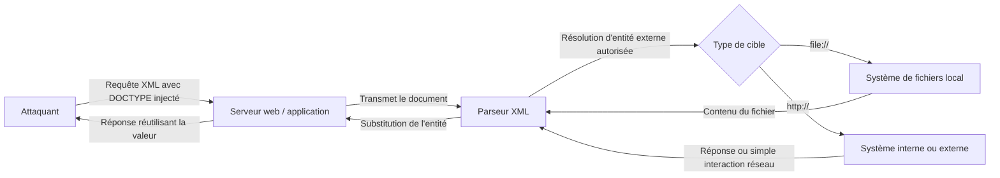

# XML External Entity (XXE) — Cours de référence

## 1. Définition

Une **XXE (XML External Entity)** est une vulnérabilité qui survient lorsqu'un parseur XML, configuré pour résoudre les entités externes, traite un document XML dont tout ou partie est influençable par un attaquant. Le composant concerné est le **parseur XML** (la bibliothèque chargée d'analyser le document), et le défaut se situe dans sa configuration : des fonctionnalités potentiellement dangereuses (résolution d'entités externes, inclusion XInclude) sont activées alors qu'elles ne sont pas nécessaires au fonctionnement de l'application. Le défaut devient exploitable dès lors qu'un attaquant peut injecter ou modifier tout ou partie du document XML soumis au parseur, directement (un champ XML du corps de la requête) ou indirectement (un fichier contenant du XML, comme un SVG ou un DOCX). La propriété de sécurité compromise est principalement la **confidentialité** (lecture de fichiers locaux, accès à des ressources internes), mais aussi potentiellement l'**intégrité** du système cible lorsque les accès obtenus permettent d'aller plus loin (pivot interne, exécution de requêtes privilégiées).

**Formulation simplifiée :** une XXE permet à un attaquant de faire lire par le serveur des fichiers locaux ou des ressources réseau, en abusant d'un parseur XML trop permissif.

Cette définition évite de réduire la vulnérabilité à son seul symptôme le plus connu (la lecture de `/etc/passwd`) : ce symptôme n'est qu'une des conséquences possibles d'un défaut plus général de configuration du parseur.

## 2. Cause racine

La cause racine d'une XXE ne se situe pas dans le XML en tant que langage, mais dans le **comportement par défaut de nombreuses bibliothèques d'analyse XML**, qui autorisent la résolution d'entités externes et (parfois) d'instructions XInclude sans que l'application en ait besoin.

Chaîne causale :

**Le parseur XML est configuré pour résoudre les entités externes (décision/configuration par défaut) → il interprète une déclaration `<!ENTITY ... SYSTEM "...">` comme une instruction légitime de charger une ressource externe (fichier local ou URL) → si un attaquant contrôle tout ou partie du document XML, il peut définir cette entité et la référencer dans une valeur traitée par l'application → le parseur exécute une opération de lecture de fichier ou une requête réseau pour le compte du serveur, en dehors de ce que l'application avait prévu → violation de la frontière de confiance entre les données fournies par le client et les ressources internes du serveur.**

Deux hypothèses incorrectes sont en jeu :

- Le parseur suppose que **toute déclaration DTD présente dans le document est légitime**, qu'elle provienne de l'application elle-même ou d'une entrée utilisateur.
- L'application suppose souvent que le XML qu'elle reçoit est un simple format de sérialisation de données, sans considérer qu'il peut embarquer des instructions de traitement (déclarations d'entités, inclusions) interprétées par le parseur sous-jacent.

Cette confusion entre "format de données" et "format pouvant contenir des instructions actives" est au cœur du problème : c'est la même classe de défaut que l'on retrouve, par analogie, dans d'autres vulnérabilités d'injection où une syntaxe de contrôle se glisse dans un champ supposé ne contenir que des données.

Il faut distinguer cette cause racine générale des causes spécifiques à certaines variantes (XInclude, DTD réutilisé localement), qui seront détaillées en section 7.

## 3. Fonctionnement normal

En l'absence de vulnérabilité, le cycle de traitement XML suit ces étapes :

1. **Émission** : le client (navigateur ou tout autre consommateur de l'API) envoie des données au serveur. Certaines applications choisissent le format XML pour structurer ces données, par exemple pour transmettre un identifiant de produit.
2. **Réception** : le serveur reçoit le corps de la requête, dont le `Content-Type` indique généralement qu'il s'agit de XML (`application/xml` ou `text/xml`).
3. **Analyse (parsing)** : le serveur transmet le document à un parseur XML, dont le rôle est de construire une représentation exploitable (arbre DOM, flux SAX, etc.) à partir du texte reçu.
4. **Extraction des données** : l'application lit les valeurs des nœuds XML qui l'intéressent (par exemple le contenu de `<productId>`).
5. **Traitement métier** : l'application utilise ces valeurs pour exécuter sa logique (recherche en base de données, etc.).
6. **Réponse** : le serveur renvoie un résultat, qui peut inclure, directement ou indirectement, une partie des données reçues.

Exemple simplifié de requête attendue :

```xml
<?xml version="1.0" encoding="UTF-8"?>
<stockCheck>
    <productId>381</productId>
</stockCheck>
```

Dans ce fonctionnement normal, le parseur ne traite que des **données** : `381` est une valeur, pas une instruction. Le document ne contient aucune déclaration `DOCTYPE`, donc aucune entité personnalisée n'entre en jeu. L'application part du principe — à tort, si le parseur est mal configuré — que le XML reçu ne peut contenir que ce type de contenu inoffensif.

## 4. Fonctionnement vulnérable

Le comportement bascule vers la vulnérabilité lorsque deux conditions se rencontrent : le parseur autorise la résolution d'entités externes, **et** l'attaquant peut insérer une déclaration `DOCTYPE` dans le document transmis.

Le mécanisme technique repose sur les entités XML, qu'il faut d'abord resituer :

- Une **entité** est un symbole qui représente une donnée, afin d'éviter d'écrire directement sa valeur (exemple : `&lt;` pour `<`).
- La **DTD (Document Type Definition)**, introduite par `DOCTYPE`, définit des règles structurelles et peut déclarer des entités personnalisées. Elle peut être interne (dans le document), externe (chargée depuis une source extérieure) ou hybride.
- Une **entité personnalisée** interne se déclare ainsi : `<!ENTITY myentity "valeur">`, puis se référence par `&myentity;`.
- Une **entité externe** utilise le mot-clé `SYSTEM` pour indiquer que sa valeur doit être chargée depuis une ressource extérieure, via une URL (`http://...`) ou le protocole `file://` pour un fichier local.

C'est cette dernière capacité — charger une ressource externe via `SYSTEM` — qui constitue le cœur du problème, car elle transforme une simple déclaration de donnée en une instruction de lecture de fichier ou de requête réseau.

| Aspect | Fonctionnement normal | Fonctionnement vulnérable |
|---|---|---|
| Entrée | Document XML sans `DOCTYPE`, valeurs de données simples | Document XML contenant un `DOCTYPE` injecté par l'attaquant |
| Traitement | Le parseur extrait les valeurs des nœuds | Le parseur résout la DTD, déclare l'entité externe, puis tente de charger la ressource indiquée (fichier local ou URL) |
| Décision | Le parseur traite uniquement des données | Le parseur traite la déclaration `ENTITY ... SYSTEM` comme une instruction légitime de chargement de ressource |
| Résultat | La valeur extraite correspond exactement aux données envoyées | La valeur extraite correspond au contenu de la ressource externe chargée (fichier ou réponse réseau) |
| Conséquence de sécurité | Aucune | Lecture de fichier local, requête SSRF, ou simple interaction réseau détectable |

Exemple de payload exploitant ce mécanisme pour lire un fichier local :

```xml
<?xml version="1.0" encoding="UTF-8"?>
<!DOCTYPE foo [
  <!ENTITY xxe SYSTEM "file:///etc/passwd">
]>
<stockCheck>
  <productId>&xxe;</productId>
</stockCheck>
```

Le `DOCTYPE` déclare l'entité externe `xxe` pointant vers `/etc/passwd`. La référence `&xxe;` dans `<productId>` indique au parseur où substituer la valeur chargée. Si l'application réutilise ensuite cette valeur dans sa réponse (par exemple pour afficher un message d'erreur produit incluant l'identifiant), le contenu du fichier peut apparaître dans la réponse HTTP.

Il est important de noter qu'une requête XML contient souvent plusieurs champs : la présence d'une XXE ne se limite pas forcément au premier nœud testé, et chaque valeur XML réutilisée par l'application constitue une surface potentielle distincte.

## 5. Modèle technique

### 5.1. Vue d'ensemble



Ce schéma illustre le chemin complet : l'entrée contrôlée par l'attaquant est le corps XML de la requête (point 1), elle traverse le serveur applicatif puis le parseur XML (point 2), le point de traitement incorrect est la résolution de l'entité externe par le parseur (point 3), le comportement inattendu est la lecture du fichier ou la requête réseau (point 4), et l'impact dépend de ce que l'application fait ensuite de cette valeur — l'afficher dans sa réponse, ou simplement l'avoir exécutée côté serveur (point 5).

### 5.2. Explication du schéma

La **frontière de confiance** franchie ici est celle qui sépare les données fournies par le client (en principe non fiables) du contenu interprété comme instruction par le parseur. L'application fait implicitement confiance au document XML dans son ensemble, alors que seule une partie (les valeurs de données) devrait l'être.

Le désaccord d'interprétation se situe entre l'application, qui considère le XML comme un simple conteneur de données métier, et le parseur, qui applique la spécification XML dans son intégralité — y compris les mécanismes de DTD et d'entités, que l'application n'a généralement pas besoin d'utiliser pour ce cas d'usage.

### 5.3. Exemple technique commenté

```xml
<!DOCTYPE foo [
  <!ENTITY xxe SYSTEM "http://internal.vulnerable-website.com/">
]>
```

- `foo` est un nom arbitraire pour le type de document racine ; il n'a pas de signification particulière ici.
- `ENTITY xxe SYSTEM "..."` déclare une entité externe nommée `xxe`, dont la valeur sera chargée depuis l'URL indiquée au moment de sa résolution.
- Si cette entité est référencée (`&xxe;`) dans une valeur traitée par l'application, le parseur effectue la requête vers `internal.vulnerable-website.com` **pour le compte du serveur**, ce qui peut permettre d'atteindre des systèmes normalement inaccessibles depuis l'extérieur (attaque SSRF, voir section 7).
- Ce qui dépend du contexte : la possibilité d'atteindre réellement `internal.vulnerable-website.com` dépend de la position réseau du serveur vulnérable, et la visibilité du résultat dépend de la réutilisation ou non de la valeur dans la réponse HTTP.

## 6. Conditions nécessaires à l'exploitation

| Condition | Pourquoi elle est importante | Obligatoire ou dépendante du scénario ? |
|---|---|---|
| Le parseur XML autorise la résolution d'entités externes | C'est le défaut de configuration sans lequel aucune entité `SYSTEM` ne serait résolue | Obligatoire |
| L'attaquant peut influencer tout ou partie du document XML traité | Sans contrôle sur le document (au moins un `DOCTYPE` ou un point d'inclusion), aucune entité malveillante ne peut être introduite | Obligatoire |
| L'application accepte un format XML que l'attaquant maîtrise (corps de requête, fichier SVG/DOCX, en-tête `Content-Type` modifié) | Détermine le point d'entrée réel de l'attaque, qui n'est pas toujours une requête XML explicite | Dépendante du scénario |
| La valeur de l'entité résolue est réutilisée dans la réponse de l'application | Nécessaire pour une XXE "visible" (lecture directe du résultat) ; non nécessaire pour une Blind XXE | Dépendante du scénario |
| Le serveur peut atteindre la ressource ciblée (fichier local lisible, ou URL réseau accessible) | Conditionne la possibilité même de charger la ressource, indépendamment de la configuration du parseur | Obligatoire pour obtenir un résultat, mais indépendante du défaut lui-même |
| Un canal d'exfiltration ou d'observation est disponible (réponse visible, message d'erreur affiché, interaction réseau détectable) | Nécessaire pour transformer la résolution d'entité en information exploitable par l'attaquant | Dépendante du scénario |
| Absence de restrictions réseau sortantes empêchant les connexions vers un serveur contrôlé par l'attaquant | Facilite la détection et l'exfiltration via OAST, mais une Blind XXE peut parfois être exploitée sans cela (messages d'erreur, DTD local) | Facilitante |

Trois situations sont à bien distinguer :

- **Déclencher le comportement vulnérable** : obtenir que le parseur tente de résoudre une entité externe. Cela peut être confirmé par une simple interaction réseau (OAST), sans qu'aucune donnée ne soit lue.
- **Démontrer la vulnérabilité** : obtenir une preuve exploitable que la résolution a eu lieu (interaction DNS/HTTP observée, message d'erreur révélateur).
- **Atteindre un impact de sécurité précis** : par exemple, exfiltrer effectivement le contenu d'un fichier sensible, ce qui suppose en plus un canal de sortie fonctionnel et un contenu de fichier compatible avec ce canal (voir section 8 sur les limites liées aux caractères spéciaux).

## 7. Variantes et cas particuliers

### 7.1. XXE classique (in-band, avec retour visible)

L'entité externe est référencée dans une valeur directement réutilisée par la réponse de l'application. L'attaquant observe directement le résultat (contenu de fichier ou réponse réseau) dans la page retournée. C'est la variante la plus simple à identifier.

### 7.2. XXE exploitée en SSRF

Au lieu de cibler un fichier local, l'entité externe pointe vers une URL interne au réseau du serveur. Le serveur effectue alors la requête à la place de l'attaquant, ce qui peut permettre d'atteindre des services non exposés publiquement. On distingue :

- **SSRF avec retour visible** : la réponse du système interne est réintégrée dans la réponse HTTP, consultable par l'attaquant.
- **SSRF aveugle** : la requête est effectuée mais son résultat n'est jamais renvoyé ; seule l'existence de la requête peut être confirmée (par exemple via les logs du système ciblé, s'ils sont accessibles, ou par un délai de traitement observable).

### 7.3. Blind XXE

Dans cette variante, l'application ne renvoie jamais le contenu de l'entité externe dans sa réponse, ce qui rend impossible la lecture directe. Deux approches d'exploitation existent, qui ne reposent pas sur le même mécanisme :

- **Interactions hors bande (OAST)** : on vérifie que le parseur tente bien de résoudre une entité pointant vers un serveur contrôlé par l'attaquant, en observant la résolution DNS ou la requête HTTP reçue. Si les entités classiques sont filtrées, les **entités paramètre** (déclarées avec `%` et référencées par `%nom;`, à l'intérieur d'une DTD) peuvent parfois contourner ces filtres, car certains parseurs ou protections ne traitent pas les deux syntaxes de la même manière.
- **Messages d'erreur XML** : on provoque volontairement une erreur de traitement dont le message contient la donnée recherchée, en tentant de charger un chemin de fichier inexistant construit à partir du contenu lu. Cette technique ne fonctionne que si l'application expose ces messages d'erreur au client.

Ces deux sous-variantes ne sont pas interchangeables : la première nécessite une connexion réseau sortante possible vers un hôte contrôlé par l'attaquant ; la seconde nécessite que les messages d'erreur du parseur soient visibles, mais peut fonctionner même si toute connexion sortante est bloquée.

### 7.4. Exfiltration via DTD malveillant hébergé à distance (OAST avancé)

Lorsque le canal d'erreur n'est pas disponible mais qu'une connexion sortante l'est, un DTD hébergé sur un serveur contrôlé par l'attaquant peut être chargé par le parseur. Ce DTD combine plusieurs entités paramètre :

- une entité qui lit le fichier ciblé,
- une entité qui construit dynamiquement (via `eval`) une nouvelle déclaration intégrant cette valeur dans une URL,
- une entité qui déclenche la requête d'exfiltration vers le serveur de l'attaquant.

Cette variante partage le même principe que les messages d'erreur (construction dynamique d'une entité à partir d'une autre), mais la restitue via le réseau plutôt que via un message d'erreur, ce qui impose une limite technique importante : les caractères spéciaux et les retours à la ligne dans le contenu du fichier peuvent empêcher sa transmission correcte dans une URL. Des fichiers simples sur une seule ligne (comme `/etc/hostname`) se prêtent mieux à cette technique que des fichiers multi-lignes.

### 7.5. Réutilisation d'un DTD local (exploitation par erreur sans réseau sortant)

Lorsque les connexions externes sont bloquées et que les messages d'erreur ne révèlent rien par défaut, il est parfois possible de s'appuyer sur un fichier DTD déjà présent sur le système (par exemple un DTD fourni avec un paquet logiciel installé). Le principe repose sur une subtilité de la spécification XML : une DTD purement interne ne permet pas de déclarer une entité paramètre à l'intérieur d'une autre entité paramètre, mais un DTD **hybride** (interne + externe) autorise certaines redéfinitions qui contournent cette restriction. En redéfinissant une entité existante dans le DTD local pour y injecter une technique basée sur les erreurs, on peut parvenir au même résultat que la variante 7.3, sans dépendre d'une ressource externe. Cette technique dépend fortement de l'existence d'un DTD compatible sur le système ciblé et du comportement précis du parseur utilisé.

### 7.6. XXE via XInclude

Lorsque l'attaquant ne contrôle qu'un fragment du document XML — et ne peut donc pas injecter de `DOCTYPE`, qui doit apparaître en tête du document — l'attaque passe par l'espace de noms `XInclude`, qui permet d'inclure le contenu d'une ressource externe directement dans un nœud du document, sans déclaration DTD :

```xml
<foo xmlns:xi="http://www.w3.org/2001/XInclude">
  <xi:include parse="text" href="file:///etc/passwd"/>
</foo>
```

Cette variante ne dépend pas de la résolution d'entités mais d'une fonctionnalité distincte (XInclude), qui doit être explicitement prise en charge et activée par le parseur. Elle illustre bien la différence entre un principe général (un parseur trop permissif peut charger des ressources externes) et les techniques spécifiques qui en découlent.

### 7.7. XXE via upload de fichiers contenant du XML

Certains formats de fichiers courants (SVG, DOCX, et plus généralement les formats Office basés sur XML) embarquent eux-mêmes du XML, traité côté serveur lors de leur import ou de leur conversion. Un attaquant peut ainsi atteindre un parseur vulnérable sans jamais envoyer de requête XML explicite, en se contentant de soumettre un fichier d'apparence anodine (une image, un document bureautique).

### 7.8. XXE via modification du Content-Type

Certaines applications qui n'exposent aucune fonctionnalité XML visible acceptent néanmoins un corps de requête XML si le `Content-Type` est modifié en conséquence, alors qu'elles utilisent normalement des formulaires encodés différemment. Cette variante ne concerne pas un mécanisme XML différent, mais une **surface d'attaque cachée** : l'endpoint accepte plusieurs formats sans que cela soit documenté ou visible côté client.

## 8. Impact et limites de l'impact

| Impact possible | Mécanisme | Conditions supplémentaires nécessaires | Limites potentielles |
|---|---|---|---|
| Lecture de fichiers locaux sensibles (configuration, clés, code source) | Entité externe `SYSTEM file://...` résolue et réutilisée dans la réponse | Le fichier doit être lisible par le processus du parseur ; la valeur doit être réintégrée dans une réponse visible (ou récupérable en Blind XXE) | Permissions du système de fichiers, présence de caractères incompatibles avec le canal d'exfiltration |
| Accès à des services internes (SSRF) | Entité externe pointant vers une URL interne | Le serveur doit pouvoir atteindre le système interne visé | Segmentation réseau, pare-feu applicatif, authentification requise par le service interne |
| Déni de service | Certaines constructions XML (par exemple des entités imbriquées de façon exponentielle) peuvent consommer des ressources excessives | Le parseur doit développer ces structures sans limite de profondeur ou de taille | De nombreux parseurs modernes limitent par défaut l'expansion d'entités récursives |
| Compromission plus large de l'infrastructure | Les accès obtenus via SSRF ou lecture de fichiers servent de point de départ à une attaque ultérieure (vol d'identifiants, pivot) | Dépend fortement du contexte : présence de secrets accessibles, services internes vulnérables à leur tour | Ce n'est jamais une conséquence automatique de la XXE elle-même, mais une exploitation en chaîne |

Deux applications présentant exactement le même défaut de configuration du parseur peuvent présenter un risque très différent : l'une peut n'exposer que des fichiers sans valeur, l'autre peut permettre d'atteindre un service de métadonnées cloud ou un système d'administration interne. Le niveau de risque dépend donc autant de l'architecture environnante (réseau, permissions, services accessibles) que du défaut technique lui-même.

## 9. Signaux d'identification et observations pertinentes

| Observation | Interprétation possible | Autres explications | Ce qui reste à démontrer |
|---|---|---|---|
| L'application accepte un `Content-Type: text/xml` ou `application/xml` sur un endpoint qui semblait utiliser des formulaires | Une surface XML cachée existe peut-être | L'application peut accepter XML sans utiliser de parseur vulnérable, ou sans jamais le faire traiter de DTD | Le parseur résout-il réellement les entités externes ? |
| Une valeur XML envoyée est répercutée telle quelle dans la réponse | Possibilité de tester une injection d'entité pour observer si elle est également substituée | Le comportement de réflexion peut être un simple echo de donnée sans lien avec le parseur XML | Une entité déclarée est-elle réellement résolue par le parseur, ou simplement ignorée ? |
| Une requête contenant un `DOCTYPE` avec une entité externe provoque un délai ou une interaction réseau observée (OAST) | Le parseur tente de résoudre l'entité externe | Un délai peut avoir d'autres causes (charge serveur, traitement non lié au XML) | Le contenu de la ressource ciblée est-il récupérable, ou seule l'interaction est confirmée ? |
| Un message d'erreur révèle des détails sur le traitement XML (chemin de fichier, trace de parsing) | Les erreurs du parseur sont exposées, ouvrant la voie à l'exploitation par erreur | Le message peut provenir d'une autre couche applicative sans lien avec les entités | Le message contient-il effectivement des données issues d'une entité contrôlée par l'attaquant ? |
| Une fonctionnalité d'upload de fichiers (SVG, DOCX) traite le contenu du fichier côté serveur | Le fichier peut embarquer du XML traité par un parseur vulnérable | Le traitement peut passer par une bibliothèque qui n'expose pas la résolution d'entités | Le parseur utilisé pour ce format spécifique partage-t-il la même configuration que le parseur XML principal ? |

Ces observations constituent des indices à confirmer, et non des preuves d'impact : un comportement qui confirme la résolution d'une entité externe ne garantit pas, par exemple, qu'un fichier sensible particulier soit accessible ou que son contenu puisse être exfiltré intégralement.

## 10. Défenses et prévention

### 10.1. Désactiver la résolution des entités externes (correction de la cause racine)

La mesure la plus fondamentale consiste à configurer le parseur XML pour qu'il refuse de résoudre toute entité externe (et idéalement, qu'il n'autorise pas de DTD du tout si l'application n'en a pas besoin). Cette configuration s'effectue au niveau de la bibliothèque XML utilisée, selon des options qui varient d'un langage et d'une bibliothèque à l'autre ; il convient de se référer à la documentation de la bibliothèque effectivement employée. Cette mesure traite directement la cause racine : si le parseur ne résout jamais d'entité externe, la quasi-totalité des variantes décrites en section 7 (y compris les entités paramètre et les DTD locaux réutilisés) deviennent inopérantes.

### 10.2. Désactiver XInclude si la fonctionnalité n'est pas utilisée

Lorsque l'application n'a pas besoin de la fonctionnalité XInclude, sa désactivation ferme la variante décrite en section 7.6, qui ne dépend pas de la résolution d'entités et ne serait donc pas bloquée par la seule mesure précédente.

### 10.3. Limiter les surfaces XML implicites

La prévention efficace suppose également d'identifier les points d'entrée XML non évidents : traitement de fichiers SVG ou DOCX uploadés, endpoints acceptant plusieurs types de contenu. Ces surfaces doivent être soumises aux mêmes règles de configuration du parseur que les endpoints XML explicites, car un parseur sécurisé pour un usage ne l'est pas automatiquement pour un autre composant de l'application qui traiterait du XML séparément (par exemple une bibliothèque de traitement d'images SVG distincte du parseur XML principal).

### 10.4. Limites générales de ces défenses

Ces mesures corrigent la cause racine, mais leur efficacité dépend de leur application **cohérente** à tous les parseurs XML utilisés par l'application, y compris ceux intégrés dans des bibliothèques tierces (traitement d'images, conversion de documents) qui peuvent avoir leur propre configuration par défaut, indépendante de celle configurée explicitement par les développeurs pour le parseur principal.

## 11. Synthèse conceptuelle

### 11.1. Le mécanisme en quelques phrases

Une XXE naît d'un parseur XML configuré pour résoudre les entités externes, combiné à la possibilité pour un attaquant d'influencer le document XML traité par le serveur. En déclarant une entité `SYSTEM` pointant vers un fichier local ou une URL, l'attaquant peut forcer le serveur à lire ce fichier ou à effectuer une requête réseau en son nom. Si le résultat est réintégré dans la réponse, l'attaque est directement exploitable ; sinon, elle reste exploitable de façon aveugle via des interactions réseau observables ou des messages d'erreur révélateurs. L'impact réel dépend toujours de ce que le serveur peut effectivement atteindre et de l'existence d'un canal permettant d'en extraire le résultat.

### 11.2. Les points fondamentaux à retenir

- La vulnérabilité provient d'une configuration du parseur, pas d'un défaut du langage XML lui-même.
- Le contrôle, même partiel, du document XML (ou d'un fichier XML embarqué) est la condition d'entrée indispensable.
- La visibilité du résultat dans la réponse distingue une XXE classique d'une Blind XXE, qui exige des techniques différentes (OAST, erreurs, DTD local).
- L'impact concret dépend de ce que le serveur peut atteindre (fichiers accessibles, réseau interne joignable), pas uniquement de la présence du défaut.

### 11.3. Les confusions à éviter

- Confondre la **résolution confirmée d'une entité externe** (via OAST) avec la **lecture effective et exfiltrée d'un fichier précis** : la première démontre la vulnérabilité, la seconde démontre un impact concret.
- Considérer qu'une XXE "classique" (visible) et une "Blind XXE" partagent les mêmes techniques d'exploitation : les mécanismes diffèrent sensiblement (réponse directe contre OAST, erreurs, ou DTD local).
- Croire que la désactivation de la résolution d'entités externes suffit systématiquement : si XInclude reste activé, une variante distincte (section 7.6) peut subsister.
- Présenter un impact comme automatique (accès root, vol de données massif) alors qu'il dépend des fichiers réellement accessibles et des protections réseau en place.
- Confondre une condition fréquemment rencontrée en lab (connexion sortante libre) avec une condition obligatoire pour toute exploitation (la variante par DTD local, section 7.5, s'en passe).

## 12. Glossaire des termes techniques

| Terme | Définition | Rôle dans la vulnérabilité XXE |
|---|---|---|
| XML | Langage de balisage extensible utilisé pour structurer des données | Format de données ciblé, dont la spécification autorise des mécanismes (DTD, entités) pouvant être détournés |
| Entité | Symbole représentant une donnée, substitué par sa valeur lors du traitement | Mécanisme de base exploité pour injecter une instruction de lecture de ressource |
| Entité externe | Entité dont la valeur est chargée depuis une ressource extérieure via `SYSTEM` | Permet de cibler un fichier local (`file://`) ou une URL (`http://`) |
| Entité paramètre | Entité déclarée avec `%` et référencée par `%nom;`, utilisable uniquement à l'intérieur d'une DTD | Permet de contourner certains filtres bloquant les entités classiques, notamment en Blind XXE |
| DTD (Document Type Definition) | Ensemble de règles définissant la structure, les types de données et les entités d'un document XML | Point d'entrée des déclarations d'entités malveillantes ; introduite par `DOCTYPE` |
| DOCTYPE | Déclaration introduisant la DTD d'un document XML | Élément que l'attaquant doit pouvoir injecter pour une XXE "classique" |
| XInclude | Mécanisme XML permettant d'inclure le contenu d'une ressource externe dans un document, indépendamment de la DTD | Permet d'exploiter une XXE sans contrôler le `DOCTYPE`, en ciblant uniquement un fragment du document |
| SSRF (Server-Side Request Forgery) | Vulnérabilité forçant le serveur à effectuer des requêtes vers des URL arbitraires | Conséquence possible d'une XXE lorsque l'entité externe cible une URL plutôt qu'un fichier |
| Blind XXE | Variante où le contenu de l'entité externe n'est jamais renvoyé dans la réponse | Nécessite des techniques d'exfiltration indirectes (OAST, messages d'erreur, DTD local) |
| OAST (Out-of-band Application Security Testing) | Méthode de détection reposant sur l'observation d'interactions réseau déclenchées par le serveur testé | Permet de confirmer la résolution d'une entité externe sans dépendre d'une réponse visible |

## 13. Ressources et références

- Document de cours source fourni pour cette fiche (notes de formation sur les vulnérabilités XXE).
- PortSwigger Web Security Academy — *XML external entity (XXE) injection* : ressource de référence couvrant les mécanismes, variantes et méthodes de détection des XXE, dont une partie des concepts de ce cours sont directement issus (notions de DTD, entités externes, Blind XXE, XInclude, SSRF via XXE). Disponible sur le site officiel de PortSwigger (portswigger.net), dans la section Web Security Academy dédiée aux XXE.

Aucune autre référence externe n'a pu être vérifiée dans le cadre de la rédaction de cette fiche ; il est recommandé de consulter en complément la documentation officielle de la bibliothèque XML effectivement utilisée par l'application étudiée, afin d'identifier les options précises de désactivation de la résolution d'entités externes et de XInclude pour cette implémentation.
